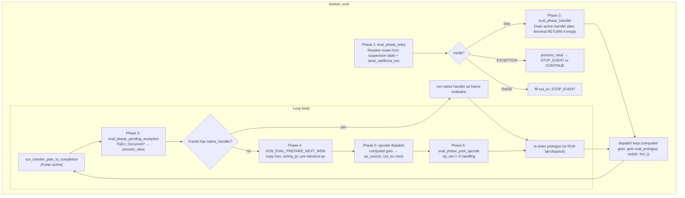
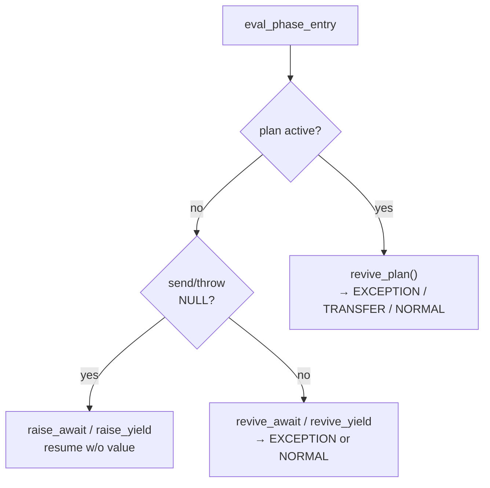
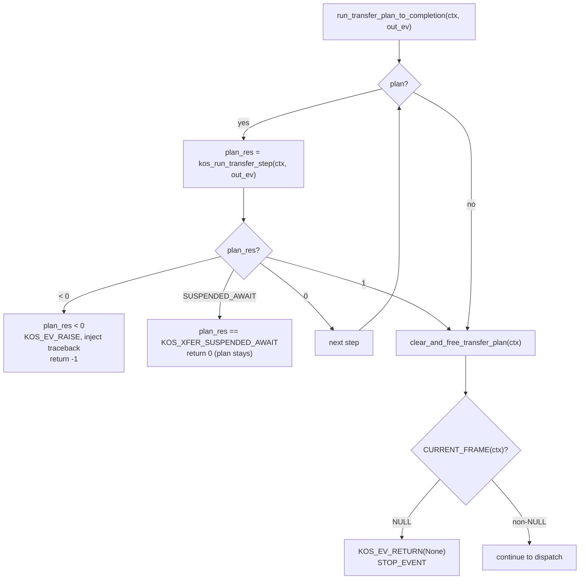
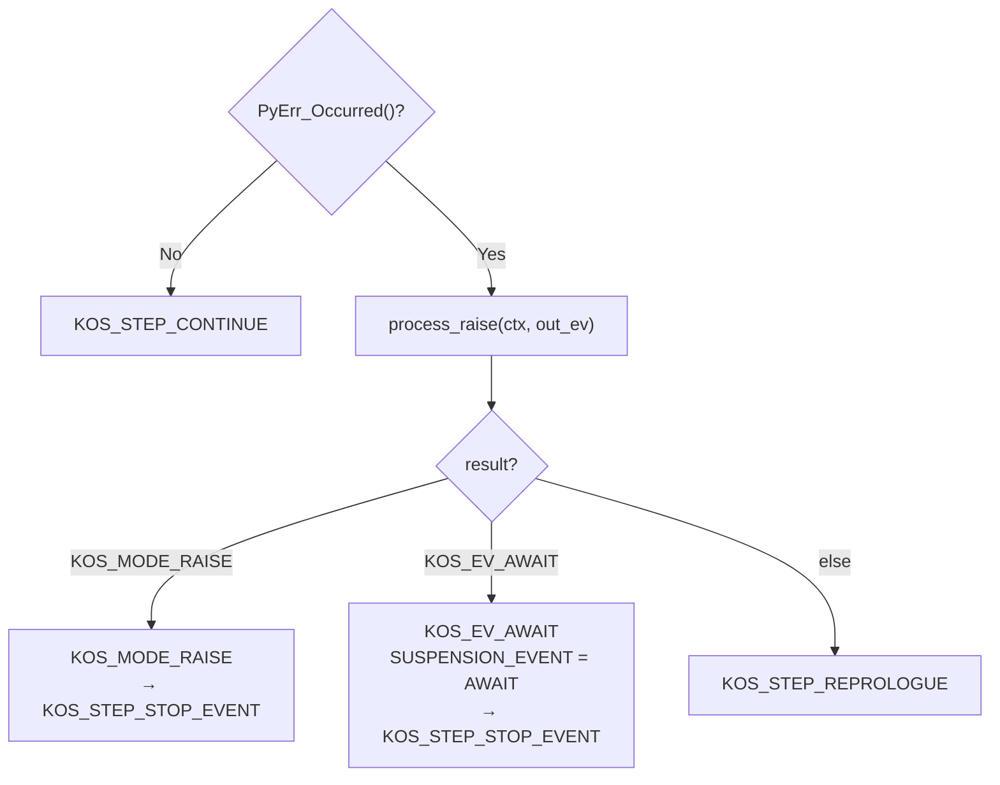
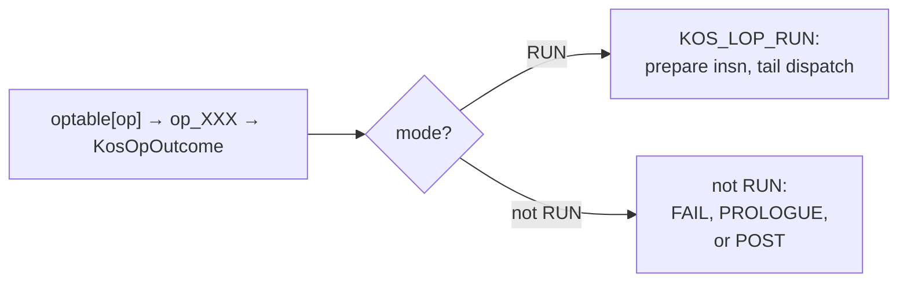
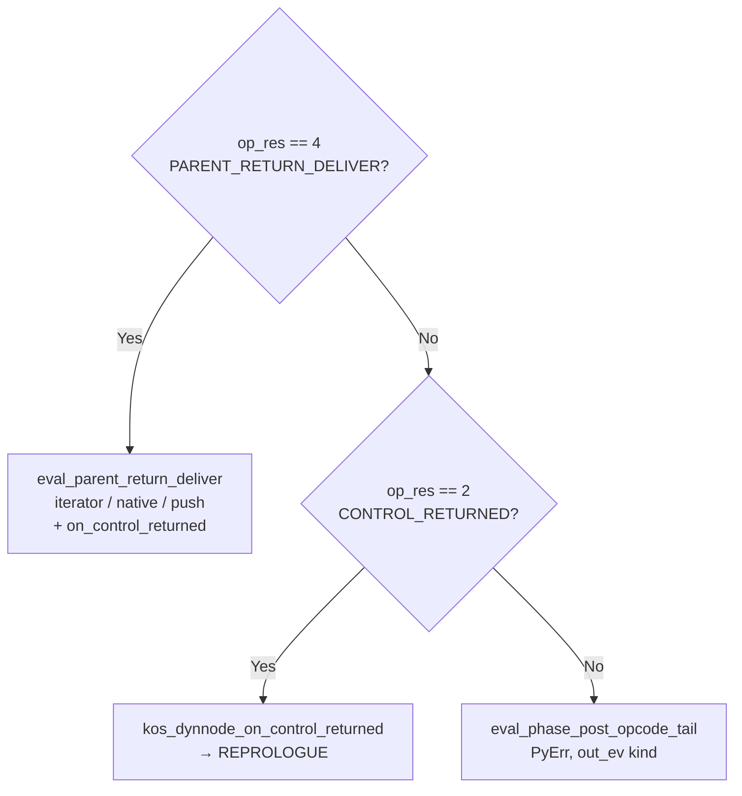
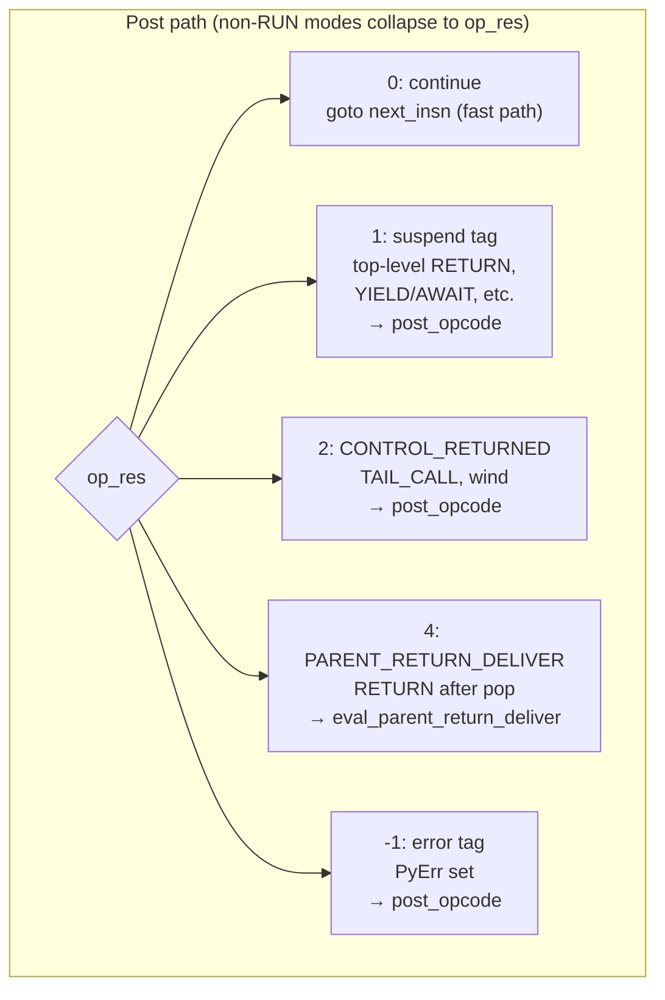
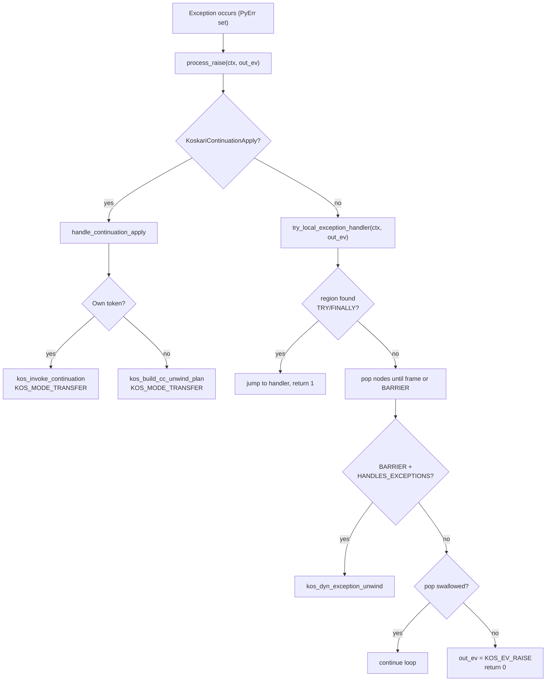
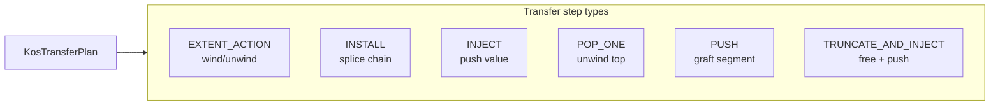
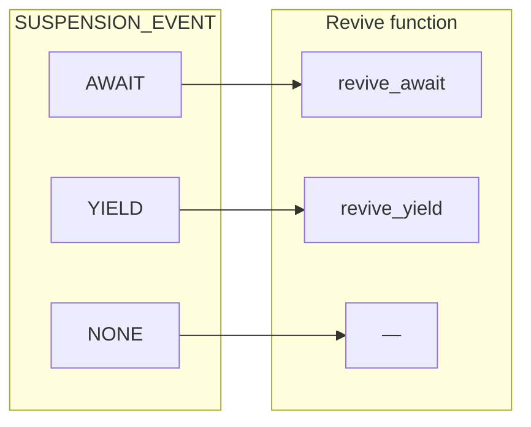

# Koskari Evaluator: Operation and Control Flow

This document describes the operation of the koskari eval loop in `koskari/lib/eval.c`: its stages, how opcodes are invoked and signal back, exception handling, control transit (event-driven handle/unwind model), transfer plans, tail calls, call installs, and resumption paths.

Implementation reference: `koskari/lib/eval.c`, `koskari/lib/eval.h`, `koskari/lib/dynchain.h`, and `design/interpreter/evaluator.md`.

---

## 1. High-Level Structure

### 1.1 Entry Point

```c
int koskari_eval(KosContext *ctx, KosEvent *out_ev,
                 PyObject *send_val, PyObject *throw_typ, PyObject *throw_exc);
```

The evaluator runs until it hits a **boundary event** (return, raise, yield, await) or a fatal error. It returns:
- **0**: Normal exit; `out_ev` contains the boundary event.
- **-1**: Fatal internal error; `PyErr` is set.

`send_val` and `throw_typ`/`throw_exc` are the resume arguments (both may be NULL for a fresh start or null resume).

### 1.2 Main Loop Phases



### 1.3 Design goals: orchestration, reactions, and local opcodes

Koskari aims for an evaluator that is easy to picture as a **pipeline of
boxes**: clear event boundaries, generic chain behavior where it helps, and
room to add new control (for example a new stop reason or a hypothetical
debug interrupt) by **extending the same pattern** instead of threading special
cases through every opcode.

A useful summary of that intent:

| Layer | Owns |
| ----- | ---- |
| **Eval** (`eval.c`) | **Orchestration**: when to run post-opcode handling, how `out_ev` and suspension line up, ordering between unwind/pop/freeze and consumer delivery, `process_raise` / exception routing, transfer-plan interaction with the loop. |
| **DynNodes** (`dynchain*.c`, kind helpers) | **Reactions**: what a particular node kind does when walked, unwound, or notified (e.g. `kos_dynnode_on_control_returned` for WIND/WITH, NEXT/FOREACH/YIELD_FROM delivery primitives). |
| **Opcodes** (`opcode/*.c`) | **Local stack and unwind steps**: pop/push operands, request transitions via `kos_dyn_transition`, return `KosOpOutcome` so the loop can run the right follow-up. |

The goal is **compartmentalization**: new behavior should touch the layers it
actually needs (a new opcode, a new cap on a node, or a new branch in eval’s
post-opcode pipeline), without forcing unrelated code to “learn” a new case.

**Where we are not there yet (honest gaps):**

- **No single generic “boundary event” dispatcher on dynnodes.** WIND/WITH use
  `kos_dynnode_on_control_returned`; flattened iterator return/yield still
  spread across eval helpers (`eval_parent_return_deliver`,
  `eval_event_yield_deliver_to_boundary`, etc.) and **kind-specific** helpers in
  `dyn_next.c` / `dyn_yield_from.c`. A unified `kos_dynnode_on_boundary_event`-
  style API remains a direction, not a full replacement for those paths yet
  (see [interpreter/boundary-control-reemit.md](interpreter/boundary-control-reemit.md)).

- **Large opcodes.** Handlers such as **YIELD_FROM** still bundle substantial
  logic in one file; the eval/dynchain split reduces duplication but does not
  yet shrink every opcode to “thin local work + one transition.”

- **Native frames** (`native_handler`) are a parallel “mini eval” on the same
  chain: orchestration and reaction blur at the frame boundary because the
  handler is not a bytecode opcode.

- **AWAIT** is intentionally **not** folded into the same boundary-control
  staging as RETURN/YIELD parent delivery; that keeps semantics stable but
  means “one pipeline for every suspend kind” is not a literal single path.

- **Exceptions** are centralized for post-opcode `PyErr` via
  `eval_boundary_raise_dispatch`, but **try/finally**, **WITH**, and
  **transfer-plan** failure paths still interact with eval and dynchain in
  several places—good for correctness, harder to draw as one box.

These gaps are useful to track: they mark where future refactors should push
**policy toward eval** and **reactions toward dynchain**, without pretending
the codebase is already uniform end-to-end.

---

## 2. Phase Detail Diagrams

### 2.1 Phase 1: Entry and Revive

**eval_phase_entry** chooses the initial `KosEvalMode`:



**Revive paths:**
- **revive_plan**: Resume a suspended transfer plan. If `throw_exc` set → `KOS_MODE_EXCEPTION`. Else inject `send_val` into plan → `KOS_MODE_TRANSFER`.
- **revive_await / revive_yield**: If `throw_exc` and `revive_yield` → `PyErr_SetObject`, `KOS_MODE_EXCEPTION`. If `throw_exc` and `revive_await` with `py_await_iter` set → `iterator.throw(typ, val, tb)` first (same idea as `coroutine_throw` when waiting on a Python await iterator): on `StopIteration`, the await completes and the normal inject/send path runs; on non-NULL `throw` result, `out_ev` is `KOS_EV_AWAIT` again and `eval_phase_entry` returns `STOP_EVENT` with `KOS_MODE_AWAIT` (re-suspend); if there is no iterator, or `throw` leaves another error, `KOS_MODE_EXCEPTION`. If no `throw_exc`, `revive_await` pushes `send_val` / `py_resume_inject` onto stack (if non-NULL), then `KOS_MODE_NORMAL`. YIELD_FROM uses these same revive paths (its phase selects AWAIT or YIELD); there is no separate `revive_yield_from` or `KOS_SUSP_YIELD_FROM`.
  - From the caller's perspective, both plain `YIELD` and `YIELD_FROM` suspensions surface as the same boundary kinds (`KOS_EV_YIELD` or `KOS_EV_AWAIT`), so resume routing is identical.

**Mode dispatch outcomes:**
- `KOS_MODE_AWAIT` (re-suspend after `throw` into `py_await_iter` yielded again) → `SUSPENSION_EVENT = AWAIT`, clear `KOS_CTX_RUNNING`, `KOS_STEP_STOP_EVENT` (same suspend shape as opcode AWAIT).
- `KOS_MODE_EXCEPTION` → `try_local_exception_handler`; on success → `KOS_STEP_CONTINUE` or `KOS_STEP_STOP_EVENT` (AWAIT); on failure → `out_ev = KOS_EV_RAISE`, `KOS_STEP_STOP_EVENT`.
- `KOS_MODE_RAISE` → fetch exception, decorate, fill `out_ev`, `KOS_STEP_STOP_EVENT`.

### 2.2 Phase 2: Transfer Plan Drain

**eval_phase_transfer** runs when `KosContext_PLAN(ctx)` is set:



### 2.3 Phase 3: Pending Exception Check

At each loop top, **eval_phase_pending_exception** handles `PyErr_Occurred()` (e.g. from a signal handler or async exception):



### 2.4 Phase 4: Prepare next instruction

**`KOS_EVAL_PREPARE_NEXT_INSN`** (macro in `eval.c`) **copies** the current instruction into a local **`KosOp insn`** lvalue and updates the frame: load `code` and `pc`, optional **`SAYF`** trace, set `acting_pc`, pre-advance `pc`, struct-assign **`insn`**. It assumes a valid frame, in-range `pc`, and valid bytecode (no defensive checks).

Opcode handlers receive **`KosEvalState *es`** (see **`koskari/lib/eval.h`**): cached **`frame`**, **`code`**, operand-stack **`block`**, and live **`pc`** / **`acting_pc`** registers for the eval slice, aligned with **`KosEvalState_CONTEXT(es)`** via **`KosEvalState_SyncFromContext`** / **`KosEvalState_RefreshDynCaches`**. There is no separate per-opcode struct beyond handler parameters; the hot path keeps a local **`KosOp insn`** and passes **`&insn`** into **`op_*`**. **eval_phase_post_opcode** does not take insn or a dispatch bundle.

PC is rolled back for WITH enter/exit suspend so the same instruction is retried on resume.

#### 2.4.1 Flattened Koskari async generator attach (NEXT / ITER_NEXT / YIELD_FROM)

When a **KosPyAsyncGen** is stepped **inside** the same **`koskari_eval`** invocation (not from Python **`__anext__`** alone), **`koskari/lib/eval.c`** installs its active dyn chain onto the **consumer** context. **`op_attach_koskari_agen_frame`** (**NEXT**), **`op_attach_koskari_agen_frame_for_iter_next`** (**ITER_NEXT**), and **`op_attach_koskari_agen_frame_for_yield_from`** (**YIELD_FROM** kos-async-gen driver) each validate **`gen`** / **`KosDynGen_ACTIVE`**, run **opcode-specific** failure cleanup (NEXT abort + decrefs; ITER_NEXT may reset **`KOS_DYN_FOREACH`** step phase; YIELD_FROM pops **`KOS_DYN_YIELD_FROM`**), then call **`kos_attach_agen_gen_flatten(es, agen, gen)`** (static). That small helper clears **`agen->ctx`**’s **`dyn_top`** / **`frame_top`** and calls **`kos_dyn_gen_install(es, gen)`**, which updates **`KosEvalState_CONTEXT(es)`**’s chain and runs **`KosEvalState_RefreshDynCaches(es)`** (recompute **`frame_top`** / **`block`** on the context, then **`KosEvalState_SyncFromContext(es)`**).

The **same** live **`es`** passed into the opcode must be forwarded to the attach path. All three helpers take **`KosEvalState *es`** first so **`kos_dyn_gen_install`** refreshes the interpreter’s eval-state mirrors—not a temporary **`KosEvalState`** built only for install.

### 2.5 Phase 5: Opcode Dispatch



Handlers return **`KosOpOutcome`**: **`KOS_LOP_RUN`** is the hot path (no
**`eval_phase_post_opcode`**). Other modes include **`KOS_LOP_FAIL`**,
**`KOS_LOP_PROLOGUE`**, and **`KOS_LOP_POST`**; only **`KOS_LOP_POST`** maps
**`post_tag`** through **`kos_op_post_tag_to_res`** to the legacy **`op_res`**
values in §2.6–3.

### 2.6 Phase 6: Post-Opcode Handling

**eval_phase_post_opcode** runs when an opcode returns **`KosOpOutcome`** with mode
`KOS_LOP_POST` (legacy **`op_res`** from **`kos_op_post_tag_to_res`** on the post
tag). Order matters:

1. **`op_res == KOS_OP_RES_PARENT_RETURN_DELIVER` (4)** — After **RETURN** popped a
   callee frame with a **non-GEN** parent: **`eval_parent_return_deliver`**
   (flattened iterator boundary if needed, native handler or stack push onto the
   caller, then **`kos_dynnode_on_control_returned`** for WIND/WITH). Does not run
   the generic tail until/unless that path falls through.
2. **`op_res == KOS_OP_RES_CONTROL_RETURNED` (2)** — e.g. TAIL_CALL or native
   follow-up: **`kos_dynnode_on_control_returned`** (wind thunks, etc.).
3. **Tail** (**`eval_phase_post_opcode_tail`**): **`PyErr`** →
   **`eval_event_raise`** / **`eval_boundary_raise_dispatch`**; then **`out_ev`**
   kind handling (AWAIT/YIELD walk, **`KOS_EV_RETURN`** + iterator boundary when
   applicable), or STOP_EVENT.



For **YIELD** and **YIELD_FROM** (suspend post tag → **`op_res` 1**, **`out_ev` ==
**KOS_EV_YIELD**): **`eval_phase_post_opcode_tail`** calls **`eval_event_yield`**.
That runs **`eval_yield_handle_walk_and_freeze`**, which uses **`kos_dyn_transition`**
with **`KOS_TRANS_WALK_HANDLE_YIELD`** — i.e. **`kos_dyn_walk_handle_yield`**. The
dynamic chain is walked; the **generator node** (**KOS_DYN_GEN**) **consumes** the
event and freezes (e.g. **`kos_dyn_gen_freeze_and_release`**).

Whether **`koskari_eval()`** stops with an external yield boundary depends on
flattened iterator delivery:
- If **`kos_dyn_need_kos_agen_boundary_deliver`** (a **NEXT**, **FOREACH**
  (iter-next), or **YIELD_FROM** iterator-boundary consumer is active), **`eval_event_yield`**
  calls **`eval_event_yield_deliver_to_boundary`**. That pushes or hands the payload
  to the consumer and usually returns **REPROLOGUE** (eval keeps running inside the
  same **`koskari_eval`** invocation). One **YIELD_FROM** sub-path can still end in
  **STOP_EVENT** with **`KOS_SUSP_YIELD`**.
- Otherwise **`eval_event_yield`** sets **`SUSPENSION_EVENT = KOS_SUSP_YIELD`** and
  returns **STOP_EVENT**; the driver sees **`out_ev.kind == KOS_EV_YIELD`** and later
  resumes via **`revive_yield(send_val)`**.

Plain **YIELD** and **YIELD_FROM** share this post-opcode pipeline; resume inject still
uses **`revive_yield`** when the outer driver re-enters the evaluator.

For **RETURN** that reaches **top-level** or **GEN parent** (Phase 2c): the opcode
runs **`KOS_TRANS_WALK_RETURN_TO_FRAME`** via **`kos_dyn_transition`** (same handle
phase as parent return). It then sets **`out_ev = KOS_EV_RETURN`**, marks the
context **DEAD**, and returns **`KOS_OP_POST_SUSPEND()`** (post tag → **`op_res` 1**).
**`eval_phase_post_opcode_tail`** tags suspension / stop; there is no
**`eval_parent_return_deliver`** on this path (no callee-to-caller stack delivery
after pop—the frame was not a normal nested CALL return in the 2b sense).

---

## 3. Opcode Signaling

Handlers return **`KosOpOutcome`** (`KosLoopOpMode` + optional post tag). The loop
maps **`KOS_LOP_POST`** tags to legacy **`op_res`** via **`kos_op_post_tag_to_res`**
for **`eval_phase_post_opcode`**.



### 3.1 Opcode Handler Return Values

| Value | Meaning |
|-------|---------|
| **0** | Normal; continue to next instruction. Loop goes to `next_insn` directly. |
| **1** | Suspend tag (e.g. top-level **`KOS_EV_RETURN`**, YIELD/AWAIT boundaries, WITH async). **`out_ev`** set where applicable. |
| **2** | **`KOS_OP_RES_CONTROL_RETURNED`** — TAIL_CALL install, wind thunk completion, native handler follow-up: **`kos_dynnode_on_control_returned`**. |
| **4** | **`KOS_OP_RES_PARENT_RETURN_DELIVER`** — RETURN Phase 2b after **`kos_dyn_pop_frame`**: **`eval_parent_return_deliver`** (iterator boundary, parent stack or native handler, then **`kos_dynnode_on_control_returned`**). |
| **-1** | Error tag; **`PyErr`** set. Post-opcode uses **`eval_boundary_raise_dispatch`** / **`process_raise`**. |

### 3.2 What Opcodes Can Signal

- **Continue** (0): Next instruction runs. **YIELD** uses this on the **in-loop**
  path (parent not GEN): detach / deliver without a driver-visible boundary.
  **RETURN** does **not** use 0 for normal parent return: after transition it
  returns **`KOS_OP_POST_PARENT_RETURN()`** → **`op_res` 4**.
- **Suspend** (1): Top-level or GEN-boundary completion, or YIELD/AWAIT suspension;
  **`out_ev`** carries the stop reason where applicable.
- **Control returned** (2): Wind/WITH thunk path, TAIL_CALL, or native handler
  result that maps to **`KOS_OP_POST_CONTROL()`** — not the primary path for
  “push return value onto caller stack” after a bytecode **RETURN**.
- **Parent return deliver** (4): Staged parent delivery after callee **RETURN**
  (Phase 2b); see **`eval_parent_return_deliver`** in **`eval.c`** and
  **`interpreter/evaluator.md`** / **`boundary-control-reemit.md`**.
- **Exception** (-1): **`PyErr`** set.

### 3.3 Boundary Events and Parent Frame

**Driver-visible** **`koskari_eval`** boundaries use **`KosEventKind`** in **`out_ev`**
when the eval loop stops (**`STOP_EVENT`**). Internal post tags (**4**, etc.) are
not new public event kinds.

Typical **surface** boundaries:

- **RETURN** → **`KOS_EV_RETURN`** when evaluation completes (**top-level** or **GEN**
  parent / Phase 2c), or when a **suspending** opcode posts suspend with return
  payload as today.
- **RAISE** → **`KOS_EV_RAISE`**
- **YIELD** → **`KOS_EV_YIELD`** when the generator boundary applies (parent is GEN
  or no parent for the yield), or YIELD_FROM emits yield.
- **AWAIT** → **`KOS_EV_AWAIT`**

When the frame **has a parent that is not GEN** (normal nested CALL return —
RETURN Phase 2b): the opcode runs **`kos_dyn_transition`** then **`kos_dyn_pop_frame`**,
then **`KOS_OP_POST_PARENT_RETURN()`** so **`eval_parent_return_deliver`** runs
(iterator NEXT/FOREACH/YIELD_FROM boundary if applicable, else push onto caller or
native handler, then **`kos_dynnode_on_control_returned`**). The outer driver does
**not** get a new **`KOS_EV_RETURN`** for that step; the loop keeps running in the
caller.

**DELIMITED** return (**`RETURN_TARGET_CHAIN`**) is separate (Phase 2a) and may
build a transfer plan.

---

## 4. Exception Handling

### 4.1 Exception Flow



### 4.2 try_local_exception_handler

1. `kos_find_node_for_raise(ctx)` — topmost enabled TRY or FINALLY.
2. If found: clear stack block, set PC to handler, stash exception in `PyErr_SetExcInfo`, clear PyErr, set `handling_raise` on FINALLY, return 1.
3. If not found: walk chain from `dyn_top` toward frame. For each node:
   - `kos_dyn_pop_top`; if `KOS_DYN_UNWIND_ASYNC_STARTED`, return 1.
   - If pop fails (BARRIER): dispatch to `kos_dyn_exception_unwind` if node has HANDLES_EXCEPTIONS.
   - If node may-swallow and PyErr cleared: set PC to catch_resume_pc, return 1.
4. If no handler: `inject_eval_frame_traceback`, fill `out_ev` with KOS_EV_RAISE, return 0.

### 4.3 Traceback Injection

`inject_eval_frame_traceback` decorates the exception with `__koskari_dynchain__` and injects the current frame into the traceback so Python can display Koskari-native frames. Called at:
- `try_local_exception_handler` (handle and re-raise branches)
- `KOS_MODE_RAISE` at entry
- `run_transfer_plan_to_completion` when a transfer step fails

---

## 5. Control Transit (Event-Driven Model)

Dynamic nodes on the dynchain participate in control flow through a small
lifecycle vocabulary and a two-phase transit model: **handle** then **unwind**
(unless the transit is AWAIT, which does not walk or pop the chain).

### 5.1 Lifecycle vocabulary

- **push(node)** — Link the node onto the dynchain (structural only: stack
  block, namespace, frame resources). No user code, suspension, or transfer.
- **wind(node)** — Enter the node’s active extent; may run user code (`__enter__`,
  dynamic-wind before-thunk, parameterize bindings) and may suspend or start a
  transfer. Often paired with **push** on construct entry and on transfer
  re-entry.
- **resume(node)** — Normal return to an already-active node after a
  subordinate step; node stays on chain. Payload is delivered by pushing to TOS
  then redispatching (send value, await result, yield-from delegate step).
- **handle(node, event)** — Offer a **control transit** (RETURN, RAISE, YIELD,
  BREAK, CONTINUE, SHIFT). Does **not** unlink the node; outcome is PASS, CONSUME,
  or DENY (see §5.3).
- **unwind(node, event)** — Leave the extent semantically; event records *why*.
  Used for after-thunks, teardown, and walking the chain during transits.
- **pop(node)** — Structural unlink (usually after unwind).
- **free(node)** — Destroy storage when ownership allows (generator nodes may
  defer until the generator object dies).

### 5.2 Construct entry

On entering constructs such as `with`, `dynamic-wind`, or handler scopes, the
evaluator performs **push** then **wind**. **push** stays cheap; **wind** runs
side-effectful entry and may suspend. Separating them avoids running user code
before the node is fully linked.

### 5.3 resume vs handle

- **resume** — Ordinary continuation **within** the current extent (value on TOS,
  node still installed).
- **handle** — A **control transit** that may cross nodes (return, raise, yield,
  break, continue, shift).

Keeping this distinction stable lets opcode and transfer machinery stay generic
while node kinds specialize behavior.

### 5.4 handle(node, event)

`kos_dyn_handle(ctx, node, event)` offers a control transit to each node. The node may:
- **PASS** — pass through unchanged
- **CONSUME** — handle the event (e.g. TRY catches RAISE, FINALLY consumes RETURN)
- **DENY** — reject (e.g. generator boundary denies SHIFT)

### 5.5 unwind(node, event)

`kos_dyn_unwind` takes a `KosXferEvent` (RETURN, RAISE, YIELD, BREAK, CONTINUE, SHIFT) so nodes know *why* they are being torn down. Transfer-aware nodes (e.g. `dynamic-wind`) use this for after-thunks.

### 5.6 Transit types

| Transit | Walk | Key functions |
|---------|------|----------------|
| RETURN | handle(RETURN) per node; FINALLY may overwrite value; if not consumed, unwind → pop callee frame; **parent** delivery for normal calls is **`eval_parent_return_deliver`** after pop (not inline in the opcode). Top-level / GEN-parent completion sets **`KOS_EV_RETURN`** in the opcode. | `kos_dyn_transition` / `kos_dyn_walk_return_to_frame`; **`eval_parent_return_deliver`** |
| RAISE | handle(RAISE); TRY/FINALLY catch; else unwind → pop | `process_raise` → `try_local_exception_handler`; `kos_dyn_handle` on unwind path |
| YIELD | handle(YIELD) per node until generator boundary consumes; post-opcode **`eval_event_yield`** walks/freeze then optional **`eval_event_yield_deliver_to_boundary`** | `kos_dyn_walk_handle_yield` (via **`kos_dyn_transition`** **`KOS_TRANS_WALK_HANDLE_YIELD`**) |
| AWAIT | **No** chain unwind or pop; full dynchain preserved; evaluator suspends with `KOS_EV_AWAIT` | AWAIT opcode, `revive_await` |
| BREAK / CONTINUE | Find loop in-frame; walk unwind/pop to loop; handle on loop; resume at loop head or after loop | `kos_dyn_transfer_to_loop` |
| SHIFT | handle(SHIFT); prompt consumes; generator boundary denies crossing | `kos_dyn_walk_handle_shift_to_prompt` |

**YIELD details:** Nodes from the emitter up to the generator boundary see
handle(YIELD); the emitter (e.g. yield-from) often passes through. The generator
boundary captures/frozen state and detaches. **Top-level** generator: suspend
and return the yield value. **Flattened** iterator stepping (**NEXT** /
**FOREACH** / **YIELD_FROM** boundary): **`eval_event_yield_deliver_to_boundary`**
may deliver the payload without stopping **`koskari_eval`**. Nodes that care may
pair unwind-before-suspend with wind-on-resume.

**Generator close:** `close` uses the normal exception path (GeneratorExit via
RAISE transit), not a separate inbound channel.

### 5.7 Generator boundary node

`KOS_DYN_GEN` marks the generator boundary. It is pushed when a generator or coroutine is **installed** (e.g. when Python drives a Koskari generator via `send`/`throw`); the frame's parent is then the GEN node.

- **handle(YIELD)**: GEN **consumes** the event. After an opcode sets **`out_ev.kind = KOS_EV_YIELD`**, **`eval_event_yield`** runs **`eval_yield_handle_walk_and_freeze`**, which invokes **`kos_dyn_walk_handle_yield`** (via **`kos_dyn_transition`**). GEN's handler runs (e.g. **`kos_dyn_gen_freeze_and_release`**): the current dynchain is captured/frozen. Resumption is via **`revive_yield`**, which pushes **`send_val`** onto the stack and continues at the next instruction.

Whether control returns to the caller depends on evaluator flattening:
- In the regular case, **`eval_event_yield`** (from **`eval_phase_post_opcode_tail`**) runs **`eval_yield_handle_walk_and_freeze`** then may tag **`SUSPENSION_EVENT = KOS_SUSP_YIELD`** and STOP_EVENT; the caller resumes via **`revive_yield`**.
- In flattened async-gen stepping (**`kos_dyn_need_kos_agen_boundary_deliver`**), boundary delivery may run without an external suspension; otherwise same tail path.
- **handle(SHIFT)**: GEN **denies**; shift cannot cross the generator boundary.
- **RETURN** when the frame's parent is GEN (or there is no parent) produces a boundary event `KOS_EV_RETURN` and the evaluator exits; the driver receives the return value (e.g. StopIteration for sync generators).

### 5.8 Node behavior categories

- **Lexical / resource nodes** (e.g. `with`): **push** / **wind**, **unwind** /
  **pop**, often **handle(RAISE)**; typically ignore YIELD.
- **Transfer-aware nodes** (e.g. `dynamic-wind`): **wind** and **unwind** on
  RETURN, RAISE, YIELD (when suspension counts as leaving the extent), BREAK,
  CONTINUE, SHIFT.
- **Interceptors** (`try` / `except`, `finally`): primarily **handle(event)**;
  may transform or swallow transits.
- **Resumable operation nodes** (e.g. `KOS_DYN_YIELD_FROM`): **resume** for
  delegate steps; internal state machine across suspensions; may **handle** for
  delegation.
- **Generator boundary (`KOS_DYN_GEN`)**: intercepts YIELD and RETURN/RAISE as
  documented in §5.7; **denies** SHIFT across the boundary. The generator object
  owns the node; the chain borrows it during execution.

**Boundaries:** When a rule would be violated, the responsible node **denies**
in **handle** (e.g. SHIFT at GEN). **BREAK** / **CONTINUE** targeting fails in
the find phase before unwind if no loop exists in-frame.

### 5.9 Inbound events from the driver

- **Value on TOS** — After **push** to TOS, **resume** runs with the active node
  consuming TOS (yield **send**, await completion, yield-from delegate).
- **Throw / close** — Delivered as a normal **RAISE** transit (no parallel
  channel). `throw` into await uses `revive_await` + iterator `throw` where
  applicable (see §8).

### 5.10 Implementation map

- **KosXferEvent** — RETURN, RAISE, YIELD, BREAK, CONTINUE, SHIFT (unwind/handle).
- **KosHandleResult** — PASS, CONSUME, DENY.
- **kos_dyn_handle()** — Offer event before unwind on RETURN, RAISE, YIELD, SHIFT
  walks.
- **kos_dyn_unwind(ctx, node, event, out_ev)** — Semantic exit with reason.
- **kos_dyn_transfer_to_loop()** — BREAK / CONTINUE targeting.
- **KOS_DYN_GEN** — Generator boundary; intercepts YIELD; denies SHIFT.
- **KosYfPhase** — Yield-from phases (DRIVING, EXPECT_SEND, EXPECT_AWAIT);
  YIELD_FROM emits only YIELD or AWAIT boundary events (no `KOS_SUSP_YIELD_FROM`
  or `revive_yield_from`).

Primary code: `koskari/lib/dynchain.c`, `koskari/lib/dynchain.h`, `koskari/lib/eval.c`.

---

## 6. Transfer Plans

### 6.1 Transfer Plan Overview

A **KosTransferPlan** is a list of actions that orchestrate continuation invocation, delimited return, or foreign-token unwind. The loop drains it via `run_transfer_plan_to_completion` → `kos_run_transfer_step`.



### 6.2 Transfer Step Types

| Step | Description |
|------|-------------|
| `KOS_XFER_EXTENT_ACTION` | Run wind (enter) or unwind (exit) for a node. |
| `KOS_XFER_INSTALL` | Splice a chain segment as the new current chain. |
| `KOS_XFER_INJECT` | Push resume value onto stack (or throw). |
| `KOS_XFER_POP_ONE` | Unwind current top, unlink and free. |
| `KOS_XFER_PUSH` | Append segment to current chain (graft). Used for delimited invoke. |
| `KOS_XFER_TRUNCATE_AND_INJECT` | Free from top through node, set dyn_top to parent, push value. |

### 6.3 kos_run_transfer_step Return Values

| Value | Meaning |
|-------|---------|
| **0** | Step complete; continue to next step. |
| **1** | Plan complete; plan is cleared. |
| **KOS_XFER_SUSPENDED_AWAIT** (2) | Step suspended on await; plan stays; driver resumes and feeds inject. |
| **< 0** | Error; PyErr set; plan fails, `run_transfer_plan_to_completion` fills out_ev with KOS_EV_RAISE. |

### 6.4 Call Sites for run_transfer_plan_to_completion

1. **eval_phase_transfer** — at loop start when plan is active.
2. **Inside dispatch loop** — at each iteration top before phase 3.
3. **eval_phase_entry** — when re-entering with an active plan (e.g. after yield-from or boundary return).

---

## 7. Tail Calls and Call Installs

### 7.1 Invocation Entry Points

- `kos_callable_call` — non-tail: look up `tp_kos_install`, invoke.
- `kos_callable_tail_call` — tail: look up `tp_kos_tail_install`; if NULL, push empty frame + `tp_kos_install`.

### 7.2 Install Slot Contract

```c
int (*KosInstallFunc)(KosContext *ctx, KosEvent *out_ev,
                      PyObject *callable, PyObject *args_tuple, PyObject *kwds_dict);
```

- **0**: Success; evaluator continues with new/reset frame.
- **1**: Suspend; `out_ev` set (e.g. AWAIT).
- **-1**: Error; `PyErr` set.

The install owns all frame setup: push new frame (non-tail) or reset current frame (tail). It does **not** recurse into `koskari_eval`; execution continues in the same loop.

### 7.3 Tail Call Behavior

For `kos_callable_tail_call`:
- If `tp_kos_tail_install` exists: it resets the current frame (code, ns, stack, pc) and returns 0.
- If not: push `kos_dyn_push_frame_empty`, then call `tp_kos_install` (no TCO).

TAIL_CALL opcodes return `KOS_OP_RES_CONTROL_RETURNED` when they install a new frame; `eval_phase_post_opcode` invokes `kos_dynnode_on_control_returned` for wind thunks.

### 7.4 Transfer Plan Integration

An install that invokes a continuation builds a transfer plan and sets `KosContext_PLAN(ctx) = plan`. The eval loop drains it on the next iteration. No recursion.

---

## 8. Resume Paths



### 8.1 Suspension Event → Revive

| `SUSPENSION_EVENT` | Revive function | Behavior |
|--------------------|-----------------|----------|
| `KOS_SUSP_AWAIT` | `revive_await` | Push send_val, complete pending WITH exit if applicable. |
| `KOS_SUSP_YIELD` | `revive_yield` | Push send_val onto stack. |
| `KOS_SUSP_NONE` | — | Fresh start or no-op resume. |

YIELD_FROM emits only YIELD or AWAIT; its phase (KosYfPhase) selects which. There is no `KOS_SUSP_YIELD_FROM` or `revive_yield_from`.

If `throw_typ`/`throw_exc` are set, any revive path calls `PyErr_SetObject` and yields `KOS_MODE_EXCEPTION`, which triggers `process_raise` at entry.

### 8.2 Native Frame Handler

When the top frame has `native_handler != NULL`, the loop runs that handler as the frame evaluator instead of bytecode dispatch. On resume with `send_val`, entry delivers the value to the handler via `fn(es, out_ev, 1, val)` (live **`KosEvalState *`**).

---

## 9. Play-by-Play Scenarios

### 9.1 Scenario: Simple Call and Return

1. Entry: `send_val == NULL`, `SUSPENSION_EVENT == NONE` → `KOS_MODE_NORMAL`.
2. Transfer: no plan → skip.
3. Pending exception: none.
4. Dispatch: opcode is CALL. Handler calls `kos_callable_call`, which invokes install. Install pushes new frame, returns 0.
5. `op_res == 0` → goto `next_insn`. New frame is now top; next opcode runs in callee.
6. Eventually RETURN in callee with a **non-GEN** parent: **`kos_dyn_transition`**
   (**`KOS_TRANS_WALK_RETURN_TO_FRAME`**), **`kos_dyn_pop_frame`**, then
   **`KOS_OP_POST_PARENT_RETURN()`** → **`eval_parent_return_deliver`** (stack push
   or native handler, **`kos_dynnode_on_control_returned`**). Loop continues in
   caller (**`op_res` 4** path, not **`op_res` 0**).
7. Caller runs until **top-level** RETURN (no parent, or parent is GEN): opcode sets
   **`KOS_EV_RETURN`**, **`KOS_OP_POST_SUSPEND()`** → post-opcode tail → **STOP_EVENT**
   with completion boundary.

### 9.2 Scenario: Exception and Local Handler

1. Opcode fails, sets PyErr. `op_res == -1`.
2. Post-opcode: `PyErr_Occurred()` → `process_raise`.
3. `try_local_exception_handler` finds TRY region, sets handler_pc, clears PyErr for handler, returns 1.
4. `process_raise` returns `KOS_MODE_NORMAL`. Post-opcode returns `KOS_STEP_REPROLOGUE`.
5. Loop continues; next instruction is the except block.

### 9.3 Scenario: Continuation Invoke (Own Token)

1. Python calls `cont(value)`. Cont raises `KoskariContinuationApply` targeting this context.
2. `PyErr_Occurred()` at next loop top (or after opcode). `process_raise` runs.
3. `handle_continuation_apply` sees own token: fetches continuation and value, clears PyErr, calls `kos_invoke_continuation(&es, …)` (eval state for the current context).
4. `kos_invoke_continuation` builds the transfer plan using `es`, sets `KosContext_PLAN(ctx) = plan`, syncs eval caches, returns 0. `handle_continuation_apply` returns `KOS_MODE_TRANSFER`.
5. Loop continues (or entry yields TRANSFER). `run_transfer_plan_to_completion` drains plan: unwind extents, install captured chain, inject value.
6. Execution resumes at captured PC with value on stack.

### 9.4 Scenario: AWAIT Suspend and Resume

1. AWAIT opcode yields awaitable. Sets `out_ev = KOS_EV_AWAIT`, `py_await_iter = iter`, returns 1.
2. Post-opcode tags `SUSPENSION_EVENT = AWAIT`, returns STOP_EVENT. Evaluator exits.
3. Driver (e.g. KosCoroutine.send) awaits the awaitable, gets result.
4. Driver calls `koskari_eval(ctx, &ev, result, NULL, NULL)`.
5. Entry: `SUSPENSION_EVENT == AWAIT`, `send_val != NULL` → `revive_await(result, ...)`.
6. `revive_await` pushes result onto stack. If `PENDING_WITH_EXIT_NODE`, completes pending WITH exit.
7. Mode = NORMAL. Loop continues; next instruction consumes the awaited value.

**Throw resume (`throw_typ` / `throw_exc` non-NULL):** When `py_await_iter` is set, `revive_await` calls `throw` on that iterator before installing `PyErr` for the VM. If the iterator completes (`StopIteration`), the completion value is staged like a normal send resume (inject / stack push). If `throw` returns a new object, `out_ev` is `KOS_EV_AWAIT` again and eval stops (second suspend). If `throw` fails or leaves an exception, `KOS_MODE_EXCEPTION` runs `try_local` as usual. If there is no `py_await_iter`, behavior matches the old path (`PyErr_SetObject` only).

### 9.5 Scenario: YIELD Suspend and Resume

1. Generator is running; frame's parent is GEN. Plain `YIELD` or `YIELD_FROM` sets `out_ev = KOS_EV_YIELD`, sets payload, marks context DEAD, returns suspend post tag (**`op_res` 1**).
2. Post-opcode tail: **`eval_event_yield`** → **`eval_yield_handle_walk_and_freeze`** → **`kos_dyn_walk_handle_yield`**. GEN receives handle(YIELD) and **consumes** it (e.g. **`kos_dyn_gen_freeze_and_release`**): dynchain is frozen.
3. If **`kos_dyn_need_kos_agen_boundary_deliver`**: **`eval_event_yield_deliver_to_boundary`** (NEXT / FOREACH / YIELD_FROM); often **REPROLOGUE** without an external **STOP_EVENT**. Otherwise **`SUSPENSION_EVENT = KOS_SUSP_YIELD`** and **STOP_EVENT**.
4. Driver (e.g. Python generator `send`) receives `KOS_EV_YIELD` and payload in the regular boundary case; later calls `koskari_eval(ctx, &ev, send_val, NULL, NULL)`.
5. Entry: `SUSPENSION_EVENT == YIELD`, `send_val` provided → `revive_yield(send_val, ...)`.
6. `revive_yield` pushes `send_val` onto the stack. Mode = NORMAL. Loop continues; next instruction runs with the sent value on the stack.

### 9.6 Scenario: Tail Call

1. TAIL_CALL opcode calls `kos_callable_tail_call`. Callable has `tp_kos_tail_install`.
2. Install resets current frame (code, ns, stack, pc) for the new function, returns 0.
3. Opcode returns `KOS_OP_RES_CONTROL_RETURNED`.
4. Post-opcode: `kos_dynnode_on_control_returned` runs (wind thunks if any). Returns `KOS_STEP_REPROLOGUE`.
5. Loop continues; next instruction is first instruction of the new function (same frame, new content).

### 9.7 Scenario: Transfer Plan Step Fails

1. Plan is draining. `kos_run_transfer_step` returns < 0 (e.g. exception in extent action).
2. `run_transfer_plan_to_completion` fetches PyErr, calls `inject_eval_frame_traceback`, fills `out_ev` with KOS_EV_RAISE, sets context DEAD, returns -1.
3. Caller (eval loop or entry) sees -1; exits with `eval_ret = 0`, `out_ev` already filled.

---

## 10. Summary Table: Modes and Outcomes

| KosEvalMode | Source | Outcome |
|-------------|--------|---------|
| NORMAL | Fresh start, resume w/o throw | Continue to dispatch |
| TRANSFER | revive_plan, handle_continuation_apply | Drain plan, then dispatch |
| EXCEPTION | throw on resume, revive_plan throw | process_raise → handler or RAISE |
| RAISE | Stored KOS_EV_RAISE at entry | Fill out_ev, STOP_EVENT |
| AWAIT / YIELD | (Used internally for resume routing) | — |

| KosEvalStep | Meaning |
|-------------|---------|
| CONTINUE | Proceed to next prologue step or prepare/dispatch |
| REPROLOGUE | Restart full dispatch prologue (xfer, pending, native) |
| STOP_EVENT | out_ev filled; return 0 to caller |
| FATAL_ERROR | PyErr set; return -1 to caller |

---

## 11. Related Documentation

- [design/interpreter/evaluator.md](interpreter/evaluator.md) — VM structures, C API reference
- [design/interpreter/event-driven-eval-event-handlers.md](interpreter/event-driven-eval-event-handlers.md) — Eval event handlers, exception boundaries, `out_ev` contracts
- [design/api/special-call-protocol.md](api/special-call-protocol.md) — Install slots and invocation
- [design/interpreter/execution-invariants.md](interpreter/execution-invariants.md) — Execution invariants
- [design/interpreter/iteration-yield-boundaries.md](interpreter/iteration-yield-boundaries.md) — Iteration vs yield-from vs for-each: implementation map and consolidation proposals
- [design/archive/dynnode-event-model.md](archive/dynnode-event-model.md) — Earlier standalone write-up of the same event model (archived)
