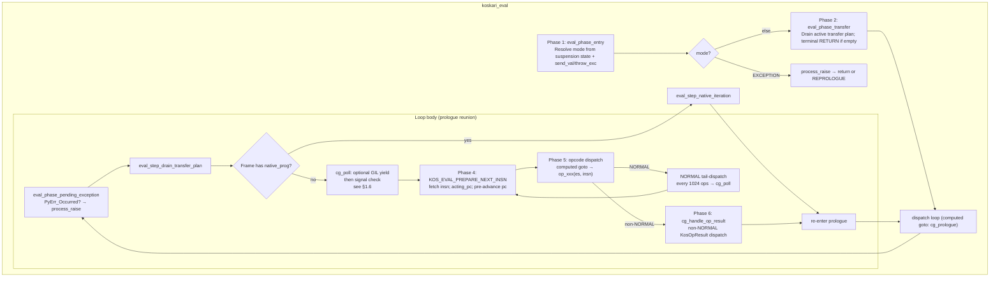
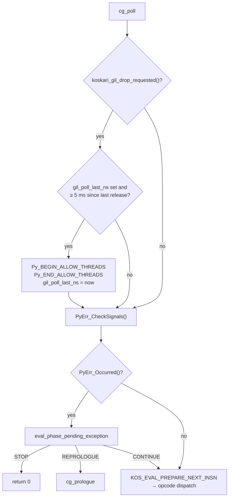
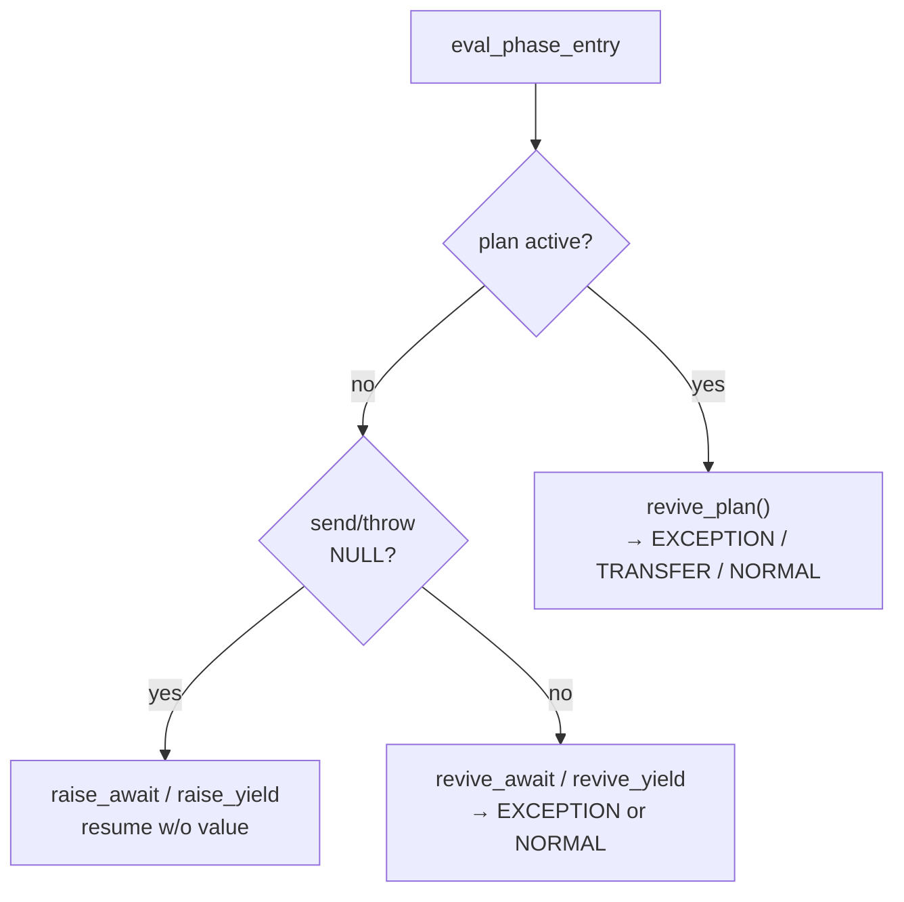
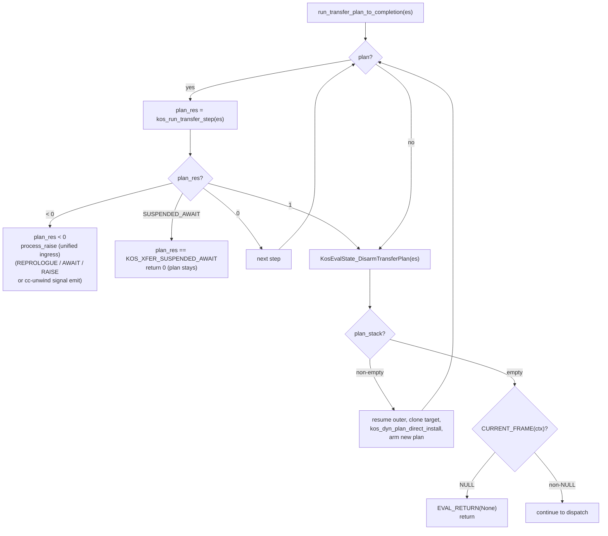
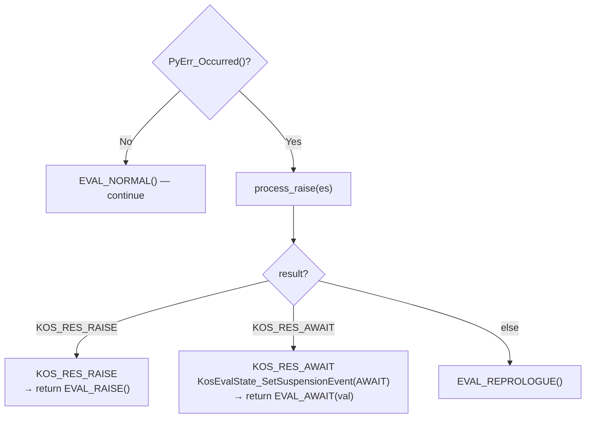
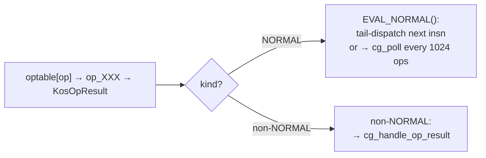
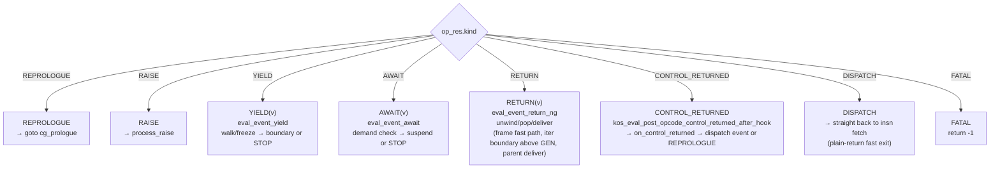
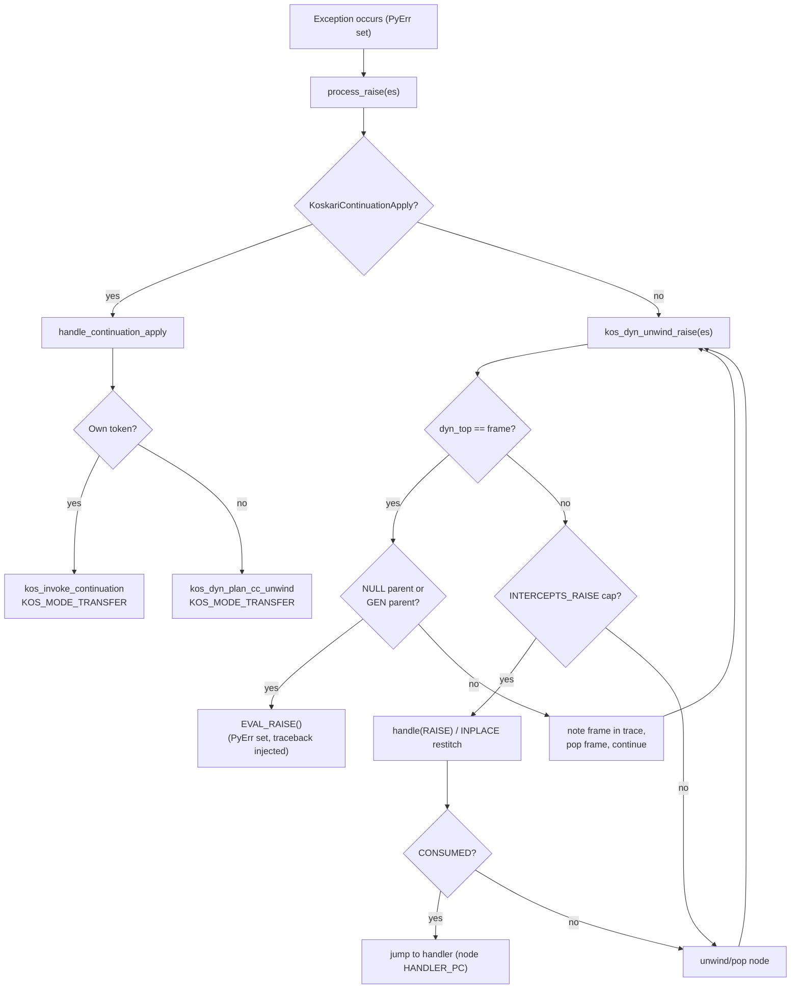
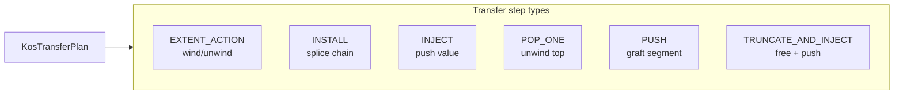
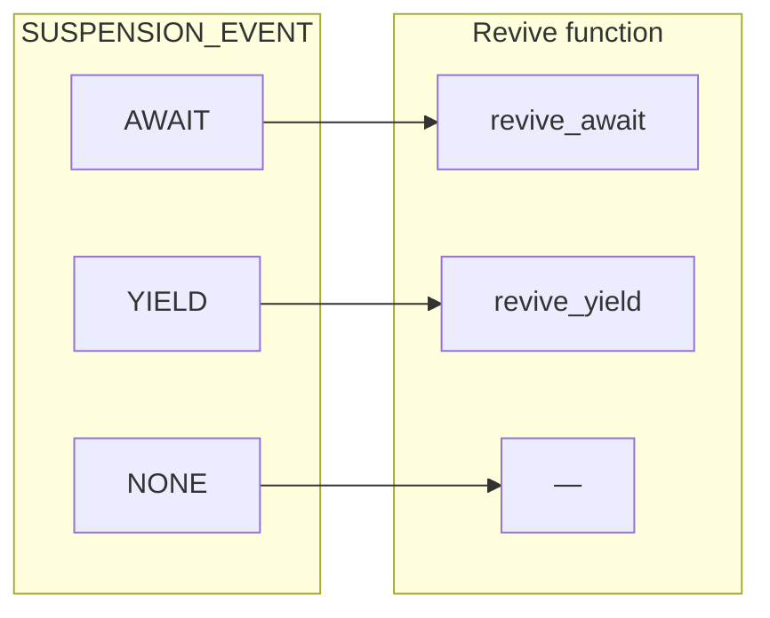

# Koskari Evaluator: Operation and Control Flow

This document describes the operation of the koskari eval loop in `koskari/lib/eval.c`: its stages, how opcodes are invoked and signal back, exception handling, control transit (event-driven handle/unwind model), transfer plans, tail calls, call installs, and resumption paths.

Implementation reference: `koskari/lib/eval.c`, `koskari/lib/eval/eval_gil.c` (included into `eval.c`; `koskari_gil_drop_requested`), `koskari/lib/eval/eval_chain.c` (included into `eval.c`; transfer-plan drain and replan), `koskari/lib/eval.h` (including suspension tagging, Python await/resume bridge fields, and domain TLS scope wrappers in `eval.c`), `koskari/lib/dynchain.c` / `koskari/lib/dynchain.h` / `koskari/lib/dynchain/dyn_walk.c` / `koskari/lib/dynchain/xfer_plan.c` (walk and xfer units are `#include`d by `dynchain.c`). For the staged `KosEvalState` surface, see `design/archive/kos_eval_state_api_migration.md` (archived). For live-field authority, choke-point funnel, and removing scatter `SyncFromContext` (performance; behavioral freeze), see `design/archive/eval-state-live-authority.md` (archived).

---

## 1. High-Level Structure

### 1.1 Entry Point

```c
KosOpResult koskari_eval(KosContext *ctx,
                         PyObject *send_val, PyObject *throw_typ,
                         PyObject *throw_exc);
```

The evaluator runs until it hits a **boundary event** (return, raise, yield, await) or a fatal error. It returns a `KosOpResult`:
- **`KOS_RES_RETURN`** / **`KOS_RES_YIELD`** / **`KOS_RES_AWAIT`**: Normal boundary; `val` holds the boundary value (new ref; caller owns).
- **`KOS_RES_RAISE`**: Exception boundary; `PyErr` is set; `val` is NULL.
- **`KOS_RES_FATAL`**: Hard internal fault; `PyErr` is also set.

`send_val` and `throw_typ`/`throw_exc` are the resume arguments (both may be NULL for a fresh start or null resume).

`koskari_eval` builds a stack **`KosEvalState`** (`KosEvalState_Init(&es, ctx)`), marks the context running, and pushes the per-thread **domain scope** via **`KosEvalState_EnterDomainScope(&es)`** (token stack and live depth in `domain.c` TLS). On exit (including error paths through **`koskari_eval_cleanup`**), it flushes registers, calls **`KosEvalState_LeaveDomainScope(&es)`**, and returns. All loop phases and opcode handlers use **`&es`**; hot-path mirrors (`frame`, `code`, `pc`, operand stack) stay in sync via **`kos_dyn_resync_after_push`**, **`kos_dyn_commit_dyn_top`** (incremental pop retarget), and **`kos_dyn_resync_chain`** when the chain shape requires a full walk.

Entry and cleanup also **swap the thread's handler-visible exception state
(`sys.exc_info`) with the context's saved triple** (`KosContext.exc_info_*`),
so contexts interleaved on one thread never see each other's handled
exception across suspensions. The all-empty common case skips the swap.
Contexts are isolated: a fresh context starts with empty handler state (no
fall-through to the host's in-flight exception). See §4.4.

### 1.2 Main Loop Phases



### 1.3 Design goals: orchestration, reactions, and local opcodes

Koskari aims for an evaluator that is easy to picture as a **pipeline of
boxes**: clear event boundaries, generic chain behavior where it helps, and
room to add new control (for example a new stop reason or a hypothetical
debug interrupt) by **extending the same pattern** instead of threading special
cases through every opcode.

A useful summary of that intent:

| Layer | Owns |
| ----- | ---- |
| **Eval** (`eval.c`) | **Orchestration**: when to run post-opcode handling, how `KosOpResult` and suspension line up, ordering between unwind/pop/freeze and consumer delivery, `process_raise` / exception routing, transfer-plan interaction with the loop. |
| **DynNodes** (`dynchain*.c`, kind helpers) | **Reactions**: what a particular node kind does when walked, unwound, or notified (e.g. `kos_dynnode_on_control_returned` for WIND/WITH, NEXT/FOREACH/YIELD_FROM delivery primitives). |
| **Opcodes** (`opcode/*.c`) | **Local stack and unwind steps**: pop/push operands, drive chain unwinds by calling the **`kos_dyn_unwind_*`** walks directly (they return **`KosWalkStatus`**), return **`KosOpResult`** via `EVAL_*` macros so the loop can run the right follow-up. Opcode sources do not use **`KosContext_*`** field macros directly; they go through **`KosEvalState_*`** helpers declared in **`eval.h`**. |

The goal is **compartmentalization**: new behavior should touch the layers it
actually needs (a new opcode, a new cap on a node, or a new branch in eval’s
post-opcode pipeline), without forcing unrelated code to “learn” a new case.

Iterator-boundary consumer routing (NEXT / awaiting-FOREACH / flattened
YIELD_FROM) is unified in **`dynchain/dyn_boundary.c`**: one
capability-keyed finder (**`kos_dyn_find_iter_boundary`**, routing on
**`KOS_DYN_CAP_RECEIVES_ITER_BOUNDARY`** only) plus yield/return delivery
entries; the per-kind semantics stay in `dyn_next.c` / `dyn_foreach.c` /
`dyn_yield_from.c` behind it (see
[archive/boundary-control-reemit.md](archive/boundary-control-reemit.md) §5.2).
WIND/WITH keep the deliberately separate
`kos_dynnode_on_control_returned` hook.

**Where we are not there yet (honest gaps):**

- **Large opcodes.** **YIELD_FROM** now shares noinline motif helpers
  across its four per-kind drive variants (yield-out, exhaustion,
  StopAsyncIteration harvest, await-resume), but the driver logic still
  lives in the opcode; the speculative next step is the GEN passthru
  proposal ([interpreter/gen-yieldfrom-passthru.md](interpreter/gen-yieldfrom-passthru.md),
  undecided).

- **Native programs** (`native_prog`, §8.2) are a parallel “mini eval” on
  the same chain: orchestration and reaction blur at the frame boundary
  because the program's handler is not a bytecode opcode.

- **AWAIT** is intentionally **not** folded into the same boundary-control
  staging as RETURN/YIELD parent delivery; that keeps semantics stable but
  means “one pipeline for every suspend kind” is not a literal single path.

- **Exceptions** are centralized in `process_raise` (the unified RAISE
  ingress; see §4.1): post-opcode `PyErr`, prologue pending exceptions,
  revive-throw, and transfer-plan step failures all converge on it. The
  **try/finally**, **WITH**, and unwind reactions it triggers still live in
  dynchain per node kind, which is the intended split.

These gaps are useful to track: they mark where future refactors should push
**policy toward eval** and **reactions toward dynchain**, without pretending
the codebase is already uniform end-to-end.

### 1.4 KosEvalState API (eval-facing glue)

Eval and opcodes share a single **`KosEvalState *es`** for the running slice. Notable entry points:

- **`kos_dyn_unwind_*` walks** — the eval loop calls the dynamic-chain unwind walks directly (no dispatcher): **`kos_dyn_unwind_return`** (RETURN), **`kos_dyn_unwind_to_frame`** / **`kos_dyn_unwind_to_node`** (targeted unwind), **`kos_dyn_unwind_yield`** (YIELD), **`kos_dyn_unwind_to_loop`** (BREAK/CONTINUE), and **`kos_dyn_unwind_raise`** (local raise). All return **`KosWalkStatus`** except **`kos_dyn_unwind_raise`**, which returns **`KosOpResult`** as the eval-loop boundary. Declared in **`dynchain.h`**, implemented in **`dynchain/dyn_walk.c`**.
- **Transfer plans** — **`KosEvalState_ArmTransferPlan`**, **`KosEvalState_DisarmTransferPlan`**, **`KosEvalState_HasActiveTransferPlan`**, plan stack **suspend/resume** helpers; delimited return **`KosEvalState_KReturnDelimited`**.
- **Pending return / unwind target** — **`KosEvalState_SetPendingReturn`**, **`KosEvalState_SetUnwindTargetFrame`**.
- **Opcode-visible flags** — **`KosEvalState_MarkSuspendedNotRunning`**, **`MarkDeadAfterYield`**, **`MarkDeadAfterReturn`**.
- **Globals / inject / iteration** — **`KosEvalState_GlobalsNamespace`**, **`KosEvalState_TakeInjectThrow`**, **`op_get_next_from_iter(es, …)`**, **`KosEvalState_EagerStepAwaitable`** (first eager **`__await__`/`send(None)`** step for awaitables; used from AWAIT plumbing and **`YIELD_FROM`**).
- **`eval.c`** (suspension / Python bridge / domain scope) — **`KosEvalState_SetSuspensionEvent`**, **`KosEvalState_ClearSuspensionEvent`**, **`KosEvalState_SuspensionEvent`**; **`KosEvalState_PythonAwaitSetIter` / `PythonAwaitClearIter` / `PythonAwaitIter`**; **`KosEvalState_PythonResumeSet` / `PythonResumeTake`**; **`KosEvalState_EnterDomainScope` / `LeaveDomainScope`**.

### 1.5 Derived `KosContext` caches (`frame_top`, `block`, `namespace`)

These fields mirror the live frame, operand-segment slot, and namespace for opcode hot paths. Each fact is answered by per-node state rather than a chain walk: the top node's segment (region kinds always own one), the top node's `ns` (the namespace owned fill), and -- on frame pops -- the popped frame's `back_frame` unwind cache.

| Mechanism | Role |
| --------- | ---- |
| **`kos_dyn_resync_after_push(es, new_node)`** | O(1) update after a single-node push: frame nodes replace all live fields; other nodes update only what they carry. Stamps the pushed node's unwind caches (segment `back` = displaced owning slot; frames also record `back_frame` = displaced frame). |
| **`kos_dyn_resync_after_pop(es, removed, new_top)`** | O(1) update after `kos_dyn_commit_dyn_top` pops a single head: block from the removed segment's `back` (or the surviving owner), namespace read from the survivor's `ns`, frame from `back_frame`. Under **`KOS_EVAL_SAFETYNET=1`** a counted chain-walk fallback backs every cache; default builds trust the cache model and fail fast on violation. |
| **`kos_dyn_resync_chain(es)`** | Full walk from **`dyn_top`** when incremental retarget does not apply (xfer INSTALL/PUSH, splices, gen freeze/thaw, bootstrap). Finishes by **restamping** the contiguous unstamped prefix at the top of the chain -- spliced spans arrive with cleared caches -- so subsequent pops stay O(1). |

Optional **`KOS_DEBUG_PATCH_DYN_CACHES`**: cross-check every cache answer (push retarget vs full rebuild; pop-side caches vs the walk) and raise on drift.

Coroutine drivers outside the bytecode loop (**`coro.c`**) still hold a **`KosContext *`** on the **`KosCoroutine`** object; they construct a short-lived **`KosEvalState`** when they need the same Python-bridge helpers as **`revive_await`**.

### 1.6 GIL cooperation and signal polling

Long-running bytecode loops must yield the GIL when CPython has asked this
thread to drop it, and must honor Python pending signals (for example **Ctrl-C**
/ **KeyboardInterrupt**). This is implemented in
**`koskari_eval_dispatch_computed_goto`** (`eval.c`), with
**`koskari_gil_drop_requested`** in **`koskari/lib/eval/eval_gil.c`** (textually
included from **`eval.c`**). It is not stored on **`KosContext`** or
**`KosEvalState`**.

| Mechanism | Role |
| --------- | ---- |
| **`koskari_gil_drop_requested()`** | Static inline in **`eval_gil.c`**. Returns **1** when another thread has set CPython’s per-thread or per-interpreter **gil drop request** (see below); **0** on free-threaded builds (**`Py_GIL_DISABLED`**). On unsupported CPython minor versions (outside the 3.9–3.13+ probes), returns **1** so time-gated release can still run. |
| **`gil_poll_ops`** (stack local) | Reset to **0** at **`cg_poll`**. Incremented on each **RUN** tail-dispatch; when **`++gil_poll_ops > KOS_EVAL_GIL_POLL`** (**1024**), control jumps to **`cg_poll`**. |
| **`gil_poll_last_ns`** (stack local) | Monotonic timestamp gate for paired GIL release (`kos_eval_gil_poll_now_ns` → `clock_gettime(CLOCK_MONOTONIC)`). **Seeded at dispatch entry** and refreshed on each paired release; a **0** value means the clock read failed and disables the timed release. (Previously initialized to 0, which left the release path unreachable — long loops never yielded the GIL; fixed in the eval simplification pass.) |
| **`KOS_EVAL_GIL_POLL_INTERVAL_NS`** | Minimum **5 ms** between paired GIL yields (enforced when both timestamps are nonzero; a failed clock read on either side skips the release). |
| **`Py_BEGIN_ALLOW_THREADS` / `Py_END_ALLOW_THREADS`** | Brief paired release at **`cg_poll`** only when **drop requested** and the interval gate passes (same C block). |
| **`PyErr_CheckSignals()`** | Runs immediately after the **`cg_poll`** GIL block (fall-through, no separate label) on every visit to the poll site. |

**`koskari_gil_drop_requested` and CPython layout**

The probe reads CPython interpreter internals (not a public API). Layout
differs by version:

| CPython | Field read |
| ------- | ---------- |
| **3.13+** | **`PyThreadState`**: **`eval_breaker`**, GIL-drop request is bit **0**. |
| **3.9–3.12** | **`PyInterpreterState` → `ceval.gil_drop_request`** (version-specific struct sizes in **`eval_gil.c`**). |
| **`Py_GIL_DISABLED`** | Always **0** (no GIL to drop). |
| **Other minors** | Always **1** (cannot detect request; poll may still attempt interval-gated release). |

**Where polling runs**

1. **Prologue reunion** — After the pending-exception check, transfer drain,
   and optional native-frame iteration, **`goto cg_poll`** before
   **`KOS_EVAL_PREPARE_NEXT_INSN`**.
2. **NORMAL tail-dispatch** — After an opcode returns **`EVAL_NORMAL()`**
   (hot path), when **`gil_poll_ops`** exceeds **`KOS_EVAL_GIL_POLL`**, branch
   to **`cg_poll`** instead of fetching the next instruction immediately.

**Poll-site sequence** (straight-line from the **`cg_poll`** label in **`eval.c`**;
the signal-check and dispatch steps fall through without their own labels):



Signal checking is unconditional: **`PyErr_CheckSignals()`** runs on every
poll-site visit. GIL release is conditional: no **`Py_BEGIN_ALLOW_THREADS`**
unless CPython (or the unsupported-minor fallback) reports a drop request
**and** at least **5 ms** have passed since the timestamp recorded at the
previous release (or, on the first visit, since the dispatch-entry seed).

**Relationship to Phase 3:** **`eval_phase_pending_exception`** still runs at the
start of each prologue. **`PyErr_CheckSignals()`** at the poll site may set
**`PyErr`**, and the poll site runs **`eval_phase_pending_exception`** inline
(the code region formerly labeled **`cg_check_signals`** / **`cg_normal_dispatch`**
is now straight-line fall-through from **`cg_poll`**) so interrupts are not
deferred until the next full prologue cycle.

**Future work:** Domain-scoped **`maybe_cooperate()`** / **`ensure_gil()`** and
cooperation inside dynchain walks are described in
[archive/gil-cooperation.md](archive/gil-cooperation.md) (design
proposal; not yet the primary mechanism). See also [TODO.md](TODO.md) § GIL.

---

## 2. Phase Detail Diagrams

### 2.1 Phase 1: Entry and Revive

**eval_phase_entry** chooses the initial `KosEvalMode`:



**Revive paths:**
- **revive_plan**: Resume a suspended transfer plan. If `throw_exc` set → `KOS_MODE_EXCEPTION`. Else inject `send_val` into plan → `KOS_MODE_TRANSFER`.
- **revive_await / revive_yield**: If `throw_exc` and `revive_yield` → `PyErr_SetObject`, `KOS_MODE_EXCEPTION`. If `throw_exc` and `revive_await` with **`KosEvalState_PythonAwaitIter(es)`** set → `iterator.throw(typ, val, tb)` first (same idea as `coroutine_throw` when waiting on a Python await iterator): on `StopIteration`, the await completes and the normal inject/send path runs; on non-NULL `throw` result, `revive_await` returns `EVAL_AWAIT(val)` and `eval_phase_entry` re-suspends; if there is no iterator, or `throw` leaves another error, `KOS_MODE_EXCEPTION`. If no `throw_exc`, `revive_await` consumes **`KosEvalState_PythonResumeTake`** (or **`send_val`**) and pushes onto stack when non-NULL, then returns `EVAL_NORMAL()`. YIELD_FROM uses these same revive paths (its phase selects AWAIT or YIELD); there is no separate `revive_yield_from` or `KOS_SUSP_YIELD_FROM`.
  - From the caller's perspective, both plain `YIELD` and `YIELD_FROM` suspensions surface as the same boundary kinds (`KOS_RES_YIELD` or `KOS_RES_AWAIT`), so resume routing is identical.

**Mode dispatch outcomes:**
- `EVAL_AWAIT` re-suspend (after `throw` into the stored Python await iterator yielded again) → **`KosEvalState_SetSuspensionEvent(es, KOS_SUSP_AWAIT)`**, **`KosEvalState_MarkSuspendedNotRunning(es)`**, return `EVAL_AWAIT(val)`.
- `KOS_MODE_EXCEPTION` → `process_raise` (unified RAISE ingress: continuation-apply interception, nest abandon, agen-boundary clear, `try_local`); on REPROLOGUE → continue in NORMAL mode; otherwise return the terminal result (`EVAL_AWAIT`, `EVAL_RAISE`, or `EVAL_FATAL`).

### 2.2 Phase 2: Transfer Plan Drain

**eval_phase_transfer** runs when the context has an active transfer plan (equivalently **`KosEvalState_HasActiveTransferPlan(&es)`**):



When a wind thunk invokes a nested continuation during an active plan, the outer
plan is suspended on **`plan_stack`**. After the inner plan drains,
**`kos_resume_transfer_plan`** pops the outer, clones **`original_target`** before
disarm (UAF avoidance), rebuilds via **`kos_dyn_plan_direct_install`**, and
continues draining. See [archive/interrupted-transfer-plans.md](archive/interrupted-transfer-plans.md) §5.

**Failed transfer (implemented):** on step failure (except foreign cc-unwind
sentinel re-emit), the drain routes through **`process_raise`** (the unified
RAISE ingress), which abandons the nest and runs
**`kos_dyn_unwind_raise`** on the manifested chain.
**`run_transfer_plan_to_completion`** returns a **`KosOpResult`**:
`EVAL_NORMAL` (drained or suspended on await), `EVAL_REPROLOGUE` (abandoned,
handler applied), `EVAL_AWAIT` (abandonment started an async unwind; the
suspension is tagged and the awaitable propagates to the driver), or
`EVAL_RAISE` / `EVAL_FATAL` (unhandled). **`KOS_DYN_CC_RAISE`** sentinel steps
return `EVAL_RAISE()` upward without entering the ingress. See
[archive/interrupted-transfer-plans.md](archive/interrupted-transfer-plans.md) §3–§4.

### 2.3 Phase 3: Pending Exception Check

At each **prologue reunion**, **eval_phase_pending_exception** handles
`PyErr_Occurred()` (opcode failure, continuation apply, async exception, etc.).
The same helper runs again at the **GIL poll site** when **`PyErr_CheckSignals()`**
sets a pending interrupt (see §1.6).



### 2.4 Phase 4: Prepare next instruction

**`KOS_EVAL_PREPARE_NEXT_INSN`** (macro in `eval.c`) sets a local **`KosOp *insn`** to the current instruction in **`KosCode_CODE`** and updates the frame: load `code` and `pc`, optional **`SAYF`** trace, set `acting_pc`, pre-advance `pc`. It assumes a valid frame, in-range `pc`, and valid bytecode (no defensive checks).

Opcode handlers receive **`KosEvalState *es`** (see **`koskari/lib/eval.h`**): cached **`frame`**, **`code`**, operand-stack **`block`**, and live **`pc`** / **`acting_pc`** registers for the eval slice, aligned with **`KosEvalState_CONTEXT(es)`** via **`kos_dyn_resync_after_push`** / **`kos_dyn_commit_dyn_top`** / **`kos_dyn_resync_chain`** (and **`KosEvalState_ThawFromContext`** / **`FreezeToContext`** at the invocation boundary) as summarized in section 1.5 above. There is no separate per-opcode struct beyond handler parameters; the hot path keeps **`KosOp *insn`** into **`op_*`**. **`cg_handle_op_result`** does not receive `insn`; it switches on the returned `KosOpResult.kind`.

PC is rolled back for WITH enter/exit suspend so the same instruction is retried on resume.

#### 2.4.1 Provider stepping (NEXT / ITER_NEXT / YIELD_FROM)

A **KosIter provider** (a type whose `kos_iter` suite carries `ki_step`;
`evaluated.h`) is stepped **inside** the same **`koskari_eval`**
invocation — no intermediary coroutine objects. Each of the three
iteration opcodes owns a chain node carrying a **`KosIterRequest`**
record (`{iter, mode}`, embedded in the FOREACH, NEXT, and YIELD_FROM
node arms: the iterator being stepped plus one byte describing the
step in flight) and calls
**`KosIterRequest_Next(es, node, send_val, &out)`**. `Next` performs
one step, choosing among the three iterator protocols: a KosIter
provider goes through its `ki_step` slot, which may install frames on
the chain; a plain sync iterator goes through `tp_iternext`; a python
async iterator has its `__anext__` coroutine created and immediately
advanced one send, so a coroutine that finishes without suspending
completes right here. The returned status:

- **DELIVERED** / **EXHAUSTED** — the element (or the end of the
  iteration) is in hand and the opcode completes immediately.
- **CONTINUES** — the provider put runnable work on the chain: a
  generator's `ki_step` re-attached its suspended frames via
  `kos_dyn_gen_install`, or a native program's frame (§8.2) was
  pushed. The record's mode says how that work will finish:
  `KOS_IREQ_INSTALLED` (the work's own yields and return are the
  outcomes) or `KOS_IREQ_GRAFT_VALUE` (the installed frame's return
  value is itself the next element). After CONTINUES the opcode
  returns: if the now-current frame has bytecode, instruction dispatch
  continues into it directly; a code-less native frame re-enters the
  prologue instead, which knows how to run it.
- **EXIT** — a python async step suspended: the record is marked
  `KOS_IREQ_AWAITING_PY`, the opcode returns `EVAL_AWAIT` with the
  suspended awaitable's payload, and when the awaited value arrives at
  resume it IS the element, delivered through the node.

The **same** live **`es`** passed into the opcode is forwarded through
`Next` into `ki_step`, so a generator install refreshes the
interpreter's eval-state mirrors — not a temporary `KosEvalState` built
only for install. Python drivers (the adapters in `iterate.c`) build
`KosEvalState` on the host context and enter the same `ki_step`.

Every later delivery back to the waiting opcode's node goes through
one entry, **`KosIterRequest_Deliver(es, node, event, value)`**
(§2.6), whether the value arrived as a generator's yield, a
generator's return (end of iteration), the return of an installed
value-mode frame, or an awaited result at resume.

### 2.5 Phase 5: Opcode Dispatch



Handlers return a **`KosOpResult {KosOpResultKind kind; PyObject *val}`** via the
`EVAL_*` macros declared in `eval.h`. **`EVAL_NORMAL()`** is the hot path:
the loop may fetch the next instruction immediately or branch to the **GIL poll
site** (§1.6) when the opcode counter wraps. All other kinds enter
**`cg_handle_op_result`** (Phase 6).

### 2.6 Phase 6: `cg_handle_op_result`

**`cg_handle_op_result`** switches on `op_res.kind` and routes each result to
the appropriate centralized event helper:



**`eval_event_yield`** runs **`eval_yield_handle_walk_and_freeze`**, which
calls **`kos_dyn_unwind_yield`**. The generator node
(**`KOS_DYN_GEN`**) consumes the event and freezes. Whether **`koskari_eval`**
stops depends on flattened iterator delivery:
- If **`kos_dyn_find_iter_boundary`** locates a receiving boundary (a node
  carrying **`KOS_DYN_CAP_RECEIVES_ITER_BOUNDARY`**: a **NEXT**, an awaiting
  **FOREACH**, or a flattened-delegate **YIELD_FROM**; dyn_top preferred,
  else the nearest receiver outward from the running frame), the payload is
  handed to it via **`KosIterRequest_Deliver(es, node, KOS_IWAKE_VALUE,
  val)`** and the loop returns **REPROLOGUE** (eval keeps running). Deliver
  runs the node's yield tail — stage the element on the consumer stack for
  NEXT/FOREACH (plus `ki_finish(iter, 0)` and mode reset), or hand it to a
  **YIELD_FROM** receiver as **`KOS_YF_PHASE_EMIT`**, whose next dispatch
  re-emits it as the delegating generator's own yield. That is itself a
  fresh YIELD event — walk and freeze the delegating **GEN**, then deliver
  to the next boundary. Each hop is one walk plus one delivery, so nested
  **for-each / yield-from / generator** stacks compose to arbitrary depth.
- Otherwise (no internal boundary; an external driver consumes the generator)
  **`KosEvalState_SetSuspensionEvent(es, KOS_SUSP_YIELD)`** and return
  `EVAL_YIELD(val)`; the driver resumes via **`revive_yield(send_val)`**.

**`eval_event_await`** checks `kos_eval_in_demand(es)` first (see §7.5); on
denial, it raises a sync-violation exception. On normal suspension it calls
**`KosEvalState_MarkSuspendedNotRunning`** and returns `EVAL_AWAIT(val)`.

**`eval_event_return_ng`** handles frame return.  When try/with/wind nodes
sit above the frame, **`eval_event_return`** first runs
**`kos_dyn_unwind_return`** (or the delimited path); both converge on
**`eval_event_return_at_frame`**, which dispatches on the frame's parent:
- **Plain parent frame** (no native program): `eval_ng_plain_return` —
  inline retarget, no chain walk, `EVAL_DISPATCH()` fast exit.
- **GEN parent:** the boundary above the GEN receives
  **`KosIterRequest_Deliver(es, node, KOS_IWAKE_END, val)`** — the gen
  chain is unwound (`kos_dyn_teardown_gen_exhausted`) and the node's
  exhaustion tail runs (else-pc branch, default push, or StopIteration
  re-emit per site arity, plus `ki_finish(iter, 1)`). A GEN with no
  consumer returns `EVAL_RETURN(val)`.
- **Value-mode iteration parent** (an iteration node whose request
  record holds `KOS_IREQ_GRAFT_VALUE`, meaning "this frame's return is
  the next element"): pop the frame, then
  `Deliver(node, KOS_IWAKE_VALUE, val)`.
- **Other parents** (WIND, TRY, WITH, native-program frame): pop the
  callee frame, then **`eval_parent_return_deliver`** (hand the value
  to a native program's handler as `KOS_NFRAME_CALL_VALUE`, or push it
  onto the parent stack, then `kos_dynnode_on_control_returned`), then
  `EVAL_REPROLOGUE()`.
- **No parent:** root frame — returns `EVAL_RETURN(val)`.

**CONTROL_RETURNED path** (`kos_eval_post_opcode_control_returned_after_hook`):
runs `kos_dynnode_on_control_returned` for WIND/WITH; on non-zero result dispatches
any event (AWAIT/YIELD/RETURN-boundary/PyErr) via `apply_kos_op_result`; otherwise
`EVAL_REPROLOGUE()`. All paths use `KosOpResult` directly.

---

## 3. Opcode Signaling

Handlers return **`KosOpResult {KosOpResultKind kind; PyObject *val}`** via the
`EVAL_*` macros in `eval.h`. `EVAL_NORMAL()` is the hot path. All other kinds
enter `cg_handle_op_result` (Phase 6).

```mermaid
flowchart TD
    subgraph opcode_return[“KosOpResult kinds”]
        rn[“EVAL_NORMAL()<br/>hot path: tail-dispatch next insn”]
        rr[“EVAL_REPROLOGUE()<br/>full prologue before next insn”]
        re[“EVAL_RAISE()<br/>PyErr set → process_raise”]
        ry[“EVAL_YIELD(v)<br/>→ eval_event_yield”]
        ra[“EVAL_AWAIT(v)<br/>→ eval_event_await”]
        rret[“EVAL_RETURN(v)<br/>→ eval_event_return_ng”]
        rd[“EVAL_DISPATCH()<br/>→ resume insn fetch directly”]
        rc[“EVAL_CONTROL_RETURNED()<br/>→ on_control_returned hook”]
        rf[“EVAL_FATAL()<br/>return -1 (non-PyErr fault)”]
    end
```

### 3.1 Opcode Handler Return Macros

| Macro | Kind | Meaning |
|-------|------|---------|
| `EVAL_NORMAL()` | `KOS_RES_NORMAL` | Continue to next instruction (no prologue). |
| `EVAL_REPROLOGUE()` | `KOS_RES_REPROLOGUE` | Re-run full prologue before next opcode (new frame, transfer plan, etc.). |
| `EVAL_RAISE()` | `KOS_RES_RAISE` | **`PyErr`** set; route to **`process_raise`**. |
| `EVAL_YIELD(v)` | `KOS_RES_YIELD` | Generator yield with payload `v`; route to **`eval_event_yield`**. |
| `EVAL_AWAIT(v)` | `KOS_RES_AWAIT` | Suspend on awaitable `v`; route to **`eval_event_await`** (demand check first). |
| `EVAL_RETURN(v)` | `KOS_RES_RETURN` | Frame return with value `v`; route to **`eval_event_return_ng`** (unwind / pop / deliver: parent frame, iterator boundary above a GEN, or driver). |
| `EVAL_DISPATCH()` | `KOS_RES_DISPATCH` | Live regs already retargeted, nothing pending; the loop resumes instruction fetch directly (plain-return fast exit). |
| `EVAL_CONTROL_RETURNED()` | `KOS_RES_CONTROL_RETURNED` | WIND/WITH thunk or TAIL_CALL install complete; route to **`kos_eval_post_opcode_control_returned_after_hook`**. |
| `EVAL_FATAL()` | `KOS_RES_FATAL` | Non-`PyErr` internal fault; `koskari_eval` returns -1 immediately. |

### 3.2 What Opcodes Signal and When

- **`EVAL_NORMAL()`**: Next instruction runs immediately. Used by almost all opcodes on the success path.
- **`EVAL_REPROLOGUE()`**: Used after installing a new frame or arming a transfer plan, so the prologue can drain before the next opcode.
- **`EVAL_YIELD(v)` / `EVAL_AWAIT(v)`**: Emitted from YIELD, YIELD_FROM, AWAIT, and auto-await after CALL. `EVAL_NORMAL()` is used instead when the yield is **in-loop** (non-GEN parent delivers directly without a driver-visible boundary).
- **`EVAL_RETURN(v)`**: RETURN pops its operands and signals the boundary; the frame is still live — `eval_event_return_ng` owns unwind, frame pop, and delivery (parent frame, iterator boundary above a GEN, or driver).
- **`EVAL_CONTROL_RETURNED()`**: TAIL_CALL install or native handler follow-up needing `kos_dynnode_on_control_returned`.
- **`EVAL_RAISE()`**: Any error path with `PyErr` set.

### 3.3 Boundary Events and Parent Frame

**Driver-visible** **`koskari_eval`** boundaries are returned as `KosOpResult`
kinds `KOS_RES_RETURN`, `KOS_RES_RAISE`, `KOS_RES_YIELD`, and `KOS_RES_AWAIT`.
Internal post tags (`KOS_RES_CONTROL_RETURNED`, and the loop-internal
`KOS_RES_REPROLOGUE` / `KOS_RES_DISPATCH`) are not surfaced to the driver;
they route to internal helpers and back into the loop.

Typical **surface** boundaries:

- **RETURN** → `KOS_RES_RETURN` when evaluation completes (**top-level**, or a
  **GEN** with no receiver above it).
- **RAISE** → `KOS_RES_RAISE`; `PyErr` is authoritative.
- **YIELD** → `KOS_RES_YIELD` when the generator boundary applies (parent is GEN
  or no parent for the yield), or YIELD_FROM emits yield.
- **AWAIT** → `KOS_RES_AWAIT`

When the frame **has a parent** (normal nested CALL return): the RETURN opcode
still just returns **`EVAL_RETURN(val)`**; **`eval_event_return_ng`** pops the
frame and delivers — inline retarget to a parent frame (the fast path), the
receiving iteration node above a GEN or one in value mode via
**`KosIterRequest_Deliver`**, or **`eval_parent_return_deliver`** for other
parents (push onto the caller's stack, or hand to a native program's
handler as `KOS_NFRAME_CALL_VALUE`, then
**`kos_dynnode_on_control_returned`**). The outer driver does **not** get a
`KOS_RES_RETURN` for that step; the loop keeps running in the caller.

**DELIMITED** return (**`RETURN_TARGET_CHAIN`**) is separate (Phase 2a) and may
build a transfer plan.

---

## 4. Exception Handling

### 4.1 Exception Flow

**`process_raise`** is the unified RAISE ingress: all PyErr /
`KOS_RES_RAISE` ingress converges on it — post-opcode results
(`apply_kos_op_result`), prologue and signal-poll pending PyErr
(`eval_phase_pending_exception`), revive-throw (`eval_phase_entry`
`KOS_MODE_EXCEPTION`), and transfer-plan step failures
(`run_transfer_plan_to_completion`). Its ordering contract (documented on
the function): guard → single continuation-signal test → nest abandon
(non-signal only) → `handle_continuation_apply` → agen-boundary clear →
`kos_dyn_unwind_raise` → outcome map (REPROLOGUE / AWAIT with
suspension tagging / RAISE / FATAL). Two deliberate non-ingress carve-outs live in
`run_transfer_plan_to_completion`: the foreign cc-unwind sentinel re-emit
(signal delivery; must not see `try_local`) and a pending
`KoskariContinuationApply` between drain steps (expected in-flight state).



### 4.2 kos_dyn_unwind_raise

Walk from `dyn_top` toward the chain root (`dynchain/dyn_walk.c`). The
walk **crosses frame boundaries** — a raise leaves the evaluator loop only
at the chain root (NULL parent) or a generator boundary. Per iteration:

1. **Frame boundary** (`dyn_top == frame`): if the frame's parent is NULL
   or a GEN, exit the walk (boundary raise); otherwise record the frame
   into the exception's trace (`kos_eval_note_crossed_frame`), pop it, and
   continue in the caller's section.
2. **Cap fast check**: only nodes with `KOS_DYN_CAP_INTERCEPTS_RAISE`
   (TRY, FINALLY, GEN, INPLACE-mode DELIM) are dispatched; everything
   else goes straight to unwind/pop. Dispatch outcomes:
   - **INPLACE DELIM** (in-place delimited invoke bookmark): restitch the
     stashed invoke span (`kos_dyn_inplace_restitch`) and continue the
     raise from the invoke site.
   - **CONSUMED** by TRY or FINALLY (**node-authoritative**: a live,
     enabled node consumes on its own state; its `HANDLER_PC` was fixed
     from the extent table at push time — there is no runtime extent
     lookup): clear the stack block, set PC to the node's handler, disable
     the region, stash the exception via `PyErr_SetExcInfo` and clear
     PyErr, set `handling_raise` on FINALLY → `EVAL_REPROLOGUE()`.
     **CONSUMED** by GEN: `kos_eval_prepare_boundary_raise` →
     `EVAL_RAISE()`.
3. **Unwind/pop**: `kos_dyn_pop_nonbarrier_top(RAISE)` (PyErr is fetched
   around the pop for PRESERVE/BARRIER/WIND nodes):
   - `KOS_RES_AWAIT` / `KOS_RES_REPROLOGUE` → async teardown started
     (dyn-wind after-thunk, dyn-with `__aexit__`): the in-flight
     exception is **parked on the context exception stash** (§4.4),
     tagged with the parking node's id; `on_control_returned` re-raises
     it when the teardown completes.
   - node may-swallow (CATCH cap) and PyErr cleared → set PC to
     `catch_resume_pc` → `EVAL_REPROLOGUE()`.
   - **Failed-pop taxonomy** (three classes):
     - `KOS_RES_FATAL` — evaluator-internal fault; abends the loop.
     - **Barrier refusal** (BARRIER cap, e.g. PROMPT) — machinery noise:
       the original exception is restored unchanged and
       `kos_dyn_exception_unwind` (HANDLES_EXCEPTIONS cap) crosses the
       barrier; a barrier with no working recovery is a legitimate walk
       exit.
     - **User teardown failure** — the teardown's exception supersedes
       the one in flight, which chains in as `__context__`
       (`kos_exc_supersede_chain`); the failing node is discarded without
       re-running its teardown and the walk continues. Never abends.
4. No handler at the chain root: `kos_eval_prepare_boundary_raise`
   (traceback injected, context marked dead), leave PyErr set →
   `EVAL_RAISE()`.

### 4.3 Traceback Injection

`inject_eval_frame_traceback` decorates the exception with `__koskari_dynchain__` and injects the current frame into the traceback so Python can display Koskari-native frames. Called via `kos_eval_prepare_boundary_raise` at:
- `kos_dyn_unwind_raise` (GEN-boundary, barrier-without-recovery, and no-handler branches)
- `xfer_emit_cc_unwind_signal` (foreign cc-unwind sentinel re-emit)

Frames **crossed** by the raise walk are recorded incrementally by
`kos_eval_note_crossed_frame` before each frame pop, as meta dicts marked
`"crossed": True`; the escape-time decoration carries crossed entries
forward and rebuilds the live-chain portion, so re-escapes cannot
duplicate frames.

### 4.4 Exception state carriers

Four distinct carriers, each with one job:

- **PyErr** (thread state) — the exception **in flight** during a raise
  walk. Never survives a suspension.
- **`KosContext.exc_stash`** — LIFO of exceptions **parked** while a
  teardown or handler works asynchronously. Entries are single normalized
  exception instances (traceback attached via `__traceback__`) tagged with
  the parking node's `node_id`. Helpers: `kos_ctx_exc_stash_push` /
  `top_is` / `reraise` / `chain_top` (dynchain.c). Parks nest strictly
  LIFO. Survives chain surgery (INSTALL, graft teardown); context teardown
  drops survivors loudly.
- **`KosContext.exc_info_*`** — the context's **handler-visible** state
  (`sys.exc_info`), swapped with the thread slot at `koskari_eval`
  entry/exit (§1.1). exc_info itself is the bytecode contract only
  (`EXCEPTION` / `CHECK_EXCEPTION` read it; TRY/FINALLY consumption
  writes it) — never a cross-suspension or cross-context stash.
- **Node handler state** — what a node needs to do its own job stays in
  the node payload: WITH's exc triple for `__exit__` arguments and
  `normal_exit`, FINALLY's `handling_raise`, DELIM's `saved_stack` /
  `saved_pc` resume fields.

---

## 5. Control Transit (Event-Driven Model)

Dynamic nodes on the dynchain participate in control flow through a small
lifecycle vocabulary and a two-phase transit model: **handle** then **unwind**
(unless the transit is AWAIT, which does not walk or pop the chain).

### 5.1 Lifecycle vocabulary

- **push(node)** — Link the node onto the dynchain (structural only: stack
  block, namespace, frame resources). No user code, suspension, or transfer.
- **wind(node)** — Enter the node’s active extent; may run user code (`__enter__`,
  dynamic-wind before-thunk, parameterize bindings) and may suspend or start a
  transfer. Often paired with **push** on construct entry and on transfer
  re-entry.
- **resume(node)** — Normal return to an already-active node after a
  subordinate step; node stays on chain. Payload is delivered by pushing to TOS
  then redispatching (send value, await result, yield-from delegate step).
- **handle(node, event)** — Offer a **control transit** (RETURN, RAISE, YIELD,
  BREAK, CONTINUE, SHIFT). Does **not** unlink the node; outcome is PASS, CONSUME,
  or DENY (see §5.3).
- **unwind(node, event)** — Leave the extent semantically; event records *why*.
  Used for after-thunks, teardown, and walking the chain during transits.
- **pop(node)** — Structural unlink (usually after unwind).
- **free(node)** — Destroy storage when ownership allows (generator nodes may
  defer until the generator object dies).

### 5.2 Construct entry

On entering constructs such as `with`, `dynamic-wind`, or handler scopes, the
evaluator performs **push** then **wind**. **push** stays cheap; **wind** runs
side-effectful entry and may suspend. Separating them avoids running user code
before the node is fully linked.

### 5.3 resume vs handle

- **resume** — Ordinary continuation **within** the current extent (value on TOS,
  node still installed).
- **handle** — A **control transit** that may cross nodes (return, raise, yield,
  break, continue, shift).

Keeping this distinction stable lets opcode and transfer machinery stay generic
while node kinds specialize behavior.

### 5.4 handle(node, event)

`kos_dyn_handle(ctx, node, event)` offers a control transit to each node. The node may:
- **PASS** — pass through unchanged
- **CONSUME** — handle the event (e.g. TRY catches RAISE, FINALLY consumes RETURN)
- **DENY** — reject (e.g. generator boundary denies SHIFT)

The caps bitfield is the **fast first check** before dispatch: the RAISE
walk consults `KOS_DYN_CAP_INTERCEPTS_RAISE` and only dispatches
cap-positive nodes (TRY, FINALLY, GEN, INPLACE DELIM); cap-negative nodes
skip the kind-switch entirely and go straight to unwind/pop. Distinct
from `KOS_DYN_CAP_HANDLES_EXCEPTIONS`, which marks failed-pop *recovery*
(`kos_dyn_exception_unwind`; PROMPT has recovery but passes on
handle(RAISE), so the two sets genuinely differ).

### 5.5 unwind(node, event)

`kos_dyn_unwind` takes a `KosXferEvent` (RETURN, RAISE, YIELD, BREAK, CONTINUE, SHIFT) so nodes know *why* they are being torn down. Transfer-aware nodes (e.g. `dynamic-wind`) use this for after-thunks.

### 5.6 Transit types

| Transit | Walk | Key functions |
|---------|------|----------------|
| RETURN | handle(RETURN) per node; FINALLY may overwrite value; if not consumed, unwind → pop callee frame; **parent** delivery for normal calls is **`eval_parent_return_deliver`** after pop (not inline in the opcode). Top-level / GEN-parent completion returns `EVAL_RETURN(val)`. | `kos_dyn_unwind_return`; **`eval_parent_return_deliver`** |
| RAISE | cap-gated handle(RAISE); TRY/FINALLY catch (node-authoritative); else unwind → pop, **crossing frames** (recorded into the trace) until chain root or GEN; async teardowns park the exception on the context stash; teardown failures supersede with `__context__` | `process_raise` → `kos_dyn_unwind_raise`; `kos_dyn_handle` behind the INTERCEPTS_RAISE gate (§4.2, §4.4) |
| YIELD | handle(YIELD) per node until generator boundary consumes; post-opcode **`eval_event_yield`** walks/freeze then optional **`eval_event_yield_deliver_to_boundary`** | `kos_dyn_unwind_yield` |
| AWAIT | **No** chain unwind or pop; full dynchain preserved; evaluator returns `EVAL_AWAIT(val)` | AWAIT opcode, `revive_await` |
| BREAK / CONTINUE | Find loop in-frame; walk unwind/pop to loop; handle on loop; resume at loop head or after loop | `kos_dyn_unwind_to_loop` |
| SHIFT | handle(SHIFT) offered to each node while locating the nearest matching prompt, in one walk; prompt consumes; generator boundary denies crossing | the capture walk in `kos_shift_capture` |

**YIELD details:** Nodes from the emitter up to the generator boundary see
handle(YIELD); the emitter (e.g. yield-from) often passes through. The generator
boundary captures/frozen state and detaches. **Top-level** generator: suspend
and return the yield value. **Flattened** iterator stepping (**NEXT** /
**FOREACH** / **YIELD_FROM** boundary): **`eval_event_yield_deliver_to_boundary`**
may deliver the payload without stopping **`koskari_eval`**. Nodes that care may
pair unwind-before-suspend with wind-on-resume.

**Generator close:** `close` uses the normal exception path (GeneratorExit via
RAISE transit), not a separate inbound channel.

### 5.7 Generator boundary node

`KOS_DYN_GEN` marks the generator boundary. It is pushed when a generator or coroutine is **installed** (e.g. when Python drives a Koskari generator via `send`/`throw`); the frame's parent is then the GEN node.

- **handle(YIELD)**: GEN **consumes** the event. After an opcode returns `EVAL_YIELD(val)`, **`eval_event_yield`** runs **`eval_yield_handle_walk_and_freeze`**, which invokes **`kos_dyn_unwind_yield`**. GEN's handler runs (e.g. **`kos_dyn_gen_freeze_and_release`**): the current dynchain is captured/frozen. Resumption is via **`revive_yield`**, which pushes **`send_val`** onto the stack and continues at the next instruction.

Whether control returns to the caller depends on evaluator flattening:
- In the regular case, **`eval_event_yield`** (called from `cg_handle_op_result` for `KOS_RES_YIELD`) runs **`eval_yield_handle_walk_and_freeze`** then may call **`KosEvalState_SetSuspensionEvent(es, KOS_SUSP_YIELD)`** and return `EVAL_YIELD(val)`; the caller resumes via **`revive_yield`**.
- In flattened async-gen stepping (**`kos_dyn_find_iter_boundary`** locates a receiver), boundary delivery may run without an external suspension; otherwise same tail path.
- **handle(SHIFT)**: GEN **denies**; shift cannot cross the generator boundary.
- **RETURN** when the frame's parent is GEN: with a receiving iterator boundary above the GEN, the value delivers internally via **`KosIterRequest_Deliver(..., KOS_IWAKE_END, val)`** and the loop keeps running; with no receiver (or no parent at all) the evaluator exits with `EVAL_RETURN(val)` and the driver receives the return value (e.g. StopIteration for sync generators).

### 5.8 Node behavior categories

- **Lexical / resource nodes** (e.g. `with`): **push** / **wind**, **unwind** /
  **pop**, often **handle(RAISE)**; typically ignore YIELD.
- **Transfer-aware nodes** (e.g. `dynamic-wind`): **wind** and **unwind** on
  RETURN, RAISE, YIELD (when suspension counts as leaving the extent), BREAK,
  CONTINUE, SHIFT.
- **Interceptors** (`try` / `except`, `finally`): primarily **handle(event)**;
  may transform or swallow transits.
- **Resumable operation nodes** (e.g. `KOS_DYN_YIELD_FROM`): **resume** for
  delegate steps; internal state machine across suspensions; may **handle** for
  delegation.
- **Generator boundary (`KOS_DYN_GEN`)**: intercepts YIELD and RETURN/RAISE as
  documented in §5.7; **denies** SHIFT across the boundary. The generator object
  owns the node; the chain borrows it during execution.

**Boundaries:** When a rule would be violated, the responsible node **denies**
in **handle** (e.g. SHIFT at GEN). **BREAK** / **CONTINUE** targeting fails in
the find phase before unwind if no loop exists in-frame.

### 5.9 Inbound events from the driver

- **Value on TOS** — After **push** to TOS, **resume** runs with the active node
  consuming TOS (yield **send**, await completion, yield-from delegate).
- **Throw / close** — Delivered as a normal **RAISE** transit (no parallel
  channel). `throw` into await uses `revive_await` + iterator `throw` where
  applicable (see §8).

### 5.10 Implementation map

- **KosXferEvent** — RETURN, RAISE, YIELD, BREAK, CONTINUE, SHIFT (unwind/handle).
- **KosHandleResult** — PASS, CONSUME, DENY.
- **kos_dyn_handle()** — Offer event before unwind on RETURN, RAISE, YIELD, SHIFT
  walks.
- **kos_dyn_unwind(ctx, node, event)** — Semantic exit with reason.
- **kos_dyn_unwind_to_loop()** — BREAK / CONTINUE targeting.
- **KOS_DYN_GEN** — Generator boundary; intercepts YIELD; denies SHIFT.
- **KosYfPhase** — Yield-from phases (DRIVING, EXPECT_SEND, EXPECT_AWAIT,
  EMIT); a KOS_ITER delegate's in-flight step state lives in the node's
  `KosIterRequest` record, not the phase. YIELD_FROM emits only YIELD or
  AWAIT boundary events (no `KOS_SUSP_YIELD_FROM` or `revive_yield_from`).

Primary code: `koskari/lib/dynchain.c` (shell plus `#include` of `dynchain/dyn_*.c`,
`dynchain/dyn_walk.c`, `dynchain/xfer_plan.c`), `koskari/lib/dynchain.h`,
`koskari/lib/eval.c`, `koskari/lib/eval/eval_chain.c`.

---

## 6. Transfer Plans

### 6.1 Transfer Plan Overview

A **KosTransferPlan** is a list of actions that orchestrate continuation invocation, delimited return, or foreign-token unwind. The loop drains it via `run_transfer_plan_to_completion` → `kos_run_transfer_step`.



### 6.2 Transfer Step Types

| Step | Description |
|------|-------------|
| `KOS_XFER_EXTENT_ACTION` | Run wind (enter) or unwind (exit) for a node. |
| `KOS_XFER_INSTALL` | Splice a chain segment as the new current chain. |
| `KOS_XFER_INJECT` | Push resume value onto stack (or throw). |
| `KOS_XFER_POP_ONE` | Unwind current top, unlink and free. |
| `KOS_XFER_PUSH` | Append segment to current chain (graft). Used for delimited invoke. |
| `KOS_XFER_TRUNCATE_AND_INJECT` | Free from top through node, set dyn_top to parent, push value. |

### 6.3 kos_run_transfer_step Return Values

| Value | Meaning |
|-------|---------|
| **0** | Step complete; continue to next step. |
| **1** | Plan complete; plan is cleared. |
| **KOS_XFER_SUSPENDED_AWAIT** (2) | Step suspended on await; plan stays; driver resumes and feeds inject. |
| **< 0** | Error; PyErr set; plan fails; nest disarmed and **`plan_stack`** freed; `EVAL_RAISE()` (or local handler dispatch if a handler catches it). |

### 6.4 In-place migration and nested interrupt

Transfer plans **mutate live eval state** step by step (unwind, INSTALL, wind,
INJECT). There is no scratch dynchain swapped in at the end. Once stepping
begins, the evaluator has left the pure invoke-site topology; after INSTALL the
chain is the destination segment (cloned, but live).

**Nested continuation interrupt (implemented):** **`kos_invoke_continuation`**
calls **`kos_suspend_transfer_plan`** before arming the inner plan. After inner
completion, **`run_transfer_plan_to_completion`** replans the outer via
**`kos_dyn_plan_direct_install`**, preserving **`graft_point_id`** and
resume PC/stack. **`KosTransferPlan_RESUME_FRAME`** is set to NULL on replan;
INSTALL discovers the frame from the installed segment.

**Wind thunks** during transfer run in the **same** **`koskari_eval`** loop (child
frame on the dyn chain), not a nested eval invocation. Thunk failure may be
sync ( **`CallNoArgs`** returns -1) or async (bytecode raises under a suspended
plan).

**Failed transfer (implemented):** abandon plan + **`plan_stack`**, then
**`try_local`** on the manifested chain (cc-unwind sentinel carve-out excepted).
Undelimited invoke does not expect a return at the invoke site on success or
failure. Exception policy is unified in **`process_raise`**: entry revive-throw
and transfer-step failures route through the same ingress as post-opcode and
prologue PyErr — see §4.1 and
[boundary-control-reemit.md](archive/boundary-control-reemit.md) §5.3.

### 6.5 Call Sites for run_transfer_plan_to_completion

1. **eval_phase_transfer** — at loop start when plan is active.
2. **Inside dispatch loop** — near each prologue top, immediately **after** the
   Phase 3 pending-exception check (so a PyErr left by a suspended transfer
   thunk runs abandon + `try_local` before the plan is drained) and before the
   native-handler and poll steps.
3. **eval_phase_entry** — when re-entering with an active plan (e.g. after yield-from or boundary return).

### 6.6 Implementation layout

| Unit | Path | Responsibility |
|------|------|----------------|
| Shell | `koskari/lib/dynchain.c` | Node allocators, continuation capture, `#include` orchestration |
| Per-kind | `koskari/lib/dynchain/dyn_*.c` | Kind-specific push/pop/wind/unwind |
| Walk | `koskari/lib/dynchain/dyn_walk.c` | Pop/unwind walks (`kos_dyn_unwind_*`), local raise |
| Xfer | `koskari/lib/dynchain/xfer_plan.c` | Plan build (`KosXferPlanOptions`, `kos_build_xfer_plan`), `kos_run_transfer_step`, suspend/resume, `kos_invoke_continuation` |
| Drain | `koskari/lib/eval/eval_chain.c` | `run_transfer_plan_to_completion`, nested replan, failed-transfer abandon |

**Plan build:** public `kos_build_*` functions fill **`KosXferPlanOptions`** and
call **`kos_build_xfer_plan`** (static in `xfer_plan.c`).

**Step hot path:** INSTALL and PUSH land through **`xfer_step_land_segment`**
(`KOS_OP_INLINE`; `graft_parent == NULL` for INSTALL, non-NULL for PUSH).
**`kos_chain_segment_bounds`** and **`xfer_plan_apply_resume_state`** are
`KOS_OP_INLINE` on the step path. INJECT is handled inline in **`xfer_step_inject`**.

**Capture:** **`kos_continuation_capture_segment`** in `dynchain.c` serves
`kos_shift_capture` and `kos_capture_cc`. A shift capture falsifies every
prompt clone in the template (fresh instance node_id + KOS_DYNF_INVOCATION,
in-template SHIFT records remapped), records the captured prompt's node_id
on the live SHIFT node, and -- when bounded at an invocation prompt --
appends a compressed baseline frame at the template bottom. POP_SHIFT
resolves its delimiter by that recorded instance id; live resets resume at
the pop_pc the prompt recorded at push, invocation prompts deliver through
their paired DELIM.

**Nested replan:** `run_transfer_plan_to_completion` in `eval_chain.c` resumes the
outer plan, clones `original_target`, disarms, calls **`kos_dyn_plan_direct_install`**,
and continues drain. Delimited PUSH outers are rejected via
**`kos_xfer_plan_is_delimited_push`** at invoke time and in the replan block.

---

## 7. Tail Calls and Call Installs

### 7.1 Invocation Entry Points

- **`KosEvalState_Call` / `KosEvalState_CallArgs`** (eval side): resolve
  the call suite once via `KosCallable_CheckSlots`, run `do_frame_prep`
  (frame push, tail reset, or nothing per the wants-frame answer), then
  dispatch the install through `KosCallable_CallSlots` /
  `KosCallable_CallArgsSlots` with the already-resolved suite.
- **`Koskari_AsyncCall`** (Python boundary): the suite's `kc_pycall`
  worker, `PyObject_Call` fallback.

### 7.2 Install Slot Contract

```c
KosOpResult (*KosInstallFunc)(KosEvalState *es,
    PyObject *callable, PyObject *args_tuple, PyObject *kwds_dict,
    int tail_call);
```

NORMAL/REPROLOGUE mean the install succeeded; RAISE with `PyErr` set on
failure. The frame was prepared by `do_frame_prep` before the slot ran
(the slot is not self-contained: `KosEvalState_Call*` are the real entry
points); the install fills code, namespace, and arguments. It does
**not** recurse into `koskari_eval`; execution continues in the same
loop. `callable_promote_normal` upgrades NORMAL to REPROLOGUE when a
transfer plan armed or the current frame carries a native program, so
the prologue notices the new work.

### 7.3 Tail Call Behavior

`do_frame_prep` with `tail_call=1` and a frame-wanting callable tears
down discardable extents above the frame (`kos_dyn_teardown_to_frame`),
resets the current frame for reuse, and zeroes the live registers; a
non-frame-wanting tail callee pops the caller frame when it is bare.

TAIL_CALL opcodes return `EVAL_CONTROL_RETURNED()` when they install a new frame; `cg_handle_op_result` routes this to `kos_eval_post_opcode_control_returned_after_hook`, which invokes `kos_dynnode_on_control_returned` for wind thunks.

**Foreign (non-KosCallable) tail calls** pop the caller frame before the
Python call **only when the frame is bare** (`dyn_top == frame`). With
extent nodes still open above the frame (a `let` NS, etc.), the pop is
skipped and the result is delivered through a normal `EVAL_RETURN`
instead of `EVAL_CONTROL_RETURNED`, so the open extents unwind through
the regular RETURN walk (`KosEvalState_Call` / `CallArgs` / `CallNoArgs`
in `eval/eval_utils.c`; `do_frame_prep` applies the same bare-frame guard
for frameless KosCallables).

### 7.4 Transfer Plan Integration

An install that invokes a continuation builds a transfer plan and arms it with **`KosEvalState_ArmTransferPlan(es, plan)`** ( **`ctx->plan`** plus **`KOS_CTX_IN_TRANSFER`** ). The eval loop drains it on the next iteration. No recursion.

If a continuation is invoked while a plan is already active (e.g. from a wind
thunk), **`kos_suspend_transfer_plan`** pushes the outer onto **`plan_stack`**
before the inner plan is armed. **`kos_free_transfer_plan_stack`** drains
suspended plans on fatal transfer errors.

### 7.5 `KosEvaluatedTypeObject`, the call suite, and Demand

**`KosEvaluatedTypeObject`** (`evaluated.h`) extends `PyTypeObject` with
the call and iter suites embedded inline. The call suite:

```c
typedef struct KosCallSlots {
  KosInstallFunc kc_install;        // args tuple + kwds dict install
  KosVectorInstallFunc kc_vinstall; // vectorcall install; may be NULL
  int kc_wants_frame;               // static default
  KosCallableWantsFrameFunc kc_wants_frame_fn;  // per-instance override
  ternaryfunc kc_pycall;            // Python-boundary call worker
  vectorcallfunc kc_pyvectorcall;   // vector variant; may be NULL
} KosCallSlots;
```

A type whose suite carries an install slot passes
**`KosCallable_CheckSlots(obj, &slots)`** (check-and-resolve in one; the
single resolve serves the whole call sequence). Adopters: Function,
Expression, BoundMethod, KosPartial, Demand, Procedure, both
continuations, Values, Apply. Python callables fail the check and are
invoked via `PyObject_Call`.

Before calling an install slot, the CALL / TAIL_CALL opcodes consult
**`do_frame_prep`** with **`KosCallSlots_WantsFrame`** (the per-instance
hook when set, else the static flag). When the result is 0 (no new
frame needed), `do_frame_prep` is a no-op and the install slot pushes
its result on the operand stack itself. `do_frame_prep` tolerates an
empty context (no current frame): installs happen at the chain root in
adapter-owned host contexts.

**Demand and `KOS_FRAME_DEMAND`.** Demand's `kc_wants_frame_fn`
delegates to `demand_inner_is_flattenable`: 1 for a non-yielding
`KosFunction` or `KosExpression`, 0 otherwise. Its install handles both:

- **Flattenable path (wants_frame=1):** installs the inner function's
  frame and sets `KOS_FRAME_DEMAND` on it. Child frames inherit the
  flag via tail-reset and frame-push preservation, native-frame
  installs included (`kos_dyn_push_frame_empty` inherits from the
  current frame; the demand adapter also forces it onto installed
  frames).

- **Fallback path (wants_frame=0):** `demand_sync_ex` drives the
  callable synchronously and pushes the result. Yielding callables
  produce a `DemandGenerator`; non-yielding callables run to
  `KOS_RES_RETURN`. (Its internal concrete-type switch is open work;
  see design/kos-evaluated-iterator.md.)

**Demand denial is centralized in `eval_event_await`.** When an opcode
returns `EVAL_AWAIT(v)` and `kos_eval_in_demand(es)` is true (i.e.
`KOS_FRAME_DEMAND` is set on the current frame), `eval_event_await`:
1. `Py_DECREF`s the awaitable payload.
2. Restores context flags (`KOS_CTX_RUNNING`; clears `KOS_CTX_DEAD`).
3. Calls `kos_demand_set_sync_violation` and then `process_raise`.

This single check intercepts all async suspension, regardless of
whether the `EVAL_AWAIT` came from an opcode, a native program, or
auto-await.

**YIELD is never denied by the demand guard.** Yielding is a synchronous
generator protocol; blocking it would incorrectly prevent generators
from yielding inside a demand context. `eval_event_yield` has no demand
check.

**Remaining early-exit guards (`kos_eval_demand_deny_suspend`).**
`yield_from_emit_yield` retains a pre-event guard because it mutates
YIELD_FROM-specific state (phase, inflight ref, PC flush) before the
`EVAL_AWAIT` is returned. All other suspension sites rely solely on the
centralized check in `eval_event_await`.

`KosBoundMethod` delegates its wants-frame hook through to its inner
callable's, so a `BoundMethod(Demand(fn))` correctly reports the same
flattenability as `Demand(fn)` alone.

See [api/demand-wrapper.md](api/demand-wrapper.md). Archived
implementation specs:
[archive/demand-evalex-phase1.md](archive/demand-evalex-phase1.md),
[archive/demand-evalex-phase2.md](archive/demand-evalex-phase2.md).

---

## 8. Resume Paths

Reads and writes of the context’s suspension tag go through **`KosEvalState_SuspensionEvent`**, **`KosEvalState_SetSuspensionEvent`**, and **`KosEvalState_ClearSuspensionEvent`** in **`eval.c`** (backed by **`KosContext.suspension_event`**). The diagram below uses the field name as a shorthand.



### 8.1 Suspension Event → Revive

| `SUSPENSION_EVENT` | Revive function | Behavior |
|--------------------|-----------------|----------|
| `KOS_SUSP_AWAIT` | `revive_await` | Push send_val, complete pending WITH exit if applicable. |
| `KOS_SUSP_YIELD` | `revive_yield` | Push send_val onto stack. |
| `KOS_SUSP_NONE` | — | Fresh start or no-op resume. |

YIELD_FROM emits only YIELD or AWAIT; its phase (KosYfPhase) selects which. There is no `KOS_SUSP_YIELD_FROM` or `revive_yield_from`.

If `throw_typ`/`throw_exc` are set, any revive path calls `PyErr_SetObject` and yields `KOS_MODE_EXCEPTION`, which triggers `process_raise` at entry.

### 8.2 Native Programs

A **native program** is C code that owns a whole frame on the chain
instead of one opcode: the frame runs no bytecode, and the eval loop
invokes the program's handler in place of instruction dispatch. Two
exist: **apply**'s non-flattening call (`utils.c`) and the **map
step** (`map.c`).

#### The descriptor and the frame slots

Each program is one static descriptor (`eval.h`):

```c
typedef struct KosNativeProgram {
  const char *np_name;            /* diagnostics; refusal message */
  KosNativeHandlerFn np_handler;  /* the function the evaluator
                                     calls to run or resume the
                                     program */
  int (*np_clone_state)(void *state, void **out);
                                  /* NULL: not capturable. 0 with *out
                                     set (owned by the copy); -1 with
                                     PyErr on failure */
  void (*np_free_state)(void *state);  /* releases a CLONED state
                                          only; never the frame */
} KosNativeProgram;
```

The frame arm carries two slots: **`native_prog`**
(`const KosNativeProgram *`, stored as `void *` for include order;
NULL on every ordinary bytecode frame) and **`native_state`** (a
pointer meaningful only to the program's handler). On a live frame the
state is **borrowed** — the program's owner (the provider object held
by the requestor or adapter) guarantees it outlives the frame. The map
stores its `KosMapObject *` there; apply uses no state (the values it
works with are held on the frame's operand stack).

Installation: push a frame (typically `kos_dyn_push_frame_empty`,
which works on an empty context and inherits `KOS_FRAME_DEMAND`), set
`native_prog` and `native_state`, optionally stage values on the frame
stack. The installer must return a result that reaches the prologue
(`EVAL_REPROLOGUE` from an opcode, `KOS_ITER_INSTALLED*` from a
provider step): the frame has no bytecode, so continuing instruction
dispatch into it reads a NULL code, and the fresh-entry FAST-namespace
check in `koskari_eval` likewise tolerates a NULL code.

#### Handler events (`KosNativeFrameEvent`)

The handler signature is
`KosOpResult (*)(KosEvalState *, KosNativeFrameEvent, PyObject *value)`;
the returned `KosOpResult` is routed through `apply_kos_op_result`
exactly like an opcode result. The event names the reason the
evaluator is invoking the handler; there are four:

- **`KOS_NFRAME_ITERATE`** (value NULL) — the evaluator's regular
  invocation: at the top of the prologue, when the current frame
  carries a program, `eval_step_native_iteration` calls the handler
  instead of fetching an instruction. This is also how the program
  receives a value that the iteration machinery delivered by pushing
  it onto the frame's operand stack — the handler pops it from there.
- **`KOS_NFRAME_CALL_VALUE`** (value owned) — a function the program
  called has returned, and the program's frame is the caller:
  `eval_parent_return_deliver` hands the return value to the handler
  instead of pushing it onto the stack.
- **`KOS_NFRAME_AWAITED`** (value owned) — the program was suspended
  on an awaitable and the awaited value has arrived: the entry phase
  pops the delivered value back off the stack and hands it to the
  handler.
- **`KOS_NFRAME_EXCEPTION`** (value NULL, PyErr set) — an exception is
  propagating and the raise walk has reached the program's frame; the
  handler is offered the exception before the frame is removed. A
  handler that handles it returns NORMAL/REPROLOGUE and the walk
  stops; one that does not returns `EVAL_RAISE()`, and the walk
  removes the frame and continues outward. Both current programs
  decline every offer: the node that requested the iteration converts
  protocol exceptions itself (a StopIteration reaching it becomes
  end-of-iteration — which is also what gives the map the same
  StopIteration-truncation behavior as builtins.map).

#### Completion

A program completes by clearing its `native_prog` slot and returning
`EVAL_RETURN(value)` — the frame then goes through the ordinary return
machinery. When the frame's parent is an iteration node whose request
record is in value mode (`KOS_IREQ_GRAFT_VALUE`, meaning "this frame's
return is the next element"), the value is delivered as that element —
the map's path. When the parent is an ordinary frame, the value is
delivered as a call result. **`KosNativeFrame_Return(es, value)`**
wraps the alternative manual completion apply uses: run the return
unwind walk (honoring FINALLY and async-unwind outcomes), detach and
free the program's frame, and deliver the value to the parent.

#### Interaction with the rest of the machinery

- **Optimized shortcut paths skip program frames**: after a call
  install, `callable_promote_normal` upgrades NORMAL to REPROLOGUE
  when the current frame carries a program, so the prologue notices
  the new frame instead of the dispatch loop fetching instructions
  from it; the shortcut return path for discardable extents and the
  tail-call frame-reuse path both step aside when the frame involved
  carries a program.
- **Demand (synchronous) driving**: the program's frame inherits or
  is forced `KOS_FRAME_DEMAND`; if the program genuinely needs to
  suspend on an awaitable while that flag is set, `eval_event_await`
  refuses with KoskariSyncViolation, which then reaches the program as
  an EXCEPTION offer like any other error.
- **Continuation capture** (`kos_dynframe_clone`): a program frame
  clones only when the program supplies `np_clone_state`; the copy
  owns the cloned state (`KOS_FRAME_OWNS_NATIVE_STATE`) and
  `kos_dynframe_free` releases it through `np_free_state` before the
  frame's ordinary teardown — the hook touches only the state, never
  the frame. A program without a clone entry makes capture fail:
  `cannot capture a continuation across native frame '<np_name>'`.
  Apply supplies a trivial clone and stays capturable; the map
  supplies none, since replaying a captured step would re-consume
  source elements.
- **Snapshots** record `native_program` (the descriptor's name, or
  None).

---

## 9. Play-by-Play Scenarios

### 9.1 Scenario: Simple Call and Return

1. Entry: `send_val == NULL`, `SUSPENSION_EVENT == NONE` → `KOS_MODE_NORMAL`.
2. Transfer: no plan → skip.
3. Pending exception: none.
4. Dispatch: opcode is CALL. Handler calls `KosEvalState_Call`, which preps the frame and invokes the install slot. Install fills the new frame; NORMAL/REPROLOGUE returned.
5. Install returns 0 → CALL opcode returns `EVAL_REPROLOGUE()` (or `EVAL_NORMAL()` if no plan/native-handler). New frame is now top; next opcode runs in callee.
6. Eventually RETURN in callee with a parent frame: the opcode returns
   **`EVAL_RETURN(val)`** → `cg_handle_op_result` → **`eval_event_return_ng`**.
   With `DYN_TOP == FRAME` and a plain parent frame, **`eval_ng_plain_return`**
   retargets live registers inline (no chain walk), pushes `val`, and returns
   **`EVAL_DISPATCH()`** — the loop resumes instruction fetch in the caller
   directly. (Unwind-needing chains route through **`eval_event_return`**'s
   transition walk first; other parent kinds go through
   **`eval_parent_return_deliver`**.)
7. Caller runs until **top-level** RETURN (no parent): **`eval_event_return_ng`**
   marks the context DEAD and returns `EVAL_RETURN(val)` (driver receives
   `KOS_RES_RETURN`).

### 9.2 Scenario: Exception and Local Handler

1. Opcode fails, sets PyErr, returns `EVAL_RAISE()`.
2. Post-opcode: `PyErr_Occurred()` → `process_raise`.
3. `kos_dyn_unwind_raise` finds the TRY region, sets handler_pc, clears PyErr for the handler, returns `EVAL_REPROLOGUE()`.
4. `process_raise` returns `EVAL_REPROLOGUE()`.
5. Loop continues; next instruction is the except block.

### 9.3 Scenario: Continuation Invoke (Own Token)

1. Python calls `cont(value)`. Cont raises `KoskariContinuationApply` targeting this context.
2. `PyErr_Occurred()` at next loop top (or after opcode). `process_raise` runs.
3. `handle_continuation_apply` sees own token: fetches continuation and value, clears PyErr, calls `kos_invoke_continuation(&es, …)` (eval state for the current context).
4. `kos_invoke_continuation` builds the transfer plan using `es`, sets `KosContext_PLAN(ctx) = plan`, syncs eval caches, returns 0. `handle_continuation_apply` returns `KOS_MODE_TRANSFER`.
5. Loop continues (or entry yields TRANSFER). `run_transfer_plan_to_completion` drains plan: unwind extents, install captured chain, wind extents, inject value.
6. Execution resumes at captured PC with value on stack.

### 9.4 Scenario: Nested Continuation During Transfer

1. Outer transfer plan is draining (e.g. dyn-wind after-thunk running during unwind).
2. Thunk invokes a second continuation. **`kos_invoke_continuation`** calls **`kos_suspend_transfer_plan`**, then arms the inner plan.
3. Inner plan drains to completion (unwind → INSTALL → wind → INJECT).
4. **`run_transfer_plan_to_completion`** sees **`plan_stack`** non-empty: resumes outer, clones **`original_target`**, disarms outer, **`kos_dyn_plan_direct_install`**, arms replanned outer, continues drain.
5. Outer completes with its inject value (e.g. outer-k wins over inner-k in the nested after-thunk test).

Tests: **`TestDynWindContinuations`** in `tests/compile/specials/test_dyn_wind.py`.

### 9.5 Scenario: AWAIT Suspend and Resume

1. AWAIT opcode yields awaitable, stores the iterator with **`KosEvalState_PythonAwaitSetIter`**, calls **`KosEvalState_SetSuspensionEvent(es, KOS_SUSP_AWAIT)`**, returns `EVAL_AWAIT(val)`. Evaluator exits.
2. Driver (e.g. KosCoroutine.send) awaits the awaitable, gets result.
3. Driver calls `koskari_eval(ctx, result, NULL, NULL)`.
4. Entry: `SUSPENSION_EVENT == AWAIT`, `send_val != NULL` → `revive_await(result, ...)`.
6. `revive_await` pushes result onto stack. If `PENDING_WITH_EXIT_NODE`, completes pending WITH exit.
7. Mode = NORMAL. Loop continues; next instruction consumes the awaited value.

**Throw resume (`throw_typ` / `throw_exc` non-NULL):** When **`KosEvalState_PythonAwaitIter(es)`** is set, `revive_await` calls `throw` on that iterator before installing `PyErr` for the VM. If the iterator completes (`StopIteration`), the completion value is staged like a normal send resume (**`KosEvalState_PythonResumeSet`** / stack push). If `throw` returns a new object, `revive_await` returns `EVAL_AWAIT(val)` and eval stops again (second suspend). If `throw` fails or leaves an exception, `KOS_MODE_EXCEPTION` runs `try_local` as usual. If there is no stored await iterator, behavior matches the old path (`PyErr_SetObject` only).

### 9.6 Scenario: YIELD Suspend and Resume

1. Generator is running; frame's parent is GEN. Plain `YIELD` or `YIELD_FROM` returns **`EVAL_YIELD(val)`** from the opcode.
2. `cg_handle_op_result` routes to **`eval_event_yield`** → **`eval_yield_handle_walk_and_freeze`** → **`kos_dyn_unwind_yield`**. GEN receives handle(YIELD) and **consumes** it (e.g. **`kos_dyn_gen_freeze_and_release`**): dynchain is frozen.
3. If **`kos_dyn_find_iter_boundary`** locates a receiver (NEXT / awaiting FOREACH / flattened YIELD_FROM, by capability): **`eval_event_yield_deliver_to_boundary`** hands the value to it via **`kos_dyn_iter_boundary_deliver_yield`** and returns **`EVAL_REPROLOGUE()`** — all boundary kinds hand off uniformly, no external stop. A YIELD_FROM receiver re-emits the value as its own yield on its next dispatch (a fresh YIELD event that freezes the delegating GEN and delivers onward), so nested stacks compose to arbitrary depth. Otherwise (an external driver consumes the generator) **`KosEvalState_SetSuspensionEvent(es, KOS_SUSP_YIELD)`** and return `EVAL_YIELD(val)`.
4. Driver (e.g. Python generator `send`) receives `KOS_RES_YIELD` and `val` in the regular boundary case; later calls `koskari_eval(ctx, send_val, NULL, NULL)`.
5. Entry: `SUSPENSION_EVENT == YIELD`, `send_val` provided → `revive_yield(send_val, ...)`.
6. `revive_yield` pushes `send_val` onto the stack. Mode = NORMAL. Loop continues; next instruction runs with the sent value on the stack.

### 9.7 Scenario: Tail Call

1. TAIL_CALL opcode calls `KosEvalState_Call` with tail_call=1; `do_frame_prep` resets the current frame for reuse.
2. Install resets current frame (code, ns, stack, pc) for the new function, returns 0.
3. Opcode returns `EVAL_CONTROL_RETURNED()`.
4. `cg_handle_op_result` → `kos_eval_post_opcode_control_returned_after_hook` → `kos_dynnode_on_control_returned` runs (wind thunks if any). Returns `EVAL_REPROLOGUE()`.
5. Loop continues; next instruction is first instruction of the new function (same frame, new content).

### 9.8 Scenario: Transfer Plan Step Fails

1. Plan is draining. `kos_run_transfer_step` returns < 0 (e.g. sync failure in extent action, **`CallNoArgs`** error, or cc-unwind sentinel re-emit).
2. **Foreign cc-unwind** (`KOS_DYN_CC_RAISE` `EXTENT_ACTION`): **`xfer_emit_cc_unwind_signal`** returns `EVAL_RAISE()` and disarms the nest — no **`try_local`** (dyn-with teardown already ran with PyErr clear).
3. **Ordinary failure:** **`process_raise`** (unified ingress) abandons the nest and runs **`kos_dyn_unwind_raise`**. `EVAL_REPROLOGUE()` continues the loop when a handler applies; `EVAL_RAISE()` propagates when unhandled.
4. **Async unwind during abandonment:** when `try_local` pops an extent whose exit is async (e.g. a dyn-with `__aexit__` coroutine), `process_raise` tags `KOS_SUSP_AWAIT` and the `EVAL_AWAIT` propagates through `run_transfer_plan_to_completion` to the driver; the driver awaits the exit, then resumes via `revive_await` → `kos_dyn_complete_pending_exit`, and the exception walk continues.
5. **Thunk bytecode raise** under **`KOS_XFER_SUSPENDED_AWAIT`**: prologue **`eval_phase_pending_exception`** runs **`process_raise`** (which abandons the plan) before plan drain; same **`try_local`** path.
6. Manifested dyn chain is left wherever steps got to; no transactional rollback to the invoke site.

See [archive/interrupted-transfer-plans.md](archive/interrupted-transfer-plans.md) §4.

### 9.9 Scenario: Ctrl-C during a tight bytecode loop

1. User runs a long Koskari loop (for example the CLI REPL evaluating many forms).
2. Every **1024** **RUN** tail-dispatches (and on each prologue reunion), the loop
   reaches **`cg_poll`** and the **`PyErr_CheckSignals()`** step that falls
   through from it.
3. **`PyErr_CheckSignals()`** converts the pending **SIGINT** into **`PyErr`** (typically **KeyboardInterrupt**).
4. **`eval_phase_pending_exception`** runs **`process_raise`**; if no handler catches it, `EVAL_RAISE()` is returned and the driver exits.
5. Between signal checks, a paired **`Py_BEGIN_ALLOW_THREADS` / `Py_END_ALLOW_THREADS`** may run only when **`koskari_gil_drop_requested()`** is true and at least **5 ms** have passed since the last recorded release (see §1.6).

---

## 10. Summary Table: Modes and Outcomes

| KosEvalMode | Source | Outcome |
|-------------|--------|---------|
| NORMAL | Fresh start, resume w/o throw | Continue to dispatch |
| TRANSFER | revive_plan, handle_continuation_apply | Drain plan, then dispatch |
| EXCEPTION | throw on resume, revive_plan throw | process_raise (unified ingress) → handler / AWAIT / RAISE |
| AWAIT / YIELD / RAISE | (No longer used as KosEvalMode values) | — |

---

## 11. VM Structures and C API Reference

Merged from the former `design/interpreter/evaluator.md`: the data-model
companion to the control-flow sections above. The KosCoroutine type and
`kos_run_code_as_coroutine` (the Python-facing entry that creates a
coroutine from code+namespace) live in `func.c`/`func.h`; driving a
KosCoroutine (send/await) invokes `koskari_eval()` from func.c. For the
numbered execution invariants list, see
[interpreter/execution-invariants.md](interpreter/execution-invariants.md);
for the combined master reference, see
[INVARIANTS-AND-CLARIFICATIONS.md](INVARIANTS-AND-CLARIFICATIONS.md).

### Design Philosophy

Koskari's evaluator implements:
- **Delimited multi-shot continuations** (reset/shift)
- **VM-native dynamic wind/unwind hooks** (bytecode blocks, not Python callables)
- **Flattened async execution**
- **Unified dynamic chain** for all control flow concerns
- **Eval-owned boundary staging** where frame crossing (unwind/pop) is separated from parent-consumer delivery using `KosOpResult` and `eval_event_*` helpers in `eval.c` (no `KosEvent` struct); see [boundary-control-reemit.md](archive/boundary-control-reemit.md)

### Core VM Structures

#### Dynamic Chain (DynNode)

The evaluator uses a unified **dynamic chain** that links all execution context:
frames, prompts, wind extents, and control regions. This replaces the previous
separate frame chain and handler chain.

**KosDynNode** — Single tagged-union struct for all chain node kinds. Base fields
`parent`, `kind`, `flags`, `caps`, `node_id`, **`stack`**, and **`ns`** precede
union `u`; an embedded **`KosInlineSegment`** (`iseg`, 8 slots) sits at the tail.
Region kinds always own a segment -- aimed at `iseg` at construction or push and
spilled to a heap segment on growth -- so **`stack == NULL` marks a transfer
bookmark** (cc, cc_raise, delim, shift, gen, next, yield_from), which inherits
the enclosing extent's segment. The **`ns`** field is uniformly owned: an
introduced scope for `KOS_DYN_CAP_BINDS_NS` kinds (frame, ns, collect),
otherwise the live-namespace fill taken at push, so the active namespace is
always readable from the top node. Frames additionally record the displaced
frame (**`back_frame`**, borrowed) as an unwind cache. Payload variants live in
`u` (see `struct KosDynNode` in [`dynchain.h`](../../koskari/lib/dynchain.h)).
**`KosDynFrame_STACK`** reads this **`stack`** field on the node, not a member
of `u.frame`.
Typedefs (KosDynFrame, KosDynPrompt, KosDynWind, KosDynNs, KosDynCC, KosDynWith,
KosDynShift, KosDynParam, KosDynYieldFrom, …) all refer to this same struct.
**All field access must use the macros** defined in dynchain.h; do not touch union
members or base fields directly. Node kinds are enumerated by `KosDynKind`:
`KOS_DYN_FRAME` through `KOS_DYN_GEN` (see `dynchain.h`; `KOS_DYN_UNKNOWN` is a
sentinel). The macro `KosDynNode_IS_REGION` matches TRY, FINALLY, LOOP, and
FOREACH for convenience. Behavior is driven by capability bits (`KOS_DYN_CAP_*`);
see [dynamic-node-unified-api.md](archive/dynamic-node-unified-api.md) for the capability model.

**Context managers (`KOS_DYN_WITH`)** — Lexical `with` and `dyn-with` share one
node kind. Multi-shot vs single-shot is **not** a second `KosDynKind`; it is
`u.with.shot` (`KOS_DYN_WITH_SHOT_MULTI`, `KOS_DYN_WITH_SHOT_SINGLE_ACTIVE`,
`KOS_DYN_WITH_SHOT_SINGLE_DONE`) together with caps set at construction (e.g.
`KOS_DYN_CAP_NEEDS_INSTALL_WIND` only for multi-shot). Policy stays in
`dynchain/dyn_with.c`; generic `dynchain.c` dispatches on kind and caps only.
See [with-dyn-with.md](with-dyn-with.md) and `dynchain.h`.

- **Frame** (u.frame): code (borrowed), pc (next instruction), acting_pc (instruction currently being executed), ns (owned), frame_flags, native_prog + native_state (optional; a non-NULL native_prog names a native program that acts as the frame evaluator; see §8.2).
  Macros: KosDynFrame_CODE, KosDynFrame_PC, KosDynFrame_ACTING_PC, KosDynFrame_STACK, KosDynFrame_NS, KosDynFrame_FLAGS, KosDynFrame_NATIVE_HANDLER.
- **Prompt** (u.prompt): prompt_id; pop_pc (the region's POP_PROMPT, resolved from the PROMPT extent at push).
  Macros: KosDynPrompt_ID, KosDynPrompt_POP_PC.
- **Wind** (u.wind): before_thunk, after_thunk, body_result, entered, phase (`KosDynWindPhase`).
  Macros: KosDynWind_BEFORE_THUNK, KosDynWind_AFTER_THUNK, KosDynWind_BODY_RESULT, KosDynWind_ENTERED, KosDynWind_PHASE.
- **Try** (u.try_): handler_pc, enabled. Macros: KosDynTry_HANDLER_PC, KosDynTry_ENABLED.
- **Finally** (u.finally_): handler_pc, enabled, handling_raise, handling_return, handling_result. Macros: KosDynFinally_HANDLER_PC, KosDynFinally_ENABLED, KosDynFinally_HANDLING_RAISE, KosDynFinally_HANDLING_RETURN, KosDynFinally_HANDLING_RESULT.
- **Loop** (u.loop): break_pc, continue_pc, enabled, result. Macros: KosDynLoop_BREAK_PC, KosDynLoop_CONTINUE_PC, KosDynLoop_ENABLED, KosDynLoop_RESULT.
- **Foreach** (u.foreach): break_pc, continue_pc, enabled, result, iter, exhausted, iter_next_else_pc (else PC when ITER_NEXT gen exhausts; 0 = not set). Macros: KosDynForeach_ITER, KosDynForeach_EXHAUSTED, KosDynForeach_ITER_NEXT_ELSE_PC, and the shared Loop macros.
- **Ns** (u.ns): saved_ns. Macro: KosDynNs_SAVED_NS.
- **With** (u.with): context manager enter/exit, optional `as` name, `resume_pc`,
  async phases (`KOS_WITH_PHASE_*`), and **`shot`** (`KOS_DYN_WITH_SHOT_*`).
  Macros: `KosDynWith_MGR`, `KosDynWith_ENTER`, `KosDynWith_EXIT`, `KosDynWith_SHOT`, etc.
- **CC** (u.cc): resume_pc. Macro: KosDynCC_RESUME_PC.

All nodes are allocated from a single-size pool in dynchain.c (one freelist for
all kinds). KosContinuation and KosContext have separate freelists/caches (see
dynchain.c and eval.c).

#### KosContext — Top-level VM Execution State

Authoritative layout is `struct KosContext` in [`eval.h`](../../koskari/lib/eval.h).
It holds `dyn_top`, `frame_top`, **`block`** (address of the innermost operand-stack
`KosSegment *`; maintained with the dyn chain), `globals_frame` / cache version,
transfer-plan fields, unwind/return staging, Python await bridge (`py_await_iter`,
`py_resume_inject`, `py_resume_kind`), exception inject fields, `suspension_event`,
and `flags`. Delimited **invoke return** metadata lives on **`KOS_DYN_DELIM`**
nodes (`kos_dyndelim_*`, `KosDynDelim_*`), not in separate context slots.
Async **WITH** enter/exit suspension does **not** use separate `KosContext`
slots: state lives on the `KosDynWith` node (`phase`, `exc_*`, `normal_exit`, etc.);
see `kos_dyn_complete_pending_exit` in `dynchain.c` and `revive_await` in `eval.c`.

```c
/* Abbreviated; see eval.h for full struct KosContext */
struct KosContext {
  KosDynNode *dyn_top;
  KosDynFrame *frame_top;
  KosSegment **block;
  PyObject *namespace;
  KosEvaluatorToken *token;
  PyObject *domain;
  PyObject *pending_return_value;
  int pending_return_to_parent;
  KosTransferPlan *plan;
  KosTransferPlan *plan_stack;
  PyObject *py_resume_inject;
  uint8_t py_resume_kind;
  PyObject *py_await_iter;
  int inject_mode;
  PyObject *inject_type;
  PyObject *inject_value;
  uint8_t suspension_event;
  uint32_t flags;
  struct KosContext *context_freelist_next;
};
```

#### KosSegment — Storage-Only Operand Stack

Control flow metadata (block style, labels, enabled flag) lives in the region
nodes on the dynamic chain (TRY, FINALLY, LOOP, FOREACH). `KosSegment` is purely storage:

```c
struct KosSegment {
  KosSegment **back;  /* unwind cache: enclosing owning slot, or NULL */
  size_t max;         /* allocated capacity */
  size_t len;         /* used count */
  PyObject *objs[0];  /* flexible array of values */
};
```

The `back` field is an install-time unwind cache: the owning slot that
was live when this segment's owner was installed. It serves uninstall
restoration and parent delivery; NULL means fall back to the dynamic
chain walk, which stays the semantic definition. Segments are single-
owner with no sharing; continuation capture deep-copies (copies are
born with `back` NULL).

#### Operand stack authority

The active operand stack for execution is **`KosContext.block`** (during RUN,
mirrored on **`KosEvalState`** via **`KosEvalState_Stack*`** helpers). That
pointer tracks the innermost **`KosDynNode.stack`** extent installed on the
dynamic chain — not a separate “frame stack” authority.

Rules (landed; archived proposals
[node-owned-operand-stack.md](archive/node-owned-operand-stack.md),
[stack-segment-simplification.md](archive/stack-segment-simplification.md),
[dynnode-inline-segments.md](archive/dynnode-inline-segments.md)):

1. **Single source of truth** — opcodes push/pop via **`KosEvalState_Stack*`** /
   **`ctx->block`**; they never touch **`KosSegment.back`** on the hot path.
2. **Universal region ownership** — every block-structured region kind owns a
   segment (FRAME, WITH, TRY, FINALLY, LOOP, FOREACH, COLLECT, PROMPT, PARAM,
   NS, WIND), born in the node's embedded 8-slot `KosInlineSegment` and
   spilled to a heap segment on growth. Transfer bookmarks (CC, CC_RAISE,
   DELIM, SHIFT, GEN, NEXT, YIELD_FROM) are deliberately transparent: the
   compiler emits their pushes mid-expression, so their extents straddle open
   operand windows on the enclosing segment.
3. **Symmetric lifecycle with unwind caches** — installing an owning node aims
   **`ctx->block`** at its **`stack`** and stamps the segment's **`back`**
   with the displaced owning slot (frames also record **`back_frame`**);
   uninstalling restores from those caches in O(1). Transparent extents
   deliver their remaining values to the revealed segment on normal pop
   (refcount-free steal/repush) and discard them on unwind.
4. **Node-owned snapshots** — continuation capture and transfer plans clone or
   reinstall nodes together with their owned **`stack`** segments; clones are
   born with cleared caches, and every splice ends in
   **`kos_dyn_resync_chain`**, which restamps the spliced prefix.
5. **The cache model is authoritative** — chain-walk fallbacks behind the
   caches are compiled only under **`KOS_EVAL_SAFETYNET=1`** (counted, for
   diagnostics); default builds trust the caches and fail fast on a model
   violation.

#### koskari_eval Return Value

`koskari_eval` returns a `KosOpResult {KosOpResultKind kind; PyObject *val}`.
Driver-facing stop kinds are `KOS_RES_RETURN`, `KOS_RES_RAISE`, `KOS_RES_YIELD`,
and `KOS_RES_AWAIT`.  `KOS_RES_RAISE` uses `PyErr` as authority (`val` is NULL).
For the others `val` carries the boundary value (new reference; caller owns it).

Internal staging of parent delivery after a callee **RETURN** does **not** add new
public kinds: opcodes return `EVAL_PARENT_RETURN(val)` (`KOS_RES_PARENT_RETURN`)
and `cg_handle_op_result` dispatches to `eval_parent_return_deliver`; the outer
driver never observes that intermediate step.

### Continuation Infrastructure

#### KosContinuation — Captured Delimited Continuation

```c
struct KosContinuation {
  KosDynNode *captured_chain;   /* cloned chain segment */
  uint32_t resume_pc;           /* pc to resume at; the frame is resolved
                                   from the landed chain at invoke time */
  KosSegment *resume_stack;  /* aliases a node-owned stack on captured_chain */
  uint32_t prompt_id;           /* target prompt tag */
  uint32_t graft_point_id;      /* node_id of graft point for LCA fallback; 0 for capture-cc */
  uint8_t one_shot;             /* 0 = multi-shot, 1 = one-shot */
};
```

#### KosTransferPlan — Continuation Transfer Execution

When a continuation is invoked, a transfer plan orchestrates the execution.
Plan and actions are a single allocation (flexible array at end). Default
capacity is 32 actions; the whole block is reallocated when more are needed.
One freed plan is cached for reuse; `koskari_dynchain_clear` frees the cache.

```c
#define KOS_XFER_PLAN_DEFAULT_ACTIONS 32

typedef enum KosTransferStep {
  KOS_XFER_EXTENT_ACTION, /* execute extent wind or unwind for a node */
  KOS_XFER_INSTALL,       /* splice target chain segment */
  KOS_XFER_INJECT,        /* push resume value onto stack */
  KOS_XFER_PARAM_RESTORE, /* restore param bindings on unwind */
} KosTransferStep;

struct KosTransferPlan {
  KosTransferPlan *suspended;   /* outer plan if nested */
  size_t action_count;          /* total actions */
  size_t action_index;          /* next action index */
  size_t action_capacity;       /* slots allocated (>= action_count) */
  KosDynNode *original_target;  /* for chain-change detection */
  uint32_t chain_version;       /* version at plan creation */
  uint32_t resume_pc;           /* UINT32_MAX = not set; set for invocation */
  KosSegment *resume_stack;  /* stack state at capture (invocation only) */
  PyObject *continuation_ref;   /* keep continuation alive until plan is freed */
  KosContinuation *invoke_clone;/* release when plan freed (re-invocation clone) */
  PyObject *step_awaitable;     /* when step suspended on await (owned) */
  PyObject *step_resume_inject; /* value/exception to inject on resume (owned) */
  KosTransferAction actions[];  /* flexible array; size = action_capacity */
};
```

#### Dynchain source layout

`koskari/lib/dynchain.c` is the translation-unit shell. It `#include`s per-kind
units (`dynchain/dyn_*.c`), **`dynchain/dyn_walk.c`** (chain walks, pop/unwind,
transition dispatch, local raise), and **`dynchain/xfer_plan.c`** (transfer plan
build and step execution). The layout compiles to a single `dynchain.o`; the
public C API is **`dynchain.h`**.

#### Transfer plan construction (`xfer_plan.c`)

Plan builders populate **`KosXferPlanOptions`** and call **`kos_build_xfer_plan`**
(static). Options fields:

| Field | Role |
|-------|------|
| `target` | Segment root for INSTALL/PUSH or plan metadata |
| `unwind_from_current` | When set, emit unwind `EXTENT_ACTION`s from `dyn_top` to `unwind_stop` |
| `unwind_stop` | Unwind bound (often LCA or prompt node) |
| `segment_op` | `KOS_XFER_INSTALL`, `KOS_XFER_PUSH`, or `0` (no segment step) |
| `with_wind` | When set, emit wind-before `EXTENT_ACTION`s from target toward `wind_lca` |
| `wind_lca` | Wind bound (LCA or `NULL` for delimited PUSH) |
| `inject_kind` | `KOS_XFER_PLAN_INJECT`, `KOS_XFER_PLAN_TRUNCATE_AND_INJECT`, or none |
| `truncate_node` | Node for `TRUNCATE_AND_INJECT` (e.g. prompt on POP_SHIFT) |
| `graft_point_id` | Stored on the plan; LCA fallback when chains are disjoint |

Public builders (`kos_dyn_plan_transfer`, `kos_build_return_plan`,
`kos_dyn_plan_delimited_push`, `kos_dyn_plan_direct_install`,
`kos_dyn_plan_install_only`, `kos_dyn_plan_pop_shift`) fill options and
delegate to **`kos_build_xfer_plan`**. LCA edge cases for direct install and
install-only paths use **`kos_dyn_resolve_lca`**.

#### Transfer step execution (`xfer_plan.c`)

**`kos_run_transfer_step`** dispatches one plan action per call. INSTALL and PUSH
share **`xfer_step_land_segment`** (`KOS_OP_INLINE`): `graft_parent == NULL`
replaces the chain; a non-NULL `graft_parent` grafts the segment bottom onto the
current `dyn_top`. **`kos_chain_segment_bounds`** and
**`xfer_plan_apply_resume_state`** are `KOS_OP_INLINE` helpers on the step path.
INJECT delivers throw or stack push inline in **`xfer_step_inject`**.

Plan-build unwind counting and filling share **`xfer_plan_unwind_includes`**
(`static inline` predicate).

#### Continuation capture (`dynchain.c`)

**`kos_shift_capture`** and **`kos_capture_cc`** call
**`kos_continuation_capture_segment`**: clone `segment_top..stop`, detach the
template bottom (**`kos_chain_detach_template`**), resolve resume frame
(**`kos_chain_first_frame`**) and stack (**`kos_chain_resume_stack`**), then
**`kos_continuation_create`**.

### Python-Facing Wrapper Types

**KosPyContinuation** (cont.c):
- Wraps undelimited `KosContinuation` (call/cc)
- Callable from Python: does not return; raises `KoskariContinuationApply` to perform upwards transfer via exception
- Multi-shot: clones captured state on each apply
- GC-tracked: traverses captured chain

**KosCoroutine** (func.c):
- Wraps `KosContext` for Python coroutine protocol
- Implements `__await__`, `send`, `throw`, `close`
- State machine: NEW → RUNNING → WAITING_PY → DONE
- Created by Expression/Function call (via `kos_run_code_as_coroutine`); drive calls `koskari_eval()`. (Continuation invocation from Python raises; it does not create a KosCoroutine.)

**KosPyAsyncGen** / **KosPyAsyncGenASend** (eval.c):
- Wraps `KosContext` for async generator protocol
- `__aiter__` returns self
- `__anext__` returns `KosPyAsyncGenASend` awaitable
- When driven from **within** a Koskari eval (e.g. `await-for-each`), the gen’s frame is **attached** to the current context and stepped in the same loop; when driven from Python (`__anext__`), `koskari_eval(agen->ctx, &ev, NULL, NULL, NULL)` is used directly (see **Drive Loop** for the full `koskari_eval` signature).

#### Synchronous entry points (demand / tp_iter)

For **synchronous** Python code (e.g. tests, scripts) that does not use `asyncio`:

- **KosCoroutine.demand()**: Runs the coroutine to completion on the demand path (no asyncio). If the coroutine suspends on a Python awaitable, `demand()` raises; use `async`/`await` for that case.
- **`iter(agen)` / `for x in agen`**: `tp_iter` returns a **DemandGenerator** that drives the Koskari async generator synchronously via the evaluator (not `koskari._sync`).

Use **`asyncio.run(expr())`** or **`await expr()`** when you need the full asyncio stack.

### In-loop flattening (same koskari_eval run)

To avoid recursive C calls and keep a single state machine:

1. **CALL (Koskari callables)**: The CALL opcode invokes `KosEvalState_Call`, which resolves the call suite, preps the frame (`do_frame_prep`; TAIL_CALL resets the current frame), and dispatches the install slot. The evaluator does **not** call Python or recurse into `koskari_eval`; it continues the dispatch loop. See [api/special-call-protocol.md](../api/special-call-protocol.md) for the install-slot design.

2. **RETURN (frame has parent, normal call return)**: When the callee’s dynamic parent is not a GEN, the RETURN opcode runs **`kos_dyn_unwind_return`**, then `kos_dyn_pop_frame` so the **caller** becomes `frame_top`. It does **not** push onto the parent stack in the opcode handler. Instead it returns `EVAL_PARENT_RETURN(val)` (`KOS_RES_PARENT_RETURN` in `KosOpResult`). `cg_handle_op_result` dispatches to **`eval_parent_return_deliver`**: optional flattened Koskari async-gen iterator delivery (`kos_dyn_try_deliver_iterator_boundary_after_pop`), else native-frame handler or `KosStack_PushRef` onto the parent stack, then **`kos_dynnode_on_control_returned`** (WIND/WITH). The outer `koskari_eval` caller still does not observe a completion event for this path unless the eval loop eventually stops for another reason.

3. **NEXT/ITER_NEXT (KosIter providers)**: **`NEXT`** pushes a **`KOS_DYN_NEXT`** boundary node (`kos_dyn_push_next_boundary`) and **`ITER_NEXT`** uses the innermost **`KOS_DYN_FOREACH`** region; both step the provider through **`KosIterRequest_Next(es, node, …)`** with the live **`KosEvalState *es`** from the opcode. A generator provider's `ki_step` splices its frozen chain via **`kos_dyn_gen_install(es, gen)`** so **`kos_dyn_resync_chain`** updates the same **`es`** the dispatch loop uses. The installed frames run until YIELD or RETURN, delivered at the boundary node via **`KosIterRequest_Deliver`**, and the loop continues with the consumer as `frame_top`. No recursive `koskari_eval(agen->ctx, ...)`.

4. **YIELD (top-level)**: When a top-level or otherwise surfaced YIELD returns `EVAL_YIELD(val)`, `cg_handle_op_result` routes to **`eval_event_yield`**, which performs stage A (`eval_yield_handle_walk_and_freeze`: `kos_dyn_unwind_yield`) and stage B (optional NEXT/FOREACH/YIELD_FROM delivery for flattened Koskari async gens via **`eval_event_yield_deliver_to_boundary`**), or tags suspension for the outer driver. In-loop child-frame YIELD (parent non-NULL) still avoids stopping `koskari_eval` with a public boundary; the exact unwind/freeze steps live in the `kos_dyn_unwind_*` walks / dynchain helpers.

5. **RETURN/YIELD (root / no in-loop parent delivery)**: When RETURN completes without a normal parent (or parent is GEN), or when the opcode path sets a stop reason, `koskari_eval` returns a `KosOpResult` with kind `KOS_RES_RETURN`, `KOS_RES_YIELD`, etc.

6. **Attach/detach (dynchain)**: `kos_dyn_attach_frame(ctx, frame)` reparents an existing frame onto `ctx->dyn_top` and sets it as the new top (no allocation). `kos_dyn_detach_top_frame(ctx, &frame_out)` removes the top frame from the chain without freeing it and returns it; used when the gen yields or returns so the frame can remain stored in the async gen’s context.

### Pushing results and auto-await

The evaluator **auto-awaits** only in two places:

1. **CALL (Python path)**: When the callable is a Python object and the call returns a coroutine/awaitable, the VM awaits it (eager step or suspend/resume) and pushes the final value; otherwise the call result is pushed as-is.
2. **AWAIT opcode**: The value on TOS is explicitly awaited; the VM suspends or injects the result.

All other opcodes push their result with **no** automatic await. That includes: CONST, VAR, GLOBALS, LOCALS, FAST, getattr, subscript, binary ops, yield-from yielded or final value, and any value that was already awaited or is not an awaitable. The implementation uses a push-only path (e.g. `push_result`) for every opcode except CALL's Python result and AWAIT. This avoids re-awaiting delegate results from YIELD_FROM and keeps semantics predictable.

#### AWAIT resume and pending WITH exit

When `koskari_eval` returns `KOS_RES_AWAIT`, the driver (e.g. KosCoroutine.send or
the sync adapter) sends the await result and calls `koskari_eval` again. On
re-entry, **revive** runs before the next opcode is dispatched. **`revive_await`**
(in `eval.c`) pushes the await result (from `py_resume_inject` or the send value)
onto the current frame stack, then calls **`kos_dyn_complete_pending_exit(ctx, 1)`**.
That walks the dynamic chain for a `KosDynWith` whose **`phase`** is
`KOS_WITH_PHASE_PENDING_EXIT_AWAIT` (async `__aexit__` had suspended) and runs
`kos_dyn_with_on_control_returned`: it pops TOS (the `__aexit__` return), applies
swallow logic (exception and truthy ⇒ swallow), drops the WITH stack block,
optionally pops the node, sets frame PC to the post-`POP_WITH` instruction, and
pushes `None` or the body value as appropriate. Thus the with-expression value is
always `None` on swallow/normal paths; the `__aexit__` return is not left on the
stack for RETURN to use.

Wrappers: **`kos_complete_pending_with_exit(ctx)`** / **`kos_complete_pending_with_exit_semantic(ctx)`**
delegate to `kos_dyn_complete_pending_exit` with `do_pop_node` 1 or 0 (full unlink
vs semantic-only for paths where the caller unlinks). See
[with-dyn-with.md](with-dyn-with.md) for the full async exit flow.

### Public C API

#### DynNode Chain Management

Chain operations dispatch on `KosDynKind` and `KOS_DYN_CAP_*` across
`dynchain.c` and the included `dynchain/dyn_*.c` units (switch-based helpers
per kind). Walk/pop/transition helpers live in **`dynchain/dyn_walk.c`**. See
[dynamic-node-unified-api.md](archive/dynamic-node-unified-api.md) for the capability model.

**Eval state:** Mutators and chain-aware helpers exposed from `dynchain.h` take
**`KosEvalState *es`** as their first parameter (not `KosContext *ctx`). Use
**`KosEvalState_CONTEXT(es)`** when you need the heap context. After edits to
**`dyn_top`** / **`frame_top`** / operand stack ownership that do not
go through push or commit, call **`kos_dyn_resync_chain(es)`**
so the hot-path **`frame`** / **`code`** caches match the chain (it
also restamps the spliced prefix's unwind caches).

Representative signatures (see **`koskari/lib/dynchain.h`** for the full set):

```c
/* Generic push/pop */
int kos_dyn_push(KosEvalState *es, KosDynNode *node);
KosOpResult kos_dyn_pop_nonbarrier_top(KosEvalState *es, KosXferEvent event);
KosOpResult kos_dyn_pop_top(KosEvalState *es, KosXferEvent event);

/* Push/pop frames */
KosDynFrame *kos_dyn_push_frame(KosEvalState *es, KosCode *code, PyObject *ns);
int kos_dyn_pop_frame(KosEvalState *es);

/* Attach/detach existing frame (no allocation/free); for in-loop async gen stepping */
int kos_dyn_attach_frame(KosEvalState *es, KosDynFrame *frame);
int kos_dyn_detach_top_frame(KosEvalState *es, KosDynFrame **frame_out);

/* Push/pop prompts (also used during POP_SHIFT truncation and exception
   unwind); pop_pc is the region's closing POP_PROMPT, resolved from the
   PROMPT extent at the push site */
KosDynPrompt *kos_dyn_push_prompt(
    KosEvalState *es, uint32_t prompt_id, uint32_t pop_pc);
int kos_dyn_pop_prompt(KosEvalState *es, KosDynPrompt *prompt);

/* Wind, regions, NS, COLLECT, CC, SHIFT, … — all first-arg es */

/* Find topmost LOOP or FOREACH node (for break/continue) */
KosDynNode *kos_dyn_find_loop(KosEvalState *es);

/* Async WITH exit completion (eval.h: still takes ctx; builds es internally) */
int kos_complete_pending_with_exit(KosContext *ctx);
int kos_complete_pending_with_exit_semantic(KosContext *ctx);

/* Unwind to specific chain position (transfer-plan paths) */
int kos_dyn_unwind_to_node(KosEvalState *es, KosDynNode *target);
int kos_dyn_unwind_to_frame(KosEvalState *es, KosDynFrame *frame);
```

#### Continuation Capture and Invocation

```c
/* Capture continuation (shift): one walk from dyn_top locates the nearest
   matching prompt while offering handle(SHIFT) to each node crossed */
int kos_shift_capture(KosEvalState *es, uint32_t prompt_id, uint32_t resume_pc,
                      KosContinuation **out_k);

/* Invoke continuation (continuation_ref keeps k alive until plan is freed) */
int kos_invoke_continuation(KosEvalState *es,
        KosContinuation *k, PyObject *value, int is_throw,
        PyObject *continuation_ref);

/* Free or clone continuation */
void kos_continuation_free(KosContinuation *k);
KosContinuation *kos_continuation_clone(KosContinuation *k);
```

#### Transfer Planning

```c
/* Compute LCA between two chain positions; graft_point_id enables ID fallback when chains disjoint */
KosDynNode *kos_dyn_find_lca(KosDynNode *a, KosDynNode *b, uint32_t graft_point_id);

/* Build transfer plan (and siblings: return, delimited_push, direct_install, install_only) */
int kos_dyn_plan_transfer(KosEvalState *es,
        KosDynNode *target, PyObject *value, int is_throw,
        uint32_t graft_point_id, KosTransferPlan **out_plan);

/* Execute next step of transfer plan */
int kos_run_transfer_step(KosEvalState *es);

/* Free transfer plan */
void kos_free_transfer_plan(KosTransferPlan *plan);

/* Suspend/resume for nested transfers */
void kos_suspend_transfer_plan(KosEvalState *es);
int kos_resume_transfer_plan(KosEvalState *es);

/* Nested delimited PUSH detection; abandon active plan + plan_stack */
int kos_xfer_plan_is_delimited_push(const KosTransferPlan *plan);
void kos_abandon_transfer_nest(KosEvalState *es);
```

#### Context and Frame Lifecycle

```c
KosContext *KosContext_New(KosDynFrame *top);
void KosContext_Free(KosContext *ctx);

/* Frame helpers (wrappers around kos_dynframe_new/clone/free) */
KosFrame *kos_frame_new(KosCode *code, PyObject *ns,
        KosSegment *stack, KosDynNode *parent);
KosFrame *kos_frame_clone(KosFrame *frame);
void kos_frame_free(KosFrame *frame);
```

#### Call Operations

Koskari-to-Koskari calls (CALL/TAIL_CALL opcodes) invoke `KosEvalState_Call`, which preps the frame (push for CALL, reset for TAIL_CALL) and dispatches the callable's install slot, and execution continues in the same drive loop. See [api/special-call-protocol.md](../api/special-call-protocol.md).

#### Drive Loop

```c
KosOpResult koskari_eval(KosContext *ctx,
                         PyObject *send_val, PyObject *throw_typ,
                         PyObject *throw_exc);
```

Main entry point: runs opcodes until boundary (RETURN/RAISE/YIELD/AWAIT).
Returns a `KosOpResult`: kind is `KOS_RES_RETURN`, `KOS_RES_RAISE`,
`KOS_RES_YIELD`, or `KOS_RES_AWAIT` on a normal boundary; `KOS_RES_FATAL` on
a hard internal fault (PyErr also set).

`send_val`, `throw_typ`, and `throw_exc` are the resume arguments (all may be
NULL for a fresh start or a NULL resume after YIELD). On re-entry after
suspension the appropriate `revive_*` helper is selected via
`KosContext_SUSPENSION_EVENT`.

##### Internal Phase Structure

`koskari_eval` runs shared entry/transfer setup, then dispatches to either
`koskari_eval_dispatch_computed_goto` (GCC/Clang: optable, `&&cg_TARGET_*`,
`goto *optable[op]` in one static function) or `koskari_eval_dispatch_switch`
(MSVC: `for(;;)` + `switch`).  Phase helpers 1–4 and 6 stay shared; phase 5
lives entirely inside those two dispatchers.

| Phase | Helper | Responsibility |
|-------|--------|----------------|
| 1 | `eval_phase_entry` | Entry/revive normalization; `entry_mode_dispatch` for the EXCEPTION outcome |
| 2 | `eval_phase_transfer` | Transfer-plan drain; terminal RETURN(None) when no frame or hook remains |
| 3 | `eval_phase_pending_exception` | `PyErr_Occurred()` → **`process_raise`** at each loop-top iteration |
| 4 | `KOS_EVAL_PREPARE_NEXT_INSN` | Copy insn into local `KosOp insn`, set `acting_pc`, pre-advance `pc` (assumes valid frame/PC; no checks) |
| 5 | *(inline)* | Computed-goto / switch opcode dispatch; handlers return **`KosOpResult`** via `EVAL_*` macros (see `eval.h`) |
| 6 | `cg_handle_op_result` | Switch on `op_res.kind`; delegates to `eval_event_yield`, `eval_event_await`, `eval_event_return`, `process_raise`, `eval_parent_return_deliver`, or `kos_eval_post_opcode_control_returned_after_hook` |

Phase 4 sets a local `KosOp insn` (and frame `acting_pc` / `pc`) for phase 5;
opcodes are called with `&insn`. Phase 6 (`cg_handle_op_result`) dispatches on
the `KosOpResult.kind` returned by the opcode. Phase helpers signal the loop
by returning `KosOpResult` directly — there is no separate `KosEvalStep`
intermediary.

##### Opcode result dispatch (`cg_handle_op_result`)

Opcode handlers return a **`KosOpResult {KosOpResultKind kind; PyObject *val}`**
via the `EVAL_*` macros defined in `eval.h`:

| Macro | Kind | Meaning |
|-------|------|---------|
| `EVAL_NORMAL()` | `KOS_RES_NORMAL` | Hot path: advance PC, loop without prologue |
| `EVAL_REPROLOGUE()` | `KOS_RES_REPROLOGUE` | Re-run full prologue before next opcode |
| `EVAL_RAISE()` | `KOS_RES_RAISE` | PyErr set; route to **`process_raise`** |
| `EVAL_YIELD(v)` | `KOS_RES_YIELD` | Generator yield; route to **`eval_event_yield`** |
| `EVAL_AWAIT(v)` | `KOS_RES_AWAIT` | Suspend on awaitable; route to **`eval_event_await`** |
| `EVAL_RETURN(v)` | `KOS_RES_RETURN` | Frame return; route to **`eval_event_return`** (walk/unwind/pop/deliver) |
| `EVAL_PARENT_RETURN(v)` | `KOS_RES_PARENT_RETURN` | Post-pop parent delivery; route to **`eval_parent_return_deliver`** |
| `EVAL_CONTROL_RETURNED()` | `KOS_RES_CONTROL_RETURNED` | WIND/WITH thunk completion; route to **`kos_eval_post_opcode_control_returned_after_hook`** |
| `EVAL_FATAL()` | `KOS_RES_FATAL` | Non-PyErr internal fault; `koskari_eval` returns -1 immediately |

`EVAL_NORMAL()` is handled on the hot path before `cg_handle_op_result` is
entered; `cg_handle_op_result` only runs for the non-normal cases.

**`process_raise`** is the common entry for all exception dispatch (the
unified RAISE ingress; see EVALUATOR.md §4.1): called from
`cg_handle_op_result` (opcode errors), `eval_phase_pending_exception`
(pending at prologue), `kos_eval_post_opcode_control_returned_after_hook`
(hook error path), entry revive-throw, and transfer-plan step failures.

**CONTROL_RETURNED path:** after a WIND/WITH unwind hook completes and
`kos_dynnode_on_control_returned` returns non-zero, the result is dispatched
as AWAIT, YIELD, RETURN-boundary, or PyErr by
`kos_eval_post_opcode_control_returned_after_hook`. All paths use `KosOpResult`
directly.

See [boundary-control-reemit.md](archive/boundary-control-reemit.md) for the design intent and [../archive/kosevent-elimination.md](archive/kosevent-elimination.md) for the archived elimination spec.

##### Exception ownership note

When `kos_dyn_unwind_raise` returns `EVAL_RAISE()` (no handler
found), it has injected traceback and left `PyErr` set. The
`KOS_RES_RAISE` result signals the unhandled raise to the caller;
`PyErr` is authoritative.

#### GC Helpers

```c
int kos_dynnode_traverse(KosDynNode *node, visitproc visit, void *arg);
int kos_dynchain_traverse(KosDynNode *node, KosDynNode *stop,
        visitproc visit, void *arg);
int kos_continuation_traverse(KosContinuation *k, visitproc visit, void *arg);
int KosStack_Traverse(KosSegment *block, visitproc visit, void *arg);
int KosContext_Traverse(KosContext *ctx, visitproc visit, void *arg);
```

### Ownership and Invariants

1. **Context ownership**: A `KosContext` is owned by exactly one Python
   wrapper (`KosCoroutine` or `KosPyAsyncGen`) during its lifetime.

2. **Chain ownership**: The dynamic chain is owned by the context. On
   continuation capture, chains are cloned for multi-shot semantics.

3. **Suspension**: When `koskari_eval` returns `KOS_RES_AWAIT`, the context's
   `py_await_iter` holds the iterator. Resumption injects result onto stack.

4. **Multi-shot**: Continuations clone all state on invocation, allowing
   multiple independent resumptions.

5. **GC safety**: Only Python-visible wrapper objects are GC-tracked.
   Internal C structs are traversed via wrapper `tp_traverse`.

6. **Python boundary**: The chain is per-context. Delimited capture only finds
   prompts in the current chain. Delimited invocation from Python is blocked
   at `DelimitedContinuation.tp_call` (always raises).

7. **Hook isolation**: Wind/unwind hooks execute with isolated operand stacks
   and cannot observe or modify the enclosing frame's stack.

### Wind/Unwind Ordering

On continuation transfer from `src` chain to `dst` chain:

1. **Unwind phase**: Execute `after` hooks from `src` toward LCA.
   - Order: innermost (top) to outermost (toward LCA).
   - Only WIND nodes with `entered = 1`.

2. **Install phase**: Splice `dst` chain segment onto current chain.

3. **Wind phase**: Execute `before` hooks from LCA toward `dst`.
   - Order: outermost (from LCA) to innermost (toward dst top).
   - Mark each WIND as `entered = 1` after its before hook completes.

This matches Scheme's `dynamic-wind` semantics.

---

## 12. Related Documentation

- [design/archive/gil-cooperation.md](archive/gil-cooperation.md) — eval-loop GIL polling (implemented); proposed domain-TLS **`maybe_cooperate()`** / **`ensure_gil()`**
- [design/TODO.md](TODO.md) — open work including GIL expansion and async nested await during transfer
- [design/archive/kos_eval_state_api_migration.md](archive/kos_eval_state_api_migration.md) — archived `KosEvalState_*` opcode migration ledger
- [design/archive/eval-result-unification.md](archive/eval-result-unification.md) — archived `KosOpResult` landing record
- [design/archive/kosevent-elimination.md](archive/kosevent-elimination.md) — Archived: KosEvent elimination (implemented; consolidated spec)
- [design/archive/boundary-control-reemit.md](archive/boundary-control-reemit.md) — Boundary staging and remaining dynnode dispatch work
- [design/api/special-call-protocol.md](api/special-call-protocol.md) — Install slots and invocation
- [design/interpreter/callcc.md](interpreter/callcc.md) — Delimited continuation implementation details
- [design/interpreter/execution-invariants.md](interpreter/execution-invariants.md) — Execution model invariants
- [design/interpreter/bytecode.md](interpreter/bytecode.md) — Bytecode format and opcodes
- [design/interpreter/introspection-trace.md](interpreter/introspection-trace.md) — Read-only introspection and trace snapshot design
- [design/language/control-flow.md](language/control-flow.md) — Language-level control flow including reset/shift
- [design/interpreter/execution-invariants.md](interpreter/execution-invariants.md) — Execution invariants
- [design/archive/iteration-yield-boundaries.md](archive/iteration-yield-boundaries.md) (archived) — Iteration vs yield-from vs for-each: implementation map
- [design/api/demand-wrapper.md](api/demand-wrapper.md) — Public `Demand` API, `demand_call`, `demand_sync_ex`
- [design/archive/demand-evalex-phase1.md](archive/demand-evalex-phase1.md) — Archived: demand in-eval denial
- [design/archive/demand-evalex-phase2.md](archive/demand-evalex-phase2.md) — Archived: demand call flattening
- [design/archive/interrupted-transfer-plans.md](archive/interrupted-transfer-plans.md) — Archived: nested interrupt and failed-transfer abandonment
- [design/archive/dynnode-event-model.md](archive/dynnode-event-model.md) — Earlier standalone write-up of the same event model (archived)
