# Koskari Evaluator: Operation and Control Flow

This document describes the operation of the koskari evaluator in `koskari/lib/eval.c`: the threaded dispatch and the boundary it returns to, how opcodes are invoked and how control transfers between them, exception handling, control transit (event-driven handle/unwind model), transfer goals, tail calls, call installs, CPS resumes, and resumption paths.

Implementation reference: `koskari/lib/eval.c`, `koskari/lib/compat.h` and the per-version `koskari/lib/compat_3*.h` (the eval breaker probes `koskari_eval_breaker_locate_tstate` and `koskari_gil_drop_requested`), `koskari/lib/eval/eval_chain.c` (included into `eval.c`; transfer-plan drain and replan), `koskari/lib/eval.h` (including suspension tagging and the Python await/resume bridge fields), `koskari/lib/dynchain.c` / `koskari/lib/dynchain.h` / `koskari/lib/dynchain/dyn_walk.c` / `koskari/lib/dynchain/xfer_plan.c` (walk and xfer units are `#include`d by `dynchain.c`). The former `KosEvalState` record, its staged surface and its removal are history, recorded in `design/archive/kos_eval_state_api_migration.md` and `design/archive/eval-state-live-authority.md`.

---

## 1. High-Level Structure

### 1.1 Entry Point

```c
KosOpResult koskari_eval(KosContext *ctx, KosTlsState *s,
                         PyObject *send_val, PyObject *throw_typ,
                         PyObject *throw_exc);
```

The evaluator runs until it hits a **boundary event** (return, raise, yield, await) or a fatal error. It returns a `KosOpResult`:
- **`KOS_RES_RETURN`** / **`KOS_RES_YIELD`** / **`KOS_RES_AWAIT`**: Normal boundary; `val` holds the delivered value (new ref; caller owns).
- **`KOS_RES_RAISE`**: Exception boundary; `PyErr` is set; `val` is NULL.
- **`KOS_RES_FATAL`**: Hard internal fault; `PyErr` is also set.

`s` is the calling thread's record (`KosTlsState *`, from `kos_tls_current`), or NULL to resolve it at entry. `send_val` and `throw_typ`/`throw_exc` are the resume arguments (both may be NULL for a fresh start or null resume).

`koskari_eval` refuses, before any state is set up, a NULL context, a context whose `KOS_CTX_RUNNING` flag is set (an eval on a C stack already holds it), and FAST-slot code over a namespace without fast slots. It then resolves the thread record when the caller passed none, counts one level on the thread state's C recursion guard (**`kos_recursion_enter`**, per version in `compat_3*.h`), and enters via **`kos_tls_enter_drive(s, ctx)`**, which holds the record for the eval, pushes the context onto its stack, and raises the token's live depth (`domain.c`); **`KosContext_EvalEnter(ctx, tstate)`** (`eval/eval_drive.c`) then sets the context's `breaker`, `recursion_limit` and `terminal` for the eval from that thread state, and the context is marked running. A boundary entry's call recorded on the context (`KosContext.entry_call`) is installed first (`eval_phase_entry_call`), ahead of the entry phase. On exit (including error paths through **`koskari_eval_cleanup`**), **`KosContext_EvalExit`** flushes `pc`/`acting_pc` into the frame and moves a staged delivery onto its code-less frame's stack, the eval leaves via **`kos_tls_leave_drive(s, ctx)`**, and **`kos_recursion_leave`** gives the level back. The context is the one record of the computation: the phase helpers, the prologue, and every opcode handler, event and resume take **`ctx`**, and its live registers (`dyn_top`, `frame`, `code`, `block`, `namespace`, `pc`, `acting_pc`) stay in sync with the chain via **`kos_dyn_resync_after_push`**, **`kos_dyn_commit_dyn_top`** (incremental pop retarget), and **`kos_dyn_resync_chain`** when the chain shape requires a full walk, inside an eval and outside one alike.

Dispatch is **threaded**: each opcode handler is a separate function with the `KosThreadFn` prototype, reached through the handler pointer recorded in its instruction (`KosOp.fn`), and each handler ends by tail-calling the next. Every control transfer is the same kind of tail call into a thread function: the raise walk (`kos_eval_raise`), the return, yield and await events (`kos_return_deliver`, `kos_yield_deliver`, `kos_eval_await`), the control-returned hook (`kos_eval_control_returned`), the breaker service (`kos_eval_poll`), and the prologue itself (`kos_eval_prologue`), which runs the re-entry protocol and tail-calls the instruction at the pc. `koskari_eval` makes one call into the prologue and gets back only a **boundary** result, one the event that produced it marked terminal on the context (`KosContext.terminal`). Requires a compiler that enforces tail calls (clang, or GCC 15+); `eval.h` refuses to build without musttail.

Entry and cleanup also **swap the thread's handler-visible exception state
(`sys.exc_info`) with the context's saved state** (`KosContext.exc_info`, a
`KosExcState` of type, value and tb, swapped through `KosExc_Fetch` and
`KosExc_Install`),
so contexts interleaved on one thread never see each other's handled
exception across suspensions. The all-empty common case skips the swap.
Contexts are isolated: a fresh context starts with empty handler state (no
fall-through to the caller's handled exception). See §4.4.

### 1.2 Main Loop Phases

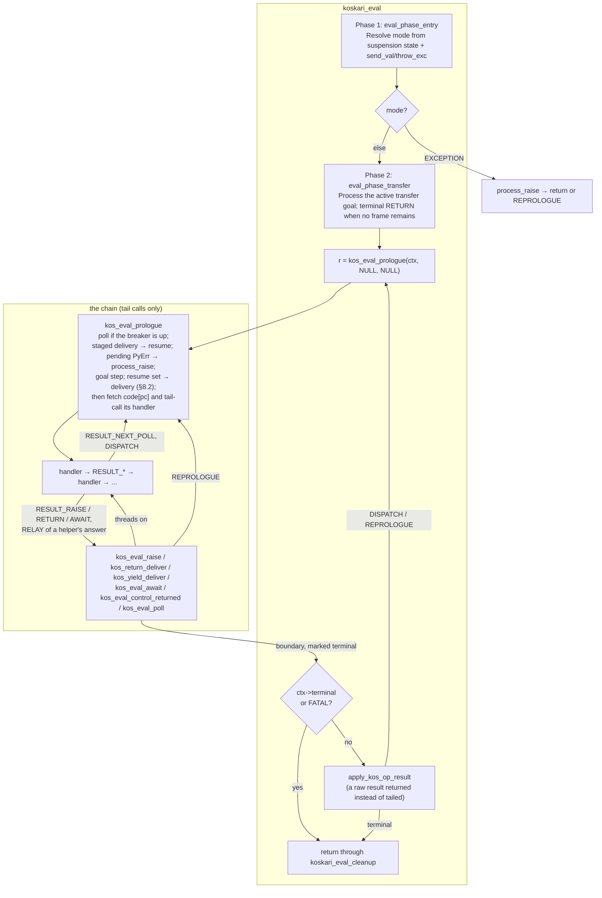

The chain returns to `koskari_eval` only with a boundary result: a raise walked to no handler, a recorded AWAIT or YIELD suspension, a root return, or FATAL, each marked on `KosContext.terminal` by the event that made it one. A result that comes back unmarked was returned raw by a producer that did not tail into its event; the loop applies it through `apply_kos_op_result` as the loop-bodied evaluator did and calls the prologue again. The trace build's trampoline-step counter counts those applications.

### 1.3 Design goals: orchestration, reactions, and local opcodes

Koskari aims for an evaluator that is easy to picture as a **pipeline of
boxes**: clear event boundaries, generic chain behavior where it helps, and
room to add new control (for example a new stop reason or a hypothetical
debug interrupt) by **extending the same pattern** instead of threading special
cases through every opcode.

A useful summary of that intent:

| Layer | Owns |
| ----- | ---- |
| **Eval** (`eval.c`) | **Orchestration**: when to run post-opcode handling, how `KosOpResult` and suspension line up, ordering between unwind/pop/freeze and consumer delivery, `process_raise` / exception routing, transfer-plan interaction with the loop. |
| **DynNodes** (`dynchain*.c`, kind helpers) | **Reactions**: what a particular node kind does when walked, unwound, or notified (e.g. `kos_dyn_settle_top` for WIND/WITH, NEXT/FOREACH/YIELD_FROM delivery primitives). |
| **Opcodes** (`opcode/*.c`) | **Local stack and unwind steps**: pop/push operands, run chain unwinds by calling the **`kos_dyn_unwind_*`** walks directly (they return **`KosOpResult`**), and end in a **`RESULT_*`** macro: the continuing forms tail-call the next handler, the others tail-call the event's thread function, and a helper's **`KosOpResult`** answer is relayed into the same tail calls. Opcode sources go through the **`KosContext_*`** live-register accessors and helpers declared in **`eval.h`**; they do not use the remaining **`KosContext_*`** field macros (Python bridge, inject, flags) directly. |

The goal is **compartmentalization**: new behavior should touch the layers it
actually needs (a new opcode, a new cap on a node, or a new branch in eval’s
post-opcode pipeline), without forcing unrelated code to “learn” a new case.

Every iteration delivery (a for-each step's element, a next request's,
a yield-from delegate's, their ends and their failures) reaches the
resume the consumer's live frame carries and nothing else: there is no
receiving node and no finder. The FOREACH region owns the loop's
iterator (`dynchain/dyn_iter_node.c` binds and finishes its request),
the next instruction's resume owns its iterator, and yield-from's
delegate is its resume's state. WIND/WITH keep
the deliberately separate `kos_dyn_settle_top` hook.

**Where we are not there yet (honest gaps):**

- **Large opcodes.** **YIELD_FROM** is a family of resume kinds over
  the delegate as the resume's state -- five `yf_drive_*` kinds, one per
  delegate kind, each naming its throw kind, an emit kind and two
  await kinds -- but the stepping logic still lives in the opcode
  fragment; the GEN passthru proposal that would have moved it
  ([archive/gen-yieldfrom-passthru.md](archive/gen-yieldfrom-passthru.md))
  is archived as superseded.

- **CPS entries still bounce on two paths.** A resume tail-calls the
  next step when a value is in hand or a callee is installed (§8.2),
  but a value that still needs settling and a stepped source's cold
  start stage for the prologue and cost one prologue pass.

- **Result-kind inspection in dynchain.** The WITH, WIND, and walk code
  still branches on a helper's `KosOpResult` and returns it for the
  handler's relay to route; those transitions are one relay each,
  bounded and rare, and are left for a later tuning pass.

- **AWAIT** is intentionally **not** folded into the same control-reemit
  staging as RETURN/YIELD parent delivery; that keeps semantics stable but
  means “one pipeline for every suspend kind” is not a literal single path.

- **Exceptions** are centralized in `process_raise` (the unified RAISE
  ingress; see §4.1): post-opcode `PyErr`, prologue pending exceptions,
  revive-throw, and transfer-plan step failures all converge on it. The
  **try/finally**, **WITH**, and unwind reactions it triggers still live in
  dynchain per node kind, which is the intended split.

These gaps are useful to track: they mark where future refactors should push
**policy toward eval** and **reactions toward dynchain**, without pretending
the codebase is already uniform end-to-end.

### 1.4 KosContext_* API (eval-facing glue)

Eval and opcodes share the running **`KosContext *ctx`**; the eval-facing operations on it are named **`KosContext_*`**. Notable entry points:

- **`kos_dyn_unwind_*` walks** -- the eval loop calls the dynamic-chain unwind walks directly (no dispatcher): **`kos_dyn_unwind_return`** (RETURN), **`kos_dyn_unwind_to_node`** (targeted unwind), **`kos_dyn_unwind_to_loop`** (BREAK/CONTINUE), and **`kos_dyn_unwind_raise`** (local raise). All return **`KosOpResult`**. Declared in **`dynchain.h`**, implemented in **`dynchain/dyn_walk.c`**. A yield is not an unwind: **`kos_dyn_find_gen`** locates the running frame's GEN and **`kos_dyn_gen_freeze`** detaches the span above it with its open extents intact (§4.5).
- **Transfer goals** -- **`kos_xfer_goal_push`**, **`kos_xfer_goal_abandon_all`**, **`kos_xfer_goal_drive`**, **`kos_xfer_goal_waits_on`** (`xfer_goal.h`); the active goal is **`KosContext_GOAL(ctx)`**.
- **Settling a pending extent** -- **`kos_dyn_settle_top`** (a returning thunk, `__enter__`, or `__exit__` settles the WIND or WITH at dyn_top and unlinks it after a leave) and **`KosEval_ResumeReturn`** (resumes a return the unlink handed back).
- **Opcode-visible flags** -- **`KosContext_MarkSuspendedNotRunning`**, **`MarkDeadAfterYield`**, **`MarkDeadAfterReturn`**.
- **Globals / throw / iteration** -- **`KosContext_GlobalsNamespace`**, **`KosContext_ThrowIntoResume`** (a throw into a frame whose resume kind names a throw kind: that kind is set on the frame and the exception staged as its delivery), **`kos_iter_fetch(ctx, req, &out)`** (the next element of a bound iterator by its kind: `tp_iternext`, the provider suite, or the eager `__anext__` step), **`KosContext_EagerStepAwaitable`** (first eager **`__await__`/`send(None)`** step for awaitables; used from AWAIT plumbing and **`YIELD_FROM`**).
- **`eval.c`** (suspension / Python bridge) -- **`KosContext_SetSuspensionEvent`**, **`KosContext_ClearSuspensionEvent`**, **`KosContext_SuspensionEvent`**; **`KosContext_PythonAwaitSetIter` / `PythonAwaitClearIter` / `PythonAwaitIter`**; **`KosContext_PythonResumeSet` / `PythonResumeTake`**.

### 1.5 Live registers on `KosContext` (`frame`, `block`, `namespace`)

These fields hold the live frame, operand-segment slot, and namespace for opcode hot paths. Each fact is answered by per-node state rather than a chain walk: the top node's segment (region kinds always own one), the top node's `ns` (the namespace owned fill), and -- on frame pops -- the popped frame's `back_frame` unwind cache.

| Mechanism | Role |
| --------- | ---- |
| **`kos_dyn_resync_after_push(ctx, new_node)`** | O(1) update after a single-node push: frame nodes replace all live fields; other nodes update only what they carry. Stamps the pushed node's unwind caches (segment `back` = displaced owning slot; frames also record `back_frame` = displaced frame). |
| **`kos_dyn_resync_after_pop(ctx, removed, new_top)`** | O(1) update after `kos_dyn_commit_dyn_top` pops a single head: block from the removed segment's `back` (or the surviving owner), namespace read from the survivor's `ns`, frame from `back_frame`. Under **`KOS_EVAL_SAFETYNET=1`** a counted chain-walk fallback backs every cache; default builds trust the cache model and fail fast on violation. |
| **`kos_dyn_resync_chain(ctx)`** | Full walk from **`dyn_top`** when incremental retarget does not apply (xfer INSTALL/PUSH, splices, gen freeze and install, `koskari_eval` entry). Finishes by **restamping** the contiguous unstamped prefix at the top of the chain -- a spliced span arrives with cleared caches, a frozen GEN span with only its bottom frame's rewritten -- so subsequent pops stay O(1). |

Optional **`KOS_DEBUG_PATCH_DYN_CACHES`**: cross-check every cache answer (push retarget vs full rebuild; pop-side caches vs the walk) and raise on drift.

The coroutine step outside the bytecode loop (**`coro.c`**, `coroutine_step`) holds hold a **`KosContext *`** on the **`KosCoroutine`** object and call the same Python-bridge helpers as **`revive_await`** on it.

### 1.6 GIL cooperation and signal polling

Long-running Koskari code must yield the GIL when CPython has asked this
thread to drop it, and must honor pending signals (for example **Ctrl-C**
/ **KeyboardInterrupt**). The evaluator does what CPython's own loop
does: it tests the interpreter's **eval breaker**, the word CPython sets
when another thread wants the GIL or a signal is pending, and it tests it
at the same kinds of places, the points that close a cycle. A threaded
chain never returns between instructions, so the breaker's address lives
on **`KosContext`** where every step can reach it.

| Mechanism | Role |
| --------- | ---- |
| **`KosContext.breaker`** | The address of this thread's eval breaker, set at each eval by **`KosContext_EvalEnter`** from the thread state (located by **`koskari_eval_breaker_locate_tstate`**, `compat.h`). The address is stable for an eval: the thread and the interpreter cannot change under it. |
| **`KOS_EVAL_BREAKER_UP(ctx)`** | One load and one branch: `(*breaker & KOS_BREAKER_MASK) != 0`. The test every cooperation point makes. |
| **`kos_eval_poll(ctx, insn, val)`** | The breaker service, a thread function: yields the GIL when a drop is requested, runs the pending calls, then threads on at `ctx->pc`, or tails into the prologue when the poll raised a signal. `kos_eval_poll_now` is the same poll as a plain call, for the prologue's own passes. |
| **`RESULT_NEXT_POLL(ctx)`** | The cooperation point for an opcode: thread on to `ctx->pc`, unless the breaker is up, in which case tail into **`kos_eval_poll`**, which threads from the same pc. |
| **`kos_call_installed(ctx)`** | The cooperation point for a frame install in the call core: **`EVAL_NORMAL`**, or **`EVAL_POLL`** when the breaker is up, which the handler's `RESULT_RELAY` turns into the tail call into `kos_eval_poll` before the callee's first instruction. |
| **`RESUME_HOP`** | The cooperation point between CPS resumes (§8.2): stages the delivery through `DISPATCH` when the breaker is up, which tails into the prologue, whose head polls before it delivers. |
| **`koskari_gil_drop_requested()`** | Whether the breaker's GIL-drop request is set (`compat.h`); **0** on free-threaded builds. |
| **`Py_BEGIN_ALLOW_THREADS` / `Py_END_ALLOW_THREADS`** | Paired release in the poll when a drop is requested. No interval check: CPython sets the request only after its own switch interval has elapsed for a waiting thread, so a request found up is exactly when CPython's loop would yield. |
| **`Py_MakePendingCalls()`** | Runs on every poll, after the GIL block: the public entry that runs the interpreter's own signal handling, which is what clears the breaker's signal input (`PyErr_CheckSignals` alone leaves it up). On 3.12+ the poll then calls `PyErr_CheckSignals()` when no error is pending, which is where a scheduled collection runs. |

**Cooperation points**

Any unbounded run of steps passes through one of these, so these are the
only places that test the breaker; `KOS_THREAD_NEXT` itself is a bare
fetch and tail call.

| Point | Where | Why it is enough |
| ----- | ----- | ---------------- |
| **`CONTINUE`** | `opcode/CONTINUE.c`, after the unwind resolves the target | The back-edge of every compiled loop: `while` and `for-each` bodies end in `CONTINUE 1`; conditionals and exception forms emit forward jumps only. `BREAK` leaves the loop and needs nothing. |
| **`MATCH_APPEND`** | `opcode/MATCH_APPEND.c` | A matcher REPEAT's back-edge is a plain `JUMP` to the pass head, and every pass that goes on appends its value with `MATCH_APPEND` just before it, once per pass. |
| **Frame install** | The install arms of the call core (`kos_call_invoke_impl`, `kos_call_invoke_self_steal`, §7.6) | Covers every CALL and TAIL_CALL opcode from one place; a tail-recursive loop has no `CONTINUE`. Python callables are not checked: Python polls inside its own frames and a C call cannot be interrupted. |
| **Resume hop** | `RESUME_HOP` in `eval.h` | A filter rejecting every element, or a map over an infinite source, runs resume to resume with no instruction between. |
| **Prologue entry** | The head of `kos_eval_prologue`, and each further pass of its loop | Plan transfers, continuation replays, raise walks, staged deliveries, and a resume hop that found the breaker up all tail into the prologue; it polls before the pass delivers, so a staged delivery never runs ahead of a pending signal, and a pass that goes round again polls in place, so a chain of resume hops inside one entry cannot spin without polling. |

A straight line with no cooperation point in it runs to its end, and the
signal is taken at the next point after it.

**The breaker and CPython layout**

The word is interpreter-private, replicated per version in the compat
headers; the evaluator never sees a layout.

| CPython | Shape (`compat_3*.h`) | Mask |
| ------- | --------------------- | ---- |
| **3.13+** | `KOS_BREAKER_WORD(tstate)`: a bit set on the thread state (`pycore_ceval.h`) | GIL drop request (bit 0), signals pending (bit 1) and GC scheduled (bit 4). The other bits (pending calls, async exception, stop requests) only Python's loop can service and are masked out, so a Koskari loop does not poll on every point for as long as one of them stays up. |
| **3.9–3.12** | `KOS_CEVAL_STATE(interp)`: the interpreter's ceval state, whose `eval_breaker` is one aggregate int with `gil_drop_request` beside it | Tested whole. |
| **`Py_GIL_DISABLED`** | The 3.13+ shape; the GIL bit is never set | Signals still work. |
| **Unmapped version** | `koskari_breaker_always`, a word that always reads up | Every cooperation point polls and every poll yields the GIL: correct, and slow only until the layout is mapped. |

**Poll-site sequence** (`kos_eval_poll` in `eval.c`):

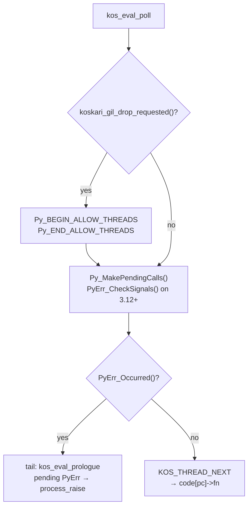

A signal raised at the poll is taken by the prologue's pending-exception
step, which drops any staged delivery before the raise walk (§2.3). Tests
in `tests/reproducers/test_signal_poll.py` arm SIGINT from inside running
Koskari code and catch it there across a counting loop, deep recursion,
two native filters looping resume to resume, and a straight line followed
by a loop.

---

## 2. Phase Detail Diagrams

### 2.1 Phase 1: Entry and Revive

**eval_phase_entry** chooses the initial `KosEvalMode` (`NORMAL` or `EXCEPTION`; there is no transfer mode, an active goal is processed by Phase 2 whatever the mode):

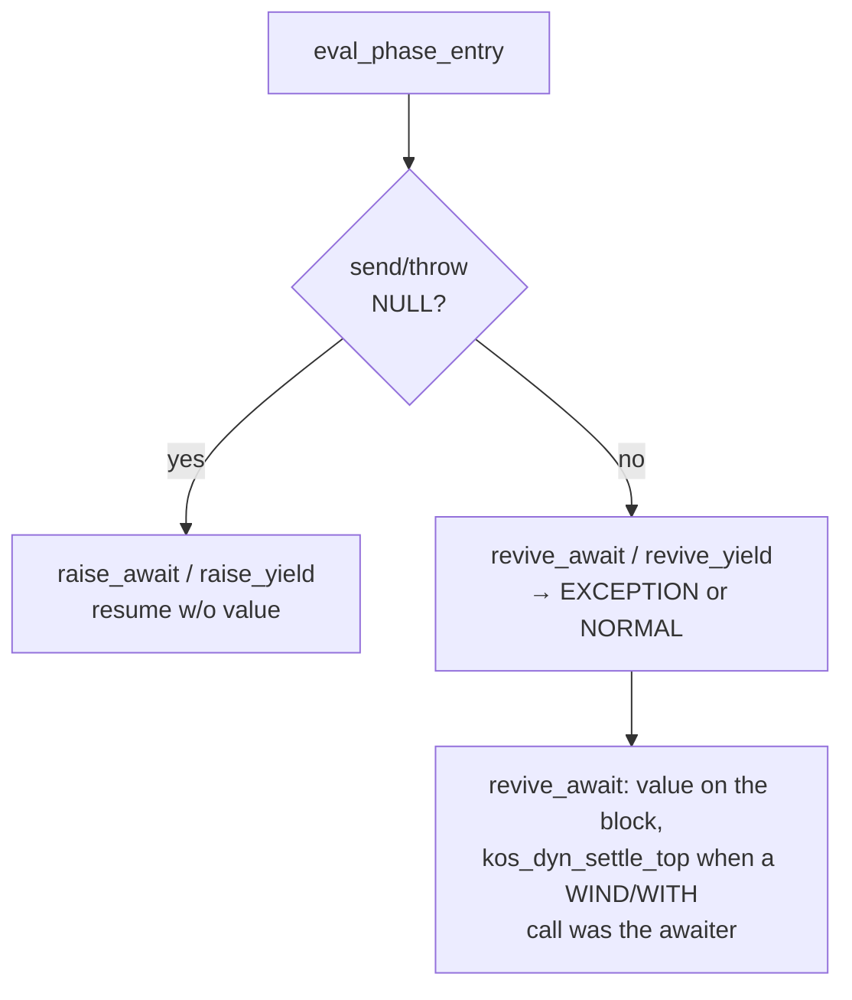

**Revive paths:**
- **Settle at revive**: when the awaited call belonged to a WIND thunk or a WITH `__enter__`/`__exit__`, `revive_await` leaves the value on the block and calls **`kos_dyn_settle_top`**; a settled leave unlinks the node, and a return the node was holding comes back as a `KOS_OB_RETURN` obligation that `eval_phase_entry` resumes through **`KosEval_ResumeReturn`** once the mode is chosen.
- **revive_await / revive_yield**: If `throw_exc` and `revive_yield`: a frame waiting on a resume whose kind names a throw kind takes the exception as that throw kind's delivery (`KosContext_ThrowIntoResume`, `KOS_MODE_NORMAL`); otherwise, and always for GeneratorExit, `PyErr_SetObject`, `KOS_MODE_EXCEPTION`. If `throw_exc` and `revive_await` with **`KosContext_PythonAwaitIter(ctx)`** set → `iterator.throw(typ, val, tb)` first (same idea as `coroutine_throw` when waiting on a Python await iterator): on `StopIteration`, the await completes and the normal inject/send path runs; on non-NULL `throw` result, `revive_await` returns `EVAL_AWAIT(val)` and `eval_phase_entry` re-suspends; if there is no iterator, or `throw` leaves another error, `KOS_MODE_EXCEPTION`. If no `throw_exc`, `revive_await` consumes **`KosContext_PythonResumeTake`** (or **`send_val`**) and pushes it onto the stack when non-NULL, or stages it in the pending slot when the frame is waiting on a resume, then returns `EVAL_NORMAL()`. `revive_yield` does the same for a sent value: a frame waiting on a resume took no install placeholder and takes the value through the slot. YIELD_FROM uses these same revive paths (the resume set on it is the send or the await one); there is no separate `revive_yield_from` or `KOS_SUSP_YIELD_FROM`.
  - From the caller's perspective, both plain `YIELD` and `YIELD_FROM` suspensions surface as the same receiver kinds (`KOS_RES_YIELD` or `KOS_RES_AWAIT`), so resume routing is identical.

**Mode dispatch outcomes:**
- `EVAL_AWAIT` re-suspend (after `throw` into the stored Python await iterator yielded again) → **`KosContext_SetSuspensionEvent(ctx, KOS_SUSP_AWAIT)`**, **`KosContext_MarkSuspendedNotRunning(ctx)`**, return `EVAL_AWAIT(val)`.
- `KOS_MODE_EXCEPTION` → `process_raise` (unified RAISE ingress: continuation-apply interception, nest abandon, `try_local`); on REPROLOGUE, or RESUME for the live frame's resume, → continue in NORMAL mode; otherwise return the terminal result (`EVAL_AWAIT`, `EVAL_RAISE`, or `EVAL_FATAL`).

### 2.2 Phase 2: Transfer Goal Processing

**eval_phase_transfer** runs **`kos_eval_drain_goal`** (`eval/eval_chain.c`), which processes the active goal through **`kos_xfer_goal_drive`** and routes its answer. The same step runs at every prologue re-entry (**`eval_step_drain_goal`**, §8.2), so a goal waiting on a thunk resumes as soon as that thunk's frame is gone.

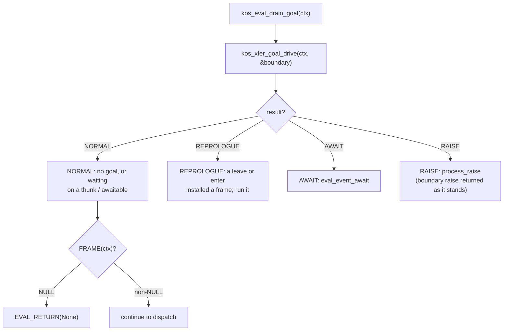

A goal records where control is going and never what to do: the goal step re-derives its next action from the live chain on every pass (§6). A leave or enter that hands control to a thunk frame or an awaitable leaves the goal waiting on that node with `dyn_top` as it was; the goal step does nothing until `dyn_top` is that node again, which means the thunk's frame came and went. Goals nest: a continuation invoked from inside a thunk pushes an inner goal while the outer keeps waiting, and the goal step retires into the outer when the inner delivers. An undelimited landing frees every outer goal, since it replaced the chain they were moving.

**Failed transfer:** a step that raises enters **`process_raise`** (the unified RAISE ingress), which frees the whole goal stack (`kos_xfer_goal_abandon_all`) and runs **`kos_dyn_unwind_raise`** on the chain as the goal step left it; there is no rollback to the invoke site. `EVAL_REPROLOGUE` continues when a handler applies, `EVAL_AWAIT` when the unwind suspended (tagged for the caller of `koskari_eval`), `EVAL_RAISE` / `EVAL_FATAL` otherwise. The walk answers `EVAL_RESUME(NULL)` when the live frame has a resume set, at entry and after every pop that reveals one, which is how a failed delivery reaches its consumer (§8.2). The one non-ingress carve-out is a foreign cc-unwind's boundary raise, which `kos_xfer_goal_drive` reports through `out_boundary` and the drain returns as it stands (§4.1).

### 2.3 Phase 3: Pending Exception Check

On each pass of the **prologue** (`kos_eval_prologue`), after the
staged-delivery bounce (§8.2), a pending exception is first offered to
the live frame's resume: a frame with one set, bytecode or code-less,
and no goal in play, takes the exception as a NULL delivery through
`eval_step_resume_delivery` (§8.2). Only past that does
**eval_phase_pending_exception** handle `PyErr_Occurred()` (opcode
failure, continuation apply, async exception, etc.), dropping any
staged delivery first, since the frame it was staged for may be popped
or replaced. The same helper is what takes a pending interrupt after
**`Py_MakePendingCalls()`** in a poll (see §1.6).

The offer sits ahead of the pending-exception phase because that phase
runs `process_raise`, which would unwind past the frame whose consumer
is waiting for the failure. A goal in play is routed past the offer
and through the phase below, whose `process_raise` abandons the goal
stack and whose walk then answers RESUME, relayed to the resume with
no goal active, so a transfer reaches abandon first and the resume
still takes the failure.

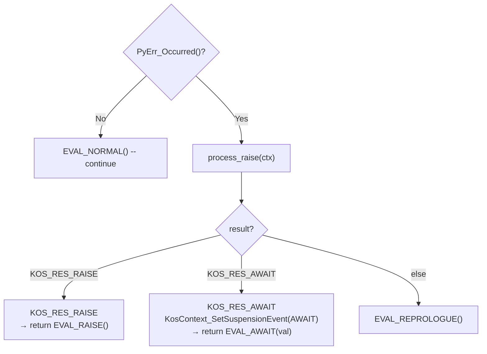

### 2.4 Phase 4: Prepare next instruction

Each instruction is a **`KosOp`**, `{ KosThreadFn fn; uint16_t op, arg,
cache, pc; union { PyObject *obj; KosOp *target; KosExtra *row; } u;
KosCacheSlot *slot; }` (32 bytes on LP64, two to a cache line): the
handler that executes it beside its decoded fields, its resolved operand,
and its cache slot. `fn` is resolved from **`kos_op_handlers[]`** (the table `eval.c`
emits from `opcodes.incl`) at finalize in the block's writable window,
and, like the cache index, is regenerated on every load and never
serialized; soften emits only `(op, arg)`.

**`KOS_EVAL_PREPARE_NEXT_INSN`** (macro in `eval.c`) sets a local **`KosOp *insn`** to `&KosCode_CODE(code)[pc]`, sets `acting_pc`, and pre-advances `pc`. It assumes a valid frame, in-range `pc`, and valid bytecode; every code object ends in a `THEEND` barrier, so no per-instruction bounds check is needed (the `ctx->code` null check is a `KOS_EVAL_SAFETYNET` guard). The prologue runs it once to enter a chain. Inside a chain a handler threads through **`KOS_THREAD_AT(ctx, next)`** (`eval.h`), a bare tail call of the record's `fn`; the live `acting_pc` and `pc` are set by the handler itself, through **`KOS_SYNC_PC(ctx, insn)`** at its head, from its own record's `pc` field (the sync rule, below). A straight-line tail steps to `insn + 1`, its own record plus one, with no walk through `ctx->code`; a jump goes through the record's resolved `target`; a tail after a frame change or a stored pc fetches from `ctx->pc` through `ctx->code` (**`KOS_THREAD_NEXT`**). The instruction base is not cached on a frame: a frame off the chain (a defer, a generator, a function's cached frame) holds the code object and an integer pc, and fetches through the code object on resume ([interpreter/execution-invariants.md](interpreter/execution-invariants.md) §20).

Opcode handlers have the **`KosThreadFn`** prototype: `op_NAME(KosContext *ctx, void *insn, PyObject *value)`, declared through **`KOS_OP_HANDLER`**; `insn` is the handler's own instruction (read through `KosOp_ARG` / `KosOp_SLOT`) and `value` is unused by an opcode. **`ctx`** carries the live **`frame`**, **`code`**, operand-stack **`block`**, and **`pc`** / **`acting_pc`** registers, kept aligned with the chain via **`kos_dyn_resync_after_push`** / **`kos_dyn_commit_dyn_top`** / **`kos_dyn_resync_chain`** as summarized in section 1.5 above.

PC is rolled back for WITH enter/exit suspend so the same instruction is retried on resume.

#### 2.4.1 Provider stepping (NEXT / ITER_NEXT / YIELD_FROM)

A **KosIter provider** (a type whose `kos_iter` suite carries `ki_step`;
`evaluated.h`) is stepped **inside** the same **`koskari_eval`**
invocation -- no intermediary coroutine objects. Every step chooses
among the three iterator protocols: a KosIter provider goes through
its `ki_step` slot, which may install frames on the chain; a plain
sync iterator goes through `tp_iternext`; a python async iterator has
its `__anext__` coroutine created and immediately advanced one send,
so a coroutine that finishes without suspending completes right here.
Three sites step:

- `ITER_NEXT` and its fused twins step the innermost FOREACH region's
  **`KosIterRequest`** (`{iter, islots, kind}`, embedded only in the
  FOREACH node arm; the kind is bound once, at
  `kos_dyn_iter_request_bind_iter`, by **`kos_iter_kind`**) through
  **`KOS_ITER_STEP`**, the threaded step the handler expands: the
  fetch, then each outcome threaded to its destination, an element in
  hand finished and delivered by the handler itself, the end in hand
  finishing the request and threading to the else target, a deferred
  element reaching the step resume set on the loop's frame.
- The next instructions (`OBJECT_NEXT`, `VAR_NEXT`, `FAST_NEXT`) call
  **`KosContext_NextResume(ctx, iter, kind, iter)`**: the resume set
  on the frame owns the iterator as its state, the arity picks the
  kind, and a default stays on the operand stack under the halt. The
  entry classifies the iterator into a stack record and continues as
  **`KosContext_NextResumeBound(ctx, req, kind, state)`**, the form a
  site with a bound kind calls directly.
- `YIELD_FROM` steps its delegate from its `yf_drive_*` kind, the delegate
  being the resume's state (§8.2).

Every fetch is **`kos_iter_fetch(ctx, req, &out)`**, keyed by
`req->kind`; a site without a record classifies with `kos_iter_kind`
on the way in. Its status:

- **DELIVERED** / **EXHAUSTED** -- the element (or the end of the
  iteration) is in hand and the opcode completes immediately.
- **CONTINUES** -- the provider put runnable work on the chain: a
  generator's `ki_step` re-attached its suspended frames via
  `kos_dyn_gen_install`, a resume-carrying step frame (§8.2) was
  pushed, or an invoke was grafted whose return is itself the next
  element. The consumer's frame carries the resume that will take the
  outcome. After CONTINUES the opcode continues: if the now-current
  frame has bytecode and is not waiting on a resume
  (`kos_frame_threads`), the chain threads into it directly; a
  bytecode frame whose yield-from delegation is in flight is handed to
  that resume by tail call (`kos_iter_installed`), and a code-less
  resume frame re-enters the prologue, whose delivery step runs its
  resume.
- **EXIT** -- a python async step suspended: the opcode returns
  `EVAL_AWAIT` with the suspended awaitable's payload, and when the
  awaited value arrives at revive it IS the element, staged for the
  consumer frame's resume.

The **same** running **`ctx`** passed into the opcode is forwarded through
`Next` into `ki_step`, so a generator install refreshes the running
context's live registers. Python callers (the adapters in `iterate.c`)
run `KosContext_EvalEnter` on the adapter's context, enter the same
`ki_step` with it, and run `KosContext_EvalExit` after.

Every later delivery back to the waiting opcode reaches the resume
its frame carries (§2.6), whether the value arrived as a generator's
yield, a generator's return (end of iteration), the return of a
grafted invoke, or an awaited result at revive. The resume finishes
the provider's step: the for-each step resume finishes the region's
request, the next resume finishes the iterator it owns, yield-from's
emit kind finishes its delegate.

### 2.5 Phase 5: Opcode Dispatch

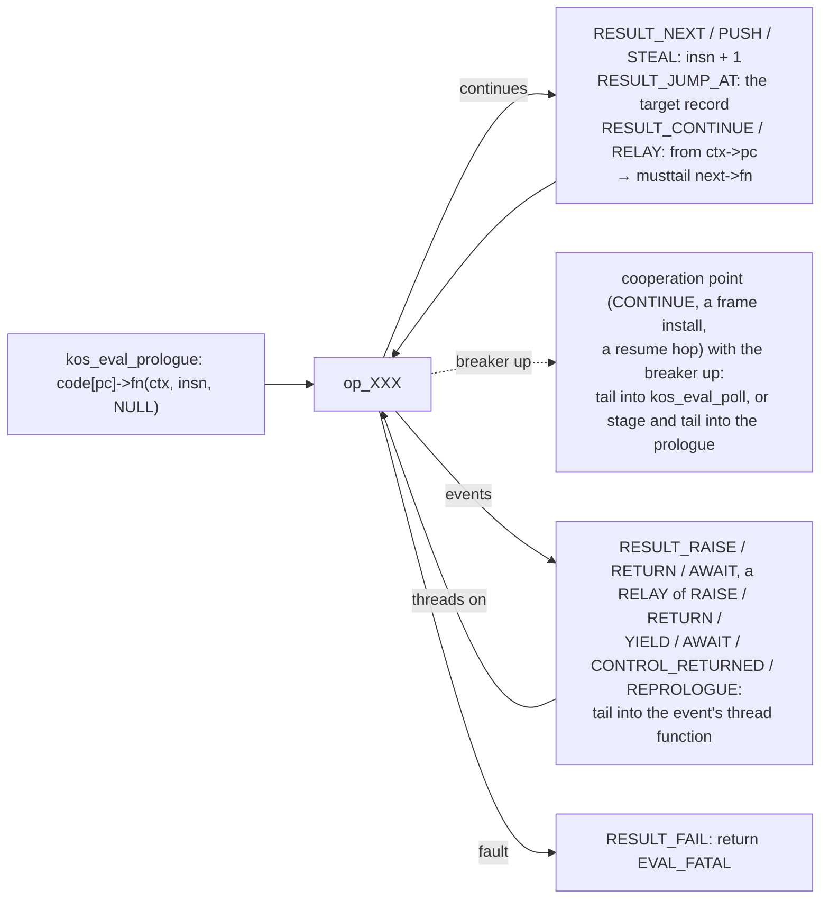

A handler ends in one of the **`RESULT_*`** macros (`eval.h`):

| Macro | Does |
|-------|------|
| `RESULT_NEXT(ctx)` | Continue at `insn + 1`, the handler's own record plus one: `KOS_THREAD_AT`. For a handler that left the frame and the pc alone. |
| `RESULT_CONTINUE(ctx)` | Continue at `ctx->pc` through `ctx->code`: `KOS_THREAD_NEXT`. For a tail after a callee install, a return to a parent, or a stored pc. |
| `RESULT_JUMP_AT(ctx, target)` | Continue at a resolved target record (`KosOp_TARGET`, or a row's `KosExtra_TARGET`). |
| `RESULT_PUSH(ctx, val)` | Push a borrowed value, then continue; a failed push leaves the value with the caller. |
| `RESULT_STEAL(ctx, val)` | Push an owned value (consumed on failure too; NULL raises), then continue. |
| `RESULT_RELAY(ctx, r)` | End with a helper's result: NORMAL and DISPATCH continue at `ctx->pc` (a callee's first instruction after an install, the next instruction after a push); POLL tails into `kos_eval_poll`; RAISE, AWAIT, RETURN, YIELD and CONTROL_RETURNED tail into their event's thread function; REPROLOGUE tails into the prologue; FATAL returns. Used by the call handlers, the NEXT handlers, AWAIT, and the delimited-return sites. |
| `RESULT_RAISE()` | Tail into `kos_eval_raise`, the raise walk; `PyErr` is set. For a handler that synced at its head. |
| `RESULT_RAISE_AT(ctx, insn)` | `KOS_SYNC_PC` from the handler's record, then the same tail. For a handler that did not sync; `RESULT_PUSH` and `RESULT_STEAL` raise this way. |
| `RESULT_RETURN(ctx, val)` / `RESULT_AWAIT(ctx, val)` | Tail into `kos_return_deliver` / `kos_eval_await` with the owned value. |
| `RESULT_FAIL()` | Return `EVAL_FATAL`: the one crossing back to `koskari_eval` a handler makes itself. |

**`KOS_THREAD_AT`** and **`KOS_THREAD_NEXT`** are bare fetches and tail
calls. The macros read the handler's own record through the name `insn`,
which `KOS_OP_HANDLER` and `KOS_ELECTOR` declare.

**The sync rule.** The dispatch tail stores nothing: `ctx->acting_pc`
and `ctx->pc` are set by the handler, with `KOS_SYNC_PC(ctx, insn)` as
its first statement, and are stale while a handler that skips it runs.
The fields are read by a frame install or return, a yield or await, an
extent push or pop that records a resume pc, a continuation capture or
transfer, the breaker poll, the raise walk, the frame flush
(`KosContext_FlushLiveRegsToFrame`) and the end-of-code bounds
reporter. A handler that can reach any of those while it runs syncs at
its head. A handler that hands `ctx` to nothing but a stack push, pop,
drop or duplicate, or a namespace slot read or store, skips the sync,
and every raise it makes goes through `RESULT_RAISE_AT`, which syncs
first; a Python callback it runs that re-enters Koskari does so on its
own context and never reads this one's pc. As applied: the no-sync set
is FAST, CONST, FAST_STORE, POP, DUP, JUMP, JUMP_FALSE, JUMP_TRUE,
NOOP, LABEL, POSITION, MATCH_FITS, MATCH_LOAD, MATCH_MIN, the elector
dispatch handlers (a cache-slot read and a tail call into the elected
body), the matcher handlers that tail-call their body in
`eval_match.c`, and the elected int, float and comparison bodies in
`eval_electors.c`; every other handler, elector body and matcher body
syncs. The rule admits more: any handler whose helpers reach none
of the readers can be moved to the no-sync set once its raise sites,
including a helper result relayed through `RESULT_RELAY`, sync on the
error path. The cooperation
points (§1.6) are the handlers that close a cycle: `CONTINUE` ends in
**`RESULT_NEXT_POLL`**, which tails into **`kos_eval_poll`** instead of
threading when the eval breaker is up, and the poll threads again from
`ctx->pc`. Every continuing step is a musttail, so the C
stack stays constant across a chain of any length, and any `Py_DECREF` a
handler owes runs before its `RESULT_*` macro. The handler's own frame is
gone once the tail call happens.

### 2.6 Phase 6: the events

Each result kind has a centralized event helper, and a thread function
that wraps it and is reached by tail call from the chain: `kos_eval_raise`
(process_raise), `kos_yield_deliver` (eval_event_yield), `kos_eval_await`
(eval_event_await), `kos_return_deliver` (eval_event_return after its
own plain arms), `kos_eval_control_returned` (the hook). Each threads on
when the event leaves a plain frame current (DISPATCH), tails into the
prologue on REPROLOGUE, and returns a boundary otherwise, marking
`KosContext.terminal` where it becomes one. **`apply_kos_op_result`**
routes the same kinds to the same helpers, and is now only the fallback in
`koskari_eval` for a raw result (§1.2):

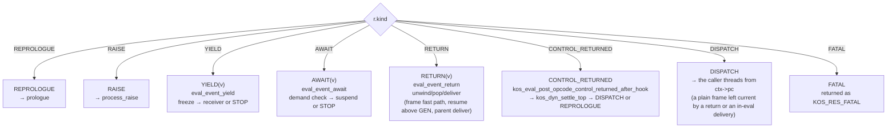

**`eval_event_yield`** takes the running frame's GEN (from
**`kos_dyn_find_gen`**) and freezes it through **`kos_dyn_gen_freeze`**.
Whether **`koskari_eval`** stops depends on flattened iterator delivery:
- If the live frame, once the freeze has detached the GEN, carries a
  resume (a for-each step, a next request, a yield-from waiting on its
  installed delegate), the payload is handed to it through
  **`iter_deliver_to_resume`**: a direct kind runs at once and the loop
  continues from what it returns. The for-each and next resumes finish
  the step and push or store the element; yield-from's emit kind
  re-emits it as the delegating generator's own yield. That is itself a
  fresh YIELD event -- walk and freeze the delegating **GEN**, then
  deliver to the next frame's resume. Each hop is one walk plus one
  delivery, so nested **for-each / yield-from / generator** stacks
  compose to arbitrary depth. Never a search outward: a frame waiting
  on its own step sits between the producer and any enclosing region.
- Otherwise (no resume waiting; the caller of `koskari_eval` consumes the generator)
  **`KosContext_SetSuspensionEvent(ctx, KOS_SUSP_YIELD)`** and return
  `EVAL_YIELD(val)`; the caller resumes via **`revive_yield(send_val)`**.

**`eval_event_await`** checks `kos_eval_in_demand(ctx)` first (see §7.5); on
denial, it raises a sync-violation exception. On normal suspension it calls
**`KosContext_MarkSuspendedNotRunning`** and returns `EVAL_AWAIT(val)`.

**Returns.** `op_RETURN` owns the four return shapes that need no walk
and threads them itself, so most returns never reach this section: a
**plain bytecode parent** (`kos_return_is_plain` → `eval_plain_return`:
inline retarget, push, then `KOS_THREAD_NEXT` into the parent's instruction at its
saved pc -- the bytecode frame's own resume); a **region** over such a
parent (`kos_return_is_region` → `eval_region_return`: any parent that is
not a frame or a GEN, beneath a frame with no resume waiting, retargeted from the same
cached facts; the value is pushed onto the region's segment, and a region that
carries `KOS_DYN_CAP_CONTROL_HOOK` (WITH, WIND) reacts through
`kos_dyn_settle_top` before `kos_eval_delivery_done`, the rest
dispatch directly); a region with no such hook over a **frame waiting
on a resume** (`kos_return_is_region_resume` →
`eval_region_resume_return`: a provider's step frame, or its in-hand
call of a Koskari function, under a for-each region; the step resume
is entered by tail call with the region at dyn_top); and a
**resume-carrying parent** (`kos_return_is_resume` →
`kos_return_take_resume`: pop the callee, take the resume pair off the
parent, `TAILCALL` the resume with the settled value, §8.2). Anything
else -- an extent above the returning frame, a generator parent, a
missing retarget cache, an unsettled value -- takes the general path
below inside `kos_return_deliver`; the
other producers of a RETURN (POP_PROMPT and POP_FINALLY through
`RESULT_RETURN`, the values.c and eval_call.c termini and a resume's
completion through `RESULT_RELAY`) tail into the same function.

**`eval_event_return`** handles such a frame return.  When try/with/wind nodes
sit above the frame, **`eval_event_return_unwind`** first runs
**`kos_dyn_unwind_return`** (or the delimited path); both converge on
**`eval_event_return_at_frame`**, which dispatches on the frame's parent:
- **Plain parent frame** (no resume set): `eval_plain_return` -- the same
  transition the opcode's fast arm uses; `EVAL_DISPATCH()` threads again.
- **GEN parent:** the gen chain is unwound
  (`kos_dyn_teardown_gen_exhausted`) and the consumer frame's resume
  takes the end through `iter_deliver_to_resume` with StopIteration
  carrying the return value; the resume's exhaustion tail runs
  (else-pc branch, default push, or StopIteration re-emit per site
  arity, and the step finished as exhausted). A GEN at the context
  root (an adapter runs it) returns `EVAL_RETURN(val)`; a GEN with a
  parent and no resume waiting is `EVAL_FATAL`.
- **Other parents** (WIND, TRY, WITH, a stepping FOREACH region whose
  grafted invoke is returning, a resume-carrying frame the fast arm
  declined): pop the callee frame, then
  **`eval_parent_return_deliver`** (stage the value in the pending slot
  when the parent frame carries a resume, or push it onto the parent
  stack, then `kos_dyn_settle_top`), then
  **`kos_eval_delivery_done`**: `EVAL_DISPATCH()` when a plain bytecode
  frame is current with nothing staged, else `EVAL_REPROLOGUE()`.
- **No parent:** root frame -- returns `EVAL_RETURN(val)`.

**CONTROL_RETURNED path** (`kos_eval_post_opcode_control_returned_after_hook`):
reached through `kos_eval_control_returned`: when the current node is a
WIND or WITH (its installed callee has popped), runs
`kos_dyn_settle_top`; a RAISE from it goes to `process_raise`, and a
return the unlink hands back resumes through `KosEval_ResumeReturn`. A
frame-topped chain has no hook work: a frame sitting on a
pending WITH is that WITH's `__enter__` or `__exit__` callee itself, and a
return into it from its own callees leaves the pending phase alone. Every
path ends in **`kos_eval_delivery_done`** (§3.2). All paths use
`KosOpResult` directly.

---

## 3. Opcode Signaling

Every handler, resume, and phase helper speaks **`KosOpResult
{KosOpResultKind kind; PyObject *val}`**, built with the `EVAL_*` macros in
`eval.h`. A handler that continues does not return at all: its `RESULT_*`
macro tail-calls the next handler (§2.5). A `KosOpResult` is a helper's
answer to the handler that called it, and the handler's `RESULT_RELAY`
turns each kind into the tail call that handles it; a `KosOpResult`
reaches `koskari_eval` only as a boundary, marked terminal on the
context by its event. An unmarked one is applied there by
`apply_kos_op_result` (§2.6).

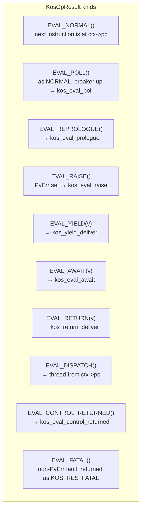

### 3.1 Opcode Handler Return Macros

| Macro | Kind | Meaning |
|-------|------|---------|
| `EVAL_NORMAL()` | `KOS_RES_NORMAL` | The next instruction is at `ctx->pc`; a helper returns it to a handler, whose `RESULT_RELAY` threads. |
| `EVAL_POLL()` | `KOS_RES_POLL` | As NORMAL, from a frame install that found the breaker up; the relay tails into `kos_eval_poll`. Loop-internal. |
| `EVAL_REPROLOGUE()` | `KOS_RES_REPROLOGUE` | Run the prologue before the next instruction (staged delivery, transfer goal, a code-less frame now current); every thread function tails into `kos_eval_prologue` on it. |
| `EVAL_RAISE()` | `KOS_RES_RAISE` | **`PyErr`** set; `kos_eval_raise` runs **`process_raise`**. A walk that finds no handler marks the result terminal. |
| `EVAL_YIELD(v)` | `KOS_RES_YIELD` | Generator yield with payload `v`; `kos_yield_deliver` runs **`eval_event_yield`**. A recorded suspension is terminal. |
| `EVAL_AWAIT(v)` | `KOS_RES_AWAIT` | Suspend on awaitable `v`; `kos_eval_await` runs **`eval_event_await`** (demand check first). A recorded suspension is terminal. |
| `EVAL_RETURN(v)` | `KOS_RES_RETURN` | Frame return with value `v`; `kos_return_deliver` threads its plain arms and otherwise runs **`eval_event_return`** (unwind / pop / deliver: parent frame, the consumer's resume above a GEN, or the caller). A root return is terminal. |
| `EVAL_DISPATCH()` | `KOS_RES_DISPATCH` | Live regs already retargeted, nothing pending; the caller threads from `ctx->pc`. Loop-internal. |
| `EVAL_CONTROL_RETURNED()` | `KOS_RES_CONTROL_RETURNED` | WIND/WITH thunk or a plain-Python tail call complete; `kos_eval_control_returned` runs **`kos_eval_post_opcode_control_returned_after_hook`**. |
| `EVAL_FATAL()` | `KOS_RES_FATAL` | Non-`PyErr` internal fault; `koskari_eval` returns `KOS_RES_FATAL` immediately. |

The threaded transfer macros sit beside these: **`TAILCALL(fn, ctx, arg,
value)`** hands control to a `KosThreadFn` as the caller's last act;
**`DISPATCH(fn, ctx, arg, value)`** stages a delivery for a resume from a
function that cannot tail-call (§8.2); **`RESULT_ENTRY(ctx, r, resume,
state)`** ends a resume with a CPS entry's outcome (§8.2).

### 3.2 What Opcodes Signal and When

- **Continuing** (`RESULT_NEXT` / `PUSH` / `STEAL` / `JUMP_AT` / `JUMP` / `CONTINUE` / `RELAY`): the next handler runs by tail call. Used by almost all opcodes on the success path, and by the call handlers after an install (the callee's first instruction is at `ctx->pc`, so those end in `RELAY` or `CONTINUE`).
- **`EVAL_REPROLOGUE()`**: Used after pushing a transfer goal or leaving a code-less frame current, so the prologue can drain or deliver before the next instruction.
- **`EVAL_YIELD(v)` / `EVAL_AWAIT(v)`**: Emitted from YIELD, YIELD_FROM, AWAIT, and auto-await after CALL. A yield that is **in-loop** (non-GEN parent delivers directly without a boundary visible to the caller) continues instead.
- **`EVAL_RETURN(v)`**: RETURN threads its own plain, extent, and resume-parent shapes (§2.6); it signals only when a walk or another parent kind is involved, and `eval_event_return` then owns unwind, frame pop, and delivery.
- **`EVAL_CONTROL_RETURNED()`**: a plain-Python tail call's completion needing `kos_dyn_settle_top`.
- **`EVAL_DISPATCH()`**: loop-internal. **`kos_eval_delivery_done`** produces it when an in-eval delivery (a control-returned hook, a flattened generator's yield, a plain return) leaves a plain bytecode frame current with nothing staged, no error, and no goal active; the thread function that ran the event threads from `ctx->pc` directly. Anything else yields `EVAL_REPROLOGUE()`, and the thread function tails into the prologue to deliver.
- **`EVAL_RAISE()`** (`RESULT_RAISE`): Any error path with `PyErr` set; a handler tails into `kos_eval_raise`, a helper returns it for the relay to do the same.

### 3.3 Boundary Events and Parent Frame

**Caller-visible** **`koskari_eval`** boundaries are returned as `KosOpResult`
kinds `KOS_RES_RETURN`, `KOS_RES_RAISE`, `KOS_RES_YIELD`, and `KOS_RES_AWAIT`.
Internal post tags (`KOS_RES_CONTROL_RETURNED`, and the loop-internal
`KOS_RES_REPROLOGUE` / `KOS_RES_DISPATCH`) are not surfaced to the caller;
they route to internal helpers and back into the loop.

Typical **surface** boundaries:

- **RETURN** → `KOS_RES_RETURN` when evaluation completes (**top-level**, or a
  **GEN** with no receiver above it).
- **RAISE** → `KOS_RES_RAISE`; `PyErr` is authoritative.
- **YIELD** → `KOS_RES_YIELD` when the generator node applies (parent is GEN
  or no parent for the yield), or YIELD_FROM emits yield.
- **AWAIT** → `KOS_RES_AWAIT`

When the frame **has a parent** (normal nested CALL return): the RETURN opcode
threads straight into a plain parent, an extent over one, or a resume-carrying
parent (§2.6); otherwise it signals **`EVAL_RETURN(val)`** and
**`eval_event_return`** pops the frame and delivers -- the consumer
frame's resume above a GEN via **`iter_deliver_to_resume`**, or
**`eval_parent_return_deliver`** for other parents (stage in the pending slot for a resume-carrying parent, or push onto
the caller's stack, then **`kos_dyn_settle_top`**, then
**`kos_eval_delivery_done`**). The caller does **not** get a
`KOS_RES_RETURN` for that step; the evaluator keeps running in the caller.

A **delimited** return (a slice spliced by a delimited invoke reaching its
`POP_PROMPT`) hands the DELIM bookmark back through
`kos_dyn_unwind_return`'s `took` out-parameter and delivers the value at the
invoke site (§6.4); no goal is involved.

---

## 4. Exception Handling

### 4.1 Exception Flow

**`process_raise`** is the unified RAISE ingress: all PyErr /
`KOS_RES_RAISE` ingress converges on it -- post-opcode results
(`apply_kos_op_result`), prologue and signal-poll pending PyErr
(`eval_phase_pending_exception`), revive-throw (`eval_phase_entry`
`KOS_MODE_EXCEPTION`), and transfer goal step failures
(`kos_eval_drain_goal`). Its ordering contract (documented on
the function): guard → single continuation-signal test → nest abandon
(non-signal only) → `handle_continuation_apply` →
`kos_dyn_unwind_raise` → outcome map (REPROLOGUE / RESUME into the
live frame's resume / AWAIT with suspension tagging / RAISE / FATAL). One deliberate non-ingress carve-out lives in `kos_eval_drain_goal`: a
foreign cc-unwind's boundary raise (signal delivery, not a failed transfer;
must not see `try_local`).


### 4.2 kos_dyn_unwind_raise

Walk from `dyn_top` toward the chain root (`dynchain/dyn_walk.c`). The
walk **crosses frame boundaries** -- a raise leaves the evaluator loop only
at the chain root (NULL parent) or a generator node. Per iteration:

0. **Resume first**: when the live frame has a resume set, the walk
   answers `EVAL_RESUME(NULL)` before anything else -- at entry, and
   after every pop or generator teardown that reveals a frame with
   one. The resume takes the failure as a NULL on a settled chain; a
   decline clears it and re-enters the walk from the same `dyn_top`.
   The walk never calls a resume itself.
1. **Frame crossing** (`dyn_top == frame`, the frame has no resume):
   if the frame's parent is NULL, or a GEN at the context root, exit
   the walk (boundary raise). A flattened GEN is finished as exhausted
   and torn down, and the walk continues into the consumer's regions.
   Otherwise record the frame into the exception's trace
   (`kos_eval_note_crossed_frame`), pop it, and continue in the
   caller's section.
2. **Cap fast check**: only nodes with `KOS_DYN_CAP_INTERCEPTS_RAISE`
   (TRY, FINALLY, GEN, INPLACE-mode DELIM) are dispatched; everything
   else goes straight to unwind/pop. Dispatch outcomes:
   - **INPLACE DELIM** (in-place delimited invoke bookmark): restitch the
     stashed invoke span (`kos_dyn_inplace_restitch`) and continue the
     raise from the invoke site.
   - **CONSUMED** by TRY or FINALLY (**node-authoritative**: a live,
     enabled node consumes on its own state; its `HANDLER_PC` was fixed
     from the extent table at push time -- there is no runtime extent
     lookup): clear the stack block, set PC to the node's handler, disable
     the region, make the exception handler-visible (`KosExc_Install`,
     the displaced state saved on the region) and clear PyErr, set
     `handling_raise` on FINALLY → `EVAL_REPROLOGUE()`.
     **CONSUMED** by GEN: `kos_eval_prepare_boundary_raise` →
     `EVAL_RAISE()`.
3. **Unwind/pop**: `kos_dyn_unlink_top(ctx, RAISE, top_is_barrier)`; a
   barrier (PROMPT) is crossed in the same unlink, and PyErr is held
   across the pop only for a wind about to fire its after-thunk:
   - `KOS_RES_AWAIT` / `KOS_RES_REPROLOGUE` → async teardown started
     (dyn-wind after-thunk, dyn-with `__aexit__`): the in-flight
     exception is **stored on the context exception stash** (§4.4),
     tagged with the storing node's id; the settle's unlink re-raises
     it when the teardown completes.
   - node may-swallow (CATCH cap) and PyErr cleared → set PC to
     `catch_resume_pc` → `EVAL_REPROLOGUE()`.
   - **Failed-pop taxonomy** (two classes):
     - `KOS_RES_FATAL` -- evaluator-internal fault; abends the loop.
     - **User teardown failure** -- the teardown's exception supersedes
       the one in flight, which chains in as `__context__`
       (`kos_exc_supersede_chain`); the failing node is aborted without
       re-running its teardown and the walk continues. A node whose
       abort fails again is a SystemError and `EVAL_FATAL`.
4. No handler at the chain root: `kos_eval_prepare_boundary_raise`
   (traceback injected, context marked dead), leave PyErr set →
   `EVAL_RAISE()`.

### 4.3 Traceback Injection

The exception's `__koskari_dynchain__` record holds one entry per Koskari frame: `kos_eval_note_crossed_frame` appends a frame as the raise walk pops it, with the line of its acting pc, and `decorate_exception_with_dynchain` appends the frames still live at an escape. Each entry carries the frame's node id, so a frame a handler recorded is not recorded again when a re-raise crosses it. `kos_eval_inject_recorded_frames` turns the record into Python traceback entries: for each entry not yet marked `traced`, innermost first, an empty code object named for the file, function and line, a frame over it whose globals carry the record as `__koskari_trace__`, and `PyTraceBack_Here`; the printed order is outermost first, as for Python frames, and a code-less entry (the root of a demand eval) adds nothing. It runs at two sites: when a TRY or FINALLY consumes a raise (`dyn_walk.c`), after the catching frame is recorded, so the handler's `e.__traceback__` holds the Koskari frames; and at the boundary, where `inject_eval_frame_traceback` decorates and injects before the exception leaves to Python. An exact `GeneratorExit` is not decorated: it is the close protocol's signal and is discarded by the close eval. `kos_eval_prepare_boundary_raise` runs the boundary injection, flushes the live pc first, and marks the context dead; it is called at:
- `process_raise` (eval.c), the unified RAISE ingress, when the walk leaves no handler
- `kos_dyn_unwind_raise` (GEN-node and no-handler branches)
- `goal_deliver` (xfer_goal.c), when a transfer goal raises at its boundary

Frames **crossed** by the raise walk are recorded incrementally by
`kos_eval_note_crossed_frame` before each frame pop, as meta dicts marked
`"crossed": True`; the escape-time decoration carries crossed entries
forward and rebuilds the live-chain portion, so re-escapes cannot
duplicate frames.

### 4.4 Exception state carriers

Four distinct carriers, each with one job:

- **PyErr** (thread state) -- the exception **in flight** during a raise
  walk. Never survives a suspension.
- **Node obligations** (`KosObligation` on WIND and WITH, `kos_dyn_node_ob`)
  -- what a node owes when it is unlinked: a VALUE (the wind body result, a
  with's body value), an EXCEPTION **stored** while the after-thunk or
  `__exit__` works (the raise walk stores it; `__exit__` handles it), or a
  RETURN crossing a leave in flight. Inline in the node arm, one slot per
  node, cleared by the unlink's release table (kind x event, §6.3) or by
  node free. Traversed by the GC through the node.
- **`KosContext.exc_info`** (a `KosExcState`) -- the context's
  **handler-visible** state (`sys.exc_info`), swapped with the thread slot
  at `koskari_eval` entry/exit through `KosExc_Fetch` / `KosExc_Install`
  (§1.1). exc_info itself is the bytecode contract only
  (`EXCEPTION` / `CHECK_EXCEPTION` read it; TRY/FINALLY consumption
  writes it) -- never a cross-suspension or cross-context stash.
- **Node handler state** -- what a node needs to do its own job stays in
  the node payload: WITH's `phase` and `entered`, FINALLY's
  `handling_raise`, DELIM's `saved_pc` /
  `saved_acting_pc` resume fields.

---

## 5. Control Transit (Event-Driven Model)

Dynamic nodes on the dynchain participate in control flow through a small
lifecycle vocabulary and a two-phase transit model: **handle** then **unwind**
(unless the transit is AWAIT, which does not walk or pop the chain).

### 5.1 Lifecycle vocabulary

- **push(node)** -- Link the node onto the dynchain (structural only: stack
  block, namespace, frame resources). No user code, suspension, or transfer.
- **wind(node)** -- Enter the node’s active extent; may run user code (`__enter__`,
  dynamic-wind before-thunk, parameterize bindings) and may suspend or start a
  transfer. Often paired with **push** on construct entry and on transfer
  re-entry.
- **resume(node)** -- Normal return to an already-active node after a
  subordinate step; node stays on chain. Payload is delivered by pushing to TOS
  then redispatching (send value, await result, yield-from delegate step).
- **handle(node, event)** -- Offer a **control transit** (RETURN, RAISE, YIELD,
  BREAK, CONTINUE, SHIFT). Does **not** unlink the node; outcome is PASS, CONSUME,
  or DENY (see §5.3).
- **unwind(node, event)** -- Leave the extent semantically; event records *why*.
  Used for after-thunks, teardown, and walking the chain during transits.
- **pop(node)** -- Structural unlink (usually after unwind).
- **free(node)** -- Destroy storage when ownership allows (generator nodes may
  defer until the generator object dies).

### 5.2 Construct entry

On entering constructs such as `with`, `dynamic-wind`, or handler scopes, the
evaluator performs **push** then **wind**. **push** stays cheap; **wind** runs
side-effectful entry and may suspend. Separating them avoids running user code
before the node is fully linked.

### 5.3 resume vs handle

- **resume** -- Ordinary continuation **within** the current extent (value on TOS,
  node still installed).
- **handle** -- A **control transit** that may cross nodes (return, raise, yield,
  break, continue, shift).

Keeping this distinction stable lets opcode and transfer machinery stay generic
while node kinds specialize behavior.

### 5.4 handle(node, event)

`kos_dyn_handle(ctx, node, event)` offers a control transit to each node. The node may:
- **PASS** -- pass through unchanged
- **CONSUMED** -- handle the event (e.g. TRY catches RAISE, FINALLY consumes RETURN)
- **ERROR** -- reject with an exception set (e.g. generator node denies SHIFT)

The caps bitfield is the **fast first check** before dispatch: the RAISE
walk consults `KOS_DYN_CAP_INTERCEPTS_RAISE` and only dispatches
cap-positive nodes (TRY, FINALLY, GEN, INPLACE DELIM); cap-negative nodes
skip the kind-switch entirely and go straight to unwind/pop. A
`KOS_DYN_CAP_BARRIER` node (PROMPT) passes on handle(RAISE) and is
crossed by the raise walk's unlink itself (`kos_dyn_unlink_top` with
the barrier allowed).

### 5.5 The unwind walks

There is no single unwind entry. Four walks, each over the running context, tear nodes down for one reason: `kos_dyn_unwind_raise` (RAISE), `kos_dyn_unwind_return` (RETURN), `kos_dyn_unwind_to_loop` (BREAK and CONTINUE), and `kos_dyn_unwind_to_node` (a transfer or shift to a chosen node). The reason reaches a node as a `KosXferEvent` (NONE, RETURN, RAISE, BREAK, CONTINUE, SHIFT, TRANSFER) so it knows *why* it is being torn down; transfer-aware nodes (e.g. `dynamic-wind`) use it for after-thunks.

### 5.6 Transit types

| Transit | Walk | Key functions |
|---------|------|----------------|
| RETURN | handle(RETURN) per node; FINALLY may overwrite value; if not consumed, unwind → pop callee frame; **parent** delivery for normal calls is **`eval_parent_return_deliver`** after pop (not inline in the opcode). Top-level / GEN-parent completion returns `EVAL_RETURN(val)`. | `kos_dyn_unwind_return`; **`eval_parent_return_deliver`** |
| RAISE | handle(RAISE) on nodes with the INTERCEPTS_RAISE cap; TRY/FINALLY catch (node-authoritative); else unwind → pop, **crossing frames** (recorded into the trace) until chain root or GEN; async teardowns store the exception on the context stash; teardown failures supersede with `__context__` | `process_raise` → `kos_dyn_unwind_raise`; `kos_dyn_handle` behind the INTERCEPTS_RAISE gate (§4.2, §4.4) |
| YIELD | No walk and no offer: a yield is not an unwind, so no node between the frame and its GEN acts on it. **`kos_dyn_find_gen`** locates the GEN; **`eval_event_yield`** freezes it, then delivers to the receiver or stops | `kos_dyn_find_gen`, `kos_dyn_gen_freeze` |
| AWAIT | **No** chain unwind or pop; full dynchain preserved; evaluator returns `EVAL_AWAIT(val)` | AWAIT opcode, `revive_await` |
| BREAK / CONTINUE | Find loop in-frame; walk unwind/pop to loop; handle on loop; resume at loop head or after loop | `kos_dyn_unwind_to_loop` |
| SHIFT | handle(SHIFT) offered to each node while locating the nearest matching prompt, in one walk; prompt consumes; generator node denies crossing | the capture walk in `kos_shift_capture` |

**YIELD details:** The span from dyn_top down to the GEN leaves the live
chain into the GEN's active slot with its open extents intact (no `finally`,
no `__exit__` runs at a yield; they return with the next install). **Top-level**
generator (a GEN at the chain root): suspend and return the yield value.
**Flattened** iterator stepping (**NEXT** / **FOREACH** / **YIELD_FROM**
node, `KosDynGen_IS_FLATTENED`): **`op_YIELD`** runs the freeze and the
delivery itself and threads into the consumer when the delivery leaves a plain
bytecode frame current; `kos_yield_deliver` runs the same
**`eval_event_yield`** for every yield, a root generator's included.

**Generator close:** `close` uses the normal exception path (GeneratorExit via
RAISE transit), not a separate inbound channel.

### 5.7 Generator node

`KOS_DYN_GEN` marks the generator node. It is pushed when a generator or coroutine is **installed** (e.g. when Python steps a Koskari generator via `send`/`throw`); the frame's parent is then the GEN node.

- **YIELD**: no node is offered the event. **`kos_dyn_find_gen`** walks outward from the running frame to its GEN, and **`eval_event_yield`** freezes it through **`kos_dyn_gen_freeze`**: the span from dyn_top down to the GEN is stored in the GEN's active slot, the GEN's parent becomes dyn_top, and the live registers retarget to it. Resumption is via **`revive_yield`**, which pushes **`send_val`** onto the stack and continues at the next instruction.

Whether control returns to the caller depends on evaluator flattening:
- In the regular case (a GEN at the chain root), `kos_yield_deliver` runs **`eval_event_yield`**, which freezes, calls **`KosContext_SetSuspensionEvent(ctx, KOS_SUSP_YIELD)`**, marks the result terminal, and returns `EVAL_YIELD(val)`; the caller resumes via **`revive_yield`**.
- In flattened async-gen stepping (the consumer frame carries a resume), the delivery runs without an external suspension; otherwise same tail path.
- **handle(SHIFT)**: GEN **denies**; shift cannot cross the generator node.
- **RETURN** when the frame's parent is GEN: with a consumer frame carrying a resume beneath the GEN, the end delivers internally via **`iter_deliver_to_resume`** and the loop keeps running; a GEN at the context root exits with `EVAL_RETURN(val)` and the caller receives the return value (e.g. StopIteration for sync generators); a GEN with a parent and no resume waiting is `EVAL_FATAL`.

### 5.8 Node behavior categories

- **Lexical / resource nodes** (e.g. `with`): **push** / **wind**, **unwind** /
  **pop**, often **handle(RAISE)**; typically ignore YIELD.
- **Transfer-aware nodes** (e.g. `dynamic-wind`): **wind** and **unwind** on
  RETURN, RAISE, YIELD (when suspension counts as leaving the extent), BREAK,
  CONTINUE, SHIFT.
- **Interceptors** (`try` / `except`, `finally`): primarily **handle(event)**;
  may transform or swallow transits.
- **Resumable operations without a node** (yield-from): the delegating
  frame's resume is the operation, its state the delegate and its kind
  the delegate's kind and the phase; each suspension sets the next
  phase's kind on the frame; the delivery step runs it. May **handle** for
  delegation.
- **Generator node (`KOS_DYN_GEN`)**: intercepts RETURN/RAISE, and is
  the node a YIELD freezes, as documented in §5.7; **denies** SHIFT across the generator node. The generator object
  owns the node; the chain borrows it during execution.

**Boundaries:** When a rule would be violated, the responsible node **denies**
in **handle** (e.g. SHIFT at GEN). **BREAK** / **CONTINUE** targeting fails in
the find phase before unwind if no loop exists in-frame.

### 5.9 Inbound events from the caller

- **Value on TOS** -- After **push** to TOS, **resume** runs with the active node
  consuming TOS (yield **send**, await completion, yield-from delegate).
- **Throw / close** -- Delivered as a normal **RAISE** transit (no parallel
  channel). `throw` into await uses `revive_await` + iterator `throw` where
  applicable (see §8).

### 5.10 Implementation map

- **KosXferEvent** -- NONE, RETURN, RAISE, BREAK, CONTINUE, SHIFT, TRANSFER (unwind/handle).
- **KosHandleResult** -- PASS, CONSUMED, ERROR (a denial raises and answers ERROR).
- **kos_dyn_handle()** -- Offer event before unwind on RETURN, RAISE, YIELD, SHIFT
  walks.
- **kos_dyn_unwind_raise() / kos_dyn_unwind_return() / kos_dyn_unwind_to_node()** -- the RAISE, RETURN and targeted walks; each takes the running context and tears nodes down with the matching event.
- **kos_dyn_unwind_to_loop()** -- BREAK / CONTINUE targeting.
- **KOS_DYN_GEN** -- Generator node; intercepts RETURN/RAISE; frozen by YIELD; denies SHIFT.
- **Yield-from kinds** (`opcode/YIELD_FROM.c`) -- five `yf_drive_*`
  kinds, one per delegate kind, each naming a `yf_throw_*` kind;
  `yf_emit_kos_iter` after a flattened inner yield; `yf_await_py_async_iter`
  and `yf_await_py_async_gen` after an await on a Python async
  delegate. The delegate is the state of each; the kind is the phase.
  YIELD_FROM emits only YIELD or AWAIT boundary events (no
  `KOS_SUSP_YIELD_FROM` or `revive_yield_from`).

Primary code: `koskari/lib/dynchain.c` (shell plus `#include` of `dynchain/dyn_*.c`,
`dynchain/dyn_walk.c`, `dynchain/xfer_plan.c`), `koskari/lib/dynchain.h`,
`koskari/lib/eval.c`, `koskari/lib/eval/eval_chain.c`.

---

## 6. Transfer Goals

### 6.1 Overview

A **KosXferGoal** (`xfer_goal.h`) moves control from the current dynamic
chain to a target chain state. It records where control is going (a seam to
leave down to and splice onto, an owned clone to splice, a payload, a resume pc)
and never what to do: **`kos_xfer_goal_drive`** derives the next step from the
live chain on every pass, so a chain that moved under a suspension is its
input rather than a hazard. The design record is
[archive/transfer-plan-rework.md](archive/transfer-plan-rework.md).

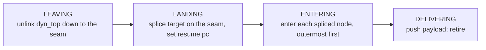

| Field | Role |
|-------|------|
| `target` | owned clone of the template above the seam's counterpart to splice; NULL once spliced or when nothing is spliced (POP_SHIFT, cc-unwind, or nothing above the ancestor) |
| `seam` (+ `seam_id`) | borrowed node on the live chain: leave down to it and splice onto it. A delimited invoke's DELIM; an undelimited invoke's lowest common ancestor with the template; NULL means the root (undelimited invoke whose chains share no node) |
| `frontier` (+ id), `wait_top` | the node whose thunk the goal waits on, and `dyn_top` when it fired |
| `payload`, `is_cc_unwind` | what delivery does: push (or stage in the pending slot when the frame delivered to carries a resume), or a boundary raise of a foreign continuation signal |
| `resume_pc`, `continuation_ref` | pc installed at LANDING; keeps the Python wrapper alive |
| `restore`, `restore_count` | the captured operand stacks of the shared nodes, put back at LANDING (§6.4) |
| `outer` | the waiting enclosing goal |

### 6.2 Goal step rules

1. **Wait.** A leave or enter answering REPROLOGUE or AWAIT leaves the goal waiting on that node with `wait_top = dyn_top`; the goal step returns and the thunk runs as an ordinary frame.
2. **Resume.** The goal step acts again only when `dyn_top == wait_top`: the thunk's frame came and went. Everything above `wait_top` belongs to the thunk, including any nested goal it pushes.
3. **LANDING is total.** Splice, resume pc, and voiding every outer goal whose frontier LEAVING unlinked (all of them when the seam is NULL) happen in one synchronous step; the spliced frames are renumbered for the recursion limit (§7.7).
4. **Re-derive.** LEAVING and ENTERING re-walk from the live chain each pass; a node already entered answers NORMAL, and a node another goal is waiting on is skipped.
5. **Raise frees the stack.** A step failure enters `process_raise`, which abandons every goal; the chain a walk left behind is a chain to raise through.

Seam and target per caller: a delimited invoke pushes a `KOS_DYN_DELIM` (POP_PROMPT mode) as the seam and splices the cloned slice onto it; an undelimited invoke's seam is the lowest common ancestor of the live chain and the captured template (matched by node id from both roots), so nothing at or below it leaves or re-enters and only the template above the ancestor's counterpart is spliced (§6.4); the whole chain is replaced only when the chains share no node (seam NULL); `POP_SHIFT` pushes a goal with no target whose seam is the prompt's parent and whose resume pc is the prompt's `pop_pc + 1`; a foreign continuation signal pushes a cc-unwind goal with no target whose seam is the root GEN (the boundary to the caller) or NULL.

### 6.3 Unlink and obligations

Every node leaves the chain through **`kos_dyn_unlink_top(ctx, ev, allow_barrier)`**: (1) a `KOS_DYN_CAP_CONTROL_HOOK` node is asked to leave (`kos_dyn_extent_leave`), and any answer but NORMAL returns with the node still on the chain; (2) the synchronous per-kind teardown runs; (3) the node's obligation is detached; (4) the parent becomes `dyn_top` and the node is freed; (5) the obligation is acted on by its kind and by `ev`:

| Obligation \ event | `NONE` (plain pop, hook finished a leave) | `RAISE` | any transfer event |
|---|---|---|---|
| VALUE | pushed onto the revealed block | dropped | dropped |
| EXCEPTION | re-raised | chained as `__context__` of the exception in flight | dropped |
| RETURN | caller error; only `kos_dyn_settle_top` receives one, handing it back for `KosEval_ResumeReturn` | dropped | dropped |
| SWALLOWED | None pushed (a with's `__exit__` consumed the raise) | None pushed | None pushed |

The **extent contract** for WIND and WITH is total and re-entrant: `enter` / `leave` answer NORMAL when discharged, REPROLOGUE when a thunk or `__enter__`/`__exit__` frame was installed, AWAIT when the call suspended, RAISE when the node's own code raised; a node in a pending phase is in flight, answers REPROLOGUE while its thunk frame sits above it, and is aborted by a leave once it is `dyn_top` with the thunk gone. `settle` takes the returned call result off the block and advances the phase; `abort` advances without one. The node never unlinks itself and never reads the transfer state.

### 6.4 Delimited invoke paths

**In place (Path A):** when the capture-time prompt and SHIFT nodes are both still live, the SHIFT lies above the prompt, no barrier sits between `dyn_top` and the SHIFT, no goal is active, and the live slice is unconsumed, `kos_delimited_invoke_inplace` detaches the invoke span onto a `KOS_DYN_DELIM_MODE_INPLACE` delim above the prompt and continues on the live chain: no clone, no goal, no enter replay. Only the first invoke runs in place. The slice's `POP_PROMPT` restitches the stashed span (`kos_dyn_inplace_restitch`).

**Splice (Path B):** `kos_invoke_continuation` checks the recursion limit against the template's frame count, clones the template, pushes the POP_PROMPT-mode DELIM as the seam, and pushes a goal with the clone as target. When the slice reaches `POP_PROMPT`, the return walk hands the DELIM back (`took`) and the value lands at the invoke site.

**Undelimited splice:** `kos_chain_common_ancestor` finds the lowest common ancestor of the live chain and the template by node id (clones keep their source's id, so a spliced clone of this template counts as the same extent). The ancestor is the seam; `kos_dyn_clone_segment` clones only the template above the ancestor's counterpart, then `kos_chain_detach_template` severs the clone's bottom from the template so LANDING's splice cannot follow into it. LEAVING runs the after thunks and `__exit__`s above the seam, LANDING restores the captured operand stacks of the shared nodes from the seam down to its frame (`kos_xfer_goal_capture_restore` records them at invoke, `goal_apply_restore` puts them back), and ENTERING runs the before thunks above the seam. The chains share no node only when the capture context is gone; then the seam is NULL and the whole chain is replaced.


## 7. Tail Calls and Call Installs

### 7.1 Invocation Entry Points

- **`KosContext_Call` / `KosContext_CallArgs` /
  `KosContext_CallMethod`** (eval side): one contract in three
  argument shapes (a vector, a tuple and dict, a vector with a
  receiver), each taking `tail_call` and an optional resume. The entry
  resolves the call suite once via `KosCallable_CheckSlots` and
  dispatches through `kos_call_dispatch`: a KosCallable's install slot,
  an instance's KosCallable `__call__` through
  `kos_instance_call_target`, or `PyObject_Vectorcall` for a plain
  Python callable. A value in hand is reported as RETURN, or handed to
  the resume when one is given.
- **`KosContext_CallInto` / `KosContext_SettleInto`**: the native
  program form. Installs a native frame carrying the resume
  (`KosContext_InstallNativeFrame`) and makes the call, or settles a
  value, from it.
- **`kos_call_push` / `kos_call_push_args`** (`eval/eval_call.c`,
  static): the CALL* opcodes' push contract over the same dispatch. A
  value in hand is pushed onto the caller's stack.
- **`Koskari_AsyncCall`** (Python boundary): the suite's `kc_pycall`
  worker, `PyObject_Call` fallback.

### 7.2 Install Slot Contract

```c
KosOpResult (*KosVectorInstallFunc)(KosContext *ctx,
    PyObject *callable, PyObject *const *args, Py_ssize_t nargs,
    PyObject *kwnames, int tail_call);
```

The install owns its frame and reports the outcome (`evaluated.h`).
RETURN carries a value in hand, unsettled, with nothing pushed. NORMAL
and POLL mean a callee frame is installed and current, through
`KosContext_InstallCallFrame` for bytecode. REPROLOGUE and AWAIT
mean the slot pushed a native frame with a resume set, through
`KosContext_InstallNativeFrame`. RAISE reports failure with `PyErr`
set. An install never recurses into `koskari_eval`; execution
continues in the same loop. `kos_call_dispatch` upgrades NORMAL to
REPROLOGUE when a transfer goal is active or the installed frame does
not thread, so the prologue notices the new work.

### 7.3 Tail Call Behavior

A tail call tears down the discardable extents above the live frame
first (`kos_dyn_teardown_to_frame`). A function's self-tail at simple
arity then rebinds the live namespace in place, no frame touched. Any
other function tail call takes the callee's ready frame, bound from
the window while it still sits on the live frame's block: at the
install arity the arguments steal-move off the block
(`KosFunction_ReadyFrameBlock`), any other shape binds from the vector
(`KosFunction_ReadyFrameVector`), and an owned callable reference
moves into the frame's tag either way. The ready frame is swapped for
the live frame (`kos_dyn_swap_frame_for_tail`): it takes the live
frame's depth, parent and demand bit, and the live frame is freed,
which drops what is left of the window with its block and offers the
frame to its own function's cache. An Expression's tail call resets the live frame for
reuse (`KosContext_InstallCallFrame`, `kos_dynframe_reset_for_tail`)
and refills it, as `KosContext_InstallNativeFrame` does. A KosCallable
that completes in hand keeps the caller's frame, and the RETURN after
TAIL_CALL retires it.

A plain-Python tail call completes with `EVAL_CONTROL_RETURNED()`; the handler's relay tails into `kos_eval_control_returned`, which runs `kos_eval_post_opcode_control_returned_after_hook`, which invokes `kos_dyn_settle_top` when a WIND or WITH is current and ends in `kos_eval_delivery_done`.

**Tail calls of Python callables** pop the caller frame before the
Python call **only when the frame is bare** (`dyn_top == frame`). With
extent nodes still open above the frame (a `let` NS, etc.), the pop is
skipped and the result is delivered through a normal `EVAL_RETURN`
instead of `EVAL_CONTROL_RETURNED`, so the open extents unwind through
the regular RETURN walk (`tail_prep_py_call` and `deliver_call_value`
under `kos_call_push` in `eval/eval_call.c`).

### 7.4 Transfer Goal Integration

An install that invokes a continuation pushes a goal with **`kos_xfer_goal_push`** (**`ctx->goal`**, read as **`KosContext_GOAL(ctx)`**) and answers REPROLOGUE; the prologue processes it. No recursion. A continuation invoked while a goal is waiting (from a wind thunk, for example) pushes an inner goal whose `outer` is the waiting one; the goal step retires into the outer when the inner delivers.

### 7.5 `KosEvaluatedTypeObject`, the call suite, and Demand

**`KosEvaluatedTypeObject`** (`evaluated.h`) extends `PyTypeObject` with
the call and iter suites embedded inline. The call suite:

```c
typedef struct KosCallSlots {
  KosVectorInstallFunc kc_vinstall; // the install entry (vector shape;
                                    // tuple+dict callers are spread
                                    // centrally by kos_call_dispatch_args)
  ternaryfunc kc_pycall;            // Python-boundary call worker
  vectorcallfunc kc_pyvectorcall;   // vector variant; may be NULL
} KosCallSlots;
```

A type whose suite carries an install slot passes
**`KosCallable_CheckSlots(obj, &slots)`** (check-and-resolve in one; the
single resolve serves the whole call sequence). Adopters: Function,
Expression, BoundMethod, KosPartial, Demand, Procedure, IterFunction,
both continuations, Values, Apply. Python callables fail the check and
are vectorcalled.

No frame is prepared before the slot runs. The slot installs the frame
it needs, or completes in hand and answers RETURN, so the caller never
asks a callable whether it wants a frame. An install may run with no
current frame: the boundary's entry call installs at the chain root.

**Demand and `KOS_FRAME_DEMAND`.** `demand_kos_vinstall` calls the
inner through `KosContext_Call` with no resume. An installed callee
frame is marked `KOS_FRAME_DEMAND`. Child frames inherit the flag
through tail reset and frame push, native frames included. A value in
hand that is still awaitable settles under a native frame carrying
`demand_resume` and the mark, through `KosContext_SettleInto`, so a
suspension is denied at the guard. A settled value is reported as
RETURN. (History:
[archive/kos-evaluated-iterator.md](archive/kos-evaluated-iterator.md).)

**Demand denial is centralized in `eval_event_await`.** When an opcode
returns `EVAL_AWAIT(v)` and `kos_eval_in_demand(ctx)` is true (i.e.
`KOS_FRAME_DEMAND` is set on the current frame), `eval_event_await`:
1. `Py_DECREF`s the awaitable payload.
2. Restores context flags (`KOS_CTX_RUNNING`; clears `KOS_CTX_DEAD`).
3. Calls `kos_demand_set_sync_violation` and then `process_raise`.

This single check intercepts all async suspension, regardless of
whether the `EVAL_AWAIT` came from an opcode, a resume, or
auto-await.

**YIELD is never denied by the demand guard.** Yielding is a synchronous
generator protocol; blocking it would incorrectly prevent generators
from yielding inside a demand context. `eval_event_yield` has no demand
check.

**No early-exit guards.** Every suspension site relies on the
centralized check in `eval_event_await`. Yield-from's Python async
await kind is already set on the frame when the denial raises, so it
takes the sync violation as a NULL delivery, as any resume takes a
failure, and releases its delegate.

`kos_vinstall_boundmethod` installs through `KosContext_CallMethod` on
the inner callable, so a `BoundMethod(Demand(fn))` flattens as
`Demand(fn)` alone does.

Archived design and implementation notes:
[archive/demand-wrapper.md](archive/demand-wrapper.md),
[archive/demand-evalex-phase1.md](archive/demand-evalex-phase1.md),
[archive/demand-evalex-phase2.md](archive/demand-evalex-phase2.md).

### 7.6 Call paths

Calls carry most of the evaluator's real complexity; an ordinary opcode
pops, computes, pushes, and threads. Every CALL and TAIL_CALL opcode
enters the same core, **`kos_call_invoke`** (`eval/eval_call.c`), which
classifies the callable and takes one of three paths. Two of them thread
straight through to what comes next; the prologue is involved only when
it has real work to do.

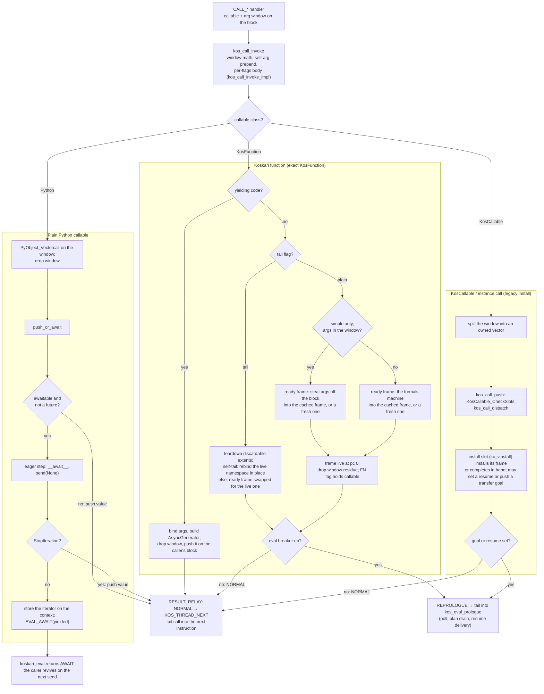

Every call of a KosFunction, from the opcodes, from Python, or for a
generator, gets its frame from one place: the **ready frame** core in
`func.h` (`KosFunction_ReadyFrameBlock`, `KosFunction_ReadyFrameVector`,
`KosFunction_ReadyFrameTuple`, one entry per argument source). The core
takes the function's cache head (`kos_function_frame_take`), else a
fresh frame over a template copy (`kos_function_frame_fresh`); binds the
arguments into its namespace by their shape (slot steal from the block,
slot store from a vector, or the formals machine); stores the function
into its own slot when the body names it (`KosFunction_StoreSelf`, the
slot known from the spec at construction); and tags the frame with the function
(`kos_function_frame_tag`), so the frame's release offers it back
(`KosFunction_CacheFrame`, up to `KOS_FRAME_CACHE_MAX` per function,
each reset to template state). A bind that fails midway hands the frame
back through the same offer (`kos_function_frame_return`), so no caller
sees a half-bound frame. The frame is ready for
`kos_dyn_push_ready_frame`: parent NULL, depth 1, pc at the code's
entry, stack empty. What it becomes is the caller's last step: pushed
(the call core, `KosFunction_Install`), swapped for the live frame (a
tail call), held by a `KosCoroutine` (the Python entries), or parented
under a GEN (`KosAsyncGen_NewFromFrame`) when the code yields.

| Path | What is pushed where | Threads or bounces |
| ---- | ---------------- | ------------------ |
| **Koskari function, plain call** | The ready frame above the caller; the caller's return address is its own saved pc. A simple call with its arguments in the window (`kos_call_simple_install` in the CALL_FAST handlers, the window arm of `kos_call_invoke_impl`, `kos_call_invoke_self_steal` for an out-of-band receiver) steal-binds them off the block (`KosFunction_ReadyFrameBlock`); every other shape binds from the vector in `KosFunction_Install` (`KosFunction_ReadyFrameVector`). | Threads into the callee's first instruction. Bounces only when the eval breaker is up (`kos_call_installed`, §1.6). |
| **Koskari function, tail call** | Extents above the live frame are torn down first. A self-tail at simple arity rebinds the live namespace in place; any other tail call swaps the callee's ready frame, steal-bound from the window at the install arity and bound from the vector otherwise, for the live frame (`kos_dyn_swap_frame_for_tail`), which goes to its own function's cache. | Threads, the same cooperation point. |
| **Koskari generator function** | No frame on the chain: the ready frame goes under a new GEN (`KosAsyncGen_NewFromFrame`) and the `AsyncGenerator` is the call's value on the caller's block. The frame keeps its tag and returns to the cache at exhaustion. The generator check runs ahead of every install arm. | Threads. |
| **Python callable, sync result** | The result on the caller's block. A future is pushed as a plain value; only an explicit `AWAIT` awaits it. | Threads. |
| **Python callable, awaitable result** | The eager step runs `send(None)` once. Immediate completion pushes the value; a yield stores the iterator on the context. | Immediate completion threads. A yield is not a bounce: `koskari_eval` returns `AWAIT`, the coroutine yields to the event loop, and the revive delivers the awaited value through the Python resume slot into the prologue (§8.1). |
| **Native KosCallable** (`partial`, `demand`, the koscallable natives) | The window is spilled so the legacy steal-first ordering holds, then `KosContext_Call` resolves the call suite and runs the install slot (§7.1, §7.2). | Threads when the install left no resume set and no goal active. Bounces when it set a resume or pushed a transfer goal, since the prologue is where those are delivered. |

The return side mirrors it. A callee's `RETURN` into a plain bytecode
parent retargets the live registers, pushes the value, and threads the
parent's next instruction; into a resume-carrying parent it tail-calls into
the resume by `RESUME_HOP`; only the shapes that need an unwind take
the general path inside `kos_return_deliver` (§2.6). The CPS entries the
natives use,
`KosContext_Call` and `KosContext_NextResume`, thread a value
that is in hand straight into the resume and stage through `DISPATCH`
only for an unsettled value or a cold start (§8.2).

---

### 7.7 Recursion limit

Frame depth per context is bounded by `sys.getrecursionlimit()`. Each FRAME
node carries `depth` (`KosDynFrame_DEPTH`): the enclosing frame's depth + 1,
the root at 1, a `uint16_t` in the frame arm's padding. **`KosContext_EvalEnter`**
reads the limit from the thread state (`kos_recursion_limit`, per version
in `compat_3*.h`) into `recursion_limit`, clamped to
`KOS_FRAME_DEPTH_MAX` (65535), so `sys.setrecursionlimit` governs both
languages; Koskari frames use no C stack, so Python's own guard never sees
them, and each `koskari_eval` entry counts one level on that guard
(`kos_recursion_enter` / `kos_recursion_leave`, reading the thread state
passed to them).

**`kos_eval_check_frame_room(ctx, base, count)`** (`eval.h`, one load and one
compare) is asked before any frame installs or any segment carrying frames is
spliced in; on refusal it sets `RecursionError` and returns -1 with the chain
and the caller's state untouched, so the error raises into the caller's frame
like any other exception. Sites: `kos_dyn_push_frame` (checks itself), the
three cached-frame arms of the call core before they steal arguments into
the cached namespace (`kos_dyn_push_ready_frame` cannot fail by contract),
the code-less frame reuse, `kos_invoke_continuation`
(the template's frame count above the invoker's frame, or above the root for
an undelimited invoke, before anything moves), and both generator installs
(a resume that would not fit raises at the request, as Python's `next()`
does, with the generator left suspended). Splices renumber the spliced frames
(`kos_dyn_renumber_frames`): a goal's LANDING, generator install, and the
stashed span an in-place restitch re-links above the prompt.

---

## 8. Resume Paths

Reads and writes of the context’s suspension tag go through **`KosContext_SuspensionEvent`**, **`KosContext_SetSuspensionEvent`**, and **`KosContext_ClearSuspensionEvent`** in **`eval.c`** (backed by **`KosContext.suspension_event`**). The diagram below uses the field name as a shorthand.

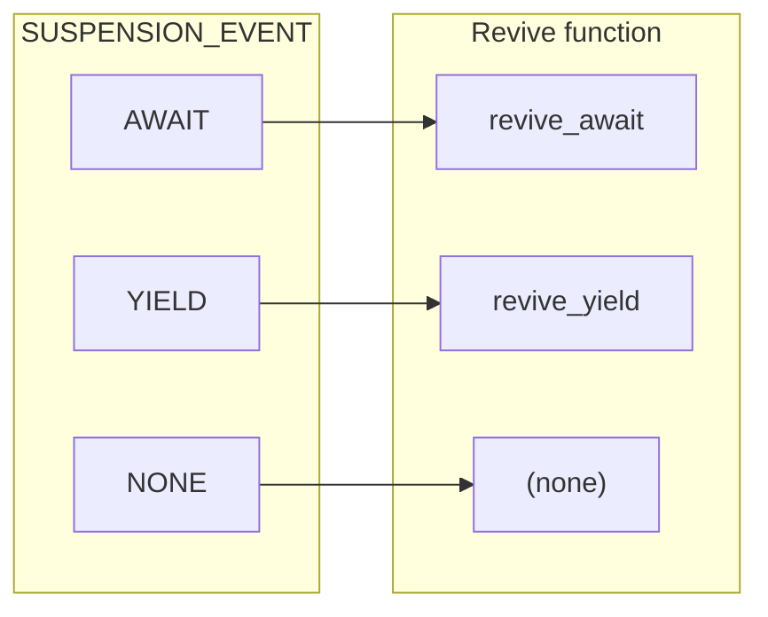

### 8.1 Suspension Event → Revive

| `SUSPENSION_EVENT` | Revive function | Behavior |
|--------------------|-----------------|----------|
| `KOS_SUSP_AWAIT` | `revive_await` | Push send_val, complete pending WITH exit if applicable. |
| `KOS_SUSP_YIELD` | `revive_yield` | Push send_val onto stack. |
| `KOS_SUSP_NONE` | -- | Fresh start or no-op resume. |

YIELD_FROM emits only YIELD or AWAIT: an emitted yield leaves the delegate's `yf_drive_*` kind set on the delegating frame, an await on a Python async delegate sets an await kind. There is no `KOS_SUSP_YIELD_FROM` or `revive_yield_from`; the revive delivers to whichever resume is set.

If `throw_typ`/`throw_exc` are set: `revive_yield` hands the exception to a resume whose kind names a throw kind (`KosContext_ThrowIntoResume`, not for GeneratorExit) and continues in `KOS_MODE_NORMAL`; `revive_await` throws into a stored Python await iterator first; otherwise the revive calls `PyErr_SetObject` and yields `KOS_MODE_EXCEPTION`, which triggers `process_raise` at entry.

### 8.2 CPS resumes

A **resume** is C code that receives one delivery on a frame instead
of implementing an opcode: the `fn` of a `KosResumeKind` set on a
frame (`resume_kind`, `resume_state`), invoked exactly once with the
value the operation produced, or with NULL and an exception set when
it failed. The kind is one static record per resume function holding
its name, `fn`, and its lifecycle: `clear` for a teardown with no
delivery coming, `clone` for a continuation capture and a transfer
restore (NULL refuses by the kind's name), `throw_kind` for a throw
into the halt, `settle` (1 when the delivery is settled before `fn`
sees it, 0 when it is data and arrives as it is), and `traverse` for
a state that owns a Python object. Two shapes exist. A **step resume**
lives on a code-less frame the consumer installed: the **map step**
and the **filter step** (`transform/`) are each a short chain of
resumes (fetch, invoke, verdict) carried by which resume is set on the
step's frame, with the step object as `resume_state`. A **halt
resume** lives on a bytecode frame halted inside an instruction: the
for-each step on the loop's frame, a next request owning its iterator,
and the yield-from kinds owning their delegate. Apply and demand are
not resume consumers: apply's completion is synchronous, and demand
runs at the classify boundary before any evaluator delivery exists.

The kind's `settle` is what the delivery step reads: a settling kind
never sees an unsettled value, and an as-is kind takes its delivery
as it is (a delegate's yielded awaitable, a for-each element, a next's
element are data). A continuation clone copies the state through the
kind's `clone` (`kos_resume_clone_object` on the next kinds, a shared
pointer on the for-each step, procedure and demand kinds) or refuses by the kind's
name (every provider step kind and every yield-from kind); a frame
freed, cached or reset with its resume still set runs the kind's
`clear` (`kos_transform_step_clear` on the provider kinds, releasing
the record's busy mark and pending value; the next kinds finish the
provider as not exhausted and release the iterator; the yield-from
kinds close the delegate). A bytecode frame's delivery is always the
pending slot, never its operand stack: the revive, the generator
install, and the flattened step route a sent value there when the
frame is waiting, and the delivery step pops a stack only on a
code-less frame. Every installer that would thread into a
just-installed frame asks `kos_frame_threads` first; an iteration
install hands a halted bytecode frame to its resume by tail call
(`kos_iter_installed`), and a call install answers REPROLOGUE.

#### The prototype

A resume and an opcode handler have the same prototype:

```c
typedef KosOpResult (*KosThreadFn)(
    KosContext *ctx, void *arg, PyObject *value);
```

`arg` is the step's own state (a resume's state pointer, a handler's
own `KosOp`), and `value` is the delivery, NULL when there is none. One
prototype is what lets a resume tail-call a handler and a handler
tail-call a resume: musttail refuses a tail call between functions of
different prototypes, so everything that `TAILCALL` may reach has this
shape. A resume that is a direct `TAILCALL` target is `KOS_NOINLINE`
(gcc otherwise inlines it into its caller and cannot honor the tail
call inside it).

The state pointer is borrowed from refcounted state the frame already
keeps alive (the map and filter objects hold their state); a resume does
no cleanup. Continuation capture across a resume-carrying frame refuses
by name (`kos_dynframe_clone`), since replaying a captured step would
re-consume source elements.

#### The entries

```c
KosOpResult KosContext_Call(
    KosContext *ctx, PyObject *callable, PyObject *const *args,
    Py_ssize_t nargs, PyObject *kwnames, int tail_call,
    const KosResumeKind *resume, void *state);

KosOpResult KosContext_NextResume(
    KosContext *ctx, PyObject *iter, PyObject *send_val,
    const KosResumeKind *resume, void *state);
```

An entry does the operation and reports what happened; the calling
resume, which has the `KosThreadFn` prototype, decides where control
goes by ending in **`RESULT_ENTRY(ctx, r, resume, state)`**:

| the entry reports | meaning | `RESULT_ENTRY` does |
|---|---|---|
| `RETURN val` | a settled value in hand, no resume set | `TAILCALL(resume, ctx, state, val)` |
| `NORMAL` | a callee (or a generator's frame) is installed and current, resume set on the caller | `KOS_THREAD_NEXT` into the callee's first instruction |
| `REPROLOGUE` | the value still needed settling: one eager step ran, the outcome is staged, resume set | tail into `kos_eval_prologue` |
| `AWAIT` | a genuine suspension, resume set | tail into `kos_eval_await` |
| `RAISE` | failure; it reaches the resume as a NULL delivery, which handles it or declines (§8.2) | tail into `kos_eval_raise` |
| `FATAL` | internal fault | return |

`KosContext_Call` with `resume == NULL` relays the install's result
untouched, `tail_call` included; that is what partial, demand, and
`TAIL_CALL_NAMES` use. `NextResume` requires a resume: the next
instructions pass one of the two next kinds, by arity.

#### Delivery

A delivery reaches a resume by one of three routes:

- **Tail call from the producer.** A settled value in hand at an entry
  (above), a bytecode callee's `RETURN` into a resume-carrying parent
  (`op_RETURN`'s resume arm pops the callee and takes the resume pair
  off the parent, §2.6), and a step's own phase hops (filter's fetch,
  invoke, verdict) all go through **`RESUME_HOP(fn, ctx, state,
  value)`**: a tail call that is also a cooperation point, which stages
  through `DISPATCH` instead when the eval breaker is up, so a chain of
  resumes with no instruction between them still sees a signal or a GIL
  request.
- **The pending slot.** `DISPATCH(fn, ctx, arg, value)` stages a
  delivery for the prologue: it sets the resume on the current
  frame, stores the owned value in `KosContext.pending_value`, and
  tails into `kos_eval_prologue`. The prologue polls if the breaker is
  up, then its delivery step (`eval_step_resume_delivery`) takes the
  slot, clears the resume,
  classifies the value, and invokes the resume; a staged delivery with
  no pending exception and no goal active is the first thing the
  prologue checks. The slot is live transit only:
  `KosContext_EvalExit` moves a live slot onto the frame
  stack, a pending exception drops it, and under `KOS_EVAL_SAFETYNET`
  instruction dispatch refuses to start over one. Besides a hop that
  found the breaker up, the slot carries the unsettled-value path
  (`KosContext_SettleStage`), an awaited value at revive, and a frame
  return into a resume-carrying parent that the tail-call arm declined.
- **The frame stack, as storage.** A frame return into a
  resume-carrying parent that does not fit the tail-call arm and an
  awaited value at revive are staged in the slot or pushed onto a
  code-less frame's own stack, and the delivery step pops from the
  stack when the slot is empty.

Whichever route, the resume sees a **settled** value: a delivery that
still needs awaiting is settled by the delivery step
(`KosContext_SettleStage`, one eager step, or a real suspension with
the resume set again) before the resume runs. Consumers never classify.

Failure reaches a resume through the same channel a value does. NULL
with `PyErr` set means the delivery failed, reported the way a
`PyObject *` API reports failure to its caller.

One rule delivers it. The live frame's resume is first at every
level: the raise walk answers `EVAL_RESUME(NULL)` when the live frame
has a resume set, at entry and after every pop or generator teardown
that reveals one, and never calls a resume itself. A thread caller
relays the answer into the resume by tail call; the trampoline stages
one a plain caller returned for the prologue's delivery step (§2.3),
which also offers a pending exception to the live frame's resume
before the pending-exception phase runs. Either way the resume runs
against a settled chain and may do anything a resume handed a value
may do -- thread on with `RESULT_ENTRY` or `RESUME_HOP`, complete the
frame with `RESULT_FRAME_RETURN`, or return `EVAL_RAISE` to decline.

Every raise ingress converges on `process_raise`, reached straight
from `apply_kos_op_result` and never through the prologue. Declining
re-raises with the resume already cleared by the delivery, so the
walk re-enters from the same `dyn_top`, finds no resume set, unwinds
as it always did, and cannot loop.

Every frame with a resume is eligible, bytecode or code-less. A CPS
step frame is code-less by construction (`KosResumeFrame_Install`). A
resume set on a frame carrying bytecode is a yield-from kind, a
for-each step or a next request, set on the frame that halted; each
takes a NULL delivery with an error pending as a failure and declines
or handles it by its own contract.

Declining and never setting a resume are observationally identical,
which is why `map`, `filter`, `zip`, `starmap`, `dropwhile`, `islice`,
and `pairwise` need no code for failure: their NULL branches return
`EVAL_RAISE`, and the failure reaches the step's consumer through its
frame's resume, which owns the conversion (a raised `StopIteration` is
exhaustion). That conversion is for a provider's source running out; a
`StopIteration` or `StopAsyncIteration` escaping a generator body never
reaches a consumer's resume as itself, because the raise walk converts it
to `RuntimeError` with the original as cause where it crosses the
generator's GEN node (`kos_dyn_gen_convert_escaping_stop`, PEP 479 and
PEP 525), ahead of the flattened consumer, the Python iterator adapter
and the async-generator stepper alike; `coroutine_settle` does the same
for a coroutine. A provider that must act on its source running out handles
that NULL instead -- `batched` completes its frame with the short final
batch, `zip-longest` files the fill value and tail-calls back into its row
walk, which its position on a settled chain makes legal.

`KosContext_NextResume`'s `KOS_IREQ_EXHAUSTED` arm sets the supplied
resume, sets `StopIteration`, and answers `EVAL_RESUME(NULL)`, so
immediate exhaustion and in-flight exhaustion reach the resume through
that one channel.

#### Frame slots and the frame cache

The frame arm carries `resume_kind`, `resume_state`, and `cache_slot`;
the kind's name is what a capture refusal message reports. A step frame completes
through `KosNativeFrame_ReturnToCache(ctx, value, &cache)`, which signals
`RETURN` and flags the frame to be stored, stripped inert, into the
consumer's one-frame cache when the return path frees it;
`KosResumeFrame_Install(ctx, kind, state, &cache)` reinstalls the cached frame
for the next step in place of a fresh allocation. `kos_dynframe_free`,
`kos_dynframe_cache_inert` and `kos_dynframe_reset_for_tail` all go
through `kos_dynframe_clear_resume`.

Python-adapter evals (`iterate.c`) run a provider's work in a durable
context exposed through the suite's `ki_pyctx`, recycled between
completed steps when `ki_pyctx_recyclable` is set; the map and filter
carry recyclable durable contexts.

---

## 9. Play-by-Play Scenarios

### 9.1 Scenario: Simple Call and Return

1. Entry: `send_val == NULL`, `SUSPENSION_EVENT == NONE` → `KOS_MODE_NORMAL`.
2. Transfer: no plan → skip.
3. Prologue (`kos_eval_prologue`): nothing staged, no pending exception, no plan → fetch `code[pc]` and tail-call its handler.
4. The chain reaches a CALL handler. It calls the call core (`kos_call_invoke`, §7.6), which preps and installs the callee frame and returns NORMAL with the callee's first instruction at `ctx->pc`; the handler's `RESULT_RELAY` tail-calls into it. No return to `koskari_eval`.
5. The callee runs by tail calls until RETURN. With `DYN_TOP == FRAME` and a plain parent frame, `op_RETURN`'s plain arm (**`kos_return_is_plain`** → **`eval_plain_return`**) retargets live registers inline, frees the callee, pushes `val`, and `KOS_THREAD_NEXT` tail-calls the caller's next instruction. Still no return to `koskari_eval`. (Chains needing an unwind go through **`eval_event_return_unwind`**'s transition walk inside `kos_return_deliver`; other parent kinds through **`eval_parent_return_deliver`**.)
6. A cooperation point that finds the eval breaker up (a `CONTINUE`, a frame install) tails into `kos_eval_poll` instead of threading; it polls and threads again (§1.6). A resume hop stages its delivery and tails into the prologue, which polls first.
7. Caller runs until **top-level** RETURN (no parent): none of `kos_return_deliver`'s plain arms fit, **`eval_event_return`** marks the context DEAD and the result terminal, and the chain returns it to `koskari_eval` (the caller receives `KOS_RES_RETURN`).

### 9.2 Scenario: Exception and Local Handler

1. Opcode fails, sets PyErr, returns `EVAL_RAISE()`.
2. Post-opcode: `PyErr_Occurred()` → `process_raise`.
3. `kos_dyn_unwind_raise` finds the TRY region, sets handler_pc, clears PyErr for the handler, returns `EVAL_REPROLOGUE()`.
4. `process_raise` returns `EVAL_REPROLOGUE()`.
5. Loop continues; next instruction is the except block.

### 9.3 Scenario: Continuation Invoke (Own Token)

1. Python calls `cont(value)`. Cont raises `KoskariContinuationApply` targeting this context.
2. `PyErr_Occurred()` at the next prologue (or after the opcode). `process_raise` runs.
3. `handle_continuation_apply` sees its own token: fetches continuation and value, clears PyErr, calls `kos_invoke_continuation(ctx, ...)`.
4. `kos_invoke_continuation` runs in place when it can (§6.4); otherwise it checks the recursion limit, clones the template, pushes the DELIM seam (delimited), and pushes a goal. `handle_continuation_apply` answers `EVAL_REPROLOGUE()`.
5. The prologue's `eval_step_drain_goal` processes it: LEAVING unlinks down to the seam (after thunks and `__exit__`s run as frames, the goal waiting on each until it returns), LANDING splices the clone and sets the resume pc, ENTERING runs before thunks outermost first, DELIVERING pushes the value, or stages it in the pending slot when the frame delivered to carries a resume the restore put back (the frame was waiting on a delivery when it was captured, and the value is that delivery).
6. Execution resumes at the captured pc with the value on the stack.

### 9.4 Scenario: Nested Continuation During Transfer

1. A goal is waiting on a wind whose after thunk is running.
2. The thunk invokes a second continuation. `kos_invoke_continuation` pushes an inner goal; the outer keeps waiting with `wait_top` recorded.
3. The inner goal proceeds to delivery on the chain above `wait_top`; a delimited inner invoke returns its reset's value to the thunk, which then returns.
4. The thunk's return settles the wind (`kos_dyn_settle_top`); `dyn_top` is `wait_top` again, and the goal step resumes the outer goal where it left off.
5. Had the inner LEAVING unlinked the wind the outer was waiting on (an undelimited inner whose common ancestor lies below it), LANDING would have freed the outer goal along with the extent it was moving through.

Tests: `TestDelimitedTransferNested` in `tests/compile/specials/test_continuations.py` and `TestDynWindContinuations` in `tests/compile/specials/test_dyn_wind.py`.

### 9.5 Scenario: AWAIT Suspend and Resume

1. AWAIT opcode yields awaitable, stores the iterator with **`KosContext_PythonAwaitSetIter`**, calls **`KosContext_SetSuspensionEvent(ctx, KOS_SUSP_AWAIT)`**, returns `EVAL_AWAIT(val)`. Evaluator exits.
2. The caller (e.g. KosCoroutine.send) awaits the awaitable, gets result.
3. The caller calls `koskari_eval(ctx, NULL, result, NULL, NULL)`.
4. Entry: `SUSPENSION_EVENT == AWAIT`, `send_val != NULL` → `revive_await(result, ...)`.
6. `revive_await` pushes result onto stack and calls `kos_dyn_settle_top`, which completes a pending WITH exit.
7. Mode = NORMAL. Loop continues; next instruction consumes the awaited value.

**Throw resume (`throw_typ` / `throw_exc` non-NULL):** When **`KosContext_PythonAwaitIter(ctx)`** is set, `revive_await` calls `throw` on that iterator before installing `PyErr` for the VM. If the iterator completes (`StopIteration`), the completion value is staged like a normal send resume (**`KosContext_PythonResumeSet`** / stack push). If `throw` returns a new object, `revive_await` returns `EVAL_AWAIT(val)` and eval stops again (second suspend). If `throw` fails or leaves an exception, `KOS_MODE_EXCEPTION` runs `try_local` as usual. If there is no stored await iterator, behavior matches the old path (`PyErr_SetObject` only).

### 9.6 Scenario: YIELD Suspend and Resume

1. Generator is running; frame's parent is GEN. Plain `YIELD` or `YIELD_FROM` returns **`EVAL_YIELD(val)`** from the opcode.
2. **`op_YIELD`** tails into **`kos_yield_deliver`**, which asks **`kos_dyn_find_gen`** for the frame's GEN and runs **`eval_event_yield`** → **`kos_dyn_gen_freeze`**: the dynchain above the GEN is frozen into it. A flattened GEN (one with a parent) delivers to its consumer and threads on; a root GEN's result is marked terminal and returned as `EVAL_YIELD(val)`.
3. If the live frame carries a resume (a for-each step, a next request, a yield-from waiting on its delegate): **`eval_event_yield`** hands the value to it via **`iter_deliver_to_resume`** and ends in **`kos_eval_delivery_done`**: `EVAL_DISPATCH()` when the consumer is a plain bytecode frame, which `op_YIELD` threads into directly, else `EVAL_REPROLOGUE()` -- every consumer hands off uniformly, no external stop. Yield-from's emit kind re-emits the value as its own yield (a fresh YIELD event that freezes the delegating GEN and delivers onward), so nested stacks compose to arbitrary depth. Otherwise (the caller of `koskari_eval` consumes the generator) **`KosContext_SetSuspensionEvent(ctx, KOS_SUSP_YIELD)`** and return `EVAL_YIELD(val)`.
4. The caller (e.g. Python generator `send`) receives `KOS_RES_YIELD` and `val` in the root case; later calls `koskari_eval(ctx, NULL, send_val, NULL, NULL)`.
5. Entry: `SUSPENSION_EVENT == YIELD`, `send_val` provided → `revive_yield(send_val, ...)`.
6. `revive_yield` pushes `send_val` onto the stack. Mode = NORMAL. Loop continues; next instruction runs with the sent value on the stack.

### 9.7 Scenario: Tail Call

1. A TAIL_CALL handler calls the call core with `KOS_CALL_TAIL`. For an exact non-yielding KosFunction the core binds the arguments from the still-intact window, resets the frame in place (code, ns, stack, pc = 0), and returns NORMAL; a self-tail at simple arity with a private namespace rebinds the live namespace without even a reset.
2. The handler's `RESULT_RELAY` tail-calls the new function's first instruction in the same frame.
3. A plain-Python tail call instead pops the caller frame, calls, and completes with `EVAL_CONTROL_RETURNED()`; the relay tails into `kos_eval_control_returned` → `kos_eval_post_opcode_control_returned_after_hook` → `kos_dyn_settle_top` runs when a WIND or WITH is current, then `kos_eval_delivery_done` (`EVAL_DISPATCH()` for a plain frame, else `EVAL_REPROLOGUE()`).

### 9.8 Scenario: Transfer Goal Step Fails

1. A goal is driving. A leave or enter answers RAISE (a thunk raised synchronously, `__exit__` refused, the seam went missing).
2. **Foreign cc-unwind delivery:** `kos_xfer_goal_drive` reports `out_boundary`, and `kos_eval_drain_goal` returns the boundary raise as it stands; no `try_local`.
3. **Ordinary failure:** `process_raise` frees the goal stack and runs `kos_dyn_unwind_raise`. `EVAL_REPROLOGUE()` continues the loop when a handler applies; `EVAL_RAISE()` propagates when unhandled.
4. **Async unwind during abandonment:** when the raise walk pops an extent whose exit is async, `process_raise` tags `KOS_SUSP_AWAIT` and the `EVAL_AWAIT` reaches the caller; the revive settles the node and the walk continues.
5. **Thunk bytecode raise** under a waiting goal: the prologue's `eval_phase_pending_exception` runs `process_raise`, which abandons the goal before anything processes it.
6. The chain is left wherever the goal step got to; no rollback to the invoke site.

### 9.9 Scenario: Ctrl-C during a tight bytecode loop

1. User runs a long Koskari loop (for example the CLI REPL evaluating many forms).
2. The SIGINT arrives; CPython's C-level handler sets the signals-pending
   bit in the eval breaker.
3. The loop's next `CONTINUE` finds the breaker up and tails into
   **`kos_eval_poll`**.
4. **`Py_MakePendingCalls()`** runs the Python handler, which converts the
   pending **SIGINT** into **`PyErr`** (typically **KeyboardInterrupt**);
   the poll tails into the prologue.
5. The prologue's **`eval_phase_pending_exception`** runs **`process_raise`**; if no handler catches it, the result is marked terminal, `EVAL_RAISE()` returns to `koskari_eval`, and the caller sees the raise.
6. Had another thread been waiting on the GIL instead, the same point
   would have found the drop-request bit up and the poll would have
   yielded it with a paired **`Py_BEGIN_ALLOW_THREADS` / `Py_END_ALLOW_THREADS`** (see §1.6).

---

## 10. Summary Table: Modes and Outcomes

| KosEvalMode | Source | Outcome |
|-------------|--------|---------|
| NORMAL | Fresh start, resume w/o throw | Continue to dispatch |
| EXCEPTION | throw on resume, revive throw | process_raise (unified ingress) → handler / AWAIT / RAISE |
| AWAIT / YIELD / RAISE | (No longer used as KosEvalMode values) | -- |

---

## 11. VM Structures and C API Reference

Merged from the former `design/interpreter/evaluator.md`: the data-model
companion to the control-flow sections above. The KosCoroutine type and
`KosCoroutine_NewFromCode` (the Python-facing entry that creates a
coroutine from code+namespace) live in `coro.c`/`coro.h`; driving a
KosCoroutine (send/await) invokes `koskari_eval()` from coro.c. For the
numbered execution invariants list, see
[interpreter/execution-invariants.md](interpreter/execution-invariants.md);
for the combined master reference, see
[INVARIANTS-AND-CLARIFICATIONS.md](INVARIANTS-AND-CLARIFICATIONS.md).

### Design Philosophy

Koskari's evaluator implements:
- **Delimited multi-shot continuations** (reset/shift)
- **VM-native dynamic wind/unwind hooks** (bytecode blocks, not Python callables)
- **Flattened async execution**
- **Unified dynamic chain** for all control flow concerns
- **Eval-owned iteration-node staging** where frame crossing (unwind/pop) is separated from parent-consumer delivery using `KosOpResult` and `eval_event_*` helpers in `eval.c` (no `KosEvent` struct); see [boundary-control-reemit.md](archive/boundary-control-reemit.md)

### Core VM Structures

#### Dynamic Chain (DynNode)

The evaluator uses a unified **dynamic chain** that links all execution context:
frames, prompts, wind extents, and control regions. This replaces the previous
separate frame chain and handler chain.

**KosDynNode** -- Single tagged-union struct for all chain node kinds. Base fields
`parent`, `kind`, `flags`, `caps`, `node_id`, **`stack`**, and **`ns`** precede
union `u`; an embedded **`KosInlineSegment`** (`iseg`, 8 slots) sits at the tail.
Region kinds always own a segment -- aimed at `iseg` at construction or push and
spilled to a heap segment on growth -- so **`stack == NULL` marks a transfer
bookmark** (cc, cc_raise, delim, shift, gen, next, yield_from), which inherits
the enclosing extent's segment. The **`ns`** field is uniformly owned: an
introduced scope for `KOS_DYN_CAP_OWNS_NS` kinds (frame, ns, collect),
otherwise the live-namespace fill taken at push, so the active namespace is
always readable from the top node. Frames additionally record the displaced
frame (**`back_frame`**, borrowed) as an unwind cache. Payload variants live in
`u` (see `struct KosDynNode` in [`dynchain.h`](../../koskari/lib/dynchain.h)).
**`KosDynFrame_STACK`** reads this **`stack`** field on the node, not a member
of `u.frame`.
Typedefs (KosDynFrame, KosDynPrompt, KosDynWind, KosDynNs, KosDynCC, KosDynWith,
KosDynShift, KosDynParam, KosDynGen, …) all refer to this same struct.
**All field access must use the macros** defined in dynchain.h; do not touch union
members or base fields directly. Node kinds are enumerated by `KosDynKind`:
`KOS_DYN_FRAME` through `KOS_DYN_GEN` (see `dynchain.h`; `KOS_DYN_UNKNOWN` is a
sentinel). TRY, FINALLY, LOOP, and FOREACH are the region kinds: each owns
the embedded operand segment, and each has only its own `KosDynNode_IS_*`
test; there is no shared region macro. Behavior is selected by capability bits (`KOS_DYN_CAP_*`);
see [dynamic-node-unified-api.md](archive/dynamic-node-unified-api.md) for the capability model.

**Context managers (`KOS_DYN_WITH`)** -- Lexical `with` and `dyn-with` share one
node kind. Multi-shot vs single-shot is **not** a second `KosDynKind`; it is
`u.with.shot` (`KOS_DYN_WITH_SHOT_MULTI`, `KOS_DYN_WITH_SHOT_SINGLE_ACTIVE`,
`KOS_DYN_WITH_SHOT_SINGLE_DONE`); a transfer landing re-enters a
`KOS_DYN_CAP_CONTROL_HOOK` node unless it is a single-shot WITH. Policy stays in
`dynchain/dyn_with.c`; generic `dynchain.c` dispatches on kind and caps only.
See [with-dyn-with.md](interpreter/with-dyn-with.md) and `dynchain.h`.

- **Frame** (u.frame): code (borrowed; NULL for a code-less resume frame), pc (next instruction), acting_pc (instruction currently being executed), ns (owned), frame_flags, depth (nesting depth on the chain, §7.7), resume_kind + resume_state (a set resume receives the frame's next delivery; see §8.2), cache_slot (the consumer cache a completing step frame is stored into).
  Macros: KosDynFrame_CODE, KosDynFrame_PC, KosDynFrame_ACTING_PC, KosDynFrame_STACK, KosDynFrame_NS, KosDynFrame_FLAGS, KosDynFrame_DEPTH, KosDynFrame_RESUME_KIND, KosDynFrame_RESUME_STATE, KosDynFrame_RESUME_NAME, KosDynFrame_CACHE_SLOT.
- **Prompt** (u.prompt): prompt_id; pop_pc (the region's POP_PROMPT, resolved from the PROMPT extent at push).
  Macros: KosDynPrompt_ID, KosDynPrompt_POP_PC.
- **Wind** (u.wind): before_thunk, after_thunk, ob (`KosObligation`: the body result stored at POP_WIND, or what a walk stored while the after thunk runs), entered, phase (`KosDynWindPhase`: IDLE, PRE_BEGIN, POST_BEGIN, PRE_AFTER, POST_AFTER).
  Macros: KosDynWind_BEFORE_THUNK, KosDynWind_AFTER_THUNK, KosDynWind_OB, KosDynWind_ENTERED, KosDynWind_PHASE.
- **Try** (u.try_): handler_pc, enabled. Macros: KosDynTry_HANDLER_PC, KosDynTry_ENABLED.
- **Finally** (u.finally_): handler_pc, enabled, handling_raise, handling_control. Macros: KosDynFinally_HANDLER_PC, KosDynFinally_ENABLED, KosDynFinally_HANDLING_RAISE, KosDynFinally_HANDLING_CONTROL. handling_control holds a KosPendingReturnKind: the return, break or continue an unwind walk stored on the region, which POP_FINALLY re-issues once the body has run. The value itself rides the region stack.
- **Loop** (u.loop): the region record (`KosDynRegionFields`: break_pc, continue_pc, result). Its enabled state is the `KOS_DYN_CAP_LOOP_REGION` capability, which CLEAR_LOOP takes away. Macros: KosDynLoop_BREAK_PC, KosDynLoop_CONTINUE_PC, KosDynLoop_ENABLED (reads the capability), KosDynLoop_RESULT.
- **Foreach** (u.foreach): the same region record and capability (CLEAR_FOREACH takes it away), plus `req`, the `KosIterRequest` (iter, islots, kind) holding the loop's iterator and its in-flight step. Macros: KosDynForeach_BREAK_PC, KosDynForeach_CONTINUE_PC, KosDynForeach_ENABLED, KosDynForeach_RESULT, KosDynForeach_REQ, KosDynForeach_ITER.
- **Ns** (u.ns): saved_ns. Macro: KosDynNs_SAVED_NS.
- **With** (u.with): context manager enter/exit, optional `as` name, `resume_pc`,
  phases (`KOS_WITH_PHASE_*`: IDLE, PENDING_ENTER_AWAIT, PENDING_EXIT_AWAIT, LEFT),
  **`shot`** (`KOS_DYN_WITH_SHOT_*`),
  and ob (`KosObligation`: the exception `__exit__` is handling, or what a
  walk stored while it runs).
  Macros: `KosDynWith_MGR`, `KosDynWith_ENTER`, `KosDynWith_EXIT`, `KosDynWith_SHOT`, `KosDynWith_OB`, `KosDynWith_LEFT`, etc.
- **CC** (u.cc): resume_pc. Macro: KosDynCC_RESUME_PC.

All nodes are allocated from a single-size pool in dynchain.c (one freelist for
all kinds). KosContinuation and KosContext have separate freelists/caches (see
`dynchain.c` and `eval/eval_context.c`).

#### KosContext -- Top-level VM Execution State

Authoritative layout is `struct KosContext` in [`eval.h`](../../koskari/lib/eval.h).
It opens with the live registers -- `dyn_top`, `frame`, `code`, **`block`**
(address of the innermost operand-stack `KosSegment *`; maintained with the dyn
chain), `namespace`, `pc`, `acting_pc` -- then `goal`, `pending_value`,
`breaker`, `recursion_limit`, `terminal`, `suspension_event` and
`flags`, followed by `token`, `domain`, `param_refs`, the Python await
bridge (`py_resume_inject`, `py_await_iter`), `entry_call`, and
`exc_info`. Delimited **invoke return** metadata lives on **`KOS_DYN_DELIM`**
nodes (`kos_dyndelim_*`, `KosDynDelim_*`), not in separate context slots.
Async **WITH** enter/exit suspension does **not** use separate `KosContext`
slots: state lives on the `KosDynWith` node (`phase`, `ob`);
see `kos_dyn_settle_top` in `dynchain.c` and `revive_await` in `eval.c`.

```c
/* Abbreviated; see eval.h for full struct KosContext */
struct KosContext {
  PyObject_HEAD
  KosDynNode *dyn_top;
  KosDynFrame *frame;
  KosCode *code;
  KosSegment **block;
  PyObject *namespace;
  uint32_t pc;
  uint32_t acting_pc;
  KosXferGoal *goal;
  PyObject *pending_value;
  const volatile KosBreakerWord *breaker;
  uint16_t recursion_limit;
  uint8_t terminal;
  uint8_t suspension_event;
  uint32_t flags;
  KosEvaluatorToken *token;
  PyObject *domain;
  PyObject *param_refs;
  PyObject *py_resume_inject;
  PyObject *py_await_iter;
  const struct KosEntryCall *entry_call;
  KosExcState exc_info;
};
```

#### KosSegment -- Storage-Only Operand Stack

Control flow metadata (block style, labels, enabled flag) lives in the region
nodes on the dynamic chain (TRY, FINALLY, LOOP, FOREACH). `KosSegment` is purely storage:

```c
struct KosSegment {
  KosSegment **back;  /* unwind cache: enclosing owning slot, or NULL */
  size_t max;         /* allocated capacity */
  size_t len;         /* used count */
  PyObject *objs[0];  /* flexible array of values */
};
```

The `back` field is an install-time unwind cache: the owning slot that
was live when this segment's owner was installed. It serves uninstall
restoration and parent delivery; NULL means fall back to the dynamic
chain walk, which stays the semantic definition. Segments are single-
owner with no sharing; continuation capture deep-copies (copies are
born with `back` NULL).

#### Operand stack authority

The active operand stack for execution is **`KosContext.block`** (used
through the **`KosContext_Stack*`** helpers). That
pointer tracks the innermost **`KosDynNode.stack`** extent installed on the
dynamic chain -- not a separate “frame stack” authority.

Rules (implemented; archived proposals
[node-owned-operand-stack.md](archive/node-owned-operand-stack.md),
[stack-segment-simplification.md](archive/stack-segment-simplification.md),
[dynnode-inline-segments.md](archive/dynnode-inline-segments.md)):

1. **Single source of truth** -- opcodes push/pop via **`KosContext_Stack*`** /
   **`ctx->block`**; they never touch **`KosSegment.back`** on the hot path.
2. **Universal region ownership** -- every block-structured region kind owns a
   segment (FRAME, WITH, TRY, FINALLY, LOOP, FOREACH, COLLECT, PROMPT, PARAM,
   NS, WIND), born in the node's embedded 8-slot `KosInlineSegment` and
   spilled to a heap segment on growth. Transfer bookmarks (CC, DELIM,
   SHIFT, GEN, NEXT, YIELD_FROM) are deliberately transparent: the
   compiler emits their pushes mid-expression, so their extents straddle open
   operand windows on the enclosing segment.
3. **Symmetric lifecycle with unwind caches** -- installing an owning node aims
   **`ctx->block`** at its **`stack`** and stamps the segment's **`back`**
   with the displaced owning slot (frames also record **`back_frame`**);
   uninstalling restores from those caches in O(1). Transparent extents
   deliver their remaining values to the revealed segment on normal pop
   (refcount-free steal/repush) and discard them on unwind.
4. **Node-owned snapshots** -- continuation capture and transfer goals clone or
   splice nodes together with their owned **`stack`** segments; clones are
   born with cleared caches, and every splice ends in
   **`kos_dyn_resync_chain`**, which restamps the spliced prefix. A frozen
   GEN span is the exception: its interior caches name nodes of the same
   span and survive the freeze, and **`kos_dyn_gen_install`** rewrites only
   the bottom frame's two, which name the consumer.
5. **The cache model is authoritative** -- chain-walk fallbacks behind the
   caches are compiled only under **`KOS_EVAL_SAFETYNET=1`** (counted, for
   diagnostics); default builds trust the caches and fail fast on a model
   violation.

#### koskari_eval Return Value

`koskari_eval` returns a `KosOpResult {KosOpResultKind kind; PyObject *val}`.
Caller-facing stop kinds are `KOS_RES_RETURN`, `KOS_RES_RAISE`, `KOS_RES_YIELD`,
and `KOS_RES_AWAIT`.  `KOS_RES_RAISE` uses `PyErr` as authority (`val` is NULL).
For the others `val` carries the boundary value (new reference; caller owns it).

Internal staging of parent delivery after a callee **RETURN** does **not** add new
public kinds: `op_RETURN` tails into `kos_return_deliver`, which threads the plain
shapes and runs `eval_event_return` and `eval_parent_return_deliver`
for the rest; the caller never observes that intermediate step.

### Continuation Infrastructure

#### KosContinuation -- Captured Delimited Continuation

```c
struct KosContinuation {
  KosDynNode *captured_chain;   /* cloned chain segment */
  uint32_t resume_pc;           /* pc to resume at; the frame is resolved
                                   from the spliced chain at invoke time */
  KosSegment *resume_stack;  /* aliases a node-owned stack on captured_chain */
  uint32_t prompt_id;           /* target prompt tag */
  uint8_t one_shot;             /* 0 = multi-shot, 1 = one-shot */
  uint8_t live_slice_consumed;  /* an in-place invoke consumed the live slice */
  PyObject *token_ref;          /* KosEvaluatorToken (ownership marker) */
  /* capture-time live prompt and shift identities for in-place invoke
     detection (borrowed; confirmed by pointer + node_id ancestry) */
  KosDynNode *live_prompt_node;  uint32_t live_prompt_node_id;
  KosDynNode *live_shift_node;   uint32_t live_shift_node_id;
};
```

#### KosXferGoal -- Continuation Transfer State

A goal is a small heap record (`xfer_goal.h`, §6.1) owned by the context
(`ctx->goal`). It owns its unlanded
target clone, its payload, and its continuation reference; `outer` links the
waiting enclosing goal. `kos_xfer_goal_traverse` reports those to the GC
through the context.

```c
struct KosXferGoal {
  KosXferGoal *outer;          /* waiting enclosing goal, or NULL */
  KosDynNode *target;          /* owned clone to splice; NULL once spliced */
  KosDynNode *seam;            /* borrowed; NULL means the root */
  uint32_t seam_id;
  KosDynNode *frontier;        /* node whose thunk we wait on, or NULL */
  uint32_t frontier_id;
  KosDynNode *wait_top;        /* dyn_top as it was when frontier fired */
  PyObject *payload;           /* owned: the value, or the exception */
  PyObject *continuation_ref;  /* owned, or NULL */
  uint32_t resume_pc;          /* UINT32_MAX when unset */
  KosXferRestore *restore;     /* owned array, or NULL */
  size_t restore_count;
  uint8_t phase;               /* LEAVING, LANDING, ENTERING, DELIVERING */
  uint8_t is_cc_unwind;
};
```

#### Dynchain source layout

`koskari/lib/dynchain.c` is the translation-unit shell. It `#include`s per-kind
units (`dynchain/dyn_*.c`), **`dynchain/dyn_walk.c`** (chain walks, pop/unwind,
transition dispatch, local raise), and **`dynchain/xfer_plan.c`** (continuation
invoke: in-place readiness and invoke, and the goal-pushing splice path). The
layout compiles to a single `dynchain.o`; the public C API is
**`dynchain.h`**. The goal step is its own translation unit,
**`xfer_goal.c`** / **`xfer_goal.h`**.

#### Transfer goal step (`xfer_goal.c`)

**`kos_xfer_goal_drive`** loops over the active goal and each outer it
retires into. Per phase: `goal_leave` unlinks `dyn_top` through
`kos_dyn_unlink_top` with `KOS_XFER_EVENT_TRANSFER` until the seam is
`dyn_top` (a root GEN as seam stops there; a missing seam is a `SystemError`);
`goal_land` restores the captured operand stacks of the live nodes from the
seam down to its frame (and that frame's registers), splices the target onto
the seam, renumbers the spliced frames, installs the resume pc, and frees the
outers when the seam is NULL;
`goal_enter` collects the spliced span and asks `kos_dyn_extent_enter` of each
`CONTROL_HOOK` node outermost first (single-shot withs are skipped, PARAM
extents re-bound); `goal_deliver` pushes the payload, or stages it in the
pending slot when the frame delivered to carries a resume, or prepares the
boundary raise for a cc-unwind (freeing every goal and
setting `out_boundary`). `goal_wait` records the frontier and `wait_top`
when a leave or enter answers REPROLOGUE or AWAIT.

#### Continuation capture (`dynchain.c`)

**`kos_shift_capture`** and **`kos_capture_cc`** call
**`kos_continuation_capture_segment`**: clone `segment_top..stop`, detach the
template bottom (**`kos_chain_detach_template`**), resolve resume frame
(**`kos_chain_first_frame`**) and stack (**`kos_chain_resume_stack`**), then
**`kos_continuation_create`**.

### Python-Facing Wrapper Types

**KosPyContinuation** (cont.c):
- Wraps undelimited `KosContinuation` (call/cc)
- Callable from Python: does not return; raises `KoskariContinuationApply` to perform upwards transfer via exception
- Multi-shot: clones captured state on each apply
- GC-tracked: traverses captured chain

**KosCoroutine** (coro.c):
- Wraps `KosContext` for Python coroutine protocol
- Implements `__await__`, `send`, `throw`, `close`
- State machine: NEW → RUNNING → WAITING_PY / YIELDED → DONE
- Created by an Expression (`KosCoroutine_NewFromCode`) or by a Function call from Python (`KosCoroutine_NewFromFrame` over the function's ready frame); the record holds the frame until the first send wraps it in a context, or a Koskari await takes it (`KosCoroutine_TakeFresh`); send and throw call `koskari_eval()`. (Continuation invocation from Python raises; it does not create a KosCoroutine.)

**KosPyAsyncGen** (iter.c):
- Wraps `KosContext` for async generator protocol
- `__aiter__` returns self
- `__anext__` returns a stepper awaitable (`KosIterAdapt_Anext`, `iterate.c`)
- When stepped from **within** a Koskari eval (e.g. `await-for-each`), the gen’s frame is **attached** to the current context and stepped in the same loop; when stepped from Python (`__anext__`), the stepper enters `koskari_eval` on the adapter's context (see **Eval Entry** for the full `koskari_eval` signature).

#### Synchronous entry points (demand / tp_iter)

For **synchronous** Python code (e.g. tests, scripts) that does not use `asyncio`:

- **KosCoroutine.demand()**: Runs the coroutine to completion on the demand path (no asyncio). If the coroutine suspends on a Python awaitable, `demand()` raises; use `async`/`await` for that case.
- **`iter(agen)` / `for x in agen`**: `tp_iter` returns a **KosPyIter** (`KosIterAdapt_PyIter`), the CPython iterator over the provider. A step from Python applies demand; Koskari iteration through a KosPyIter flattens, since its KosIter suite forwards to the provider. Demand applies to the step, never to construction: `demand(...)` on a generator function returns the `AsyncGenerator`, and a generator-function `__iter__` is wrapped in `IterFunction` so `iter(obj)` from Python gets a KosPyIter.

Use **`asyncio.run(expr())`** or **`await expr()`** when you need the full asyncio stack.

### In-loop flattening (same koskari_eval run)

To avoid recursive C calls and keep a single state machine:

1. **CALL (Koskari callables)**: The CALL opcode's class dispatch (`kos_call_invoke_impl`) installs an exact `KosFunction` directly (`KosFunction_Install`) and routes every other KosCallable through `kos_call_push`, which resolves the call suite and dispatches the install slot; the slot installs its own frame (TAIL_CALL reuses the current one). The evaluator does **not** call Python or recurse into `koskari_eval`; it continues the dispatch loop. The install slot is `kc_vinstall` in the call suite (`evaluated.h`, `callable.h`); the two-slot design it replaced is archived at [archive/special-call-protocol.md](archive/special-call-protocol.md).

2. **RETURN (frame has parent, normal call return)**: When the callee's parent is a plain bytecode frame, a discardable extent over one, or a frame waiting on a resume, the RETURN opcode frees the callee, delivers (push onto the parent's stack, or hand the value to the resume), and threads on (§2.6). Otherwise `kos_return_deliver` runs **`eval_event_return`**, which runs the unwind walk if extents sit above the frame, pops it, and delivers through the consumer frame's resume or **`eval_parent_return_deliver`** (pending slot or parent stack, then **`kos_dyn_settle_top`** for WIND/WITH). The outer `koskari_eval` caller still does not observe a completion event for this path unless the evaluator eventually stops for another reason.

3. **NEXT/ITER_NEXT (KosIter providers)**: the NEXT opcodes (**`OBJECT_NEXT`**, **`VAR_NEXT`**, **`FAST_NEXT`**, through **`KosContext_NextResume`**) step the provider with a next resume set on the frame, owning the iterator as its state; **`ITER_NEXT`** and its fused twins step the innermost **`KOS_DYN_FOREACH`** region's iterator through **`KOS_ITER_STEP`** (the fetch `kos_iter_fetch` by the request's bound kind) with the step resume set; both with the live **`KosContext *ctx`** from the opcode. A generator provider's `ki_step` splices its frozen chain via **`kos_dyn_gen_install(ctx, gen)`** so **`kos_dyn_resync_chain`** updates the same **`ctx`** the dispatch loop uses. The installed frames run until YIELD or RETURN, delivered to the consumer frame's resume via **`iter_deliver_to_resume`**, and the loop continues with the consumer as `frame`. No recursive `koskari_eval(agen->ctx, ...)`.

4. **YIELD (top-level)**: A root GEN's YIELD tails into `kos_yield_deliver`, whose **`eval_event_yield`** freezes the GEN (`kos_dyn_find_gen`, `kos_dyn_gen_freeze`), tags suspension for the caller, and marks the result terminal. A flattened GEN's YIELD takes the same function: it freezes, delivers to the consumer frame's resume, and threads into the consumer (§9.6).

5. **RETURN/YIELD (root / no in-loop parent delivery)**: When RETURN completes without a normal parent (or parent is GEN), or when the opcode path sets a stop reason, `koskari_eval` returns a `KosOpResult` with kind `KOS_RES_RETURN`, `KOS_RES_YIELD`, etc.

6. **Detach (dynchain)**: `kos_dyn_detach_top_frame(ctx, &frame_out)` removes the top frame from the chain without freeing it and returns it; used when the gen yields or returns so the frame can remain stored in the async gen’s context.

### Pushing results and auto-await

The evaluator **auto-awaits** only in two places:

1. **CALL (Python path)**: When the callable is a Python object and the call returns a coroutine/awaitable, the VM awaits it (eager step or suspend/resume) and pushes the final value; otherwise the call result is pushed as-is.
2. **AWAIT opcode**: The value on TOS is explicitly awaited; the VM suspends or injects the result.

All other opcodes push their result with **no** automatic await. That includes: CONST, VAR, GLOBALS, LOCALS, FAST, getattr, subscript, binary ops, yield-from yielded or final value, and any value that was already awaited or is not an awaitable. The implementation uses a push-only path for every opcode except CALL's Python result and AWAIT (`push_or_await`). This avoids re-awaiting delegate results from YIELD_FROM and keeps semantics predictable.

#### AWAIT resume and pending WITH exit

When `koskari_eval` returns `KOS_RES_AWAIT`, the caller (e.g. KosCoroutine.send or
the sync adapter) sends the await result and calls `koskari_eval` again. On
re-entry, **revive** runs before the next opcode is dispatched. **`revive_await`**
(in `eval.c`) pushes the await result (from `py_resume_inject` or the send value)
onto the current block, then calls **`kos_dyn_settle_top`**. An awaitable
protocol call installs no frame and the pending phase is set only on
dyn_top, so the check is a dyn_top test: a WIND or WITH in a pending phase
is settled (`kos_dyn_extent_settle` takes the value off the block and
advances the phase: a with's `__enter__` result binds the `as` name, its
`__exit__` result that swallowed a raise leaves a SWALLOWED obligation), and when what settled was a leave the
node is unlinked through `kos_dyn_unlink_top`, which delivers the body value
or `None` on swallow, re-raises a stored exception, or hands a stored return
back for `KosEval_ResumeReturn`. The `__aexit__` return is never left on the
block for RETURN to use. A goal waiting on that node is not unlinked here; the
goal step does it. See [with-dyn-with.md](interpreter/with-dyn-with.md) for the full async exit flow.

### Public C API

#### DynNode Chain Management

Chain operations dispatch on `KosDynKind` and `KOS_DYN_CAP_*` across
`dynchain.c` and the included `dynchain/dyn_*.c` units (switch-based helpers
per kind). Walk/pop/transition helpers live in **`dynchain/dyn_walk.c`**. See
[dynamic-node-unified-api.md](archive/dynamic-node-unified-api.md) for the capability model.

**Context:** Mutators and chain-aware helpers exposed from `dynchain.h` take
**`KosContext *ctx`** as their first parameter. After edits to
**`dyn_top`** / **`frame`** / operand stack ownership that do not
go through push or commit, call **`kos_dyn_resync_chain(ctx)`**
so the hot-path **`frame`** / **`code`** caches match the chain (it
also restamps the spliced prefix's unwind caches).

Representative signatures (see **`koskari/lib/dynchain.h`** for the full set):

```c
/* Generic push/pop */
int kos_dyn_push(KosContext *ctx, KosDynNode *node);
KosOpResult kos_dyn_unlink_top(KosContext *ctx, KosXferEvent event,
                               int allow_barrier);

/* Push/pop frames */
KosDynFrame *kos_dyn_push_frame(KosContext *ctx, KosCode *code, PyObject *ns);
int kos_dyn_pop_frame(KosContext *ctx);

/* Detach an existing frame (no free); for in-loop async gen stepping */
int kos_dyn_detach_top_frame(KosContext *ctx, KosDynFrame **frame_out);

/* Push/pop prompts (also used during POP_SHIFT truncation and exception
   unwind); pop_pc is the region's closing POP_PROMPT, resolved from the
   PROMPT extent at the push site */
KosDynPrompt *kos_dyn_push_prompt(
    KosContext *ctx, uint32_t prompt_id, uint32_t pop_pc);
int kos_dyn_pop_prompt(KosContext *ctx, KosDynPrompt *prompt);

/* Wind, regions, NS, COLLECT, CC, SHIFT, … -- all first-arg ctx */

/* Find topmost LOOP or FOREACH node (for break/continue) */
KosDynNode *kos_dyn_find_loop(KosContext *ctx);

/* The extent contract on WIND / WITH (dyn_wind.c, dyn_with.c) */
KosOpResult kos_dyn_extent_enter(KosContext *ctx, KosDynNode *node);
KosOpResult kos_dyn_extent_leave(KosContext *ctx, KosDynNode *node, KosXferEvent ev);
int kos_dyn_extent_settle(KosContext *ctx, KosDynNode *node);
void kos_dyn_extent_abort(KosDynNode *node);

/* The one unlink site, and the settle a returning thunk / __exit__ fires */
KosOpResult kos_dyn_unlink_top(KosContext *ctx, KosXferEvent ev, int allow_barrier);
KosOpResult kos_dyn_settle_top(KosContext *ctx, KosObligation *out_return);

/* Obligations on WIND / WITH */
KosObligation *kos_dyn_node_ob(KosDynNode *node);
int kos_dyn_ob_store_value(KosDynNode *node, PyObject *val);
int kos_dyn_ob_store_exception(KosDynNode *node, PyObject *typ, PyObject *val, PyObject *tb);
int kos_dyn_ob_store_return(KosDynNode *node, PyObject *val, uint8_t path, KosDynNode *delim);

/* Unwind to a specific chain position; *out_pending names a node whose
   leave is in flight when the walk stopped */
KosOpResult kos_dyn_unwind_to_node(KosContext *ctx, const KosDynNode *target,
        KosXferEvent event, KosDynNode **out_pending);
```

#### Continuation Capture and Invocation

```c
/* Capture continuation (shift): one walk from dyn_top locates the nearest
   matching prompt while offering handle(SHIFT) to each node crossed */
int kos_shift_capture(KosContext *ctx, uint32_t prompt_id, uint32_t resume_pc,
                      KosContinuation **out_k);

/* Invoke continuation (continuation_ref keeps k alive until plan is freed) */
int kos_invoke_continuation(KosContext *ctx,
        KosContinuation *k, PyObject *value,
        PyObject *continuation_ref);

/* Free or clone continuation */
void kos_continuation_free(KosContinuation *k);
KosContinuation *kos_continuation_clone(KosContinuation *k);
```

#### Transfer Goals

```c
/* Allocate a goal: target is an owned clone (or NULL), seam is borrowed and
   on the live chain (or NULL for the root); references are taken to payload
   and continuation_ref. NULL with PyErr set on failure (target freed). */
KosXferGoal *kos_xfer_goal_new(KosDynNode *target, KosDynNode *seam,
        PyObject *payload, uint32_t resume_pc,
        PyObject *continuation_ref, int is_cc_unwind);

void kos_xfer_goal_free(KosXferGoal *goal);

/* Make goal active; the current one becomes its outer and waits */
void kos_xfer_goal_push(KosContext *ctx, KosXferGoal *goal);

/* Free the active goal and every outer; the chain is left as it is */
void kos_xfer_goal_abandon_all(KosContext *ctx);

/* Proceed as far as the chain allows: NORMAL (none left, or waiting),
   REPROLOGUE (a frame was installed), AWAIT, RAISE (*out_boundary = 1 for
   a foreign cc-unwind's boundary raise) */
KosOpResult kos_xfer_goal_drive(KosContext *ctx, int *out_boundary);

int kos_xfer_goal_waits_on(KosContext *ctx, const KosDynNode *node);

/* Continuation invoke: in place when possible, else clone + seam + goal */
int kos_invoke_continuation(KosContext *ctx, KosContinuation *k,
        PyObject *value, PyObject *continuation_ref);
```

#### Context and Frame Lifecycle

```c
/* A Python object (koskari.lib.Context): new reference; the last
   holder's Py_DECREF deallocates it */
KosContext *KosContext_New(KosDynFrame *top, KosTlsState *s);

/* Frame helpers (wrappers around kos_dynframe_new/clone/free) */
KosFrame *kos_frame_new(KosCode *code, PyObject *ns,
        KosSegment *stack, KosDynNode *parent);
KosFrame *kos_frame_clone(KosFrame *frame);
void kos_frame_free(KosFrame *frame);
```

#### Call Operations

Koskari-to-Koskari calls (CALL/TAIL_CALL opcodes) enter `kos_call_invoke` (§7.6), which preps the frame (push for CALL, reset for TAIL_CALL) directly for a KosFunction and dispatches any other callable's install slot through `kos_call_push`, and execution continues in the same eval. The install slot is `kc_vinstall` (`evaluated.h`); the two-slot design it replaced is archived at [archive/special-call-protocol.md](archive/special-call-protocol.md).

#### Eval Entry

```c
KosOpResult koskari_eval(KosContext *ctx, KosTlsState *s,
                         PyObject *send_val, PyObject *throw_typ,
                         PyObject *throw_exc);
```

Main entry point: runs opcodes until boundary (RETURN/RAISE/YIELD/AWAIT).
Returns a `KosOpResult`: kind is `KOS_RES_RETURN`, `KOS_RES_RAISE`,
`KOS_RES_YIELD`, or `KOS_RES_AWAIT` on a normal boundary; `KOS_RES_FATAL` on
a hard internal fault (PyErr also set).

`s` is the calling thread's record, or NULL to resolve it at entry.
`send_val`, `throw_typ`, and `throw_exc` are the resume arguments (all may be
NULL for a fresh start or a NULL resume after YIELD). On re-entry after
suspension the appropriate `revive_*` helper is selected via
`KosContext_SUSPENSION_EVENT`.

##### Internal Phase Structure

`koskari_eval` runs entry/revive normalization and transfer-plan
synchronization, then calls `kos_eval_prologue` and leaves through
`koskari_eval_cleanup` with the boundary result the chain hands back
(§1.2); a raw, unmarked result is applied through `apply_kos_op_result`
and the prologue called again.

| Section | Helper | Responsibility |
|---------|--------|----------------|
| 0 | `eval_phase_entry_call` | A boundary entry's call recorded on the context (`entry_call`): installed as the root frame, or called from a code-less root frame carrying its resume |
| 1 | `eval_phase_entry` | Entry/revive normalization; `process_raise` for the EXCEPTION outcome |
| 2 | `eval_phase_transfer` | Transfer-plan drain; terminal RETURN(None) when no frame or hook remains |
| prologue | `kos_eval_prologue` (thread function) | Poll when the breaker is up; staged delivery to its resume; `PyErr_Occurred()` → **`process_raise`**; goal step; resume delivery; loops until none asks to run again (§8.2); then fetch the `KosOp` at `ctx->pc` (`KOS_EVAL_PREPARE_NEXT_INSN`) and tail-call its `fn` |
| poll | `kos_eval_poll` (thread function), `kos_eval_poll_now` | GIL yield when requested, then `Py_MakePendingCalls`; reached by tail call from a cooperation point that found the eval breaker up (§1.6), and called in place by the prologue's passes |
| events | `kos_eval_raise`, `kos_return_deliver`, `kos_yield_deliver`, `kos_eval_await`, `kos_eval_control_returned` (thread functions) | Each runs its event helper (`process_raise`, `eval_event_return`, `eval_event_yield`, `eval_event_await`, `kos_eval_post_opcode_control_returned_after_hook`), threads on for `DISPATCH`, tails into the prologue for `REPROLOGUE`, and returns a boundary otherwise |
| fallback | `apply_kos_op_result` | In `koskari_eval` only, for a raw result a producer returned instead of tailing: the same routing to the event helpers |

Phase helpers answer with `KosOpResult` directly -- there is no separate
`KosEvalStep` intermediary.

##### Opcode results

Opcode handlers end in a `RESULT_*` macro (§2.5); the continuing forms
tail-call the next handler, the event forms tail-call the event's thread
function, and a helper's answer is a **`KosOpResult {KosOpResultKind
kind; PyObject *val}`** built with the `EVAL_*` macros defined in
`eval.h`, which the handler's `RESULT_RELAY` routes:

| Macro | Kind | Meaning |
|-------|------|---------|
| `EVAL_NORMAL()` | `KOS_RES_NORMAL` | Next instruction is at `ctx->pc`; thread |
| `EVAL_POLL()` | `KOS_RES_POLL` | As NORMAL from a frame install with the breaker up; tail into `kos_eval_poll` |
| `EVAL_REPROLOGUE()` | `KOS_RES_REPROLOGUE` | Tail into the prologue before the next instruction |
| `EVAL_RAISE()` | `KOS_RES_RAISE` | PyErr set; tail into `kos_eval_raise` (**`process_raise`**) |
| `EVAL_YIELD(v)` | `KOS_RES_YIELD` | Generator yield; tail into `kos_yield_deliver` (**`eval_event_yield`**) |
| `EVAL_AWAIT(v)` | `KOS_RES_AWAIT` | Suspend on awaitable; tail into `kos_eval_await` (**`eval_event_await`**) |
| `EVAL_RETURN(v)` | `KOS_RES_RETURN` | Frame return; tail into `kos_return_deliver` (plain arms, else **`eval_event_return`**) |
| `EVAL_DISPATCH()` | `KOS_RES_DISPATCH` | Live registers retargeted; thread |
| `EVAL_CONTROL_RETURNED()` | `KOS_RES_CONTROL_RETURNED` | WIND/WITH thunk or plain-Python tail call completion; tail into `kos_eval_control_returned` |
| `EVAL_FATAL()` | `KOS_RES_FATAL` | Non-PyErr internal fault; `koskari_eval` returns `KOS_RES_FATAL` immediately |

**`process_raise`** is the common entry for all exception dispatch (the
unified RAISE ingress; see EVALUATOR.md §4.1): called from
`kos_eval_raise` (opcode errors), `eval_phase_pending_exception`
(pending at the prologue), `kos_eval_post_opcode_control_returned_after_hook`
(hook error path), entry revive-throw, and transfer-plan step failures.

**CONTROL_RETURNED path:** `kos_eval_post_opcode_control_returned_after_hook`
runs `kos_dyn_settle_top` when a WIND or WITH is current, hands a
RAISE to `process_raise`, and otherwise ends in `kos_eval_delivery_done`
(DISPATCH or REPROLOGUE). All paths use `KosOpResult` directly.

See [boundary-control-reemit.md](archive/boundary-control-reemit.md) for the design intent and [../archive/kosevent-elimination.md](archive/kosevent-elimination.md) for the archived elimination spec.

##### Exception ownership note

When `kos_dyn_unwind_raise` returns `EVAL_RAISE()` (no handler
found), it has injected traceback and left `PyErr` set. The
`KOS_RES_RAISE` result signals the unhandled raise to the caller;
`PyErr` is authoritative.

#### GC Helpers

```c
int kos_dynnode_traverse(KosDynNode *node, visitproc visit, void *arg);
int kos_dynchain_traverse(KosDynNode *node, KosDynNode *stop,
        visitproc visit, void *arg);
int kos_continuation_traverse(KosContinuation *k, visitproc visit, void *arg);
int KosStack_Traverse(KosSegment *block, visitproc visit, void *arg);
int KosContext_Traverse(KosContext *ctx, visitproc visit, void *arg);
```

### Ownership and Invariants

1. **Context ownership**: A `KosContext` is a Python object; every holder
   (coroutine, async generator, map, filter, iteration adapter) keeps its
   own reference and the last one deallocates it. `koskari_eval` holds one
   for the length of an eval.

2. **Chain ownership**: The dynamic chain is owned by the context. On
   continuation capture, chains are cloned for multi-shot semantics.

3. **Suspension**: When `koskari_eval` returns `KOS_RES_AWAIT`, the context's
   `py_await_iter` holds the iterator. Resumption injects result onto stack.

4. **Multi-shot**: Continuations clone all state on invocation, allowing
   multiple independent resumptions.

5. **GC safety**: Only Python-visible wrapper objects are GC-tracked.
   Internal C structs are traversed via wrapper `tp_traverse`.

6. **Python boundary**: The chain is per-context. Delimited capture only finds
   prompts in the current chain. Delimited invocation from Python is blocked
   in `DelimitedContinuation`'s `kc_pycall` worker
   (`delimited_continuation_call`, always raises).

7. **Hook isolation**: Wind/unwind hooks execute with isolated operand stacks
   and cannot observe or modify the enclosing frame's stack.

### Wind/Unwind Ordering

On continuation transfer from the current chain to a target segment:

1. **LEAVING**: unlink from `dyn_top` down to the seam, innermost first.
   Each WIND with `entered = 1` runs its `after` thunk; each WITH runs
   `__exit__`; PARAM extents restore.
2. **LANDING**: splice the target segment onto the seam.
3. **ENTERING**: enter the spliced nodes outermost first. Each WIND runs its
   `before` thunk and is marked `entered = 1` when it returns; PARAM extents
   re-bind; multi-shot withs re-enter, single-shot withs do not.

The seam is the node both chains share: the DELIM a delimited invoke pushed
(so nothing below the invoker leaves), or the lowest common ancestor for an
undelimited one, so a wind, parameterize, or with that encloses both the
capture point and the invoke point neither leaves nor re-enters. LANDING
restores the captured operands of the shared nodes down to the ancestor's
frame. This matches Scheme's `dynamic-wind` semantics.

---

## 12. Related Documentation

- [design/archive/threaded-dispatch.md](archive/threaded-dispatch.md) -- Archived: the musttail-threaded dispatch design (implemented; §1.2, §2.4, §2.5 here)
- [design/archive/cps-consumer-api.md](archive/cps-consumer-api.md) -- Archived: continuation-passing Call/Next entries and resumes (implemented; §8.2 here)
- [design/interpreter/stencil-compilation.md](interpreter/stencil-compilation.md) -- Copy-and-patch native lowering built on the threaded handler form (proposal)
- [design/archive/gil-cooperation.md](archive/gil-cooperation.md) -- Archived: the step-counter GIL polling this design replaced (§1.6 here); proposed domain-TLS **`maybe_cooperate()`** / **`ensure_gil()`**
- [design/TODO.md](TODO.md) -- open work including async nested await during transfer
- [design/archive/kos_eval_state_api_migration.md](archive/kos_eval_state_api_migration.md) -- archived `KosEvalState_*` opcode migration ledger
- [design/archive/eval-result-unification.md](archive/eval-result-unification.md) -- archived `KosOpResult` implementation record
- [design/archive/kosevent-elimination.md](archive/kosevent-elimination.md) -- Archived: KosEvent elimination (implemented; consolidated spec)
- [design/archive/boundary-control-reemit.md](archive/boundary-control-reemit.md) -- Boundary staging and remaining dynnode dispatch work
- [design/archive/special-call-protocol.md](archive/special-call-protocol.md) (archived) -- the two-slot install design, superseded by the `kc_vinstall` call suite
- [design/interpreter/callcc.md](interpreter/callcc.md) -- Delimited continuation implementation details
- [design/archive/transfer-plan-rework.md](archive/transfer-plan-rework.md) -- the goal, extent contract, unlink, and obligation design record
- [design/interpreter/execution-invariants.md](interpreter/execution-invariants.md) -- Execution model invariants
- [design/interpreter/bytecode.md](interpreter/bytecode.md) -- Bytecode format and opcodes
- [design/archive/introspection-trace.md](archive/introspection-trace.md) (archived) -- the TraceView snapshot proposal, never built
- [design/language/control-flow.md](language/control-flow.md) -- Language-level control flow including reset/shift
- [design/interpreter/execution-invariants.md](interpreter/execution-invariants.md) -- Execution invariants
- [design/archive/iteration-yield-boundaries.md](archive/iteration-yield-boundaries.md) (archived) -- Iteration vs yield-from vs for-each: implementation map
- [design/archive/demand-wrapper.md](archive/demand-wrapper.md) (archived) -- the original `Demand` API note; the type and `Koskari_DemandSync` live in `demand.c`
- [design/archive/demand-evalex-phase1.md](archive/demand-evalex-phase1.md) -- Archived: demand in-eval denial
- [design/archive/demand-evalex-phase2.md](archive/demand-evalex-phase2.md) -- Archived: demand call flattening
- [design/archive/interrupted-transfer-plans.md](archive/interrupted-transfer-plans.md) -- Archived: nested interrupt and failed-transfer abandonment
- [design/archive/dynnode-event-model.md](archive/dynnode-event-model.md) -- Earlier standalone write-up of the same event model (archived)
