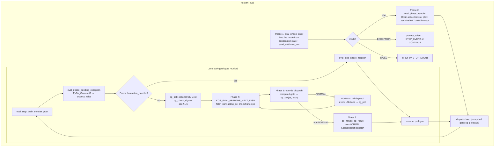
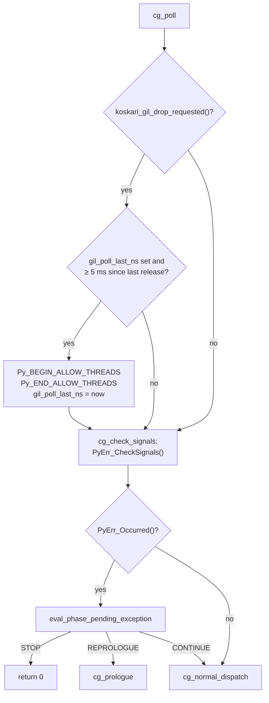
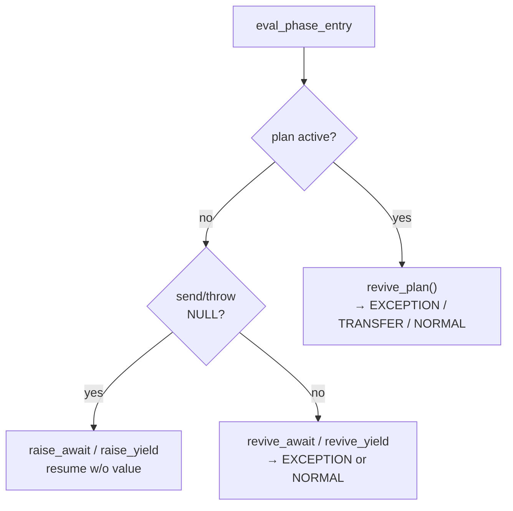
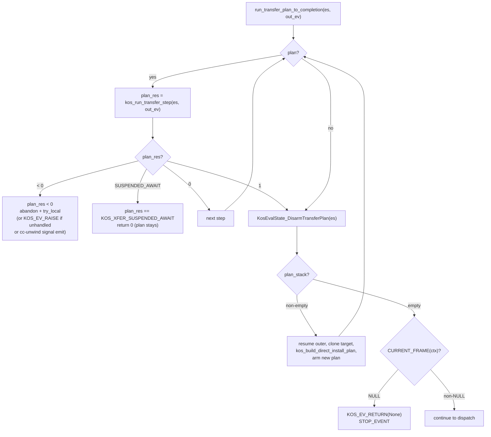
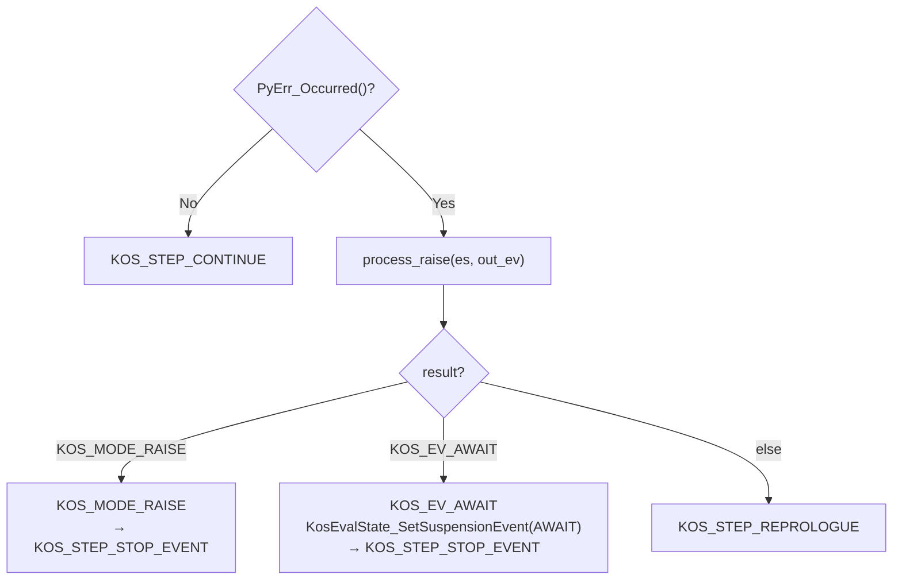
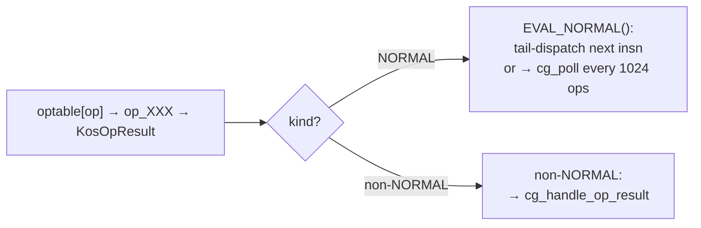
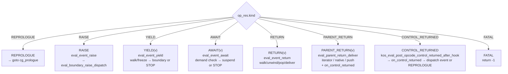
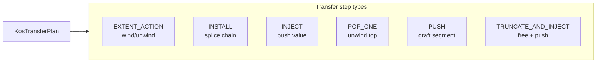
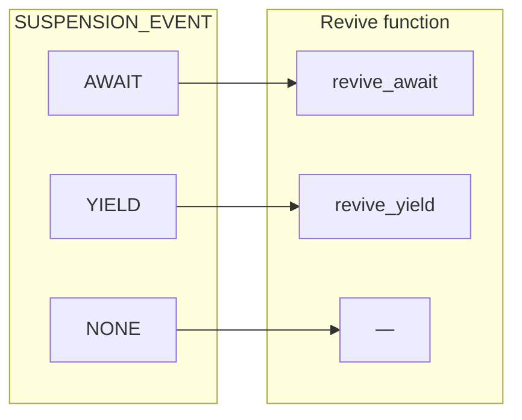

# Koskari Evaluator: Operation and Control Flow

This document describes the operation of the koskari eval loop in `koskari/lib/eval.c`: its stages, how opcodes are invoked and signal back, exception handling, control transit (event-driven handle/unwind model), transfer plans, tail calls, call installs, and resumption paths.

Implementation reference: `koskari/lib/eval.c`, `koskari/lib/eval/eval_gil.c` (included into `eval.c`; `koskari_gil_drop_requested`), `koskari/lib/eval/eval_chain.c` (included into `eval.c`; transfer-plan drain and replan), `koskari/lib/eval.h` (including suspension tagging, Python await/resume bridge fields, and domain TLS scope wrappers in `eval.c`), `koskari/lib/dynchain.c` / `koskari/lib/dynchain.h` / `koskari/lib/dynchain/dyn_walk.c` / `koskari/lib/dynchain/xfer_plan.c` (walk and xfer units are `#include`d by `dynchain.c`), and `design/interpreter/evaluator.md`. For the staged `KosEvalState` surface and migration rationale, see `design/kos_eval_state_api_migration.md`. For live-field authority, choke-point funnel, and removing scatter `SyncFromContext` (performance; behavioral freeze), see `design/interpreter/eval-state-live-authority.md`.

---

## 1. High-Level Structure

### 1.1 Entry Point

```c
int koskari_eval(KosContext *ctx, KosEvent *out_ev,
                 PyObject *send_val, PyObject *throw_typ, PyObject *throw_exc);
```

The evaluator runs until it hits a **boundary event** (return, raise, yield, await) or a fatal error. It returns:
- **0**: Normal exit; `out_ev` contains the boundary event.
- **-1**: Fatal internal error; `PyErr` is set.

`send_val` and `throw_typ`/`throw_exc` are the resume arguments (both may be NULL for a fresh start or null resume).

`koskari_eval` builds a stack **`KosEvalState`** (`KosEvalState_Init(&es, ctx)`), marks the context running, and pushes the per-thread **domain scope** via **`KosEvalState_EnterDomainScope(&es)`** (token stack and live depth in `domain.c` TLS). On exit (including error paths through **`koskari_eval_cleanup`**), it flushes registers, calls **`KosEvalState_LeaveDomainScope(&es)`**, and returns. All loop phases and opcode handlers use **`&es`**; hot-path mirrors (`frame`, `code`, `pc`, operand stack) stay in sync via **`kos_dyn_retarget_after_push`**, **`kos_dyn_commit_dyn_top`** (incremental pop retarget), and **`kos_dyn_rebuild_live_from_chain`** when the chain shape requires a full walk.

### 1.2 Main Loop Phases



### 1.3 Design goals: orchestration, reactions, and local opcodes

Koskari aims for an evaluator that is easy to picture as a **pipeline of
boxes**: clear event boundaries, generic chain behavior where it helps, and
room to add new control (for example a new stop reason or a hypothetical
debug interrupt) by **extending the same pattern** instead of threading special
cases through every opcode.

A useful summary of that intent:

| Layer | Owns |
| ----- | ---- |
| **Eval** (`eval.c`) | **Orchestration**: when to run post-opcode handling, how `out_ev` and suspension line up, ordering between unwind/pop/freeze and consumer delivery, `process_raise` / exception routing, transfer-plan interaction with the loop. |
| **DynNodes** (`dynchain*.c`, kind helpers) | **Reactions**: what a particular node kind does when walked, unwound, or notified (e.g. `kos_dynnode_on_control_returned` for WIND/WITH, NEXT/FOREACH/YIELD_FROM delivery primitives). |
| **Opcodes** (`opcode/*.c`) | **Local stack and unwind steps**: pop/push operands, request chain transitions via **`KosEvalState_Transition`** (wrapper around the internal dynchain dispatcher), return **`KosOpResult`** via `EVAL_*` macros so the loop can run the right follow-up. Opcode sources do not use **`KosContext_*`** field macros directly; they go through **`KosEvalState_*`** helpers declared in **`eval.h`**. |

The goal is **compartmentalization**: new behavior should touch the layers it
actually needs (a new opcode, a new cap on a node, or a new branch in eval’s
post-opcode pipeline), without forcing unrelated code to “learn” a new case.

**Where we are not there yet (honest gaps):**

- **No single generic “boundary event” dispatcher on dynnodes.** WIND/WITH use
  `kos_dynnode_on_control_returned`; flattened iterator return/yield still
  spread across eval helpers (`eval_parent_return_deliver`,
  `eval_event_yield_deliver_to_boundary`, etc.) and **kind-specific** helpers in
  `dyn_next.c` / `dyn_yield_from.c`. A unified `kos_dynnode_on_boundary_event`-
  style API remains a direction, not a full replacement for those paths yet
  (see [interpreter/boundary-control-reemit.md](interpreter/boundary-control-reemit.md)).

- **Large opcodes.** Handlers such as **YIELD_FROM** still bundle substantial
  logic in one file; the eval/dynchain split reduces duplication but does not
  yet shrink every opcode to “thin local work + one transition.”

- **Native frames** (`native_handler`) are a parallel “mini eval” on the same
  chain: orchestration and reaction blur at the frame boundary because the
  handler is not a bytecode opcode.

- **AWAIT** is intentionally **not** folded into the same boundary-control
  staging as RETURN/YIELD parent delivery; that keeps semantics stable but
  means “one pipeline for every suspend kind” is not a literal single path.

- **Exceptions** are centralized for post-opcode `PyErr` via
  `eval_boundary_raise_dispatch`, but **try/finally**, **WITH**, and
  **transfer-plan** failure paths still interact with eval and dynchain in
  several places—good for correctness, harder to draw as one box.

These gaps are useful to track: they mark where future refactors should push
**policy toward eval** and **reactions toward dynchain**, without pretending
the codebase is already uniform end-to-end.

### 1.4 KosEvalState API (eval-facing glue)

Eval and opcodes share a single **`KosEvalState *es`** for the running slice. Notable entry points:

- **`KosEvalState_Transition(es, req, res, out_ev)`** — Public name for dynamic-chain transitions (RETURN walk, unwind-to-frame/node, yield walk, loop transfer, local raise). Implemented in **`eval/eval_chain.c`** atop **`kos_dyn_transition_internal`**; on **`-1`** propagates **`PyErr`** without rebuilding live fields.
- **Transfer plans** — **`KosEvalState_ArmTransferPlan`**, **`KosEvalState_DisarmTransferPlan`**, **`KosEvalState_HasActiveTransferPlan`**, plan stack **suspend/resume** helpers; delimited return **`KosEvalState_KReturnDelimited`**.
- **Pending return / unwind target** — **`KosEvalState_SetPendingReturn`**, **`KosEvalState_SetUnwindTargetFrame`**.
- **Opcode-visible flags** — **`KosEvalState_MarkSuspendedNotRunning`**, **`MarkDeadAfterYield`**, **`MarkDeadAfterReturn`**.
- **Globals / inject / iteration** — **`KosEvalState_GlobalsNamespace`**, **`KosEvalState_TakeInjectThrow`**, **`op_get_next_from_iter(es, …)`**, **`KosEvalState_EagerStepAwaitable`** (first eager **`__await__`/`send(None)`** step for awaitables; used from AWAIT plumbing and **`YIELD_FROM`**).
- **`eval.c`** (suspension / Python bridge / domain scope) — **`KosEvalState_SetSuspensionEvent`**, **`KosEvalState_ClearSuspensionEvent`**, **`KosEvalState_SuspensionEvent`**; **`KosEvalState_PythonAwaitSetIter` / `PythonAwaitClearIter` / `PythonAwaitIter`**; **`KosEvalState_PythonResumeSet` / `PythonResumeTake`**; **`KosEvalState_EnterDomainScope` / `LeaveDomainScope`**.

### 1.5 Derived `KosContext` caches (`frame_top`, `block`, `namespace`)

These fields summarize the innermost frame, operand-stack head, and namespace along the dynamic chain (same predicate as the walk in **`KosEvalState_RefreshDynCaches`**). **`KosEvalState`** mirrors them for opcode hot paths.

| Mechanism | Role |
| --------- | ---- |
| **`KosEvalState_PatchDynCaches(es, new_node)`** | **Trusting push-only** update after **`new_node` is already `dyn_top`** via **`kos_dyn_push`** / **`kos_dyn_push_noinstall`**: O(1), no parent walk. Frame nodes refresh all three derived fields from that frame; other nodes update **namespace** and/or **block** only when the node carries them. Always ends with **`KosEvalState_ApplyDynCaches`**. |
| **`KosEvalState_RefreshDynCaches(es)`** | **Full recompute** (walk from **`dyn_top`**, then **`ApplyDynCaches`**). Used when the head changes by **pop**, **splice**, **`kos_dyn_commit_dyn_top`** without the simple-push contract (uninstall after pop, transfer-plan steps, **`kos_dyn_gen_install`** publishing a grafted segment, etc.). |
| **`kos_dyn_rebuild_live_from_chain(es)`** | Full walk from **`dyn_top`** when incremental retarget does not apply (xfer INSTALL/PUSH, splices, bootstrap). |

Optional **`KOS_DEBUG_PATCH_DYN_CACHES`**: after push retarget, compare incremental caches to a full rebuild and raise on mismatch.

Coroutine drivers outside the bytecode loop (**`coro.c`**) still hold a **`KosContext *`** on the **`KosCoroutine`** object; they construct a short-lived **`KosEvalState`** when they need the same Python-bridge helpers as **`revive_await`**.

### 1.6 GIL cooperation and signal polling

Long-running bytecode loops must yield the GIL when CPython has asked this
thread to drop it, and must honor Python pending signals (for example **Ctrl-C**
/ **KeyboardInterrupt**). This is implemented in
**`koskari_eval_dispatch_computed_goto`** (`eval.c`), with
**`koskari_gil_drop_requested`** in **`koskari/lib/eval/eval_gil.c`** (textually
included from **`eval.c`**). It is not stored on **`KosContext`** or
**`KosEvalState`**.

| Mechanism | Role |
| --------- | ---- |
| **`koskari_gil_drop_requested()`** | Static inline in **`eval_gil.c`**. Returns **1** when another thread has set CPython’s per-thread or per-interpreter **gil drop request** (see below); **0** on free-threaded builds (**`Py_GIL_DISABLED`**). On unsupported CPython minor versions (outside the 3.9–3.13+ probes), returns **1** so time-gated release can still run. |
| **`gil_poll_ops`** (stack local) | Reset to **0** at **`cg_poll`**. Incremented on each **RUN** tail-dispatch; when **`++gil_poll_ops > KOS_EVAL_GIL_POLL`** (**1024**), control jumps to **`cg_poll`**. |
| **`gil_poll_last_ns`** (stack local) | Monotonic timestamp of the last paired GIL release (`clock_gettime(CLOCK_MONOTONIC)`). |
| **`KOS_EVAL_GIL_POLL_INTERVAL_NS`** | Minimum **5 ms** between paired GIL yields (when the clock read succeeds and **`gil_poll_last_ns`** is already set). |
| **`Py_BEGIN_ALLOW_THREADS` / `Py_END_ALLOW_THREADS`** | Brief paired release at **`cg_poll`** only when **drop requested** and the interval gate passes (same C block). |
| **`PyErr_CheckSignals()`** | Runs at **`cg_check_signals`** after **`cg_poll`** on every visit to the poll site. |

**`koskari_gil_drop_requested` and CPython layout**

The probe reads CPython interpreter internals (not a public API). Layout
differs by version:

| CPython | Field read |
| ------- | ---------- |
| **3.13+** | **`PyThreadState`**: **`eval_breaker`**, GIL-drop request is bit **0**. |
| **3.9–3.12** | **`PyInterpreterState` → `ceval.gil_drop_request`** (version-specific struct sizes in **`eval_gil.c`**). |
| **`Py_GIL_DISABLED`** | Always **0** (no GIL to drop). |
| **Other minors** | Always **1** (cannot detect request; poll may still attempt interval-gated release). |

**Where polling runs**

1. **Prologue reunion** — After transfer drain, pending-exception check,
   post-opcode event handling, and optional native-frame iteration, **`goto
   cg_poll`** before **`KOS_EVAL_PREPARE_NEXT_INSN`**.
2. **NORMAL tail-dispatch** — After an opcode returns **`EVAL_NORMAL()`**
   (hot path), when **`gil_poll_ops`** exceeds **`KOS_EVAL_GIL_POLL`**, branch
   to **`cg_poll`** instead of fetching the next instruction immediately.

**Poll-site sequence** (computed-goto labels in **`eval.c`**):



Signal checking is unconditional at **`cg_check_signals`**. GIL release is
conditional: no **`Py_BEGIN_ALLOW_THREADS`** unless CPython (or the unsupported-
minor fallback) reports a drop request **and** at least **5 ms** have passed
since the timestamp recorded at the previous release.

**Relationship to Phase 3:** **`eval_phase_pending_exception`** still runs at the
start of each prologue (before **`cg_poll`**). **`PyErr_CheckSignals()`** at
**`cg_check_signals`** may set **`PyErr`** again; **`eval_phase_pending_exception`**
then runs so interrupts are not deferred until the next full prologue cycle.

**Future work:** Domain-scoped **`maybe_cooperate()`** / **`ensure_gil()`** and
cooperation inside dynchain walks are described in
[interpreter/gil-cooperation.md](interpreter/gil-cooperation.md) (design
proposal; not yet the primary mechanism). See also [TODO.md](TODO.md) § GIL.

---

## 2. Phase Detail Diagrams

### 2.1 Phase 1: Entry and Revive

**eval_phase_entry** chooses the initial `KosEvalMode`:



**Revive paths:**
- **revive_plan**: Resume a suspended transfer plan. If `throw_exc` set → `KOS_MODE_EXCEPTION`. Else inject `send_val` into plan → `KOS_MODE_TRANSFER`.
- **revive_await / revive_yield**: If `throw_exc` and `revive_yield` → `PyErr_SetObject`, `KOS_MODE_EXCEPTION`. If `throw_exc` and `revive_await` with **`KosEvalState_PythonAwaitIter(es)`** set → `iterator.throw(typ, val, tb)` first (same idea as `coroutine_throw` when waiting on a Python await iterator): on `StopIteration`, the await completes and the normal inject/send path runs; on non-NULL `throw` result, `out_ev` is `KOS_EV_AWAIT` again and `eval_phase_entry` returns `STOP_EVENT` with `KOS_MODE_AWAIT` (re-suspend); if there is no iterator, or `throw` leaves another error, `KOS_MODE_EXCEPTION`. If no `throw_exc`, `revive_await` consumes **`KosEvalState_PythonResumeTake`** (or **`send_val`**) and pushes onto stack when non-NULL, then `KOS_MODE_NORMAL`. YIELD_FROM uses these same revive paths (its phase selects AWAIT or YIELD); there is no separate `revive_yield_from` or `KOS_SUSP_YIELD_FROM`.
  - From the caller's perspective, both plain `YIELD` and `YIELD_FROM` suspensions surface as the same boundary kinds (`KOS_EV_YIELD` or `KOS_EV_AWAIT`), so resume routing is identical.

**Mode dispatch outcomes:**
- `KOS_MODE_AWAIT` (re-suspend after `throw` into the stored Python await iterator yielded again) → **`KosEvalState_SetSuspensionEvent(es, KOS_SUSP_AWAIT)`**, **`KosEvalState_MarkSuspendedNotRunning(es)`**, `KOS_STEP_STOP_EVENT` (same suspend shape as opcode AWAIT).
- `KOS_MODE_EXCEPTION` → `try_local_exception_handler`; on success → `KOS_STEP_CONTINUE` or `KOS_STEP_STOP_EVENT` (AWAIT); on failure → `out_ev = KOS_EV_RAISE`, `KOS_STEP_STOP_EVENT`.
- `KOS_MODE_RAISE` → fetch exception, decorate, fill `out_ev`, `KOS_STEP_STOP_EVENT`.

### 2.2 Phase 2: Transfer Plan Drain

**eval_phase_transfer** runs when the context has an active transfer plan (equivalently **`KosEvalState_HasActiveTransferPlan(&es)`**):



When a wind thunk invokes a nested continuation during an active plan, the outer
plan is suspended on **`plan_stack`**. After the inner plan drains,
**`kos_resume_transfer_plan`** pops the outer, clones **`original_target`** before
disarm (UAF avoidance), rebuilds via **`kos_build_direct_install_plan`**, and
continues draining. See [interpreter/interrupted-transfer-plans.md](interpreter/interrupted-transfer-plans.md) §5.

**Failed transfer (implemented):** on step failure (except foreign cc-unwind
sentinel re-emit), **`kos_abandon_transfer_nest`** disarms the plan and frees
**`plan_stack`**, then **`try_local_exception_handler`** runs on the manifested
chain. Return `1` continues the eval loop when a handler applies; unhandled
exceptions emit **`KOS_EV_RAISE`**. **`KOS_DYN_CC_RAISE`** sentinel steps emit
**`KOS_EV_RAISE`** upward without **`try_local`**. See
[interpreter/interrupted-transfer-plans.md](interpreter/interrupted-transfer-plans.md) §3–§4.

### 2.3 Phase 3: Pending Exception Check

At each **prologue reunion**, **eval_phase_pending_exception** handles
`PyErr_Occurred()` (opcode failure, continuation apply, async exception, etc.).
The same helper runs again at the **GIL poll site** when **`PyErr_CheckSignals()`**
sets a pending interrupt (see §1.6).



### 2.4 Phase 4: Prepare next instruction

**`KOS_EVAL_PREPARE_NEXT_INSN`** (macro in `eval.c`) sets a local **`KosOp *insn`** to the current instruction in **`KosCode_CODE`** and updates the frame: load `code` and `pc`, optional **`SAYF`** trace, set `acting_pc`, pre-advance `pc`. It assumes a valid frame, in-range `pc`, and valid bytecode (no defensive checks).

Opcode handlers receive **`KosEvalState *es`** (see **`koskari/lib/eval.h`**): cached **`frame`**, **`code`**, operand-stack **`block`**, and live **`pc`** / **`acting_pc`** registers for the eval slice, aligned with **`KosEvalState_CONTEXT(es)`** via **`KosEvalState_PatchDynCaches`**, **`KosEvalState_RefreshDynCaches`**, and **`KosEvalState_SyncFromContext`** as summarized in section 1.5 above. There is no separate per-opcode struct beyond handler parameters; the hot path keeps **`KosOp *insn`** into **`op_*`**. **`cg_handle_op_result`** does not receive `insn`; it switches on the returned `KosOpResult.kind`.

PC is rolled back for WITH enter/exit suspend so the same instruction is retried on resume.

#### 2.4.1 Flattened Koskari async generator attach (NEXT / ITER_NEXT / YIELD_FROM)

When a **KosPyAsyncGen** is stepped **inside** the same **`koskari_eval`** invocation (not from Python **`__anext__`** alone), **`koskari/lib/eval.c`** installs its active dyn chain onto the **consumer** context. **`op_attach_koskari_agen_frame`** (**NEXT**), **`op_attach_koskari_agen_frame_for_iter_next`** (**ITER_NEXT**), and **`op_attach_koskari_agen_frame_for_yield_from`** (**YIELD_FROM** kos-async-gen driver) each validate **`gen`** / **`KosDynGen_ACTIVE`**, run **opcode-specific** failure cleanup (NEXT abort + decrefs; ITER_NEXT may reset **`KOS_DYN_FOREACH`** step phase; YIELD_FROM pops **`KOS_DYN_YIELD_FROM`**), then call **`kos_attach_agen_gen_flatten(es, agen, gen)`** (static). That small helper clears **`agen->ctx`**’s **`dyn_top`** / **`frame_top`** and calls **`kos_dyn_gen_install(es, gen)`**. **`kos_dyn_gen_install`** publishes the restored **`dyn_top`** via **`kos_dyn_commit_dyn_top(es, active)`**, which runs **`KosEvalState_RefreshDynCaches`** (full chain walk, then **`KosEvalState_ApplyDynCaches`**) — **not** **`PatchDynCaches`**, because install grafts a frozen **segment** rather than appending a single new head. Earlier draft text in this section sometimes paired that path with **`KosEvalState_SyncFromContext`**; **`RefreshDynCaches`** already applies eval mirrors via **`ApplyDynCaches`**, so that was redundant.

The **same** live **`es`** passed into the opcode must be forwarded to the attach path. All three helpers take **`KosEvalState *es`** first so **`kos_dyn_gen_install`** refreshes the interpreter’s eval-state mirrors—not a temporary **`KosEvalState`** built only for install.

When a **KosPyAsyncGen** is resumed from Python drivers (**`iter.c`**, **`demand.c`**) with a frozen chain in **`KosDynGen_ACTIVE`**, those paths build **`KosEvalState`** on the **`agen->ctx`** stack, call **`kos_dyn_gen_frozen_needs_install_es(&es, g)`**, and only then **`kos_dyn_gen_install(&es, g)`** so the consumer context’s **`dyn_top`** is updated through the same helpers as the in-eval attach path.

### 2.5 Phase 5: Opcode Dispatch



Handlers return a **`KosOpResult {KosOpResultKind kind; PyObject *val}`** via the
`EVAL_*` macros declared in `eval.h`. **`EVAL_NORMAL()`** is the hot path:
the loop may fetch the next instruction immediately or branch to the **GIL poll
site** (§1.6) when the opcode counter wraps. All other kinds enter
**`cg_handle_op_result`** (Phase 6).

### 2.6 Phase 6: `cg_handle_op_result`

**`cg_handle_op_result`** switches on `op_res.kind` and routes each result to
the appropriate centralized event helper:



**`eval_event_yield`** runs **`eval_yield_handle_walk_and_freeze`** via
**`KosEvalState_Transition`** (`KOS_TRANS_WALK_HANDLE_YIELD`). The generator node
(**`KOS_DYN_GEN`**) consumes the event and freezes. Whether **`koskari_eval`**
stops depends on flattened iterator delivery:
- If **`kos_dyn_need_kos_agen_boundary_deliver`** (a **NEXT**, **FOREACH**,
  or **YIELD_FROM** boundary is active), **`eval_event_yield_deliver_to_boundary`**
  pushes or delivers the payload to the consumer and returns **REPROLOGUE** (eval
  keeps running). One YIELD_FROM sub-path can end in **STOP_EVENT**.
- Otherwise **`KosEvalState_SetSuspensionEvent(es, KOS_SUSP_YIELD)`** and
  **STOP_EVENT**; the driver sees `out_ev.kind == KOS_EV_AWAIT` and later resumes
  via **`revive_yield(send_val)`**.

**`eval_event_await`** checks `kos_eval_in_demand(es)` first (see §7.5); on
denial, it raises a sync-violation exception. On normal suspension it calls
**`KosEvalState_MarkSuspendedNotRunning`**, sets `out_ev = KOS_EV_AWAIT`,
and returns **STOP_EVENT**.

**`eval_event_return`** handles all phases of frame return: `KOS_TRANS_WALK_RETURN_TO_FRAME`
(or delimited path), marks context DEAD, runs `kos_dyn_pop_frame`, then delivers:
- **Top-level / GEN parent:** fills `out_ev = KOS_EV_RETURN`, **STOP_EVENT**.
- **Normal parent (non-GEN):** falls through to **`eval_parent_return_deliver`**
  (iterator boundary, native handler or stack push, `kos_dynnode_on_control_returned`),
  then **REPROLOGUE**.

**CONTROL_RETURNED path** (`kos_eval_post_opcode_control_returned_after_hook`):
runs `kos_dynnode_on_control_returned` for WIND/WITH; on non-zero result dispatches
any event (AWAIT/YIELD/RETURN-boundary/PyErr) the hook placed in `out_ev`; otherwise
**REPROLOGUE**. This is the only path inside eval that still uses `out_ev`-based
event dispatch (opcode handlers use `KosOpResult` directly).

---

## 3. Opcode Signaling

Handlers return **`KosOpResult {KosOpResultKind kind; PyObject *val}`** via the
`EVAL_*` macros in `eval.h`. `EVAL_NORMAL()` is the hot path. All other kinds
enter `cg_handle_op_result` (Phase 6).

```mermaid
flowchart TD
    subgraph opcode_return[“KosOpResult kinds”]
        rn[“EVAL_NORMAL()<br/>hot path: tail-dispatch next insn”]
        rr[“EVAL_REPROLOGUE()<br/>full prologue before next insn”]
        re[“EVAL_RAISE()<br/>PyErr set → eval_event_raise”]
        ry[“EVAL_YIELD(v)<br/>→ eval_event_yield”]
        ra[“EVAL_AWAIT(v)<br/>→ eval_event_await”]
        rret[“EVAL_RETURN(v)<br/>→ eval_event_return”]
        rpret[“EVAL_PARENT_RETURN(v)<br/>→ eval_parent_return_deliver”]
        rc[“EVAL_CONTROL_RETURNED()<br/>→ on_control_returned hook”]
        rf[“EVAL_FATAL()<br/>return -1 (non-PyErr fault)”]
    end
```

### 3.1 Opcode Handler Return Macros

| Macro | Kind | Meaning |
|-------|------|---------|
| `EVAL_NORMAL()` | `KOS_RES_NORMAL` | Continue to next instruction (no prologue). |
| `EVAL_REPROLOGUE()` | `KOS_RES_REPROLOGUE` | Re-run full prologue before next opcode (new frame, transfer plan, etc.). |
| `EVAL_RAISE()` | `KOS_RES_RAISE` | **`PyErr`** set; route to **`eval_event_raise`** → **`eval_boundary_raise_dispatch`**. |
| `EVAL_YIELD(v)` | `KOS_RES_YIELD` | Generator yield with payload `v`; route to **`eval_event_yield`**. |
| `EVAL_AWAIT(v)` | `KOS_RES_AWAIT` | Suspend on awaitable `v`; route to **`eval_event_await`** (demand check first). |
| `EVAL_RETURN(v)` | `KOS_RES_RETURN` | Frame return with value `v`; route to **`eval_event_return`** (walk / unwind / pop / deliver). |
| `EVAL_PARENT_RETURN(v)` | `KOS_RES_PARENT_RETURN` | Post-pop parent delivery (RETURN Phase 2b after **`kos_dyn_pop_frame`**); route to **`eval_parent_return_deliver`**. |
| `EVAL_CONTROL_RETURNED()` | `KOS_RES_CONTROL_RETURNED` | WIND/WITH thunk or TAIL_CALL install complete; route to **`kos_eval_post_opcode_control_returned_after_hook`**. |
| `EVAL_FATAL()` | `KOS_RES_FATAL` | Non-`PyErr` internal fault; `koskari_eval` returns -1 immediately. |

### 3.2 What Opcodes Signal and When

- **`EVAL_NORMAL()`**: Next instruction runs immediately. Used by almost all opcodes on the success path.
- **`EVAL_REPROLOGUE()`**: Used after installing a new frame or arming a transfer plan, so the prologue can drain before the next opcode.
- **`EVAL_YIELD(v)` / `EVAL_AWAIT(v)`**: Emitted from YIELD, YIELD_FROM, AWAIT, and auto-await after CALL. `EVAL_NORMAL()` is used instead when the yield is **in-loop** (non-GEN parent delivers directly without a driver-visible boundary).
- **`EVAL_RETURN(v)`**: Top-level RETURN or RETURN with a GEN parent — frame is still live when this is returned; `eval_event_return` does the pop. (Contrast with `EVAL_PARENT_RETURN` below.)
- **`EVAL_PARENT_RETURN(v)`**: RETURN Phase 2b — the callee frame was already popped by the RETURN opcode before returning; `eval_parent_return_deliver` delivers the value to the caller.
- **`EVAL_CONTROL_RETURNED()`**: TAIL_CALL install or native handler follow-up needing `kos_dynnode_on_control_returned`.
- **`EVAL_RAISE()`**: Any error path with `PyErr` set.

### 3.3 Boundary Events and Parent Frame

**Driver-visible** **`koskari_eval`** boundaries use **`KosEventKind`** in **`out_ev`**
when the eval loop stops (**`STOP_EVENT`**). Internal post tags (**4**, etc.) are
not new public event kinds.

Typical **surface** boundaries:

- **RETURN** → **`KOS_EV_RETURN`** when evaluation completes (**top-level** or **GEN**
  parent / Phase 2c), or when a **suspending** opcode posts suspend with return
  payload as today.
- **RAISE** → **`KOS_EV_RAISE`**
- **YIELD** → **`KOS_EV_YIELD`** when the generator boundary applies (parent is GEN
  or no parent for the yield), or YIELD_FROM emits yield.
- **AWAIT** → **`KOS_EV_AWAIT`**

When the frame **has a parent that is not GEN** (normal nested CALL return —
RETURN Phase 2b): the opcode runs **`KosEvalState_Transition`** then **`kos_dyn_pop_frame`**,
then returns **`EVAL_PARENT_RETURN(val)`** so **`eval_parent_return_deliver`** runs
(iterator NEXT/FOREACH/YIELD_FROM boundary if applicable, else push onto caller or
native handler, then **`kos_dynnode_on_control_returned`**). The outer driver does
**not** get a new **`KOS_EV_RETURN`** for that step; the loop keeps running in the
caller.

**DELIMITED** return (**`RETURN_TARGET_CHAIN`**) is separate (Phase 2a) and may
build a transfer plan.

---

## 4. Exception Handling

### 4.1 Exception Flow


### 4.2 try_local_exception_handler

1. `kos_find_node_for_raise(es)` — topmost enabled TRY or FINALLY.
2. If found: clear stack block, set PC to handler, stash exception in `PyErr_SetExcInfo`, clear PyErr, set `handling_raise` on FINALLY, return 1.
3. If not found: walk chain from `dyn_top` toward frame. For each node:
   - `kos_dyn_pop_top`; if `KOS_DYN_UNWIND_ASYNC_STARTED`, return 1.
   - If pop fails (BARRIER): dispatch to `kos_dyn_exception_unwind` if node has HANDLES_EXCEPTIONS.
   - If node may-swallow and PyErr cleared: set PC to catch_resume_pc, return 1.
4. If no handler: `inject_eval_frame_traceback`, fill `out_ev` with KOS_EV_RAISE, return 0.

### 4.3 Traceback Injection

`inject_eval_frame_traceback` decorates the exception with `__koskari_dynchain__` and injects the current frame into the traceback so Python can display Koskari-native frames. Called at:
- `try_local_exception_handler` (handle and re-raise branches)
- `KOS_MODE_RAISE` at entry
- `run_transfer_plan_to_completion` when a transfer step fails

---

## 5. Control Transit (Event-Driven Model)

Dynamic nodes on the dynchain participate in control flow through a small
lifecycle vocabulary and a two-phase transit model: **handle** then **unwind**
(unless the transit is AWAIT, which does not walk or pop the chain).

### 5.1 Lifecycle vocabulary

- **push(node)** — Link the node onto the dynchain (structural only: stack
  block, namespace, frame resources). No user code, suspension, or transfer.
- **wind(node)** — Enter the node’s active extent; may run user code (`__enter__`,
  dynamic-wind before-thunk, parameterize bindings) and may suspend or start a
  transfer. Often paired with **push** on construct entry and on transfer
  re-entry.
- **resume(node)** — Normal return to an already-active node after a
  subordinate step; node stays on chain. Payload is delivered by pushing to TOS
  then redispatching (send value, await result, yield-from delegate step).
- **handle(node, event)** — Offer a **control transit** (RETURN, RAISE, YIELD,
  BREAK, CONTINUE, SHIFT). Does **not** unlink the node; outcome is PASS, CONSUME,
  or DENY (see §5.3).
- **unwind(node, event)** — Leave the extent semantically; event records *why*.
  Used for after-thunks, teardown, and walking the chain during transits.
- **pop(node)** — Structural unlink (usually after unwind).
- **free(node)** — Destroy storage when ownership allows (generator nodes may
  defer until the generator object dies).

### 5.2 Construct entry

On entering constructs such as `with`, `dynamic-wind`, or handler scopes, the
evaluator performs **push** then **wind**. **push** stays cheap; **wind** runs
side-effectful entry and may suspend. Separating them avoids running user code
before the node is fully linked.

### 5.3 resume vs handle

- **resume** — Ordinary continuation **within** the current extent (value on TOS,
  node still installed).
- **handle** — A **control transit** that may cross nodes (return, raise, yield,
  break, continue, shift).

Keeping this distinction stable lets opcode and transfer machinery stay generic
while node kinds specialize behavior.

### 5.4 handle(node, event)

`kos_dyn_handle(ctx, node, event)` offers a control transit to each node. The node may:
- **PASS** — pass through unchanged
- **CONSUME** — handle the event (e.g. TRY catches RAISE, FINALLY consumes RETURN)
- **DENY** — reject (e.g. generator boundary denies SHIFT)

### 5.5 unwind(node, event)

`kos_dyn_unwind` takes a `KosXferEvent` (RETURN, RAISE, YIELD, BREAK, CONTINUE, SHIFT) so nodes know *why* they are being torn down. Transfer-aware nodes (e.g. `dynamic-wind`) use this for after-thunks.

### 5.6 Transit types

| Transit | Walk | Key functions |
|---------|------|----------------|
| RETURN | handle(RETURN) per node; FINALLY may overwrite value; if not consumed, unwind → pop callee frame; **parent** delivery for normal calls is **`eval_parent_return_deliver`** after pop (not inline in the opcode). Top-level / GEN-parent completion sets **`KOS_EV_RETURN`** in the opcode. | **`KosEvalState_Transition`** / `kos_dyn_walk_return_to_frame`; **`eval_parent_return_deliver`** |
| RAISE | handle(RAISE); TRY/FINALLY catch; else unwind → pop | `process_raise` → `try_local_exception_handler`; `kos_dyn_handle` on unwind path |
| YIELD | handle(YIELD) per node until generator boundary consumes; post-opcode **`eval_event_yield`** walks/freeze then optional **`eval_event_yield_deliver_to_boundary`** | `kos_dyn_walk_handle_yield` (via **`KosEvalState_Transition`** **`KOS_TRANS_WALK_HANDLE_YIELD`**) |
| AWAIT | **No** chain unwind or pop; full dynchain preserved; evaluator suspends with `KOS_EV_AWAIT` | AWAIT opcode, `revive_await` |
| BREAK / CONTINUE | Find loop in-frame; walk unwind/pop to loop; handle on loop; resume at loop head or after loop | `kos_dyn_transfer_to_loop` |
| SHIFT | handle(SHIFT); prompt consumes; generator boundary denies crossing | `kos_dyn_walk_handle_shift_to_prompt` |

**YIELD details:** Nodes from the emitter up to the generator boundary see
handle(YIELD); the emitter (e.g. yield-from) often passes through. The generator
boundary captures/frozen state and detaches. **Top-level** generator: suspend
and return the yield value. **Flattened** iterator stepping (**NEXT** /
**FOREACH** / **YIELD_FROM** boundary): **`eval_event_yield_deliver_to_boundary`**
may deliver the payload without stopping **`koskari_eval`**. Nodes that care may
pair unwind-before-suspend with wind-on-resume.

**Generator close:** `close` uses the normal exception path (GeneratorExit via
RAISE transit), not a separate inbound channel.

### 5.7 Generator boundary node

`KOS_DYN_GEN` marks the generator boundary. It is pushed when a generator or coroutine is **installed** (e.g. when Python drives a Koskari generator via `send`/`throw`); the frame's parent is then the GEN node.

- **handle(YIELD)**: GEN **consumes** the event. After an opcode sets **`out_ev.kind = KOS_EV_YIELD`**, **`eval_event_yield`** runs **`eval_yield_handle_walk_and_freeze`**, which invokes **`kos_dyn_walk_handle_yield`** (via **`KosEvalState_Transition`**). GEN's handler runs (e.g. **`kos_dyn_gen_freeze_and_release`**): the current dynchain is captured/frozen. Resumption is via **`revive_yield`**, which pushes **`send_val`** onto the stack and continues at the next instruction.

Whether control returns to the caller depends on evaluator flattening:
- In the regular case, **`eval_event_yield`** (called from `cg_handle_op_result` for `KOS_RES_YIELD`) runs **`eval_yield_handle_walk_and_freeze`** then may call **`KosEvalState_SetSuspensionEvent(es, KOS_SUSP_YIELD)`** and STOP_EVENT; the caller resumes via **`revive_yield`**.
- In flattened async-gen stepping (**`kos_dyn_need_kos_agen_boundary_deliver`**), boundary delivery may run without an external suspension; otherwise same tail path.
- **handle(SHIFT)**: GEN **denies**; shift cannot cross the generator boundary.
- **RETURN** when the frame's parent is GEN (or there is no parent) produces a boundary event `KOS_EV_RETURN` and the evaluator exits; the driver receives the return value (e.g. StopIteration for sync generators).

### 5.8 Node behavior categories

- **Lexical / resource nodes** (e.g. `with`): **push** / **wind**, **unwind** /
  **pop**, often **handle(RAISE)**; typically ignore YIELD.
- **Transfer-aware nodes** (e.g. `dynamic-wind`): **wind** and **unwind** on
  RETURN, RAISE, YIELD (when suspension counts as leaving the extent), BREAK,
  CONTINUE, SHIFT.
- **Interceptors** (`try` / `except`, `finally`): primarily **handle(event)**;
  may transform or swallow transits.
- **Resumable operation nodes** (e.g. `KOS_DYN_YIELD_FROM`): **resume** for
  delegate steps; internal state machine across suspensions; may **handle** for
  delegation.
- **Generator boundary (`KOS_DYN_GEN`)**: intercepts YIELD and RETURN/RAISE as
  documented in §5.7; **denies** SHIFT across the boundary. The generator object
  owns the node; the chain borrows it during execution.

**Boundaries:** When a rule would be violated, the responsible node **denies**
in **handle** (e.g. SHIFT at GEN). **BREAK** / **CONTINUE** targeting fails in
the find phase before unwind if no loop exists in-frame.

### 5.9 Inbound events from the driver

- **Value on TOS** — After **push** to TOS, **resume** runs with the active node
  consuming TOS (yield **send**, await completion, yield-from delegate).
- **Throw / close** — Delivered as a normal **RAISE** transit (no parallel
  channel). `throw` into await uses `revive_await` + iterator `throw` where
  applicable (see §8).

### 5.10 Implementation map

- **KosXferEvent** — RETURN, RAISE, YIELD, BREAK, CONTINUE, SHIFT (unwind/handle).
- **KosHandleResult** — PASS, CONSUME, DENY.
- **kos_dyn_handle()** — Offer event before unwind on RETURN, RAISE, YIELD, SHIFT
  walks.
- **kos_dyn_unwind(ctx, node, event, out_ev)** — Semantic exit with reason.
- **kos_dyn_transfer_to_loop()** — BREAK / CONTINUE targeting.
- **KOS_DYN_GEN** — Generator boundary; intercepts YIELD; denies SHIFT.
- **KosYfPhase** — Yield-from phases (DRIVING, EXPECT_SEND, EXPECT_AWAIT);
  YIELD_FROM emits only YIELD or AWAIT boundary events (no `KOS_SUSP_YIELD_FROM`
  or `revive_yield_from`).

Primary code: `koskari/lib/dynchain.c` (shell plus `#include` of `dynchain/dyn_*.c`,
`dynchain/dyn_walk.c`, `dynchain/xfer_plan.c`), `koskari/lib/dynchain.h`,
`koskari/lib/eval.c`, `koskari/lib/eval/eval_chain.c`.

---

## 6. Transfer Plans

### 6.1 Transfer Plan Overview

A **KosTransferPlan** is a list of actions that orchestrate continuation invocation, delimited return, or foreign-token unwind. The loop drains it via `run_transfer_plan_to_completion` → `kos_run_transfer_step`.



### 6.2 Transfer Step Types

| Step | Description |
|------|-------------|
| `KOS_XFER_EXTENT_ACTION` | Run wind (enter) or unwind (exit) for a node. |
| `KOS_XFER_INSTALL` | Splice a chain segment as the new current chain. |
| `KOS_XFER_INJECT` | Push resume value onto stack (or throw). |
| `KOS_XFER_POP_ONE` | Unwind current top, unlink and free. |
| `KOS_XFER_PUSH` | Append segment to current chain (graft). Used for delimited invoke. |
| `KOS_XFER_TRUNCATE_AND_INJECT` | Free from top through node, set dyn_top to parent, push value. |

### 6.3 kos_run_transfer_step Return Values

| Value | Meaning |
|-------|---------|
| **0** | Step complete; continue to next step. |
| **1** | Plan complete; plan is cleared. |
| **KOS_XFER_SUSPENDED_AWAIT** (2) | Step suspended on await; plan stays; driver resumes and feeds inject. |
| **< 0** | Error; PyErr set; plan fails; nest disarmed and **`plan_stack`** freed; **`KOS_EV_RAISE`** today (local handler dispatch planned). |

### 6.4 In-place migration and nested interrupt

Transfer plans **mutate live eval state** step by step (unwind, INSTALL, wind,
INJECT). There is no scratch dynchain swapped in at the end. Once stepping
begins, the evaluator has left the pure invoke-site topology; after INSTALL the
chain is the destination segment (cloned, but live).

**Nested continuation interrupt (implemented):** **`kos_invoke_continuation`**
calls **`kos_suspend_transfer_plan`** before arming the inner plan. After inner
completion, **`run_transfer_plan_to_completion`** replans the outer via
**`kos_build_direct_install_plan`**, preserving **`graft_point_id`** and
resume PC/stack. **`KosTransferPlan_RESUME_FRAME`** is set to NULL on replan;
INSTALL discovers the frame from the installed segment.

**Wind thunks** during transfer run in the **same** **`koskari_eval`** loop (child
frame on the dyn chain), not a nested eval invocation. Thunk failure may be
sync ( **`CallNoArgs`** returns -1) or async (bytecode raises under a suspended
plan).

**Failed transfer (implemented):** abandon plan + **`plan_stack`**, then
**`try_local`** on the manifested chain (cc-unwind sentinel carve-out excepted).
Undelimited invoke does not expect a return at the invoke site on success or
failure. Exception policy is still split across **`process_raise`**,
**`eval_phase_entry`**, and **`run_transfer_plan_to_completion`** — see
[event-driven-eval-event-handlers.md](interpreter/event-driven-eval-event-handlers.md).

### 6.5 Call Sites for run_transfer_plan_to_completion

1. **eval_phase_transfer** — at loop start when plan is active.
2. **Inside dispatch loop** — at each iteration top before phase 3.
3. **eval_phase_entry** — when re-entering with an active plan (e.g. after yield-from or boundary return).

### 6.6 Implementation layout

| Unit | Path | Responsibility |
|------|------|----------------|
| Shell | `koskari/lib/dynchain.c` | Node allocators, continuation capture, `#include` orchestration |
| Per-kind | `koskari/lib/dynchain/dyn_*.c` | Kind-specific push/pop/wind/unwind |
| Walk | `koskari/lib/dynchain/dyn_walk.c` | Pop/unwind walks, `kos_dyn_transition`, local raise |
| Xfer | `koskari/lib/dynchain/xfer_plan.c` | Plan build (`KosXferPlanOptions`, `kos_build_xfer_plan`), `kos_run_transfer_step`, suspend/resume, `kos_invoke_continuation` |
| Drain | `koskari/lib/eval/eval_chain.c` | `run_transfer_plan_to_completion`, nested replan, failed-transfer abandon |

**Plan build:** public `kos_build_*` functions fill **`KosXferPlanOptions`** and
call **`kos_build_xfer_plan`** (static in `xfer_plan.c`).

**Step hot path:** INSTALL and PUSH land through **`xfer_step_land_segment`**
(`KOS_OP_INLINE`; `graft_parent == NULL` for INSTALL, non-NULL for PUSH).
**`kos_chain_segment_bounds`** and **`xfer_plan_apply_resume_state`** are
`KOS_OP_INLINE` on the step path. INJECT is handled inline in **`xfer_step_inject`**.

**Capture:** **`kos_continuation_capture_segment`** in `dynchain.c` serves
`kos_shift_capture` and `kos_capture_cc`.

**Nested replan:** `run_transfer_plan_to_completion` in `eval_chain.c` resumes the
outer plan, clones `original_target`, disarms, calls **`kos_build_direct_install_plan`**,
and continues drain. Delimited PUSH outers are rejected via
**`kos_xfer_plan_is_delimited_push`** at invoke time and in the replan block.

---

## 7. Tail Calls and Call Installs

### 7.1 Invocation Entry Points

- `kos_callable_call` — non-tail: look up `tp_kos_install`, invoke.
- `kos_callable_tail_call` — tail: look up `tp_kos_tail_install`; if NULL, push empty frame + `tp_kos_install`.

### 7.2 Install Slot Contract

```c
int (*KosInstallFunc)(KosContext *ctx, KosEvent *out_ev,
                      PyObject *callable, PyObject *args_tuple, PyObject *kwds_dict);
```

- **0**: Success; evaluator continues with new/reset frame.
- **1**: Suspend; `out_ev` set (e.g. AWAIT).
- **-1**: Error; `PyErr` set.

The install owns all frame setup: push new frame (non-tail) or reset current frame (tail). It does **not** recurse into `koskari_eval`; execution continues in the same loop.

### 7.3 Tail Call Behavior

For `kos_callable_tail_call`:
- If `tp_kos_tail_install` exists: it resets the current frame (code, ns, stack, pc) and returns 0.
- If not: push `kos_dyn_push_frame_empty`, then call `tp_kos_install` (no TCO).

TAIL_CALL opcodes return `EVAL_CONTROL_RETURNED()` when they install a new frame; `cg_handle_op_result` routes this to `kos_eval_post_opcode_control_returned_after_hook`, which invokes `kos_dynnode_on_control_returned` for wind thunks.

### 7.4 Transfer Plan Integration

An install that invokes a continuation builds a transfer plan and arms it with **`KosEvalState_ArmTransferPlan(es, plan)`** ( **`ctx->plan`** plus **`KOS_CTX_IN_TRANSFER`** ). The eval loop drains it on the next iteration. No recursion.

If a continuation is invoked while a plan is already active (e.g. from a wind
thunk), **`kos_suspend_transfer_plan`** pushes the outer onto **`plan_stack`**
before the inner plan is armed. **`kos_free_transfer_plan_stack`** drains
suspended plans on fatal transfer errors.

### 7.5 `KosCallableTypeObject` and Demand

**`KosCallableTypeObject`** extends `PyTypeObject` with four additional slots:

```c
int tp_kos_wants_frame;       // static: 1 = install always needs a new frame
tp_kos_wants_frame_fn;        // dynamic: per-instance wants-frame query
tp_kos_install;               // non-vectorcall install (args tuple + kwds dict)
tp_kos_vinstall;              // vectorcall install (C array + kwnames)
```

Types carrying this structure pass `KosCallable_Check`. The current
`KosCallable` types are **`KosFunction`**, **`KosExpression`**,
**`KosDemand`**, and **`KosBoundMethod`**. Python callables do not pass
`KosCallable_Check` and are invoked via `PyObject_Call` / `PyObject_CallNoArgs`.

Before calling an install slot, the CALL / TAIL_CALL opcodes consult
**`do_frame_prep`**: if `tp_kos_wants_frame_fn` is set it is called; otherwise
`tp_kos_wants_frame` is used. When the result is 0 (no new frame needed),
`do_frame_prep` is a no-op and the install slot is responsible for pushing its
result on the operand stack itself.

**Demand and `KOS_FRAME_DEMAND`.** `KosDemandCallableType` sets
`tp_kos_wants_frame_fn = demand_wants_frame`, which delegates to
`demand_inner_is_flattenable`: returns 1 for a non-yielding `KosFunction` or
`KosExpression`, 0 otherwise. `demand_kos_install` handles both cases:

- **Flattenable path (wants_frame=1):** calls `KosCallable_CallArgs(inner, ...)`,
  which installs the inner function's frame (a `KosDynFrame`). On success
  (`r == 0`) it sets `KOS_FRAME_DEMAND` on that frame. Child frames inherit
  the flag via tail-reset and frame-push preservation.

- **Fallback path (wants_frame=0):** calls `demand_sync_ex(ctx, out_ev, inner,
  args, kwds)`, which drives the callable synchronously and pushes the result on
  the operand stack. No new frame is installed; the evaluator continues in the
  current frame on the next iteration. Yielding callables (`KosCode_YIELDS`)
  produce a `KosDemandGenerator` and return early; non-yielding callables run
  to `KOS_EV_RETURN`.

**Demand denial is centralized in `eval_event_await`.** When an opcode returns
`EVAL_AWAIT(v)` and `kos_eval_in_demand(es)` is true (i.e. `KOS_FRAME_DEMAND`
is set on the current frame), `eval_event_await`:
1. `Py_DECREF`s the awaitable payload.
2. Restores context flags (`KOS_CTX_RUNNING`; clears `KOS_CTX_DEAD`).
3. Calls `kos_demand_set_sync_violation` and then `eval_event_raise`.

This single check intercepts all async suspension, regardless of whether the
`EVAL_AWAIT` came from an opcode, a native handler, or auto-await.

**YIELD is never denied by the demand guard.** Yielding is a synchronous
generator protocol; blocking it would incorrectly prevent generators from
yielding inside a demand context. `eval_event_yield` has no demand check.

**Remaining early-exit guards (`kos_eval_demand_deny_suspend`).** Two sites in
`YIELD_FROM.c` retain a pre-event guard: `yield_from_emit_yield` and the AWAIT
path in the inline driver. Both mutate `YIELD_FROM`-specific state (phase,
inflight ref, PC flush) before the `EVAL_AWAIT` is returned; the guard fires
before those mutations to avoid leaving dirty state on denial. All other
suspension sites rely solely on the centralized check in `eval_event_await`.

`KosBoundMethod` delegates `tp_kos_wants_frame_fn` through to its inner
callable's wants-frame slot, so a `BoundMethod(Demand(fn))` correctly reports
the same flattenability as `Demand(fn)` alone.

See [design/interpreter/demand-evalex-phase1.md](interpreter/demand-evalex-phase1.md)
and [design/interpreter/demand-evalex-phase2.md](interpreter/demand-evalex-phase2.md)
for full implementation detail.

---

## 8. Resume Paths

Reads and writes of the context’s suspension tag go through **`KosEvalState_SuspensionEvent`**, **`KosEvalState_SetSuspensionEvent`**, and **`KosEvalState_ClearSuspensionEvent`** in **`eval.c`** (backed by **`KosContext.suspension_event`**). The diagram below uses the field name as a shorthand.



### 8.1 Suspension Event → Revive

| `SUSPENSION_EVENT` | Revive function | Behavior |
|--------------------|-----------------|----------|
| `KOS_SUSP_AWAIT` | `revive_await` | Push send_val, complete pending WITH exit if applicable. |
| `KOS_SUSP_YIELD` | `revive_yield` | Push send_val onto stack. |
| `KOS_SUSP_NONE` | — | Fresh start or no-op resume. |

YIELD_FROM emits only YIELD or AWAIT; its phase (KosYfPhase) selects which. There is no `KOS_SUSP_YIELD_FROM` or `revive_yield_from`.

If `throw_typ`/`throw_exc` are set, any revive path calls `PyErr_SetObject` and yields `KOS_MODE_EXCEPTION`, which triggers `process_raise` at entry.

### 8.2 Native Frame Handler

When the top frame has `native_handler != NULL`, the loop runs that handler as the frame evaluator instead of bytecode dispatch. The handler has type `KosNativeHandlerFn` (`KosOpResult (*)(KosEvalState *, PyObject *val)`). On resume with `send_val`, entry delivers the value to the handler via `fn(es, val)` and dispatches the returned `KosOpResult` through `eval_dispatch_op_result`.

---

## 9. Play-by-Play Scenarios

### 9.1 Scenario: Simple Call and Return

1. Entry: `send_val == NULL`, `SUSPENSION_EVENT == NONE` → `KOS_MODE_NORMAL`.
2. Transfer: no plan → skip.
3. Pending exception: none.
4. Dispatch: opcode is CALL. Handler calls `kos_callable_call`, which invokes install. Install pushes new frame, returns 0.
5. Install returns 0 → CALL opcode returns `EVAL_REPROLOGUE()` (or `EVAL_NORMAL()` if no plan/native-handler). New frame is now top; next opcode runs in callee.
6. Eventually RETURN in callee with a **non-GEN** parent: **`KosEvalState_Transition`**
   (**`KOS_TRANS_WALK_RETURN_TO_FRAME`**), **`kos_dyn_pop_frame`**, then
   **`EVAL_PARENT_RETURN(val)`** → `cg_handle_op_result` → **`eval_parent_return_deliver`**
   (stack push or native handler, **`kos_dynnode_on_control_returned`**). Loop
   continues in caller (`KOS_RES_PARENT_RETURN` path).
7. Caller runs until **top-level** RETURN (no parent, or parent is GEN): opcode
   returns **`EVAL_RETURN(val)`** → `cg_handle_op_result` → **`eval_event_return`**
   → marks context DEAD, fills `out_ev = KOS_EV_RETURN`, **STOP_EVENT**.

### 9.2 Scenario: Exception and Local Handler

1. Opcode fails, sets PyErr, returns `EVAL_RAISE()`.
2. Post-opcode: `PyErr_Occurred()` → `process_raise`.
3. `try_local_exception_handler` finds TRY region, sets handler_pc, clears PyErr for handler, returns 1.
4. `process_raise` returns `KOS_MODE_NORMAL`. Post-opcode returns `KOS_STEP_REPROLOGUE`.
5. Loop continues; next instruction is the except block.

### 9.3 Scenario: Continuation Invoke (Own Token)

1. Python calls `cont(value)`. Cont raises `KoskariContinuationApply` targeting this context.
2. `PyErr_Occurred()` at next loop top (or after opcode). `process_raise` runs.
3. `handle_continuation_apply` sees own token: fetches continuation and value, clears PyErr, calls `kos_invoke_continuation(&es, …)` (eval state for the current context).
4. `kos_invoke_continuation` builds the transfer plan using `es`, sets `KosContext_PLAN(ctx) = plan`, syncs eval caches, returns 0. `handle_continuation_apply` returns `KOS_MODE_TRANSFER`.
5. Loop continues (or entry yields TRANSFER). `run_transfer_plan_to_completion` drains plan: unwind extents, install captured chain, wind extents, inject value.
6. Execution resumes at captured PC with value on stack.

### 9.4 Scenario: Nested Continuation During Transfer

1. Outer transfer plan is draining (e.g. dyn-wind after-thunk running during unwind).
2. Thunk invokes a second continuation. **`kos_invoke_continuation`** calls **`kos_suspend_transfer_plan`**, then arms the inner plan.
3. Inner plan drains to completion (unwind → INSTALL → wind → INJECT).
4. **`run_transfer_plan_to_completion`** sees **`plan_stack`** non-empty: resumes outer, clones **`original_target`**, disarms outer, **`kos_build_direct_install_plan`**, arms replanned outer, continues drain.
5. Outer completes with its inject value (e.g. outer-k wins over inner-k in the nested after-thunk test).

Tests: **`TestDynWindContinuations`** in `tests/compile/specials/test_dyn_wind.py`.

### 9.5 Scenario: AWAIT Suspend and Resume

1. AWAIT opcode yields awaitable. Sets `out_ev = KOS_EV_AWAIT`, stores the iterator with **`KosEvalState_PythonAwaitSetIter`**, returns 1.
2. Post-opcode calls **`KosEvalState_SetSuspensionEvent(es, KOS_SUSP_AWAIT)`**, returns STOP_EVENT. Evaluator exits.
3. Driver (e.g. KosCoroutine.send) awaits the awaitable, gets result.
4. Driver calls `koskari_eval(ctx, &ev, result, NULL, NULL)`.
5. Entry: `SUSPENSION_EVENT == AWAIT`, `send_val != NULL` → `revive_await(result, ...)`.
6. `revive_await` pushes result onto stack. If `PENDING_WITH_EXIT_NODE`, completes pending WITH exit.
7. Mode = NORMAL. Loop continues; next instruction consumes the awaited value.

**Throw resume (`throw_typ` / `throw_exc` non-NULL):** When **`KosEvalState_PythonAwaitIter(es)`** is set, `revive_await` calls `throw` on that iterator before installing `PyErr` for the VM. If the iterator completes (`StopIteration`), the completion value is staged like a normal send resume (**`KosEvalState_PythonResumeSet`** / stack push). If `throw` returns a new object, `out_ev` is `KOS_EV_AWAIT` again and eval stops (second suspend). If `throw` fails or leaves an exception, `KOS_MODE_EXCEPTION` runs `try_local` as usual. If there is no stored await iterator, behavior matches the old path (`PyErr_SetObject` only).

### 9.6 Scenario: YIELD Suspend and Resume

1. Generator is running; frame's parent is GEN. Plain `YIELD` or `YIELD_FROM` returns **`EVAL_YIELD(val)`** from the opcode.
2. `cg_handle_op_result` routes to **`eval_event_yield`** → **`eval_yield_handle_walk_and_freeze`** → **`kos_dyn_walk_handle_yield`**. GEN receives handle(YIELD) and **consumes** it (e.g. **`kos_dyn_gen_freeze_and_release`**): dynchain is frozen.
3. If **`kos_dyn_need_kos_agen_boundary_deliver`**: **`eval_event_yield_deliver_to_boundary`** (NEXT / FOREACH / YIELD_FROM); often **REPROLOGUE** without an external **STOP_EVENT**. Otherwise **`KosEvalState_SetSuspensionEvent(es, KOS_SUSP_YIELD)`** and **STOP_EVENT**.
4. Driver (e.g. Python generator `send`) receives `KOS_EV_YIELD` and payload in the regular boundary case; later calls `koskari_eval(ctx, &ev, send_val, NULL, NULL)`.
5. Entry: `SUSPENSION_EVENT == YIELD`, `send_val` provided → `revive_yield(send_val, ...)`.
6. `revive_yield` pushes `send_val` onto the stack. Mode = NORMAL. Loop continues; next instruction runs with the sent value on the stack.

### 9.7 Scenario: Tail Call

1. TAIL_CALL opcode calls `kos_callable_tail_call`. Callable has `tp_kos_tail_install`.
2. Install resets current frame (code, ns, stack, pc) for the new function, returns 0.
3. Opcode returns `EVAL_CONTROL_RETURNED()`.
4. `cg_handle_op_result` → `kos_eval_post_opcode_control_returned_after_hook` → `kos_dynnode_on_control_returned` runs (wind thunks if any). Returns `KOS_STEP_REPROLOGUE`.
5. Loop continues; next instruction is first instruction of the new function (same frame, new content).

### 9.8 Scenario: Transfer Plan Step Fails

1. Plan is draining. `kos_run_transfer_step` returns < 0 (e.g. sync failure in extent action, **`CallNoArgs`** error, or cc-unwind sentinel re-emit).
2. **Foreign cc-unwind** (`KOS_DYN_CC_RAISE` `EXTENT_ACTION`): **`xfer_emit_cc_unwind_signal`** fills **`out_ev`** with **`KOS_EV_RAISE`** and disarms the nest — no **`try_local`** (dyn-with teardown already ran with PyErr clear).
3. **Ordinary failure:** **`abandon_xfer_and_try_local`** abandons the nest and runs **`try_local_exception_handler`**. Return `1` → caller **`REPROLOGUE`** / **`CONTINUE`**; return `-1` → **`KOS_EV_RAISE`**, **`STOP_EVENT`**.
4. **Thunk bytecode raise** under **`KOS_XFER_SUSPENDED_AWAIT`**: prologue **`eval_phase_pending_exception`** runs **`process_raise`** (which abandons the plan) before plan drain; same **`try_local`** path.
5. Manifested dyn chain is left wherever steps got to; no transactional rollback to the invoke site.

See [interpreter/interrupted-transfer-plans.md](interpreter/interrupted-transfer-plans.md) §4.

### 9.9 Scenario: Ctrl-C during a tight bytecode loop

1. User runs a long Koskari loop (for example the CLI REPL evaluating many forms).
2. Every **1024** **RUN** tail-dispatches (and on each prologue reunion), the loop
   reaches **`cg_poll`** then **`cg_check_signals`**.
3. **`PyErr_CheckSignals()`** converts the pending **SIGINT** into **`PyErr`** (typically **KeyboardInterrupt**).
4. **`eval_phase_pending_exception`** runs **`process_raise`**; if no handler catches it, **`out_ev`** becomes **`KOS_EV_RAISE`** and the driver exits.
5. Between signal checks, a paired **`Py_BEGIN_ALLOW_THREADS` / `Py_END_ALLOW_THREADS`** may run only when **`koskari_gil_drop_requested()`** is true and at least **5 ms** have passed since the last recorded release (see §1.6).

---

## 10. Summary Table: Modes and Outcomes

| KosEvalMode | Source | Outcome |
|-------------|--------|---------|
| NORMAL | Fresh start, resume w/o throw | Continue to dispatch |
| TRANSFER | revive_plan, handle_continuation_apply | Drain plan, then dispatch |
| EXCEPTION | throw on resume, revive_plan throw | process_raise → handler or RAISE |
| RAISE | Stored KOS_EV_RAISE at entry | Fill out_ev, STOP_EVENT |
| AWAIT / YIELD | (Used internally for resume routing) | — |

| KosEvalStep | Meaning |
|-------------|---------|
| CONTINUE | Proceed to next prologue step or prepare/dispatch |
| REPROLOGUE | Restart full dispatch prologue (xfer, pending, native) |
| STOP_EVENT | out_ev filled; return 0 to caller |
| FATAL_ERROR | PyErr set; return -1 to caller |

---

## 11. Related Documentation

- [design/interpreter/gil-cooperation.md](interpreter/gil-cooperation.md) — proposed domain-TLS **`maybe_cooperate()`** / **`ensure_gil()`** (beyond current eval-loop polling)
- [design/TODO.md](TODO.md) — open work including GIL MVP notes
- [design/kos_eval_state_api_migration.md](kos_eval_state_api_migration.md) — `KosEvalState_*` facade, opcode migration, verification greps
- [design/interpreter/evaluator.md](interpreter/evaluator.md) — VM structures, C API reference
- [design/interpreter/event-driven-eval-event-handlers.md](interpreter/event-driven-eval-event-handlers.md) — Eval event handlers, exception boundaries, `out_ev` contracts
- [design/api/special-call-protocol.md](api/special-call-protocol.md) — Install slots and invocation
- [design/interpreter/execution-invariants.md](interpreter/execution-invariants.md) — Execution invariants
- [design/interpreter/iteration-yield-boundaries.md](interpreter/iteration-yield-boundaries.md) — Iteration vs yield-from vs for-each: implementation map and consolidation proposals
- [design/interpreter/demand-evalex-phase1.md](interpreter/demand-evalex-phase1.md) — Demand in-eval denial: `KOS_FRAME_DEMAND` flag; centralized AWAIT denial in `eval_event_await`; YIELD_FROM early-exit guards
- [design/interpreter/demand-evalex-phase2.md](interpreter/demand-evalex-phase2.md) — Demand call flattening: `KosDemandCallableType`, `demand_kos_install`, BoundMethod cleanup
- [design/api/demand-wrapper.md](api/demand-wrapper.md) — Public `Demand` API, `demand_call`, `demand_sync_ex`
- [design/archive/dynnode-event-model.md](archive/dynnode-event-model.md) — Earlier standalone write-up of the same event model (archived)
