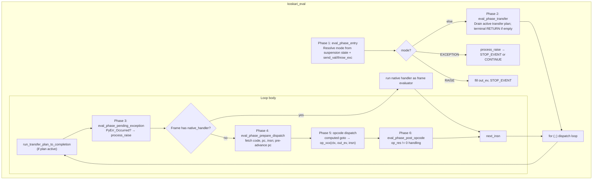
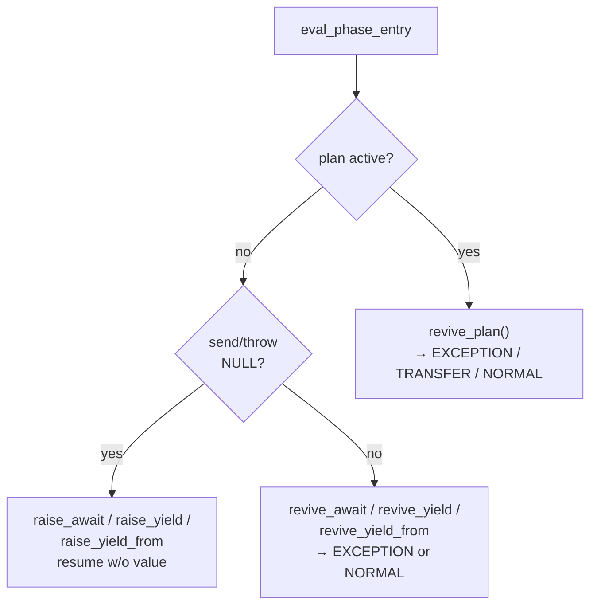
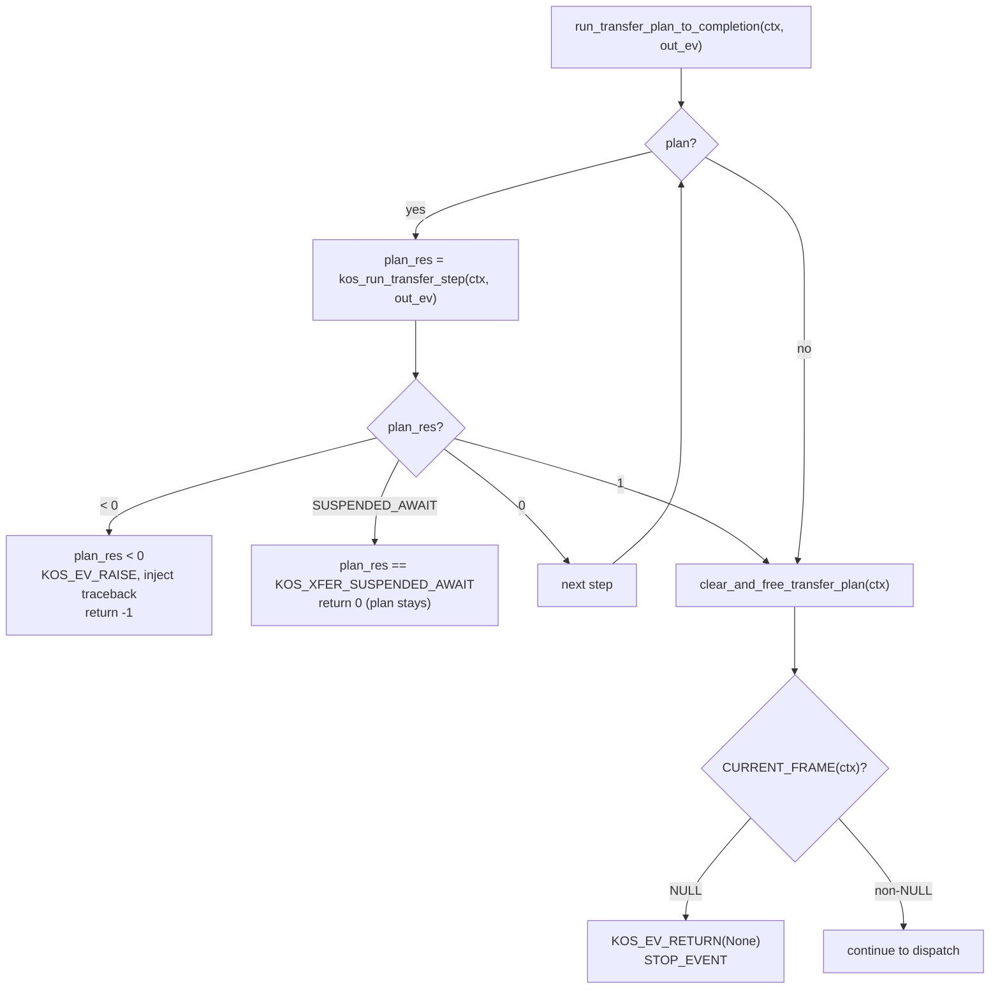
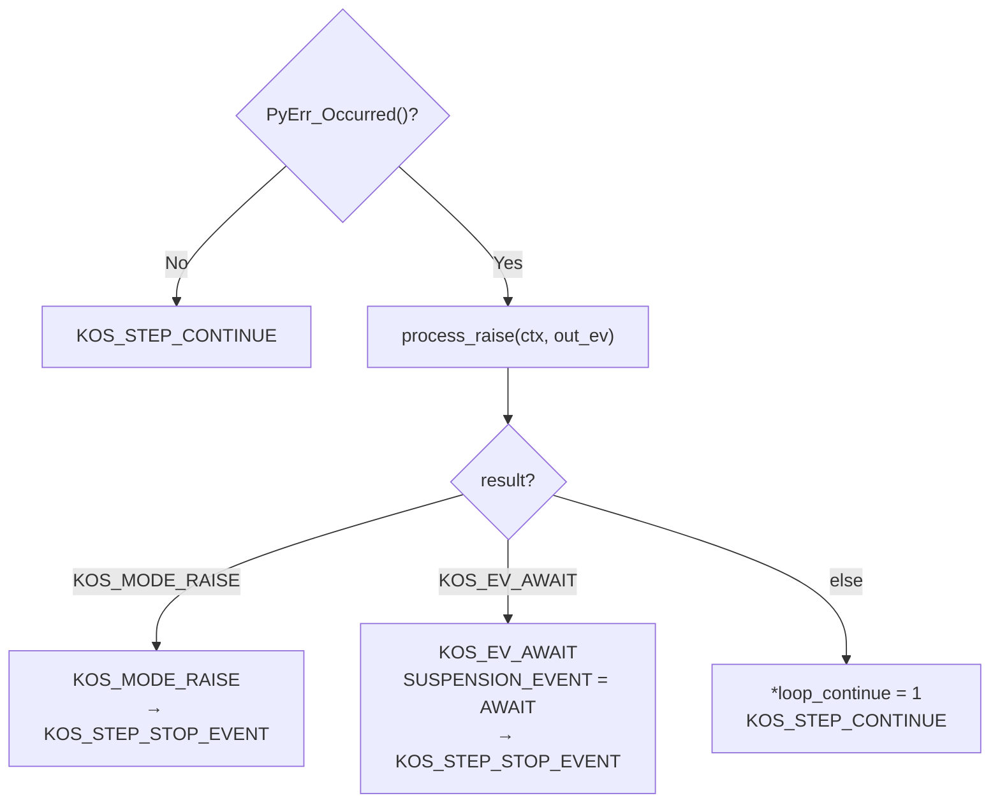
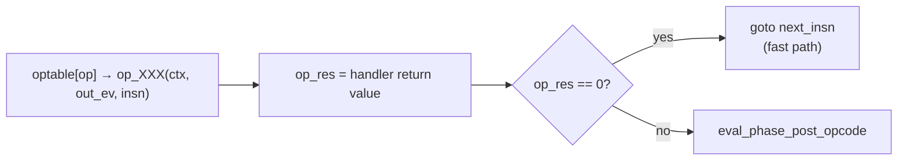
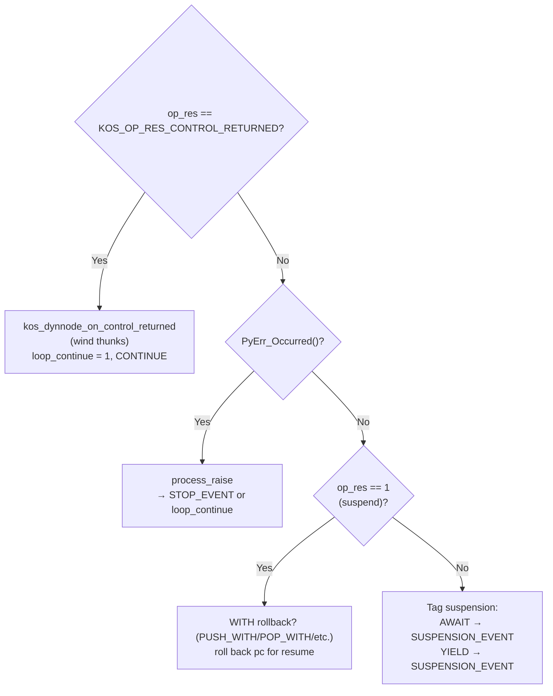
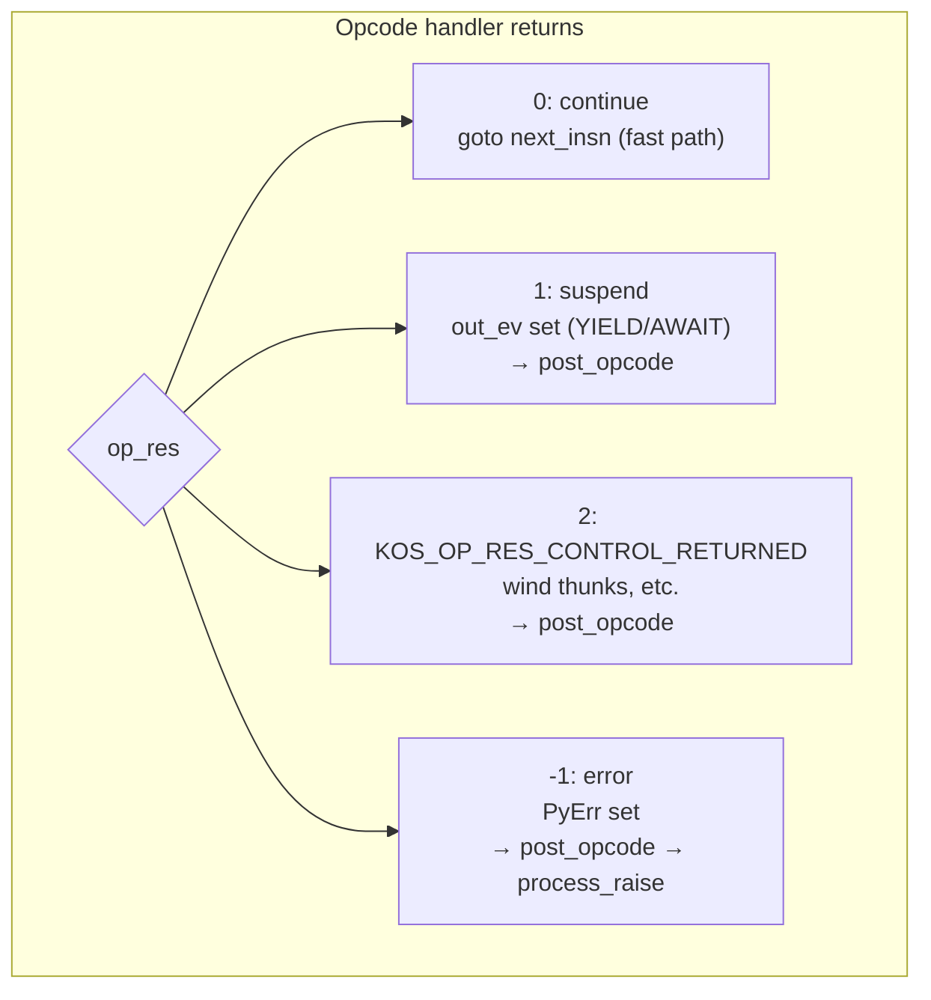
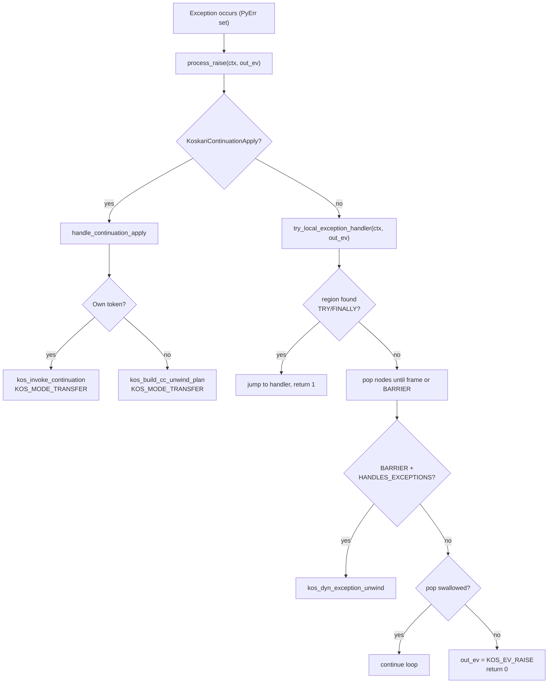
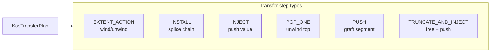
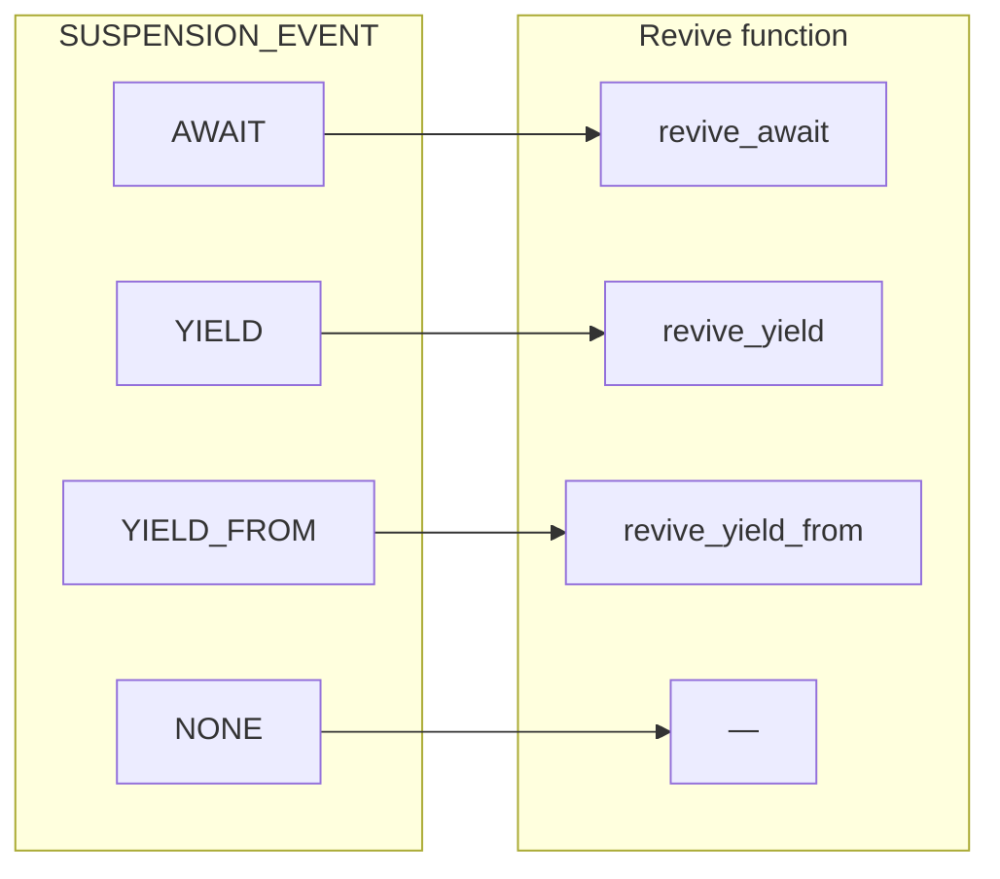

# Koskari Evaluator: Operation and Control Flow

This document describes the operation of the koskari eval loop in `koskari/lib/eval.c`: its stages, how opcodes are invoked and signal back, exception handling, transfer plans, tail calls, call installs, and resumption paths.

Implementation reference: `koskari/lib/eval.c`, `koskari/lib/eval.h`, `koskari/lib/dynchain.h`, and `design/interpreter/evaluator.md`.

---

## 1. High-Level Structure

### 1.1 Entry Point

```c
int koskari_eval(KosContext *ctx, KosEvent *out_ev,
                 PyObject *send_val, PyObject *throw_typ, PyObject *throw_exc);
```

The evaluator runs until it hits a **boundary event** (return, raise, yield, await) or a fatal error. It returns:
- **0**: Normal exit; `out_ev` contains the boundary event.
- **-1**: Fatal internal error; `PyErr` is set.

`send_val` and `throw_typ`/`throw_exc` are the resume arguments (both may be NULL for a fresh start or null resume).

### 1.2 Main Loop Phases



---

## 2. Phase Detail Diagrams

### 2.1 Phase 1: Entry and Revive

**eval_phase_entry** chooses the initial `KosEvalMode`:



**Revive paths:**
- **revive_plan**: Resume a suspended transfer plan. If `throw_exc` set → `KOS_MODE_EXCEPTION`. Else inject `send_val` into plan → `KOS_MODE_TRANSFER`.
- **revive_await / revive_yield / revive_yield_from**: If `throw_exc` → `PyErr_SetObject`, `KOS_MODE_EXCEPTION`. Else push `send_val` onto stack (if non-NULL), then `KOS_MODE_NORMAL`.

**Mode dispatch outcomes:**
- `KOS_MODE_EXCEPTION` → `try_local_exception_handler`; on success → `KOS_STEP_CONTINUE` or `KOS_STEP_STOP_EVENT` (AWAIT); on failure → `out_ev = KOS_EV_RAISE`, `KOS_STEP_STOP_EVENT`.
- `KOS_MODE_RAISE` → fetch exception, decorate, fill `out_ev`, `KOS_STEP_STOP_EVENT`.

### 2.2 Phase 2: Transfer Plan Drain

**eval_phase_transfer** runs when `KosContext_PLAN(ctx)` is set:



### 2.3 Phase 3: Pending Exception Check

At each loop top, **eval_phase_pending_exception** handles `PyErr_Occurred()` (e.g. from a signal handler or async exception):



### 2.4 Phase 4: Prepare Dispatch

**eval_phase_prepare_dispatch** fills `KosDispatchCtx`:

1. Check `CURRENT_FRAME(ctx)`.
2. Read `code`, `pc` from frame; bounds-check `pc`.
3. Load `insn = code->code[pc]`.
4. Set `acting_pc = pc` (instruction being executed).
5. Advance `pc` (pre-advance so normal path does not need to redo).

PC is rolled back for WITH enter/exit suspend so the same instruction is retried on resume.

### 2.5 Phase 5: Opcode Dispatch



### 2.6 Phase 6: Post-Opcode Handling

**eval_phase_post_opcode** runs when an opcode returns non-zero:



---

## 3. Opcode Signaling



### 3.1 Opcode Handler Return Values

| Value | Meaning |
|-------|---------|
| **0** | Normal; continue to next instruction. Loop goes to `next_insn` directly. |
| **1** | Suspend (e.g. YIELD, AWAIT, WITH async enter/exit). `out_ev` is set. Loop exits or continues as determined by post-opcode. |
| **2** | `KOS_OP_RES_CONTROL_RETURNED` — control returned to an awaiting dynamic node (e.g. wind thunk). Triggers `kos_dynnode_on_control_returned`; loop continues. |
| **-1** | Error; `PyErr` set. Post-opcode calls `process_raise`; if no local handler, STOP_EVENT with RAISE. |

### 3.2 What Opcodes Can Signal

- **Continue** (0): No boundary; next instruction runs.
- **Suspend** (1): `out_ev` holds `KOS_EV_YIELD` or `KOS_EV_AWAIT`. Loop exits to caller.
- **Control returned** (2): Used by RETURN, TAIL_CALL when control returns through wind/unwind thunks.
- **Exception** (-1): Opcode or callee sets `PyErr`; post-opcode runs `process_raise`.

### 3.3 Boundary Events (top-level only)

When the current frame has **no parent** (top-level):

- **RETURN** → `KOS_EV_RETURN`, payload = value
- **RAISE**  → `KOS_EV_RAISE`, payload = exception value
- **YIELD**  → `KOS_EV_YIELD`, payload = yielded value
- **AWAIT**  → `KOS_EV_AWAIT`, payload = awaitable

When the frame **has a parent** (callee or attached async gen): YIELD and RETURN do **not** produce boundary events; they detach the frame, push value onto the parent stack, and return 0 so the loop continues.

---

## 4. Exception Handling

### 4.1 Exception Flow



### 4.2 try_local_exception_handler

1. `kos_find_node_for_raise(ctx)` — topmost enabled TRY or FINALLY.
2. If found: clear stack block, set PC to handler, stash exception in `PyErr_SetExcInfo`, clear PyErr, set `handling_raise` on FINALLY, return 1.
3. If not found: walk chain from `dyn_top` toward frame. For each node:
   - `kos_dyn_pop_top`; if `KOS_DYN_UNWIND_ASYNC_STARTED`, return 1.
   - If pop fails (BARRIER): dispatch to `kos_dyn_exception_unwind` if node has HANDLES_EXCEPTIONS.
   - If node may-swallow and PyErr cleared: set PC to catch_resume_pc, return 1.
4. If no handler: `inject_eval_frame_traceback`, fill `out_ev` with KOS_EV_RAISE, return 0.

### 4.3 Traceback Injection

`inject_eval_frame_traceback` decorates the exception with `__koskari_dynchain__` and injects the current frame into the traceback so Python can display Koskari-native frames. Called at:
- `try_local_exception_handler` (handle and re-raise branches)
- `KOS_MODE_RAISE` at entry
- `run_transfer_plan_to_completion` when a transfer step fails

---

## 5. Transfer Plans

### 5.1 Transfer Plan Overview

A **KosTransferPlan** is a list of actions that orchestrate continuation invocation, delimited return, or foreign-token unwind. The loop drains it via `run_transfer_plan_to_completion` → `kos_run_transfer_step`.



### 5.2 Transfer Step Types

| Step | Description |
|------|-------------|
| `KOS_XFER_EXTENT_ACTION` | Run wind (enter) or unwind (exit) for a node. |
| `KOS_XFER_INSTALL` | Splice a chain segment as the new current chain. |
| `KOS_XFER_INJECT` | Push resume value onto stack (or throw). |
| `KOS_XFER_POP_ONE` | Unwind current top, unlink and free. |
| `KOS_XFER_PUSH` | Append segment to current chain (graft). Used for delimited invoke. |
| `KOS_XFER_TRUNCATE_AND_INJECT` | Free from top through node, set dyn_top to parent, push value. |

### 5.3 kos_run_transfer_step Return Values

| Value | Meaning |
|-------|---------|
| **0** | Step complete; continue to next step. |
| **1** | Plan complete; plan is cleared. |
| **KOS_XFER_SUSPENDED_AWAIT** (2) | Step suspended on await; plan stays; driver resumes and feeds inject. |
| **< 0** | Error; PyErr set; plan fails, `run_transfer_plan_to_completion` fills out_ev with KOS_EV_RAISE. |

### 5.4 Call Sites for run_transfer_plan_to_completion

1. **eval_phase_transfer** — at loop start when plan is active.
2. **Inside dispatch loop** — at each iteration top before phase 3.
3. **eval_phase_entry** — when re-entering with an active plan (e.g. after yield-from or boundary return).

---

## 6. Tail Calls and Call Installs

### 6.1 Invocation Entry Points

- `kos_callable_call` — non-tail: look up `tp_kos_install`, invoke.
- `kos_callable_tail_call` — tail: look up `tp_kos_tail_install`; if NULL, push empty frame + `tp_kos_install`.

### 6.2 Install Slot Contract

```c
int (*KosInstallFunc)(KosContext *ctx, KosEvent *out_ev,
                      PyObject *callable, PyObject *args_tuple, PyObject *kwds_dict);
```

- **0**: Success; evaluator continues with new/reset frame.
- **1**: Suspend; `out_ev` set (e.g. AWAIT).
- **-1**: Error; `PyErr` set.

The install owns all frame setup: push new frame (non-tail) or reset current frame (tail). It does **not** recurse into `koskari_eval`; execution continues in the same loop.

### 6.3 Tail Call Behavior

For `kos_callable_tail_call`:
- If `tp_kos_tail_install` exists: it resets the current frame (code, ns, stack, pc) and returns 0.
- If not: push `kos_dyn_push_frame_empty`, then call `tp_kos_install` (no TCO).

TAIL_CALL opcodes return `KOS_OP_RES_CONTROL_RETURNED` when they install a new frame; `eval_phase_post_opcode` invokes `kos_dynnode_on_control_returned` for wind thunks.

### 6.4 Transfer Plan Integration

An install that invokes a continuation builds a transfer plan and sets `KosContext_PLAN(ctx) = plan`. The eval loop drains it on the next iteration. No recursion.

---

## 7. Resume Paths



### 7.1 Suspension Event → Revive

| `SUSPENSION_EVENT` | Revive function | Behavior |
|--------------------|-----------------|----------|
| `KOS_SUSP_AWAIT` | `revive_await` | Push send_val, complete pending WITH exit if applicable. |
| `KOS_SUSP_YIELD` | `revive_yield` | Push send_val onto stack. |
| `KOS_SUSP_YIELD_FROM` | `revive_yield_from` | Push send_val onto stack. |
| `KOS_SUSP_NONE` | — | Fresh start or no-op resume. |

If `throw_typ`/`throw_exc` are set, any revive path calls `PyErr_SetObject` and yields `KOS_MODE_EXCEPTION`, which triggers `process_raise` at entry.

### 7.2 Native Frame Handler

When `CURRENT_FRAME(ctx)` has `native_handler != NULL`, the loop runs that handler as the frame evaluator instead of bytecode dispatch. On resume with `send_val`, entry delivers the value to the handler via `fn(ctx, out_ev, 1, val)`.

---

## 8. Play-by-Play Scenarios

### 8.1 Scenario: Simple Call and Return

1. Entry: `send_val == NULL`, `SUSPENSION_EVENT == NONE` → `KOS_MODE_NORMAL`.
2. Transfer: no plan → skip.
3. Pending exception: none.
4. Dispatch: opcode is CALL. Handler calls `kos_callable_call`, which invokes install. Install pushes new frame, returns 0.
5. `op_res == 0` → goto `next_insn`. New frame is now top; next opcode runs in callee.
6. Eventually RETURN in callee. Frame has parent → detach frame, push value onto parent, return 0. Loop continues in caller.
7. Caller runs until top-level RETURN → `out_ev = KOS_EV_RETURN`, return 1 from opcode → STOP_EVENT.

### 8.2 Scenario: Exception and Local Handler

1. Opcode fails, sets PyErr. `op_res == -1`.
2. Post-opcode: `PyErr_Occurred()` → `process_raise`.
3. `try_local_exception_handler` finds TRY region, sets handler_pc, clears PyErr for handler, returns 1.
4. `process_raise` returns `KOS_MODE_NORMAL`. Post-opcode sets `loop_continue = 1`, returns CONTINUE.
5. Loop continues; next instruction is the except block.

### 8.3 Scenario: Continuation Invoke (Own Token)

1. Python calls `cont(value)`. Cont raises `KoskariContinuationApply` targeting this context.
2. `PyErr_Occurred()` at next loop top (or after opcode). `process_raise` runs.
3. `handle_continuation_apply` sees own token: fetches continuation and value, clears PyErr, calls `kos_invoke_continuation`.
4. `kos_invoke_continuation` builds transfer plan, sets `KosContext_PLAN(ctx) = plan`, returns 0. `handle_continuation_apply` returns `KOS_MODE_TRANSFER`.
5. Loop continues (or entry yields TRANSFER). `run_transfer_plan_to_completion` drains plan: unwind extents, install captured chain, inject value.
6. Execution resumes at captured PC with value on stack.

### 8.4 Scenario: AWAIT Suspend and Resume

1. AWAIT opcode yields awaitable. Sets `out_ev = KOS_EV_AWAIT`, `py_await_iter = iter`, returns 1.
2. Post-opcode tags `SUSPENSION_EVENT = AWAIT`, returns STOP_EVENT. Evaluator exits.
3. Driver (e.g. KosCoroutine.send) awaits the awaitable, gets result.
4. Driver calls `koskari_eval(ctx, &ev, result, NULL, NULL)`.
5. Entry: `SUSPENSION_EVENT == AWAIT`, `send_val != NULL` → `revive_await(result, ...)`.
6. `revive_await` pushes result onto stack. If `PENDING_WITH_EXIT_NODE`, completes pending WITH exit.
7. Mode = NORMAL. Loop continues; next instruction consumes the awaited value.

### 8.5 Scenario: Tail Call

1. TAIL_CALL opcode calls `kos_callable_tail_call`. Callable has `tp_kos_tail_install`.
2. Install resets current frame (code, ns, stack, pc) for the new function, returns 0.
3. Opcode returns `KOS_OP_RES_CONTROL_RETURNED`.
4. Post-opcode: `kos_dynnode_on_control_returned` runs (wind thunks if any). `loop_continue = 1`, CONTINUE.
5. Loop continues; next instruction is first instruction of the new function (same frame, new content).

### 8.6 Scenario: Transfer Plan Step Fails

1. Plan is draining. `kos_run_transfer_step` returns < 0 (e.g. exception in extent action).
2. `run_transfer_plan_to_completion` fetches PyErr, calls `inject_eval_frame_traceback`, fills `out_ev` with KOS_EV_RAISE, sets context DEAD, returns -1.
3. Caller (eval loop or entry) sees -1; exits with `eval_ret = 0`, `out_ev` already filled.

---

## 9. Summary Table: Modes and Outcomes

| KosEvalMode | Source | Outcome |
|-------------|--------|---------|
| NORMAL | Fresh start, resume w/o throw | Continue to dispatch |
| TRANSFER | revive_plan, handle_continuation_apply | Drain plan, then dispatch |
| EXCEPTION | throw on resume, revive_plan throw | process_raise → handler or RAISE |
| RAISE | Stored KOS_EV_RAISE at entry | Fill out_ev, STOP_EVENT |
| AWAIT / YIELD / YIELD_FROM | (Used internally for resume routing) | — |

| KosEvalStep | Meaning |
|-------------|---------|
| CONTINUE | Proceed to next phase or next iteration |
| STOP_EVENT | out_ev filled; return 0 to caller |
| FATAL_ERROR | PyErr set; return -1 to caller |

---

## 10. Related Documentation

- [design/interpreter/evaluator.md](interpreter/evaluator.md) — VM structures, C API reference
- [design/interpreter/ceval-exception-paths.md](interpreter/ceval-exception-paths.md) — Exception paths and trace injection
- [design/api/special-call-protocol.md](api/special-call-protocol.md) — Install slots and invocation
- [design/interpreter/execution-invariants.md](interpreter/execution-invariants.md) — Execution invariants
