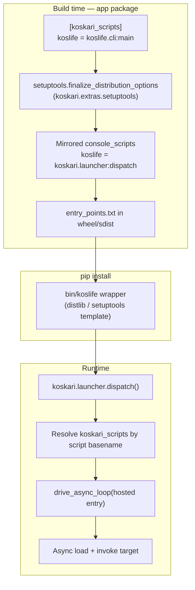

# Koskari scripts packaging (`koskari_scripts`)

## Status

**v1 implemented** (launcher + setuptools plugin + unit tests).

Implemented:

* **`koskari.launcher`** — `dispatch`, `drive_async_loop`, `hosted_run`, `run_entry`, `run_target`
* **`koskari.importer.import_module_async`** — async `.ki`/`.kio` import under a running loop
* **`koskari.extras.setuptools`** — `mirror_koskari_scripts` finalize hook, validation helpers
* Unit tests under **`tests/extras/setuptools/`**

Deferred from v1:

* **`examples/life`** migration to **`koskari_scripts`**
* End-to-end pip-install integration test
* User-facing **`docs/`** packaging guide
* Native **`koskari`** binary and koskari shebang **`ScriptWriter`**

## Summary

Add **`koskari.extras.setuptools`**, a pure-Python subpackage shipped with the
main **`koskari`** distribution, plus a small runtime **`koskari.launcher`**
module. Together they let third-party packages declare **`koskari_scripts`**
entry points (analogous to **`console_scripts`**) that install as normal
`bin/` commands but run through the koskari async runtime host instead of a bare
Python import-and-call.

When **`koskari`** is installed, its setuptools plugin mirrors each
**`koskari_scripts`** name into **`console_scripts`** pointing at a shared
launcher. **`pip install`** therefore generates wrappers the same way it does
for Python CLIs, while runtime dispatch resolves the real koskari target from
**`koskari_scripts`** metadata.

## Motivation

### Problem

**`console_scripts`** assumes a synchronous Python callable with no arguments.
Generated wrappers look like:

```python
from mypkg.cli import main
sys.exit(main())
```

That is a poor fit for koskari applications:

| Concern | `console_scripts` today | Koskari CLI apps |
| ------- | ----------------------- | ---------------- |
| Event loop | None unless the app creates one | Required for asyncio interop, `defer`, `create-task`, many server patterns |
| Loop driver | Often `asyncio.run` in ad hoc shims | Should use `drive_async_loop` (SIGINT / eval interrupt semantics) |
| Module load path | Python `import` → demand **`exec_module`** | Async host should use **`load_module_async`** / **`exec_module_async`** |
| Author boilerplate | Per-package Python `main()` shim | Should be declarative in packaging metadata only |

The **`examples/life`** package illustrates the workaround: a Python
**`koslife/__init__.py`** stub that imports a `.ki` **`main`** and calls
**`asyncio.run`**. That duplicates bootstrap logic already present in
**`koskari.cli`** and uses the wrong loop driver.

### Goal

Application authors declare installed commands in **`setup.cfg`** / **`pyproject.toml`**
and ship `.ki` modules. No Python entry shim is required. Installed commands
behave like **`koskari tool.ki`**: koskari + Python environment, baseline
modules, **`Domain`**, event loop, then dispatch.

## Design goals

* **`koskari_scripts`** entry point group with setuptools + pip install support
* One canonical runtime bootstrap shared with **`koskari`** CLI where practical
* Correct async module loading and **`drive_async_loop`** for all installed scripts
* Pure-Python packaging code under **`koskari.extras.setuptools`** (no C extension)
* Runtime launcher must not import setuptools (only **`importlib.metadata`**)
* Fail clearly on duplicate script names or missing metadata
* Document build-time requirements for PEP 517 isolated builds

## Non-goals (v1)

* Replacing the **`koskari`** developer CLI (REPL, **`--compile-kio`**, etc.)
* A native C executable embedding CPython
* Custom pip patches or non-standard install paths
* Auto-generating **`when-main:`** entry modules; authors supply **`main`** or a script module explicitly
* **`gui_scripts`** parity (can follow later using the same mirroring pattern)

## Architecture overview



Two layers:

1. **Build-time (`koskari.extras.setuptools`)** — registers the setuptools
   plugin, mirrors **`koskari_scripts`** → **`console_scripts`**, optional
   validation helpers for app authors.
2. **Runtime (`koskari.launcher`)** — shared dispatch and hosted execution;
   no setuptools dependency.

## Package layout

New modules (proposed):

```
koskari/
├── launcher.py                 # Runtime: dispatch, run_entry, hosted bootstrap
└── extras/
    └── setuptools/
        ├── __init__.py         # Public helpers / version note
        ├── finalize.py         # finalize_distribution_options hook
        └── validate.py         # Optional: check dist metadata in tests/CI
```

**Registration in koskari's own `setup.cfg`:**

```ini
[options]
packages =
  ...
  koskari.extras.setuptools

[options.entry_points]
setuptools.finalize_distribution_options =
    koskari_scripts = koskari.extras.setuptools.finalize:mirror_koskari_scripts
console_scripts =
  koskari = koskari.cli:main
  ; koskari-lsp unchanged
```

**`koskari.extras.setuptools`** is part of the default **`koskari`** install
(not gated behind an optional extra). It is tiny and has no dependencies beyond
the standard library + setuptools APIs used only at build time of *other*
packages. Optional extras (**`lsp`**, **`pygments`**, **`sphinx`**) remain
unchanged.

Update **`design/api/package-layout.md`** when implemented.

## Entry point specification

### Group name

**`koskari_scripts`**

Follows the entry-points spec (`^\w+(\.\w+)*$`). Alternative
**`koskari.scripts`** is slightly more collision-resistant; pick one name and
use it consistently in metadata, docs, and tests.

### Value syntax

Same as **`console_scripts`**:

```
NAME = MODULE[:OBJECT[.ATTR ...]]
```

| Form | Meaning |
| ---- | ------- |
| `koslife.cli:main` | Load module **`koslife.cli`**, invoke binding **`main`** |
| `koslife.cli` | Treat as script module ( **`__name__ == "__main__"`** semantics; **`when-main:`** runs) |

**Recommended for installed apps:** **`module:callable`** with an explicit
**`define main [argv: None]: …`** (see **`examples/life/koslife/cli.ki`**).
Easier to test and clearer than relying on **`when-main:`** for packaging.

### App author configuration

**`setup.cfg`:**

```ini
[options.entry_points]
koskari_scripts =
    koslife = koslife.cli:main
```

**`pyproject.toml`:**

```toml
[project.entry-points.koskari_scripts]
koslife = "koslife.cli:main"
```

**PEP 517 build system** (required for isolated builds to see the plugin):

```toml
[build-system]
requires = ["setuptools>=61", "koskari"]
build-backend = "setuptools.build_meta"
```

**Package data:** `.ki` files must be installed (**`package_data`**, **`zip_safe = False`**
when needed for importer discovery — see **`examples/life/setup.py`**).

**Runtime dependency:**

```toml
[project]
dependencies = ["koskari"]
```

Authors must **not** also register the same command name under
**`console_scripts`**. The finalize hook should error on collisions.

## Build-time: `mirror_koskari_scripts`

**Module:** **`koskari.extras.setuptools.finalize`**

**Entry point group:** **`setuptools.finalize_distribution_options`**

**Hook name:** **`koskari_scripts`** (or **`mirror_koskari_scripts`**)

### Algorithm

During **`Distribution.finalize_options()`** for any setuptools build:

1. Read **`dist.entry_points`** (dict or **`EntryPoints`**-like mapping).
2. If **`koskari_scripts`** is absent or empty, return.
3. Normalize entries to **`name = value`** strings.
4. For each name in **`koskari_scripts`**:
   * If name already exists in **`console_scripts`**, raise **`DistutilsSetupError`**
     with a clear message.
   * Append **`f"{name} = koskari.launcher:dispatch"`** to **`console_scripts`**.
5. Leave **`koskari_scripts`** unchanged in metadata (launcher reads it at runtime).

### Resulting `entry_points.txt`

```ini
[console_scripts]
koslife = koskari.launcher:dispatch

[koskari_scripts]
koslife = koslife.cli:main
```

**`pip install`** and setuptools **`install_scripts`** both consume
**`console_scripts`**; **`koskari_scripts`** is preserved for the launcher.

### When the hook runs

The plugin is discovered when **`koskari`** is importable in the build
environment:

| Install path | Plugin active? |
| ------------ | -------------- |
| **`pip install .`** with koskari already in env | Yes |
| PEP 517 isolated build with **`build-system.requires = [..., "koskari"]`** | Yes |
| PEP 517 build without koskari in build deps | No — **`koskari_scripts` not mirrored**; document as author error |
| Legacy **`python setup.py install`** with koskari installed | Yes |

### Optional: custom `ScriptWriter` (later)

Setuptools **`ScriptWriter.get_args()`** only emits wrappers for
**`console_scripts`** / **`gui_scripts`**. Mirroring to **`console_scripts`**
is sufficient for **`pip`**.

A future enhancement could subclass **`ScriptWriter`** to embed
**`spec, group, name`** directly in each wrapper (avoiding basename lookup).
Not required for v1.

## Runtime: `koskari.launcher`

### Public API

| Symbol | Role |
| ------ | ---- |
| **`dispatch()`** | **`console_scripts`** entry; no args; uses **`sys.argv[0]`** to find script name |
| **`run_entry(name, argv=None)`** | Programmatic dispatch by command name (tests, embedding) |
| **`run_target(target, argv=None)`** | Run **`module:callable`** or script module (internal / tests) |

**`dispatch()`** contract (packaging spec):

* Callable with **no arguments**
* Returns **`int`** exit code, or **`None`** → **`0`**
* **`KeyboardInterrupt`** → **`130`** (match **`koskari.cli:main`**)

### Dispatch algorithm

1. Derive command **`name`** from **`sys.argv[0]`** (strip **`-script.py`**, **`.exe`**, path — same normalization as setuptools wrappers).
2. Load **`importlib.metadata.entry_points(group='koskari_scripts')`**.
3. Select entry with **`ep.name == name`**. If missing, print error to stderr and exit **`1`**.
4. Parse **`ep.value`** into script module vs **`module:callable`** (reuse setuptools parsing rules or a small local parser).
5. Set **`sys.argv`** to **`[name] + list(argv)`** (or preserve full argv per policy — align with **`cli_async`**).
6. Call **`drive_async_loop(hosted_run(...))`** from **`koskari.cli`** (factor shared loop driver; do not duplicate).
7. Map result to process exit code.

### Hosted execution (`hosted_run`)

Shared bootstrap extracted from **`koskari.cli.cli_async`** (minimal subset):

```text
with Domain():
    optionally sys.path.insert(0, '.')   # tweakpath policy — see Open questions
    if module:callable:
        async load target module (exec_module_async or equivalent)
        resolve callable from koskari module namespace
        result = callable(argv...) or callable() per signature
        if awaitable: await
        normalize exit code from result
    elif script module:
        mod = new_module('__main__')
        init_module + load_module_async from module file
        when-main already ran during load if __name__ semantics set correctly
```

**Critical:** use the **async import / load path**, not demand
**`exec_module`**. Cross-ref **[import-system.md](import-system.md)**.

**Reuse from existing code:**

| Existing | Reuse in launcher |
| -------- | ----------------- |
| **`drive_async_loop`** | **`koskari.cli`** |
| **`Domain`** | **`koskari.lib`** |
| **`new_module`**, **`init_module`**, **`load_module_async`** | **`koskari.module`** |
| **`run_file_async`** | Script-module path may delegate here |
| Exit code / KeyboardInterrupt handling | **`koskari.cli.main`** |

Refactor **`cli_async`** to call shared helpers in **`koskari.launcher`** (or
**`koskari.cli._host`**) so REPL and packaging entry stay aligned.

### Callable invocation semantics

For **`module:callable`**:

* Prefer **`main(argv=None)`** accepting optional argv list (life example pattern).
* If callable takes no arguments, call **`()`**.
* If return value is **`int`**, use as exit code.
* If return value is awaitable, **`await`** it; then apply exit-code rules.
* **`True`/`False`** / **`None`** — document explicit mapping ( **`None` → 0** ).

Do **not** use **`ep.load()`** for the target callable if that would import
through demand path before the async host is running. Parse **`ep.value`**
and load under **`hosted_run`**.

## Relationship to the `koskari` CLI

| Feature | **`koskari`** command | **`koskari_scripts`** installed command |
| ------- | --------------------- | --------------------------------------- |
| REPL | Yes | No |
| **`--compile-kio`** | Yes | No |
| Run arbitrary **`.ki`** file | Yes | No |
| Run packaged entry | No | Yes |
| Event loop driver | **`drive_async_loop`** | Same |
| **`Domain`** | Yes | Yes |

Optional future: **`koskari -m koslife.cli`** as a dev-time alias — not v1.

## Migration: `examples/life`

**Before:**

* **`console_scripts`:** **`koslife = koslife:main`**
* Python **`koslife/__init__.py`** with **`asyncio.run`**

**After:**

```ini
[options.entry_points]
koskari_scripts =
    koslife = koslife.cli:main
```

Remove **`koslife/__init__.py`** **`main`** shim (or the whole file if unused).
Keep **`cli.ki`** **`define main`** unchanged.

## Testing plan

| Test | Location (proposed) |
| ---- | ------------------- |
| Finalize hook mirrors entries | **`tests/extras/setuptools/test_finalize.py`** |
| Collision with **`console_scripts`** raises | same |
| **`dispatch`** resolves metadata, runs entry | **`tests/extras/setuptools/test_launcher.py`** or **`tests/cli/`** |
| End-to-end: build tiny fixture package, install in tmp env, run script | integration test (tox env or **`tests/extras/setuptools/fixtures/`**) |
| SIGINT / exit code parity with **`koskari.cli`** | launcher tests |

Use **`tox`** per project rules. Packaging tests may use **`venv`** + **`pip install`** on a fixture sdist/wheel.

## Documentation (when implemented)

User-facing (**`docs/`** only — no **`design/`** links from user docs):

* New page or section under CLI / packaging: declaring **`koskari_scripts`**
* Update **`docs/patterns/recipes/script-main.md`** with installed-app pattern
* Update **`examples/life`** README

Internal:

* This document
* **`design/api/import-system.md`** — cross-link async load path for launchers
* **`design/api/package-layout.md`** — new subpackage

## Implementation phases

### Phase 1 — Runtime launcher

**Done.**

* **`koskari/launcher.py`**
* **`koskari.importer.import_module_async`**
* **`drive_async_loop`** moved from **`koskari.cli`**; CLI imports from launcher
* Unit tests in **`tests/extras/setuptools/test_launcher.py`**

### Phase 2 — Setuptools plugin

**Done.**

* **`koskari/extras/setuptools/`** (`finalize`, `validate`, `errors`)
* Registered in **`setup.cfg`** as **`setuptools.finalize_distribution_options`**
* Tests in **`tests/extras/setuptools/test_finalize.py`**, **`test_validate.py`**

### Phase 3 — Integration

* Migrate **`examples/life`**
* Add packaging integration test
* User docs ( **`docs/`** )

### Phase 4 — Polish (optional)

* **`run_entry`** programmatic API for tests/embedders
* Custom **`ScriptWriter`** with embedded EP metadata
* **`gui_scripts`** mirror if needed

## Open questions

1. **Default `sys.path` tweak** — Should installed scripts insert **`'.'`** like
   **`koskari`** CLI default? Likely **no** for installed apps; optional env var
   or entry-point option later.
2. **Group name** — **`koskari_scripts`** vs **`koskari.scripts`** final choice.
3. **Build dep weight** — PEP 517 builds require **`koskari`** (C extension) in
   **`build-system.requires`**. Acceptable, or split **`koskari-packaging`** stub
   later if builds become too heavy?
4. **Script module vs callable** — Support both in v1, or callable-only to reduce
   **`__name__`** / **`when-main:`** ambiguity?
5. **Editable installs** — Verify mirroring under **`pip install -e`**; setuptools
   editable backends differ; add explicit test.

## References

* **[import-system.md](import-system.md)** — async vs demand module load
* **[../interpreter/domain.md](../interpreter/domain.md)** — **`Domain`** scope
* **`koskari/cli/__init__.py`** — **`drive_async_loop`**, **`cli_async`**
* **`examples/life/`** — current **`console_scripts`** workaround
* Setuptools **`ScriptWriter`** — **`setuptools/_scripts.py`**
* Entry points spec — [packaging.python.org](https://packaging.python.org/en/latest/specifications/entry-points/)

## See also

* **[TODO.md](../TODO.md)** — evaluation and implementation tracking
