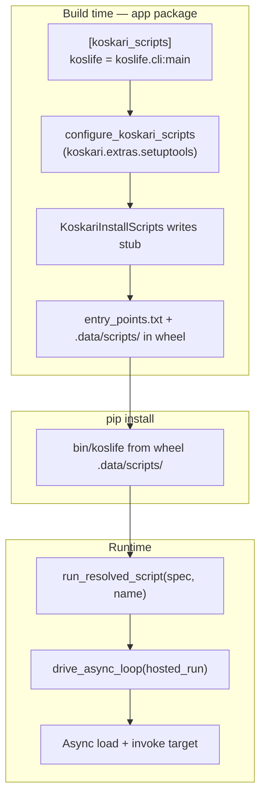

# Koskari scripts packaging (`koskari_scripts`)

## Status

**v1 implemented** (launcher + setuptools plugin + unit tests).

Implemented:

* **`koskari.launcher`** — `run_resolved_script`, `drive_async_loop`, `hosted_run`, `run_target`
* **`koskari.importer.import_module_async`** — async `.ki`/`.kio` import under a running loop
* **`koskari.extras.setuptools`** — `configure_koskari_scripts` finalize hook, **`KoskariInstallScripts`**, validation helpers
* Unit tests under **`tests/extras/setuptools/`**

Deferred from v1:

* End-to-end pip-install integration test

Phase A native host (implemented):

* **`koskari.lib.drive_async_loop`** — C asyncio host (SIGINT-safe)
* **`koskari.cli.prepare_cli_async`** — shared CLI parse path for embed entry
* Native **`koskari`** embed executable — **`make koskari-bin`**; not shipped
  in PyPI wheels (setuptools has no first-class binary entry point)
* **`pip install`** places **`koskari`** on PATH via **`console_scripts`**
  (**`koskari.cli:main`**) which still uses native **`drive_async_loop`**

Deferred after Phase A:

* Static link of **`koskari.lib`** into the executable with fake import
  injection
* Binary dispatch for **`koskari_scripts`** entry points
* Optional native **`koskari`** binary in RPM or other system packaging (not
  wheel/sdist)

Also done since initial v1 landing:

* **`examples/life`** migrated to **`koskari_scripts`** ( **`setup.cfg`** + minimal **`setup.py`** )
* User-facing packaging guide: **`docs/patterns/recipes/packaging-installed-scripts.md`**
* **`parse_config_files`** wrapper so **`setup.cfg`** entry points configure correctly
* **`KoskariInstallScripts`** writes **`run_resolved_script(spec, name)`** stubs into
  wheel **`.data/scripts/`** (dist-scoped metadata resolve, no global scan)
* **`KoskariEditableWheel`** ensures PEP 660 editable builds run **`install_scripts`**
  for **`koskari_scripts`** (stock **`editable_wheel`** skips scripts otherwise)

## Summary

Add **`koskari.extras.setuptools`**, a pure-Python subpackage shipped with the
main **`koskari`** distribution, plus a small runtime **`koskari.launcher`**
module. Together they let third-party packages declare **`koskari_scripts`**
entry points (analogous to **`console_scripts`**) that install as normal
`bin/` commands but run through the koskari async runtime host instead of a bare
Python import-and-call.

When **`koskari`** is installed, its setuptools plugin registers an
**`install_scripts`** hook that writes one stub file per **`koskari_scripts`**
name during wheel build. **`pip install`** copies those stubs into **`bin/`**;
runtime dispatch resolves the real koskari target from **`koskari_scripts`**
metadata in dist-info.

## Motivation

### Problem

**`console_scripts`** assumes a synchronous Python callable with no arguments.
Generated wrappers look like:

```python
from mypkg.cli import main
sys.exit(main())
```

That is a poor fit for koskari applications:

| Concern | `console_scripts` today | Koskari CLI apps |
| ------- | ----------------------- | ---------------- |
| Event loop | None unless the app creates one | Required for asyncio interop, `defer`, `create-task`, many server patterns |
| Loop driver | Often `asyncio.run` in ad hoc shims | Should use `drive_async_loop` (SIGINT / eval interrupt semantics) |
| Module load path | Python `import` → demand **`exec_module`** | Async host should use **`load_module_async`** / **`exec_module_async`** |
| Author boilerplate | Per-package Python `main()` shim | Should be declarative in packaging metadata only |

The **`examples/life`** package previously used a Python **`koslife/__init__.py`**
stub that imported a `.ki` **`main`** and called **`asyncio.run`**. That
duplicated bootstrap logic already present in **`koskari.cli`** and used the
wrong loop driver. It now uses **`koskari_scripts`** instead (see Migration).

### Goal

Application authors declare installed commands in **`setup.cfg`** / **`pyproject.toml`**
and ship `.ki` modules. No Python entry shim is required. Installed commands
behave like **`koskari tool.ki`**: koskari + Python environment, baseline
modules, **`Domain`**, event loop, then dispatch.

## Design goals

* **`koskari_scripts`** entry point group with setuptools + pip install support
* One canonical runtime bootstrap shared with **`koskari`** CLI where practical
* Correct async module loading and **`drive_async_loop`** for all installed scripts
* Pure-Python packaging code under **`koskari.extras.setuptools`** (no C extension)
* Runtime launcher must not import setuptools (only **`importlib.metadata`**)
* Fail clearly on duplicate script names or missing metadata
* Document build-time requirements for PEP 517 isolated builds

## Non-goals (v1)

* Replacing the **`koskari`** developer CLI (REPL, **`--compile-kio`**, etc.)
* A native C executable embedding CPython
* Custom pip patches or non-standard install paths
* Auto-generating **`when-main:`** entry modules; authors supply **`main`** or a script module explicitly
* **`gui_scripts`** parity (can follow later using the same install_scripts pattern)

## Architecture overview



Two layers:

1. **Build-time (`koskari.extras.setuptools`)** — registers the setuptools
   plugin, installs koskari stub files via **`install_scripts`**, augments
   **`package_data`** / **`zip_safe`**, optional validation helpers for app
   authors.
2. **Runtime (`koskari.launcher`)** — shared dispatch and hosted execution;
   no setuptools dependency.

## Package layout

New modules (proposed):

```
koskari/
├── launcher.py                 # Runtime: run_resolved_script, hosted bootstrap
└── extras/
    └── setuptools/
        ├── __init__.py         # Public helpers / version note
        ├── finalize.py         # configure hook + parse_config_files wrapper
        ├── scripts.py          # KoskariInstallScripts + stub template
        ├── packages.py         # .ki/.kio package discovery and augmentation
        └── validate.py         # Optional: check dist metadata in tests/CI
```

**Registration in koskari's own `setup.cfg`:**

```ini
[options]
packages =
  ...
  koskari.extras.setuptools

[options.entry_points]
setuptools.finalize_distribution_options =
    koskari_scripts = koskari.extras.setuptools.finalize:configure_koskari_scripts
console_scripts =
  koskari = koskari.cli:main
  ; koskari-lsp unchanged
```

**`koskari.extras.setuptools`** is part of the default **`koskari`** install
(not gated behind an optional extra). It is tiny and has no dependencies beyond
the standard library + setuptools APIs used only at build time of *other*
packages. Optional extras (**`lsp`**, **`pygments`**, **`sphinx`**) remain
unchanged.

Update **`design/api/package-layout.md`** when implemented.

## Entry point specification

### Group name

**`koskari_scripts`**

Follows the entry-points spec (`^\w+(\.\w+)*$`). Alternative
**`koskari.scripts`** is slightly more collision-resistant; pick one name and
use it consistently in metadata, docs, and tests.

### Value syntax

Same as **`console_scripts`**:

```
NAME = MODULE[:OBJECT[.ATTR ...]]
```

| Form | Meaning |
| ---- | ------- |
| `koslife.cli:main` | Load module **`koslife.cli`**, invoke binding **`main`** |
| `koslife.cli` | Treat as script module ( **`__name__ == "__main__"`** semantics; **`when-main:`** runs) |

**Recommended for installed apps:** **`module:callable`** with an explicit
**`define main [argv: None]: …`** (see **`examples/life/koslife/cli.ki`**).
Easier to test and clearer than relying on **`when-main:`** for packaging.

### App author configuration

**`setup.cfg`:**

```ini
[options.entry_points]
koskari_scripts =
    koslife = koslife.cli:main
```

**`pyproject.toml`:**

```toml
[project.entry-points.koskari_scripts]
koslife = "koslife.cli:main"
```

**PEP 517 build system** (required for isolated builds to see the plugin):

```toml
[build-system]
requires = ["setuptools>=61", "koskari"]
build-backend = "setuptools.build_meta"
```

**Package data:** authors declare **`packages=`** explicitly. When
**`koskari_scripts`** is also declared, the finalize hook adds **`package_data`**
patterns (**`*.ki`**, **`*.kio`**) for each listed package and sets
**`zip_safe = False`**. It warns when entry point module paths reference
packages not listed in **`packages=`**. It does not infer package names from
the filesystem or entry points alone.

**Runtime dependency:**

```toml
[project]
dependencies = ["koskari"]
```

Authors must **not** also register the same command name under
**`console_scripts`**. The finalize hook should error on collisions.

## Build-time: `configure_koskari_scripts`

**Module:** **`koskari.extras.setuptools.finalize`**

**Entry point group:** **`setuptools.finalize_distribution_options`**

**Hook name:** **`koskari_scripts`** (or **`configure_koskari_scripts`**)

### Algorithm

**`configure_koskari_scripts(dist)`** runs the same steps in both hook paths
below. It is idempotent (safe to invoke more than once on the same
**`Distribution`**).

1. Read **`dist.entry_points`** (dict or **`EntryPoints`**-like mapping).
2. If **`koskari_scripts`** is absent or empty, return.
3. Validate names and values; augment **`package_data`** / **`zip_safe`** for
   declared **`packages=`** (see **`packages.py`**).
4. Register **`dist.cmdclass['install_scripts'] = KoskariInstallScripts`**.

No mutation of **`console_scripts`**. Stub files are written during
**`install_scripts`** (including wheel builds where **`no_ep=True`** skips
stock entry-point script generation).

### When the hook runs (setuptools ordering)

Setuptools **`setup()`** order matters:

1. **`Distribution.__init__(attrs)`** — applies kwargs passed to **`setup(...)`**
2. **`Distribution.finalize_options()`** — runs
   **`setuptools.finalize_distribution_options`** entry points (including
   **`configure_koskari_scripts`**)
3. **`Distribution.parse_config_files()`** — loads **`setup.cfg`** and
   relevant **`pyproject.toml`** sections

Entry points declared as **`setup(..., entry_points={...})`** kwargs are
visible at step 2. Entry points declared only in **`setup.cfg`** (or
**`[tool.setuptools.entry-points]`** in **`pyproject.toml`**) are applied at
step 3 — **after** the finalize hook has already run once with
**`dist.entry_points is None`**.

The plugin therefore uses **two invocation paths**:

| Path | Trigger | Covers |
| ---- | ------- | ------ |
| **`setuptools.finalize_distribution_options`** | **`Distribution.finalize_options()`** during **`__init__`** | Inline **`setup()`** kwargs; installs the **`parse_config_files`** wrapper |
| **`parse_config_files` wrapper** | End of **`Distribution.parse_config_files()`** | **`setup.cfg`**, **`pyproject.toml`**, and any config applied after **`__init__`** |

On first finalize hook entry, **`finalize.py`** lazily wraps
**`Distribution.parse_config_files`** so step 3 re-invokes
**`configure_koskari_scripts`** after config is loaded. No author-facing
difference: declarative **`koskari_scripts`** in **`setup.cfg`** and inline
**`setup()`** kwargs produce the same wheel metadata.

The plugin is discovered when **`koskari`** is importable in the build
environment:

| Install path | Plugin active? |
| ------------ | -------------- |
| **`pip install .`** with koskari already in env | Yes |
| PEP 517 isolated build with **`build-system.requires = [..., "koskari"]`** | Yes |
| PEP 517 build without koskari in build deps | No — **`koskari_scripts` stubs not written**; document as author error |
| Legacy **`python setup.py install`** with koskari installed | Yes |

### Resulting wheel artifacts

**`entry_points.txt`:**

```ini
[koskari_scripts]
koslife = koslife.cli:main
```

**`.data/scripts/koslife`** (pre-built stub, copied to **`bin/`** on install):

```python
# KOSKARI-SCRIPT-ENTRY: 'myapp==1.0', 'koskari_scripts', 'koslife'
from koskari.launcher import run_resolved_script
sys.exit(run_resolved_script('myapp==1.0', 'koslife'))
```

### Stub install (`KoskariInstallScripts`)

**Module:** **`koskari.extras.setuptools.scripts`**

When **`configure_koskari_scripts`** runs, it registers **`KoskariInstallScripts`**
which writes one stub per **`koskari_scripts`** entry during **`install_scripts`**.
Wheel builds set **`no_ep=True`** (skip stock **`console_scripts`** generation)
but koskari stubs still land in **`.data/scripts/`**.

This matches setuptools' dist-scoped resolve model: one **`dist-info`** read,
no global **`entry_points()`** scan. Other **`console_scripts`** on the same
distribution keep the stock setuptools template when **`no_ep`** is false.

## Runtime: `koskari.launcher`

### Public API

| Symbol | Role |
| ------ | ---- |
| **`run_resolved_script(spec, name, argv=None)`** | Installed stub entry; resolves one distribution's **`koskari_scripts`** metadata |
| **`run_target(target, argv=None)`** | Run **`module:callable`** directly (tests, embedding) |
| **`hosted_run(...)`** | Async bootstrap coroutine used by the above |

**`run_resolved_script`** contract:

* **`spec`**: **`distname==version`** embedded at install time (setuptools-style)
* **`name`**: **`koskari_scripts`** entry name / installed command basename
* Returns **`int`** exit code; **`KeyboardInterrupt`** → **`130`**

### Resolve and run algorithm

1. Load **`importlib.metadata.distribution(distname)`** from embedded **`spec`**
2. Read **`koskari_scripts`** entry **`name`** from that distribution only; take
   **`.value`** string — do **not** call **`EntryPoint.load()`**
3. Parse **`module:callable`**
4. Set **`sys.argv`** to **`[name] + argv[1:]`**
5. Call **`drive_async_loop(hosted_run(...))`**
6. Map result to process exit code

### Entry callable contract

Same as PyPA **`console_scripts`**:

* Called with **no arguments** — **`fn()`**
* Read CLI args from **`sys.argv`** (set by **`hosted_run`** before invoke)
* Return **`int`** exit code, **`None`** → **`0`**, or an awaitable producing one
* Wrong call signature raises **`TypeError`** at invoke time (no introspection)

### Hosted execution (`hosted_run`)

Shared bootstrap extracted from **`koskari.cli.cli_async`** (minimal subset):

```text
with Domain():
    optionally sys.path.insert(0, '.')   # tweakpath policy — see Open questions
    if module:callable:
        async load target module (exec_module_async or equivalent)
        resolve callable from koskari module namespace
        result = callable()
        if awaitable: await
        normalize exit code from result
    elif script module:
        mod = new_module('__main__')
        init_module + load_module_async from module file
        when-main already ran during load if __name__ semantics set correctly
```

**Critical:** use the **async import / load path**, not demand
**`exec_module`**. Cross-ref **[import-system.md](import-system.md)**.

**Reuse from existing code:**

| Existing | Reuse in launcher |
| -------- | ----------------- |
| **`drive_async_loop`** | **`koskari.cli`** |
| **`Domain`** | **`koskari.lib`** |
| **`new_module`**, **`init_module`**, **`load_module_async`** | **`koskari.module`** |
| **`run_file_async`** | Script-module path may delegate here |
| Exit code / KeyboardInterrupt handling | **`koskari.cli.main`** |

Refactor **`cli_async`** to call shared helpers in **`koskari.launcher`** (or
**`koskari.cli._host`**) so REPL and packaging entry stay aligned.

### Callable invocation semantics

For **`module:callable`**:

* Called with **no arguments** — same contract as PyPA **`console_scripts`**
* Read CLI args from **`sys.argv`** (set by **`hosted_run`** before invoke)
* If return value is **`int`**, use as exit code
* If return value is awaitable, **`await`** it; then apply exit-code rules
* **`True`/`False`** / **`None`** — document explicit mapping ( **`None` → 0** )

Do **not** use **`ep.load()`** for the target callable if that would import
through demand path before the async host is running. Parse **`ep.value`**
and load under **`hosted_run`**.

## Relationship to the `koskari` CLI

| Feature | **`koskari`** command | **`koskari_scripts`** installed command |
| ------- | --------------------- | --------------------------------------- |
| REPL | Yes | No |
| **`--compile-kio`** | Yes | No |
| Run arbitrary **`.ki`** file | Yes | No |
| Run packaged entry | No | Yes |
| Event loop driver | **`drive_async_loop`** | Same |
| **`Domain`** | Yes | Yes |

Optional future: **`koskari -m koslife.cli`** as a dev-time alias — not v1.

## Migration: `examples/life`

**Before:**

* **`console_scripts`:** **`koslife = koslife:main`**
* Python **`koslife/__init__.py`** with **`asyncio.run`**

**After:**

**`examples/life/setup.cfg`** (minimal **`setup.py`** shim):

```ini
[options]
packages =
    koslife
install_requires =
    koskari

[options.entry_points]
koskari_scripts =
    koslife = koslife.cli:main
```

Remove the Python **`main`** / **`asyncio.run`** shim. Keep a minimal
**`koslife/__init__.py`** with **`import koskari`** so the import hook is
active under editable installs. **`cli.ki`** **`define main`** is unchanged.

## Testing plan

| Test | Location (proposed) |
| ---- | ------------------- |
| Finalize hook configures koskari_scripts | **`tests/extras/setuptools/test_finalize.py`** |
| **`setup.cfg`** path after **`parse_config_files`** | same (**`test_setup_cfg_entry_points_configured_after_parse_config_files`**) |
| Collision with **`console_scripts`** raises | same |
| **`run_resolved_script`** resolves metadata, runs entry | **`tests/extras/setuptools/test_launcher.py`** |
| **`KoskariInstallScripts`** stub generation | **`tests/extras/setuptools/test_scripts.py`** |
| End-to-end: build tiny fixture package, install in tmp env, run script | integration test (tox env or **`tests/extras/setuptools/fixtures/`**) |
| SIGINT / exit code parity with **`koskari.cli`** | launcher tests |

Use **`tox`** per project rules. Packaging tests may use **`venv`** + **`pip install`** on a fixture sdist/wheel.

## Documentation (when implemented)

User-facing (**`docs/`** only — no **`design/`** links from user docs):

* **`docs/patterns/recipes/packaging-installed-scripts.md`** — declaring
  **`koskari_scripts`**, **`setup.cfg`** layout, build notes
* Cross-links from **`docs/patterns/recipes/script-main.md`**, CLI docs,
  **`examples/life/koslife/README.md`**

Internal:

* This document
* **`design/api/import-system.md`** — cross-link async load path for launchers
* **`design/api/package-layout.md`** — new subpackage

## Implementation phases

### Phase 1 — Runtime launcher

**Done.**

* **`koskari/launcher.py`**
* **`koskari.importer.import_module_async`**
* **`drive_async_loop`** moved from **`koskari.cli`**; CLI imports from launcher
* Unit tests in **`tests/extras/setuptools/test_launcher.py`**

### Phase 2 — Setuptools plugin

**Done.**

* **`koskari/extras/setuptools/`** (`finalize`, `packages`, `validate`, `errors`)
* Registered in **`setup.cfg`** as **`setuptools.finalize_distribution_options`**
* **`parse_config_files`** wrapper for **`setup.cfg`** / **`pyproject.toml`**
  entry points (setuptools ordering)
* Tests in **`tests/extras/setuptools/test_finalize.py`**, **`test_validate.py`**

### Phase 3 — Integration

* **`examples/life`** migrated
* Add packaging integration test
* User docs ( **`docs/`** ) — packaging recipe added; integration test remains

### Phase 4 — Polish (optional)

* End-to-end pip-install integration test
* **`gui_scripts`** support if needed

## Open questions

1. **Default `sys.path` tweak** — Should installed scripts insert **`'.'`** like
   **`koskari`** CLI default? Likely **no** for installed apps; optional env var
   or entry-point option later.
2. **Group name** — **`koskari_scripts`** vs **`koskari.scripts`** final choice.
3. **Build dep weight** — PEP 517 builds require **`koskari`** (C extension) in
   **`build-system.requires`**. Acceptable, or split **`koskari-packaging`** stub
   later if builds become too heavy?
4. **Script module vs callable** — Support both in v1, or callable-only to reduce
   **`__name__`** / **`when-main:`** ambiguity?
5. **Editable installs** — Verify stub install under **`pip install -e`**; setuptools
   editable backends differ; add explicit test.

## References

* **[import-system.md](import-system.md)** — async vs demand module load
* **[../interpreter/domain.md](../interpreter/domain.md)** — **`Domain`** scope
* **`koskari/cli/__init__.py`** — **`drive_async_loop`**, **`cli_async`**
* **`examples/life/`** — reference **`koskari_scripts`** application
* Setuptools **`install_scripts`** — **`setuptools/command/install_scripts.py`**
* Entry points spec — [packaging.python.org](https://packaging.python.org/en/latest/specifications/entry-points/)

## See also

* **[TODO.md](../TODO.md)** — evaluation and implementation tracking
