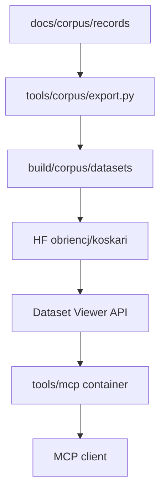

# Corpus Hugging Face publication and MCP server

Long-term design record for publishing the Koskari language conformance corpus
to Hugging Face and serving it to AI coding agents via a local MCP server.
This augments [corpus-schema-philosophy.md](corpus-schema-philosophy.md) (corpus
as source of truth, datasets as views) with concrete publication mechanics and
the planned agent-facing retrieval layer.

**Status**

| Track | Summary | Status |
|-------|---------|--------|
| A — HF dataset publish | Export corpus views to parquet; publish to `obriencj/koskari` | **Implemented** |
| B — MCP server | Koskari stdio MCP shim over the HF Dataset Viewer API | **Designed, not implemented** |

User-facing export and dataset column documentation lives in
[docs/corpus/datasets.md](../docs/corpus/datasets.md). This note is the
maintainer design record for publication and MCP decisions.

---

## Goals

1. **Publish** verified corpus examples to Hugging Face so they are stable,
   versioned, and discoverable outside the git repository.
2. **Serve** those examples to agents in local tools (Cursor, Claude Desktop,
   VS Code MCP clients, and similar) without requiring a checkout of the corpus
   YAML shards or a local Python virtualenv tied to workspace churn.
3. **Preserve corpus authority** — training rows and agent retrieval must not
   assert behavior the corpus does not verify at the relevant stage (see
   corpus-schema-philosophy § Hugging Face and LLM training targets).
4. **Dogfood Koskari** for the MCP server implementation where feasible,
   demonstrating Python interop (`import`, decorators, async) on a small,
   real service.

**Non-goals (for this design)**

- Fine-tuning or hosting a custom Hugging Face **model** on corpus rows. A
  dataset is the right first artifact; a small fine-tune on hundreds of rows
  would be lossy and could hallucinate `eval` results the corpus never
  verified.
- Replacing the corpus YAML or corpus test phase with the published dataset.
  The corpus remains authoritative; HF is a publication sink.
- Linking from `docs/` into this file. User docs stand alone per documentation
  boundaries.

---

## Architecture overview

```text
docs/corpus/records/*.yaml          (source of truth, ~542 records)
        │
        │  tools/corpus/export.py
        ▼
build/corpus/datasets/
  koskari-corpus/train.parquet      (all records, all verify stages)
  koskari-eval/train.parquet        (subset with verify.eval only)
        │
        │  .github/workflows/publish_corpus_dataset.yml
        │  (manual workflow_dispatch; Trusted Publishers OIDC)
        ▼
Hugging Face dataset obriencj/koskari
  config: corpus (default)
  config: eval
        │
        │  datasets-server.huggingface.co (Dataset Viewer API)
        ▼
tools/mcp/mcp.ki  (planned Koskari MCP stdio server in container)
        │
        │  MCP JSON-RPC over stdin/stdout
        ▼
Cursor / Claude Desktop / other MCP clients
```



---

## Track A — Hugging Face dataset publication (implemented)

### Corpus views

Published ML datasets are **views** produced by transforms registered in
`tools/corpus/views/`, not copies of the YAML schema.

| View name | Config on Hub | Rows | Purpose |
|-----------|---------------|------|---------|
| `koskari-corpus` | `corpus` (default) | Every record (~542) | Full example shape for retrieval and multi-stage traces |
| `koskari-eval` | `eval` | Records with `verify.eval` (~496) | Flat source → eval rows for completion-style use |

**`koskari-corpus` columns:** `corpus_id`, `feature`, `source`, `read`,
`expand`, `eval`, `error`, `invalid`, `references`, `stability`, `tags`,
`schema_version`, `git_ref`. Missing verify stages are null.

**`koskari-eval` columns:** `corpus_id`, `feature`, `source`, `eval`,
`schema_version`, `git_ref`.

Every row carries provenance (`corpus_id`, `schema_version`, `git_ref`) so
downstream consumers can join back to the YAML record and export revision.

Export locally:

```bash
tox -qe regen-corpus -- --all-views
make corpus-parquet-all
```

Single-view export remains available (`--view koskari-eval` or
`--view koskari-corpus`).

### Dataset card

`tools/corpus/dataset_card.md` is the source-controlled dataset README. It
declares both Hub configurations in YAML frontmatter and documents columns and
verify-stage semantics. The publish workflow uploads it as the dataset repo
`README.md`.

### Publish workflow

File: `.github/workflows/publish_corpus_dataset.yml`

- **Trigger:** `workflow_dispatch` only (no push/release/schedule yet).
- **Input:** `dry_run` (boolean). When true, export runs and uploads a CI
  artifact; the publish job is skipped.
- **Export job:** `tox -qe regen-corpus -- --all-views`; artifact path
  `build/corpus/datasets/`.
- **Publish job:** downloads artifact; uploads parquet tree and dataset card to
  `obriencj/koskari` via `hf upload`.

### Authentication — Trusted Publishers (OIDC)

Publication does **not** use a long-lived `HF_TOKEN` GitHub secret.

The publish job sets `permissions: id-token: write` and each upload step sets:

```text
HF_OIDC_RESOURCE: datasets/obriencj/koskari
```

The `hf` CLI (`huggingface_hub>=1.19.0`) exchanges the GitHub Actions OIDC
token for a short-lived, repo-scoped Hub token.

**Hub configuration** (dataset settings → Trusted Publishers):

| Claim | Value |
|-------|-------|
| Provider | GitHub Actions |
| `repository` | `obriencj/koskari` |
| `workflow` | `publish_corpus_dataset.yml` |

Optional `branch` pinning can be added later when push-triggered publish is
enabled.

Ref: [Hugging Face Trusted Publishers](https://huggingface.co/docs/hub/trusted-publishers).

### Scale note

At the time of this design, exported parquet sizes are small (on the order of
tens of kilobytes for the full corpus view). That affects MCP caching decisions
(see Track B) but does not change the publication model.

---

## Track B — MCP server (designed)

### Problem

Agents writing Koskari need **idiomatic, verified examples** at query time —
source forms, optional read/expand/eval expectations, feature taxonomy, and
links to user documentation. The corpus YAML shards in git are authoritative
but heavy for a client to load; a uv-managed venv in the developer workspace
is sensitive to churn and is a poor fit for MCP client launch configuration.

### Alternatives considered

| Approach | Verdict | Rationale |
|----------|---------|-----------|
| Fine-tuned HF model on corpus rows | Rejected | Too few rows today; lossy; cannot cite `corpus_id` or guarantee verified `eval` strings |
| HF official MCP server (`huggingface.co/mcp`) | Rejected for this use case | Hub **discovery** (models, datasets, Spaces, papers), not row-level retrieval inside `obriencj/koskari` |
| Community dataset-viewer MCP wrappers | Not adopted | Unvetted; custom maintenance |
| **Thin MCP shim over Dataset Viewer API** | **Chosen** | HF hosts data and search; no local index; always reflects live published dataset; minimal moving parts |
| Pull parquet locally (`huggingface_hub` + pyarrow) | Deferred | Viable for offline use; at current corpus size (~46 KiB parquet) download cost is negligible; adds deps and cache policy without strong benefit for a forwarding shim |
| Bake parquet into MCP image at build | Rejected | Snapshot goes stale; conflicts with “publish once to HF, read live” story unless image is rebuilt on every corpus publish |
| uv-managed venv launch | Rejected | Workspace churn; harder client config than a single container command |
| **Container from `koskari:local`** | **Chosen** | Stable runtime; matches `examples/scheduler/Containerfile` pattern; rebuild rarely once working |

### Retrieval backend — Dataset Viewer API

Once `obriencj/koskari` is public and processed, Hugging Face exposes a
read-only HTTP API at `https://datasets-server.huggingface.co`. The MCP server
does not download or store the dataset; each tool call issues one or more GET
requests and returns JSON to the client.

Default dataset parameters for all tools:

```text
dataset = obriencj/koskari
config  = corpus
split   = train
```

Relevant endpoints:

| Endpoint | Use in MCP |
|----------|------------|
| `/is-valid?dataset=obriencj/koskari` | Startup or error-path check that the dataset is available |
| `/splits?dataset=obriencj/koskari` | Confirm `corpus` / `train` exist |
| `/search?dataset=...&config=corpus&split=train&query=...&offset=0&length=N` | `search_examples` — full-text match over string columns |
| `/filter?dataset=...&config=corpus&split=train&where=...&offset=0&length=N` | `get_example` by `corpus_id`; optional `feature` filter combined with search |
| `/statistics?dataset=...&config=corpus&split=train` | `list_features` — column statistics / value frequencies on `feature` |
| `/rows?...` | Pagination fallback if search/filter are insufficient |

Gated datasets would require `Authorization: Bearer <token>`; `obriencj/koskari`
is intended to be public, so no token is required for the MCP container.

Ref: [Dataset Viewer API](https://huggingface.co/docs/dataset-viewer/index);
internal skill notes under `docs/corpus/` corpus tooling.

### MCP tools (planned)

Minimal surface for ~500 records — lexical/feature retrieval is sufficient;
embedding search is a future upgrade without changing tool names.

#### `search_examples`

Find corpus rows by keyword and optional feature filter.

| Parameter | Type | Default | Description |
|-----------|------|---------|-------------|
| `query` | string | required | Text to match (passed to `/search` or combined filter) |
| `feature` | string | optional | Restrict to feature path prefix or exact match |
| `limit` | integer | 10 | Max rows (API page size cap applies, typically 100) |

Returns a list of matching rows with `corpus_id`, `feature`, `source`, and
non-null verify stage columns present in the row.

#### `get_example`

Fetch one record by id.

| Parameter | Type | Description |
|-----------|------|-------------|
| `corpus_id` | string | Corpus record `id` |

Implementation: `/filter` with a predicate on `corpus_id` (exact match).

#### `list_features`

Browse the feature taxonomy.

Returns distinct `feature` values with counts (from `/statistics` on the
`feature` column, or deduplicated `/rows` if statistics are unavailable).

### Transport — stdio MCP

MCP clients launch the server as a **subprocess** and speak JSON-RPC over
**stdin/stdout**. This differs from the scheduler webhook example
(`examples/scheduler/kosrunner/webhook.ki`), which binds an HTTP port.

**Container run requirements**

```text
podman run -i --rm koskari-mcp:local
```

| Flag | Required | Reason |
|------|----------|--------|
| `-i` | yes | Keep stdin open for JSON-RPC requests |
| `--rm` | recommended | Ephemeral server per client session |
| `-t` | **no** | TTY allocation corrupts the byte stream |

Example client configuration (Cursor / Claude Desktop):

```json
{
  "mcpServers": {
    "koskari-corpus": {
      "command": "podman",
      "args": ["run", "-i", "--rm", "koskari-mcp:local"]
    }
  }
}
```

Use `docker` instead of `podman` when appropriate. Image tag and name are
TBD at implementation time (proposed: `koskari-mcp:local`).

### Implementation language — Koskari

The server is implemented as **`tools/mcp/mcp.ki`**, following patterns from
`examples/scheduler/kosrunner/webhook.ki`:

- `import httpx` (or equivalent) for Viewer API HTTP calls
- `import-from mcp.server.fastmcp FastMCP` for tool registration
- `@(mcp.tool)` decorator on tool functions
- Parameter annotations (e.g. `[query :: str]`) for JSON Schema generation
- `(mcp.run transport: "stdio")` as the program entry

Logging and diagnostics must use **stderr only**. Any stdout write from the
`koskari` CLI bootstrap or import path during startup will corrupt the MCP
stream and must be verified absent before release.

### Container packaging

**Directory:** `tools/mcp/`

**Base image:** `koskari:local` from root `Containerfile`, built by
`make build-container`. That image is `python:3.14-alpine` with Koskari
installed and `ENTRYPOINT ["koskari"]`.

**Child image** (proposed `tools/mcp/Containerfile`):

```dockerfile
FROM koskari:local

RUN pip install --no-cache-dir --disable-pip-version-check \
    mcp httpx

WORKDIR /srv
COPY mcp.ki ./mcp.ki

CMD ["mcp.ki"]
```

Effective command: `koskari mcp.ki` (entrypoint + CMD).

**Makefile target:**

```make
build-mcp: build-container
	$(CONTAINER_ENGINE) build -t koskari-mcp:local -f tools/mcp/Containerfile tools/mcp/
```

Precedent: `examples/scheduler/Containerfile` (`FROM koskari:local`, extra
pip deps, `CMD ["run.ki"]`).

### Dependencies and build risks

| Package | Role | Alpine note |
|---------|------|-------------|
| `mcp` | FastMCP stdio server | Pulls `pydantic` → `pydantic-core` (Rust extension) |
| `httpx` | HTTP client for Viewer API | Pure Python |

`pydantic-core` publishes `musllinux` wheels for common architectures
(x86_64, aarch64). If `pip install` fails on an uncommon arch, add a builder
stage with `gcc musl-dev` similar to the scheduler image’s `aiokafka` wheel
build.

### Caching — explicitly out of scope for v1

A host scratch volume (e.g. `tmp/hf-data` with `HF_HOME`) was considered so
the server would not re-download data on every launch. The **forwarding shim
does not download the dataset**; only HTTP response bodies for the current
query are transferred. Local parquet caching would require switching to a
**local-pull** design (pyarrow + `huggingface_hub`), which is deferred.

No bind-mount of `mcp.ki` for development was requested; the image is built
once and treated as stable.

### Network

The container needs **outbound HTTPS** to `datasets-server.huggingface.co`.
No inbound ports. Default bridge networking is sufficient.

### Failure modes

| Condition | Behavior |
|-----------|----------|
| Dataset not yet processed on Hub | `/is-valid` false; tools return a clear error |
| Viewer API unreachable | Tool error; client may retry |
| stdout pollution on startup | MCP client desync; must be caught in manual smoke test |
| Corpus publish lag | MCP reflects Hub state, not git `master`; republish workflow after corpus changes |

---

## Relationship to corpus growth

[corpus-generation-agent.md](corpus-generation-agent.md) targets hundreds–
thousands of records via an autonomous agent in an isolated worktree. As the
corpus grows:

- Re-run **Track A** publish workflow to refresh Hub parquet.
- **Track B** MCP needs no image rebuild for data updates (live Viewer API).
- If row count reaches a point where lexical search is insufficient, consider
  embeddings or local parquet index **without** changing the MCP tool surface.

---

## Implementation checklist (Track B)

1. Add `tools/mcp/mcp.ki` with FastMCP tools and Viewer API client helpers.
2. Add `tools/mcp/Containerfile` and `make build-mcp` depending on
   `build-container`.
3. Smoke test: `podman run -i --rm koskari-mcp:local` with a manual MCP
   client or `mcp` inspector; confirm silent stdout and tool responses.
4. Document client config snippet in `tools/mcp/README.md` (maintainer-facing;
   not required in `docs/` unless a user guide page is added later).
5. Optional: add a minimal integration test that mocks Viewer API responses
   (pytest in `tests/` is out of band for the `.ki` server unless a harness
   exists).

---

## References

- [corpus-schema-philosophy.md](corpus-schema-philosophy.md) — corpus first,
  dataset views, provenance, no semantic drift
- [corpus-generation-agent.md](corpus-generation-agent.md) — corpus volume
  growth workflow
- [docs/corpus/datasets.md](../docs/corpus/datasets.md) — user-facing published
  dataset status and export commands
- [docs/corpus/SCHEMA.md](../docs/corpus/SCHEMA.md) — verify stages and record
  shape
- `tools/corpus/` — export, views, dataset card
- `.github/workflows/publish_corpus_dataset.yml` — publish workflow
- `examples/scheduler/Containerfile` — `koskari:local` child image precedent
- `examples/scheduler/kosrunner/webhook.ki` — Koskari Python interop and
  decorator pattern
- [Hugging Face Trusted Publishers](https://huggingface.co/docs/hub/trusted-publishers)
- [Hugging Face MCP Server (Hub discovery)](https://huggingface.co/docs/hub/agents-mcp) —
  not used for row retrieval

# The end.
