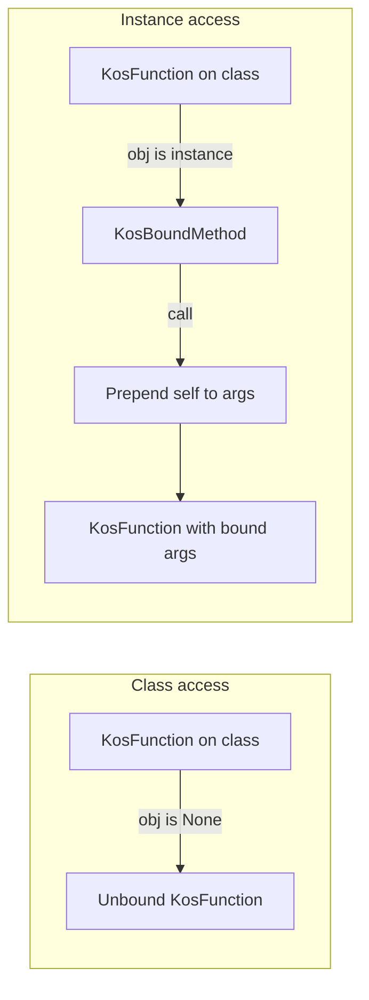

# Inspect interoperability for `KosFunction` and `KosBoundMethod`

This document specifies how Koskari’s native function objects should participate in Python’s runtime introspection ecosystem (`inspect`, and closely related `typing` helpers). It is grounded in the current C implementation; it proposes a **recommended v1 interop surface** and separates **later** or **non** goals.

## Motivation and scope

### Why this matters

Many Python libraries discover call shape and types through:

- `inspect.signature` / `inspect.Signature.bind` — dependency injection (e.g. FastAPI), validation, adapters
- Optional combination with `__annotations__` and `typing.get_type_hints` — static-style types at runtime
- `functools.wraps` and `inspect.unwrap` — decorator stacks that preserve or forward metadata

Koskari defines its own callable types (`KosFunction`, `KosBoundMethod`) in [`koskari/lib/func.c`](../../../koskari/lib/func.c). They are not CPython `types.FunctionType` instances, so **duck typing via attributes** (`__signature__`, etc.) is the practical path to interoperability.

### In scope

- Behavior described in the **`inspect`** module that applies to arbitrary callables (especially `inspect.signature` and related patterns).
- **`typing.get_type_hints`** only where it depends on the same object attributes (`__annotations__`, `__module__`, `__globals__`-like context).

### Out of scope for the recommended v1 feature set

- Making `KosFunction` pass **`inspect.isfunction`** (would imply being or mimicking `types.FunctionType` in ways that are brittle or wrong).
- Full **`inspect.getsource`** / line-accurate tracebacks **unless** a deliberate bridge exists from `KosCode` to something `inspect` understands (see [Non-goals and limitations](#explicit-non-goals-and-limitations); [`KosCode`](../../../koskari/lib/bytecode.h) already carries `KosCode_FILENAME` / `KosCode_NAME` and a `KosCode_Faux` path to a `PyCodeObject`, but wiring that to user-facing “source” is separate work).

---

## Baseline: current implementation

### `KosFunction`

The native struct holds: `code` (`KosCode`), `base_ns` (template namespace), `formals` (`KosFormals`), optional `name`, plus a vectorcall slot ([`koskari/lib/func.h`](../../../koskari/lib/func.h)).

Exposed to Python as **members** `code`, `base_ns`, `formals`, `name` ([`koskari/lib/func.c`](../../../koskari/lib/func.c) `function_members`). There is **no** `__name__`, `__qualname__`, `__module__`, `__doc__`, `__code__`, or `__signature__` on the type today.

`KosFunction` implements the **descriptor protocol**: `tp_descr_get` returns the bare function when `obj is None` (class access) and a **`KosBoundMethod`** when `obj` is the instance ([`koskari/lib/func.c`](../../../koskari/lib/func.c) `function_descr_get`).

### `KosBoundMethod`

Wraps `(func, self)` where `func` is a `KosFunction`. Python-visible attributes **`__func__`** and **`__self__`** match the usual method layout ([`koskari/lib/func.c`](../../../koskari/lib/func.c) `boundmethod_members`). Calling prepends `self` to the argument tuple (`boundmethod_call`, and the evaluator paths `kos_install_boundmethod` / `kos_vinstall_boundmethod`).

### `KosFormals`

Formal parameters are represented in [`koskari/lib/formals.h`](../../../koskari/lib/formals.h) as:

- `pos`, `pos_only`, `kwd`, `kwd_only`, `star`, `starstar`, `defaults`

This is the **authoritative** source for building `inspect.Parameter` lists and an `inspect.Signature` (together with default values in `defaults`).

### Call flow (descriptor vs bound call)

Behavior is exercised from Python in [`tests/lib/test_expression_function.py`](../../../tests/lib/test_expression_function.py) (descriptor `__get__`, bound method, `apply` flattening).

### Gaps relative to `inspect` today

| Desired introspection | Today |
|----------------------|--------|
| `inspect.signature(fn)` without special cases | **No** `__signature__`; introspection does not see Koskari shape |
| `__annotations__` / return annotation | **Not** on `KosFunction` |
| `__name__` / `__qualname__` / `__module__` | **`name` member** only; not standard dunders |
| `__doc__` on the callable | **Not** exposed on `KosFunction` (docstrings on `KosCode` / compiler metadata are **open design** for tying into `__doc__`) |
| `__code__` | **No**; `KosFunction` holds `KosCode`, not `types.CodeType` |

---

## Recommended v1 interop surface (priorities)

### Priority A — `inspect.signature` via `__signature__`

**Mechanism (CPython):** For objects that are not normal Python functions, `inspect.signature` consults a **`__signature__`** attribute. If it is an `inspect.Signature` instance, that value is used (see CPython docs for `inspect.signature`).

**Proposal:** Implement **`__signature__`** on `KosFunction` (and possibly on `KosBoundMethod`; see next section) such that:

1. **Construction:** Build `inspect.Signature` from **`KosFormals`**: map each slot to `inspect.Parameter` with the appropriate **`Parameter.kind`**:
   - `pos_only` → `POSITIONAL_ONLY`
   - `pos` / `kwd` (after rules in formals apply) → `POSITIONAL_OR_KEYWORD` as appropriate for the compiler’s calling convention
   - `star` → `VAR_POSITIONAL`
   - `kwd_only` → `KEYWORD_ONLY`
   - `starstar` → `VAR_KEYWORD`
2. **Defaults:** Merge **`KosFormals_DEFAULTS`** (and any keyword-default dict used at `KosFormals_New` time) so parameters that have defaults use non-`empty` defaults in `Parameter.default`.
3. **Return annotation:** Use **`inspect.Parameter.empty`** for `Signature.return_annotation` until the language and compiler consistently attach a return type to functions (then map into `typing` objects or strings).

**Caching:** Prefer a **lazy** cache: compute the first time `__signature__` is read, then store the result on the `KosFunction` (or in a side table keyed by id) to avoid rebuilding. `KosFormals` on a live function should be treated as **immutable** after construction for this purpose. Under the CPython GIL, a simple “compute once, assign pointer” pattern is typically sufficient.

**Implementation location:** Native type slots (`tp_getset` or a descriptor on the type) keep the logic in one place and avoid pure-Python wrappers for every instance.

### Priority A — `KosBoundMethod` vs unbound `KosFunction`

**Requirement:** Match **`types.MethodType`** semantics for **`inspect.signature`**: for a **bound** method, the signature seen at the **call site** should **not** include a separate first argument for the already-bound receiver (CPython drops the `self` parameter for bound methods in the public signature).

**Relationship:** `KosBoundMethod.__func__` is the underlying `KosFunction` ([`koskari/lib/func.c`](../../../koskari/lib/func.c)). Two consistent options:

1. **`__signature__` only on `KosBoundMethod`:** When present, return a signature with the **first** positional parameter of the unbound signature removed, **if** that parameter is the implicit receiver (same rule as CPython for instance methods). **`__signature__` on unbound `KosFunction`** remains the full parameter list including `self`/`cls` when applicable.
2. **`__signature__` only on `KosFunction`:** Implementors of consumers call `inspect.signature` on `__func__` and apply the same “bound method” adjustment — **less** convenient and easier to get wrong; not recommended for ecosystem compatibility.

Prefer (1) or expose both with clear documentation.

**Exact drop rule (to specify in implementation):** Align with CPython: bound instance method → remove first positional parameter from the unbound signature when it would have been bound by `__self__`. Class methods / static methods (if introduced later) need distinct rules.

### Priority B — `__annotations__` and typing interop

Many frameworks combine signatures with **`__annotations__`** and call **`typing.get_type_hints(obj)`**.

**Status:** If the compiler does not yet emit per-parameter and return annotations onto `KosFunction`, the interoperable default is:

- **`__annotations__`** as an empty **`dict`**, or
- A dict with keys only where the compiler eventually supplies types, using **`Parameter.empty`** in the `Signature` for parameters without annotations.

**Open design:** Where compile-time type metadata will live long-term (e.g. attached to `KosCode`, module namespace, or a side table) should be decided when annotation support lands; this document only requires that **`__annotations__`** and **`__signature__` stay consistent** once both exist.

### Priority B — `__wrapped__` and decorator chains

When Koskari callables are wrapped with **`functools.wraps`** or similar:

- **`inspect.unwrap`** follows **`__wrapped__`**
- **`inspect.signature`** often resolves through wrappers if `__signature__` is set on the outer callable or copied by `wraps`

**Recommendation:** Document that **user-defined** or **stdlib** wrappers should set **`__wrapped__`** to the inner callable. If Koskari provides its own decorator helpers, they should do the same. Prefer **`__signature__` on the outermost** callable that tools see first, or rely on `functools.wraps` copying when possible.

### Priority C — Standard presentation attributes

Many tools use:

- `getattr(fn, "__name__", ...)`
- `getattr(fn, "__module__", ...)`
- Docstrings via `__doc__`

**Today:** `KosFunction` exposes **`name`**, not **`__name__`**. Options:

1. Add **`__name__`** / **`__qualname__`** (and optionally **`__module__`**) as properties or members mirroring `name` and defining module when known from `BUILD_FUNCTION` / import context.
2. Leave **`name`** only and document that ecosystem code may need **`getattr(fn, "__name__", getattr(fn, "name", None))`** — higher friction.

**Recommendation for v1 doc:** Treat **`__name__` alignment** as **Priority C** but **high leverage** for libraries that do not use `inspect.signature` alone.

---

## Explicit non-goals and limitations

| Area | Rationale |
|------|-----------|
| **`inspect.isfunction` / `inspect.ismethod`** | Koskari callables are native extension types; tests should not require these to be true. Consumers should rely on **`inspect.signature`** and attribute protocols. |
| **`inspect.getfile` / `inspect.getsourcelines`** | Typically need a **`types.CodeType`** or equivalent; `KosFunction` does not expose `__code__`. `KosCode` has filename/name hooks ([`bytecode.h`](../../../koskari/lib/bytecode.h)); bridging to `inspect` is **future** optional work. |
| **`inspect.getclosurevars`** | Requires a closure representation compatible with CPython’s expectations; Koskari’s closure model may not map 1:1 until explicitly designed. |

---

## Validation matrix (design-level)

| Feature | Motivating consumer | Attributes / behavior | Suggested acceptance check |
|---------|---------------------|------------------------|------------------------------|
| Callable shape | FastAPI, Starlette, generic DI | `__signature__` on `KosFunction` | `inspect.signature(fn)` returns stable `Signature`; `bind` / `bind_partial` behave for positional/kw-only/\*args/\*\*kwargs |
| Bound calls | Same, instance routes | `__signature__` on `KosBoundMethod` or equivalent | `inspect.signature(bound)` omits receiver parameter like CPython methods |
| Types | Pydantic v2, `typing` | `__annotations__`, optional `get_type_hints` | Parameters and return match compiler when annotations exist |
| Decorators | `functools`, middleware | `__wrapped__` | `inspect.unwrap(outer) is inner` |
| Display | Loggers, frameworks | `__name__`, `__module__`, `__doc__` | `getattr` patterns succeed without Koskari-specific branches |

---

## Related design links

- [types.md](../api/types.md) — core type catalog (Function section can gain a pointer here when this is implemented).
- [../language/functions.md](../language/functions.md) — surface syntax for formals (pos-only, defaults, `*`, `**`).
- [special-call-protocol.md](../api/special-call-protocol.md) — kos install / vectorcall entry points for `KosFunction` and `KosBoundMethod` (orthogonal to `inspect`, but useful for understanding call vs introspection).

---

## Implementation status (native)

Implemented in [`koskari/lib/func.c`](../../../koskari/lib/func.c) and [`koskari/lib/func.h`](../../../koskari/lib/func.h):

- **`KosFunction`**: `__signature__` (lazy cache on the instance), `__annotations__` (fresh empty `dict` per access), `__name__` / `__qualname__` (from `name` or `KosCode` name or `"<lambda>"`), `__module__` (`None`). `KosFormals` is mapped to `inspect.Parameter` in runtime positional order (`pos`, `pos_only`, `kwd`, `*`, `kwd_only`, `**`); if `inspect.Signature` rejects the kind order (e.g. `POSITIONAL_ONLY` after `POSITIONAL_OR_KEYWORD`), the build is retried with positional-only names emitted as `POSITIONAL_OR_KEYWORD` (introspection may over-report keyword acceptance for those names).
- **`KosBoundMethod`**: `__signature__` by taking the unbound function’s signature and dropping the first parameter (receiver), matching bound method call semantics.
- **Tests**: [`tests/lib/test_inspect_kos_function.py`](../../../tests/lib/test_inspect_kos_function.py).

---

## Summary

The **highest-value** interoperability step is a correct, cached **`__signature__`** derived from **`KosFormals`**, plus **bound-method** behavior matching **`types.MethodType`** for signature visibility. **`__annotations__`** and presentation dunders (**`__name__`**, **`__module__`**, **`__doc__`**) layer on top for full ecosystem parity; **`inspect.isfunction`** and **source introspection** are explicit non-goals for the first pass unless separately designed.
