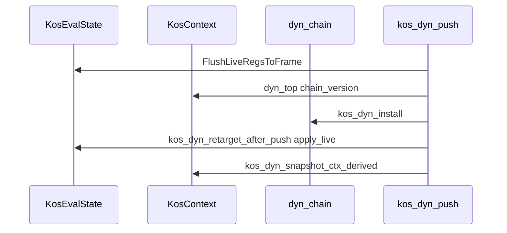

# Dyn-chain vs KosEvalState authority violations

**Status:** Audit ledger (code survey)  
**Audience:** Agents and humans working on live-authority cleanup  
**Repository root:** `sibilant-ng/`  
**Code survey:** `koskari/lib` as of 2026-05-26, branch `eval_state_truth`, commit `160c19f` (POP_LOOP retarget) and working tree thereafter  

**Related documents:**

| Document | Relationship |
|----------|----------------|
| [eval-state-live-authority.md](eval-state-live-authority.md) | Target authority model and Phase 1/2 plan |
| [../api/tracing.md](../api/tracing.md) | `eval_state_sync` trace buckets |
| [freeze-thaw-context-segments.md](freeze-thaw-context-segments.md) | Long-term freeze/thaw direction |

---

## 1. Premises and scope

This document records violations of the live-authority model for dynamic-chain transitions. The premises below are the audit standard; entries in §2 name code that diverges from them.

### 1.1 Premises (audit standard)

| Rule | Meaning |
|------|---------|
| **P1 — `es` during RUN** | `es->frame`, `es->code`, `es->block`, `es->namespace`, `es->pc`, `es->acting_pc` are the live registers opcodes and hot helpers use. |
| **P2 — `ctx` derived between drives** | `ctx->frame_top`, `ctx->block`, `ctx->namespace` are revive snapshots. During RUN they are NULL on ctx (stolen onto `es`); restored at eval exit via `KosEvalState_FreezeToContext`. |
| **P3 — `ctx` structural between drives** | `ctx->dyn_top`, `plan`, `plan_stack` are revive snapshots. During RUN they are NULL on ctx; live chain/plan live on `es` only (`KosEvalState_DYN_TOP`, `KosEvalState_PLAN`). GC while RUNNING uses TLS active `es` in `KosContext_Traverse`. |
| **P4 — flush on frame identity only** | `KosEvalState_FlushLiveRegsToFrame` runs when pushing or removing a **frame** (when `es->frame` identity changes). Region push/pop (LOOP, TRY, FOREACH, WITH, …) with unchanged frame must not flush live PCs to the heap frame. |
| **P5 — no success-path repair sync** | `KosEvalState_SyncFromContext` (`ctx` derived → `es` full repair) belongs on error/guard paths only, not on successful Tier-1 push/pop retarget. |
| **P6 — no dual publish** | Successful chain edits update `es` live fields at choke points. Writing `ctx->frame_top` / `block` / `namespace` on every retarget duplicates authority during RUN. |

### 1.2 Alignment with eval-state-live-authority.md

[eval-state-live-authority.md §3.1](eval-state-live-authority.md) states `es` live fields are authoritative during RUN and `ctx->frame_top` / `block` / `namespace` are not.

§3.2 diagram (lines 131–132) says RUN updates **`es` live fields there only**.

§3.2 “Current (Phase 1)” block (lines 150–151) says snapshot of ctx derived fields **only at freeze**.

§0 implementation status (row 49) marks **`es` first, ctx snapshot at retarget end** as **Done**. That landed behavior is listed as heresy **H17** below because it populates ctx derived fields on every Tier-1 retarget during RUN.

### 1.3 Scope

- **In scope:** `koskari/lib/dynchain.c`, `koskari/lib/dynchain/dyn_*.c`, eval lifecycle (`eval_state.c`, `eval.c`, `eval_chain.c`, `eval_utils.c`), opcode flush sites, trace bucket names.
- **Out of scope:** Remediation designs, test commands, behavioral changes to transfer plans or install/uninstall semantics.

---

## 2. Heresy catalog

Each entry: **ID**, **name**, **violation** (which premise), **evidence**, **affected paths**.

### H1 — `kos_dyn_snapshot_ctx_derived` on every Tier-1 retarget

| Field | Detail |
|-------|--------|
| **Premises** | P2, P6 |
| **Violation** | After `kos_dyn_apply_live` updates `es`, copies `es->frame` / `block` / `namespace` into `ctx->frame_top` / `block` / `namespace` on every successful push/pop retarget. |
| **Evidence** | `koskari/lib/dynchain.c`: definition ~610–623; calls ~717 (`kos_dyn_retarget_after_push`), ~788 and ~802 (`kos_dyn_retarget_after_pop`, including block-only fast path), ~858 (`kos_dyn_rebuild_live_from_chain`). |
| **Affected** | All `kos_dyn_push_noinstall` callers (PUSH_LOOP, PUSH_TRY, PUSH_FOREACH, …), all `kos_dyn_commit_dyn_top` pops (POP_LOOP, POP_TRY, …), Tier-2 rebuilds. |

### H2 — Unconditional flush in `kos_dyn_push_noinstall`

| Field | Detail |
|-------|--------|
| **Premises** | P4 |
| **Violation** | `KosEvalState_FlushLiveRegsToFrame(es)` before every region push regardless of frame identity. |
| **Evidence** | `koskari/lib/dynchain.c` ~925. |
| **Affected** | `kos_dyn_push_loop` → PUSH_LOOP; same helper for TRY, FINALLY, FOREACH, WITH, CC, NS, PARAM, WIND, COLLECT, frame via `dyn_frame.c`, etc. |

### H3 — Unconditional flush in `kos_dyn_push`

| Field | Detail |
|-------|--------|
| **Premises** | P4 |
| **Violation** | Flush before every `kos_dyn_push` including nodes that only need `kos_dyn_install` and may not change `es->frame`. |
| **Evidence** | `koskari/lib/dynchain.c` ~878. |
| **Affected** | Push paths that use `kos_dyn_push` (install-required node kinds). |

### H4 — Unconditional flush in `kos_dyn_uninstall_core`

| Field | Detail |
|-------|--------|
| **Premises** | P4 |
| **Violation** | Flush at start of uninstall before handler runs, including region nodes where frame is unchanged. |
| **Evidence** | `koskari/lib/dynchain.c` ~941. |
| **Affected** | `kos_dyn_uninstall` and unwind paths through uninstall core. |

### H5 — `kos_dyn_push` success: flush, structural ctx, install, `es` retarget, ctx snapshot

| Field | Detail |
|-------|--------|
| **Premises** | P2, P4, P6 |
| **Violation** | Single success path performs: flush to heap frame; `ctx->dyn_top` and `chain_version` update; `kos_dyn_install`; `kos_dyn_retarget_after_push` (`apply_live` on `es`); `kos_dyn_snapshot_ctx_derived` on `ctx`. |
| **Evidence** | `koskari/lib/dynchain.c` ~872–887. |
| **Affected** | Any push using `kos_dyn_push`. |



### H6 — `kos_dyn_push` install failure: `SyncFromContext` — **resolved**

| Field | Detail |
|-------|--------|
| **Resolution** | On install failure, `dyn_top` is restored to the previous head; no rebuild. |
| **Evidence** | `koskari/lib/dynchain.c` `kos_dyn_push`. |

### H7 — Trace buckets mislabel retarget/rebuild work

| Field | Detail |
|-------|--------|
| **Premises** | Observability |
| **Violation** | `kos_dyn_retarget_after_push` ends with `KOS_TRACE_EVAL_SYNC_END(KOS_TEVS_patch_dyn_caches)` (~736). `kos_dyn_rebuild_live_from_chain` ends with `KOS_TRACE_EVAL_SYNC_END(KOS_TEVS_refresh_dyn_caches)` (~861). APIs `PatchDynCaches` / `RefreshDynCaches` are removed; trace names survive. |
| **Evidence** | `koskari/lib/dynchain.c` ~695–736, ~826–861. `rg 'PatchDynCaches|RefreshDynCaches|ApplyDynCaches' koskari/lib` — no matches. |
| **Affected** | `trace.json` `eval_state_sync.patch_dyn_caches` / `refresh_dyn_caches` understate flush vs overstate “patch” on region retarget. |

### H8 — `kos_dyn_rebuild_live_from_chain` always snapshots ctx

| Field | Detail |
|-------|--------|
| **Premises** | P2, P6 |
| **Violation** | Full chain walk, `apply_live` on `es`, then `kos_dyn_snapshot_ctx_derived` on every rebuild. |
| **Evidence** | `koskari/lib/dynchain.c` ~818–858. |
| **Affected** | xfer INSTALL/PUSH, pop fallback when `new_top != parent(removed)`, `KosContext_New` bootstrap, tail paths, opcode post-assign stack paths (per authority doc §9.3). |

### H9 — `SyncFromContext` call sites — **resolved**

| Field | Detail |
|-------|--------|
| **Resolution** | `KosEvalState_SyncFromContext` removed from `koskari/lib`; `grep` gate zero. |
| **Evidence** | Appendix A (historical inventory). |

### H10 — `kos_dyn_pop_*` mismatch → `SyncFromContext` — **resolved**

| Field | Detail |
|-------|--------|
| **Resolution** | Region pops return `int`; mismatch sets `PyErr` and `-1` without rebuild. |
| **Evidence** | `koskari/lib/dynchain/dyn_*.c`, `kos_dyn_pop_yield_from` in `dynchain.c`. |

### H11 — Tail koscall writes ctx derived during RUN

| Field | Detail |
|-------|--------|
| **Premises** | P2, P6 |
| **Violation** | After in-place `es` publish for tail recycle, assigns `KosContext_FRAME_TOP`, `BLOCK`, `NAMESPACE` directly without going through freeze-only path. |
| **Evidence** | `koskari/lib/eval/eval_utils.c` ~386–395 (`do_frame_prep` tail branch). |
| **Affected** | Tail koskari calls with `wants_frame && tail_call`. |

### H12 — `kos_dyn_finish_delimited_pop_return` writes ctx frame_top then rebuild

| Field | Detail |
|-------|--------|
| **Premises** | P2, P6, P8 |
| **Violation** | `KosContext_FRAME_TOP(ctx) = ret_frame` (~4583) then `kos_dyn_rebuild_live_from_chain` (full walk + snapshot). Error path also calls `SyncFromContext` (~4577). |
| **Evidence** | `koskari/lib/dynchain.c` ~4515–4587. |
| **Affected** | Delimited pop return delivery. |

### H13 — `eval_chain.c` writes ctx derived during transition setup

| Field | Detail |
|-------|--------|
| **Premises** | P2, P6 |
| **Violation** | Assigns `KosContext_NAMESPACE`, `FRAME_TOP`, `BLOCK` during chain transition work. |
| **Evidence** | `koskari/lib/eval/eval_chain.c` ~263–268. |
| **Affected** | `kos_dyn_transition` / related setup. |

### H14 — Bootstrap and agen paths write ctx frame_top

| Field | Detail |
|-------|--------|
| **Premises** | P2 (bootstrap may be lifecycle exception; agen clears consumer ctx) |
| **Violation** | `KosContext_FRAME_TOP` assigned outside freeze helper. |
| **Evidence** | `koskari/lib/eval.c` ~947 (`KosContext_New` / bootstrap); ~1588–1589 (`kos_attach_agen_gen_flatten` sets agen `ctx` `dyn_top` and `frame_top` NULL). |
| **Affected** | New context setup; async gen flatten attach. |

### H15 — Pop flush conditional; push flush not symmetric

| Field | Detail |
|-------|--------|
| **Premises** | P4 |
| **Violation** | `kos_dyn_commit_dyn_top` flushes only when `KosEvalState_FRAME(es) == (KosDynFrame *) removed` (~906–907). `kos_dyn_push_noinstall` still flushes unconditionally (~925). |
| **Evidence** | `koskari/lib/dynchain.c` ~900–929. |
| **Affected** | POP_LOOP / region pops vs PUSH_LOOP / region pushes. POP_LOOP corrective plan fixed pop side only; push flush listed out of scope in that plan. |

### H16 — Stale comment: flush required before every `push_noinstall`

| Field | Detail |
|-------|--------|
| **Premises** | P4, documentation |
| **Violation** | `kos_dyn_retarget_after_push` comment states caller must already have called `FlushLiveRegsToFrame` for all push paths (~679–681). Encodes unconditional flush policy for region nodes. |
| **Evidence** | `koskari/lib/dynchain.c` ~677–681. |
| **Affected** | Maintenance of push retarget. |

### H17 — Phase 1 “Done” row vs §3.2 RUN-only-`es` diagram

| Field | Detail |
|-------|--------|
| **Premises** | P2, P6, documentation |
| **Violation** | §0 marks `es` first + ctx snapshot at retarget end as complete. §3.2 lines 131–132 show RUN updating `es` only. §3.2 lines 150–151 show ctx derived snapshot optional at freeze only. Landed code does snapshot at every retarget (H1). |
| **Evidence** | [eval-state-live-authority.md](eval-state-live-authority.md) §0 row 49, §3.2, §4.2 row “Push retarget”, §6.2. |
| **Affected** | Agent expectations vs code. |

### H18 — PUSH_LOOP / POP_LOOP cost vs unnecessary publish work

| Field | Detail |
|-------|--------|
| **Premises** | P2, P4, P6 (performance) |
| **Violation** | PUSH_LOOP: extent lookup, `kos_dynloop_new` (dyn node + `KosStackBlock_NewEmpty`), `push_noinstall` (H2 flush + H1 snapshot), `Py_INCREF(None)`. POP_LOOP: `commit_dyn_top` (H1 snapshot on block retarget; conditional pop flush per H15), `kos_dynloop_free` → `KosStackBlock_Release`. |
| **Evidence** | `koskari/lib/opcode/PUSH_LOOP.c`; `koskari/lib/dynchain/dyn_loop.c`; `trace.json` opcode_timing (survey run): PUSH_LOOP count 50 avg_ns 1078; POP_LOOP count 50 avg_ns 3019; CALL_FAST count 26214300 avg_ns 560. |
| **Affected** | Per-`while` entry/exit (PUSH/POP once each), not per loop iteration. |

### H19 — Renamed heresy: removed cache APIs, surviving behavior

| Field | Detail |
|-------|--------|
| **Premises** | P2, P6, P5 |
| **Violation** | `PatchDynCaches`, `RefreshDynCaches`, `ApplyDynCaches` deleted from `koskari/lib`. Equivalent work: `kos_dyn_snapshot_ctx_derived` (ctx←es), `kos_dyn_rebuild_live_from_chain` (walk + apply_live + snapshot), `KosEvalState_SyncFromContext` (ctx→es repair). |
| **Evidence** | `rg` no matches for removed API names. Rebuild log string still says `refresh_dyn_caches` (~842–854). |
| **Affected** | Interpretation of Phase 1 “removed refresh APIs” checklist. |

### H20 — `kos_dyn_apply_live` flush on frame pointer change (pop/push frame)

| Field | Detail |
|-------|--------|
| **Premises** | P4 (correct when frame changes; can pair with redundant flush in push/commit) |
| **Violation** | When `ef != ft`, flushes outgoing frame then loads new frame PCs (~579–581). Frame pop may flush in `commit_dyn_top` and again in `apply_live`. |
| **Evidence** | `koskari/lib/dynchain.c` ~567–599. |
| **Affected** | Frame push/pop; double flush possible on frame identity change. |

---

## 3. Phase 1 omissions (documented, not fixed)

| Item | Notes |
|------|--------|
| Push-side conditional flush | POP_LOOP plan scoped pop-only; `push_noinstall` ~925 unchanged. |
| Defer ctx derived writes to freeze-only | Authority doc §10 Phase 2 “Optional: defer ctx derived writes…” — open. |
| Tier-4 `SyncFromContext` | **Removed** (Appendix A is historical). |
| Opcode PUSH_* post-push full rebuild | §9.3 kept intentionally. |

---

## 4. Appendix A — `KosEvalState_SyncFromContext` inventory

**Total call sites in `koskari/lib/**/*.c`:** 141 (excluding the function definition in `eval_state.c`).

### A.1 Per-file counts

| File | Count |
|------|------:|
| `koskari/lib/dynchain.c` | 90 |
| `koskari/lib/dynchain/dyn_with.c` | 19 |
| `koskari/lib/dynchain/dyn_next.c` | 7 |
| `koskari/lib/dynchain/dyn_wind.c` | 5 |
| `koskari/lib/dynchain/dyn_yield_from.c` | 4 |
| `koskari/lib/dynchain/dyn_gen.c` | 4 |
| `koskari/lib/dynchain/dyn_foreach.c` | 3 |
| `koskari/lib/eval/eval_chain.c` | 1 |
| `koskari/lib/dynchain/dyn_loop.c` | 1 |
| `koskari/lib/dynchain/dyn_param.c` | 1 |
| `koskari/lib/dynchain/dyn_collect.c` | 1 |
| `koskari/lib/dynchain/dyn_ns.c` | 1 |
| `koskari/lib/dynchain/dyn_finally.c` | 1 |
| `koskari/lib/dynchain/dyn_try.c` | 1 |
| `koskari/lib/dynchain/dyn_delim.c` | 1 |
| `koskari/lib/utils.c` | 1 |

### A.2 `dynchain.c` — grouped by enclosing function

| Function (approx.) | Lines |
|--------------------|-------|
| `kos_dyn_push` (install failure) | 883 |
| `kos_dyn_push_clone`, `kos_dyn_uninstall` area | 977, 990, 996 |
| `kos_dyn_walk_handle_yield` | 1389, 1399 |
| `kos_dyn_exception_unwind` | 1460, 1467, 1474, 1494 |
| `kos_dyn_pop_nonbarrier_top`, `kos_dyn_pop_top_allow_barrier`, `kos_dyn_pop_top` | 1581, 1587, 1592, 1606, 1611 |
| `kos_dyn_pop_one_unwind_walk`, `kos_dyn_unwind_to_node` | 1642, 1674, 1678 |
| `kos_dyn_walk_return_to_frame`, `kos_dyn_unwind_to_frame` | 1715, 1720, 1733, 1740, 1745, 1758, 1763, 1798, 1802, 1813, 1817 |
| `kos_dyn_transfer_to_loop` | 1874, 1893, 1906, 1926, 1947 |
| `kos_dyn_try_local_raise_body` | 2027, 2055, 2083, 2087 |
| `kos_validate_capture`, `kos_dyn_walk_handle_shift_to_prompt` | 2226, 2251, 2257, 2265, 2275, 2313 |
| `kos_shift_capture`, `kos_capture_cc` | 2397, 2403, 2409, 2442, 2473, 2498, 2517, 2522, 2531, 2537, 2563, 2587 |
| `kos_build_transfer_plan`, `kos_build_return_plan`, related plan builders | 3063, 3079, 3105, 3141, 3150, 3164, 3227, 3242, 3270, 3314, 3356, 3362, 3410, 3424, 3439 |
| `kos_run_transfer_step`, xfer step helpers | 3980, 3992, 4004, 4016, 4028, 4037 |
| `kos_invoke_continuation` | 4112, 4138, 4160, 4188, 4234 |
| `kos_dyn_finish_delimited_pop_return` | 4577 |
| `kos_dyn_deliver_iterator_boundary_return_event` | 4623 |
| `kos_dyn_try_deliver_iterator_boundary_after_pop` | 4705 |

### A.3 `dyn_*.c` — line list

| File | Line | Context |
|------|------|---------|
| `dyn_loop.c` | 106 | `kos_dyn_pop_loop` — dyn_top mismatch guard |
| `dyn_try.c` | 94 | error/guard |
| `dyn_finally.c` | 111 | error/guard |
| `dyn_ns.c` | 96 | error/guard |
| `dyn_collect.c` | 108 | error/guard |
| `dyn_param.c` | 295 | error/guard |
| `dyn_delim.c` | 127 | error/guard |
| `dyn_foreach.c` | 128, 150, 174 | error/guard |
| `dyn_gen.c` | 104, 112, 179, 184 | error/guard |
| `dyn_yield_from.c` | 178, 183, 201, 238 | error/guard |
| `dyn_wind.c` | 112, 139, 152, 157, 246 | error/guard |
| `dyn_next.c` | 20, 55, 156, 161, 184, 192, 205 | error/guard |
| `dyn_with.c` | 270, 306, 313, 321, 345, 351, 378, 391, 400, 427, 434, 442, 490, 510, 520, 529, 545, 566, 584 | error/guard |
| `eval_chain.c` | 166 | `kos_dyn_transition` on -1 |
| `utils.c` | 197 | helper error path |

---

## 5. Appendix B — `KosEvalState_FlushLiveRegsToFrame` inventory

| File | Line | Notes |
|------|------|--------|
| `dynchain.c` | 581 | `kos_dyn_apply_live` when `ef != ft` |
| `dynchain.c` | 878 | `kos_dyn_push` — unconditional |
| `dynchain.c` | 907 | `kos_dyn_commit_dyn_top` — when removed == `es->frame` |
| `dynchain.c` | 925 | `kos_dyn_push_noinstall` — unconditional |
| `dynchain.c` | 941 | `kos_dyn_uninstall_core` — unconditional |
| `eval.c` | 617 | `kos_eval_emit_raise_from_pyerr` |
| `eval.c` | 2640 | `koskari_eval_cleanup` |
| `dyn_yield_from.c` | 209 | yield-from path |
| `dyn_next.c` | 129 | next-node path |
| `dyn_gen.c` | 117, 189 | gen install paths |
| `opcode/YIELD_FROM.c` | 181, 444 | opcode handler |

---

## 6. Appendix C — `ctx` derived field writes outside freeze/init

Writes to `KosContext_FRAME_TOP`, `BLOCK`, or `NAMESPACE` outside `KosEvalState_FreezeDerivedToContext` and outside `KosEvalState_Init` thaw.

| File | Line | Assignment | Path |
|------|------|------------|------|
| `dynchain.c` | 620–622 | all three | `kos_dyn_snapshot_ctx_derived` |
| `dynchain.c` | 4583 | `FRAME_TOP` | `kos_dyn_finish_delimited_pop_return` |
| `eval_state.c` | 126–128 | all three | `KosEvalState_FreezeDerivedToContext` (lifecycle OK) |
| `eval_state.c` | 33–35 | read into `es` | `KosEvalState_Init` thaw (lifecycle OK) |
| `eval_utils.c` | 393–395 | all three | tail koscall `do_frame_prep` |
| `eval_chain.c` | 263, 267–268 | `NAMESPACE`, `FRAME_TOP`, `BLOCK` | transition setup |
| `eval.c` | 947 | `FRAME_TOP` | bootstrap |
| `eval.c` | 1589 | `FRAME_TOP = NULL` | agen flatten attach |

---

## 7. Appendix D — `kos_dyn_snapshot_ctx_derived` call sites

| Line | Caller |
|------|--------|
| 717 | `kos_dyn_retarget_after_push` |
| 788 | `kos_dyn_retarget_after_pop` (block-only fast path) |
| 802 | `kos_dyn_retarget_after_pop` (walk path) |
| 858 | `kos_dyn_rebuild_live_from_chain` |

---

## 8. Verification commands (regenerate inventories)

```bash
rg -n 'KosEvalState_SyncFromContext' koskari/lib --glob '*.c'
rg -n 'KosEvalState_FlushLiveRegsToFrame' koskari/lib --glob '*.c'
rg -n 'KosContext_FRAME_TOP\(ctx\)\s*=|KosContext_BLOCK\(ctx\)\s*=|KosContext_NAMESPACE\(ctx\)\s*=' koskari/lib --glob '*.c'
rg -n 'kos_dyn_snapshot_ctx_derived' koskari/lib
rg 'PatchDynCaches|RefreshDynCaches|ApplyDynCaches' koskari/lib
```

---

## 9. Document maintenance

- Re-run §8 commands after any dynchain or eval-state change.
- Add heresy IDs; do not renumber existing IDs without cause.
- This document is audit-only; remediation belongs in separate plans.
