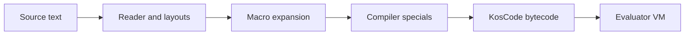

# Architecture map

High-level pipeline from source text to execution:

## Python package layout

| Area | Package path | Role |
|------|--------------|------|
| Reader | `koskari.reader` | S-expressions, layout blocks |
| Compiler | `koskari.compile` | Special forms, bytecode emission |
| Syntax | `koskari.syntax` | Syntax-rule transformers |
| Matcher | `koskari.matcher` | Pattern matching for specials |
| VM | `koskari.lib` | Native types, bytecode, evaluator |
| CLI | `koskari.cli` | REPL and script runner |
| Builtins | `koskari.builtins` | Standard library (virtual module) |

Bootstrap `.ki` sources compile into `koskari.builtins`; that loading
machinery is internal and not part of this user documentation.

## Contributor design docs

Implementation contracts and in-progress design live under `design/` in the
repository. Start at `design/README.md`.
